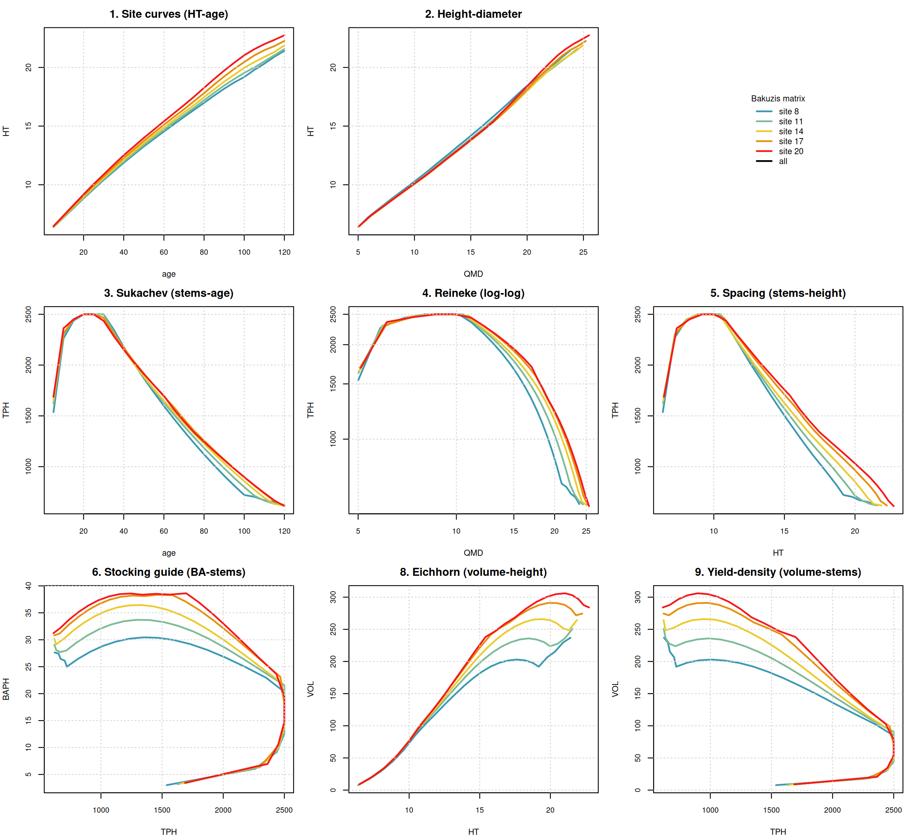

# Bakuzis biological-realism assessment: AcadianGY 12.3.9

*28 June 2026. Modified Bakuzis matrix (Leary 1997) applied to AcadianGY 12.3.9 long-term
projections across a site-index gradient. The test falsifies structurally flawed projections;
passing a relation says the projection is not obviously broken there, not that it is accurate.
Plaintext math, no em dashes.*

## Method

A common young even-aged Acadian mixedwood cohort (2500 stems/ha, mean DBH 3 cm, BF/RS/RM/YB/SM
mix) was projected with AcadianGY 12.3.9 under a site-index gradient (CSI = 8, 11, 14, 17, 20 m)
to age 120, recording top height, stems/ha, basal area/ha, QMD, and volume every 5 years.
Ingrowth was off so the cohort stays even-aged for a clean site-curve read.
[ASSUMPTION: synthetic regen cohort is standard for a site-curve realism check; absolute levels
are less important than the cross-site relationships.] The bundled `bakuzis_check.R` and
`bakuzis_matrix.R` (Leary triangular form) produced the report and the matrix figure.

## PASS / FLAG table

| Relation | Test | Result | Note |
|---|---|---|---|
| 1 Site curves (HT-age) | HT monotone up, sites ordered, no crossing | PASS | HT up at every site; 0 inversions across 24 ages |
| 1/7 Site ordering (HT, VOL) | better site not overtaken | PASS | 0 HT inversions, 0 VOL inversions |
| 2 Height-diameter | HT rises with QMD, ordered by site | PASS | clean, ordered (figure panel 2) |
| 3 Sukachev (stems-age) | TPH declines with age | PASS with caveat | declines after canopy closure; early rise is a merch-threshold artifact, see below |
| 4 Reineke (stems-QMD) | log-log self-thinning slope near -1.605 | FLAG | slope -0.78 to -0.89, too shallow |
| 8 Eichhorn (volume-height) | volume near-unique in height, site-independent | PASS | CV of volume at matched height = 7.3% (< 15%) |

The strongest law, Eichhorn, passes, and site ordering holds with no curve crossing. The one
genuine flag is the Reineke self-thinning slope.

## Interpretation

1. Site curves, height-diameter, site ordering, and Eichhorn all pass. The height, volume, and
   height-diameter chain is biologically consistent across the productivity gradient, and the
   site signal orders the curves correctly. This is the good news: the parts touched by the ESI
   site-input swap behave correctly.

2. The TPH-down flag is not a real Sukachev violation. The cohort starts at DBH 3 cm, below the
   4 cm counting threshold, so counted stems rise as trees recruit past the threshold, peak near
   2500/ha at canopy closure, then decline through self-thinning. From the peak onward TPH is
   monotone decreasing. This is a measurement-threshold artifact, not a mortality defect.

3. The Reineke slope is the diagnostic finding. The self-thinning trajectory in log(stems) on
   log(QMD) has slope about -0.8, shallower than the law-like -1.605 (and outside the -1.2 to
   -2.2 acceptance band). A shallow slope means the stand sheds too few stems as mean diameter
   grows, that is, it carries too much density into the larger-diameter, older phase. Part of
   the shallowness reflects the 120 year run spending time below the self-thinning boundary
   before riding it, but the late self-thinning limb is still shallower than Reineke.

4. This ties directly to the independent growth finding. On both Maine FIA and Seven Islands CFI
   AcadianGY over-predicts basal area, growing to +16 to +18% at 8 to 15 year horizons. A
   self-thinning rule that releases too little density is exactly the mechanism that inflates
   standing basal area over multi-year horizons. The Bakuzis Reineke flag and the BA
   over-prediction point at the same submodel: mortality / self-thinning (SDImax and the
   density-dependent mortality lift), not the height or site equations.

## Recommended refinements, prioritized

1. Re-examine the self-thinning / mortality submodel so the realized log(stems)-log(QMD) slope
   approaches -1.605. Check the SDImax setting and the density-dependent mortality response. This
   is the lever most likely to remove the long-horizon BA over-prediction. It is the focus of the
   existing MORTCAL and MORTCAL-V calibration variants, and this assessment supports that
   direction quantitatively.
2. Leave the height, height-diameter, and volume chain as is for this purpose; they pass the
   strong laws. The ESI site-input swap does not disturb any of these relations.
3. When re-checking Reineke, fit the slope on the upper self-thinning boundary only (late ages,
   stands at maximum density) rather than the whole trajectory, to separate the genuine slope
   from the building-phase dilution.

## Caveat

The Bakuzis test falsifies; it does not confirm accuracy. Passing site ordering and Eichhorn
means those relations are not broken, not that the projection levels are correct. The Reineke
flag is the actionable result and it is consistent with the measured BA bias.

## Files

- Trajectories: `results/seven_islands/acadgy_bakuzis_trajectories.csv`
- Generator: `scripts/seven_islands/acadgy_bakuzis_traj.R` (on Cardinal)
- Figure: `figures/acadgy_bakuzis_matrix.png`
