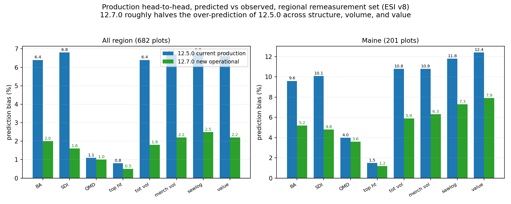
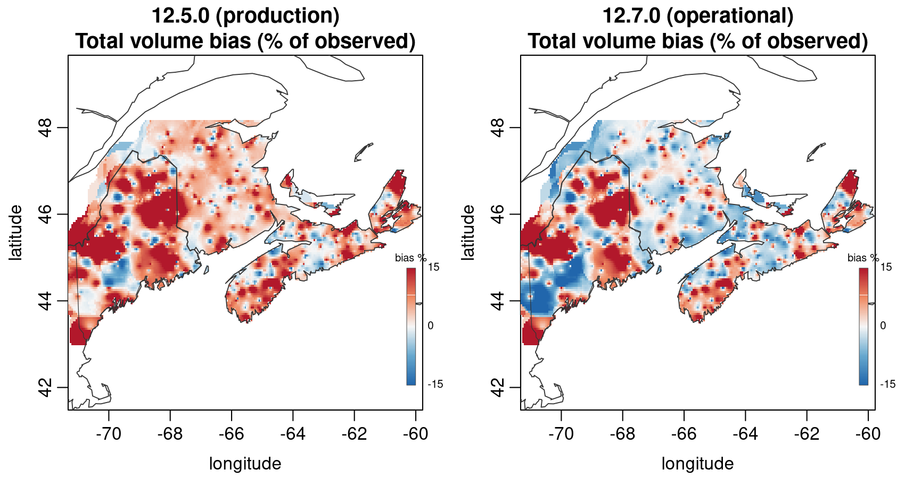
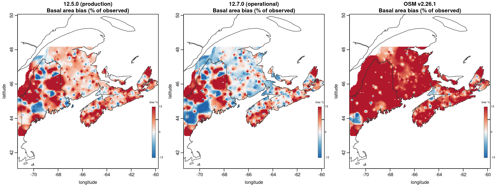
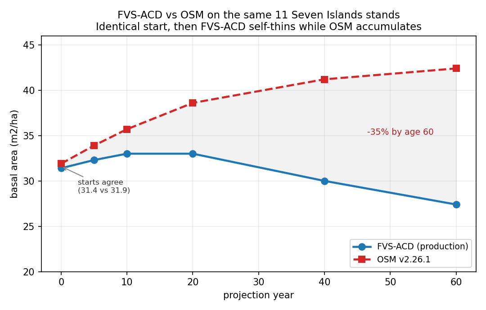
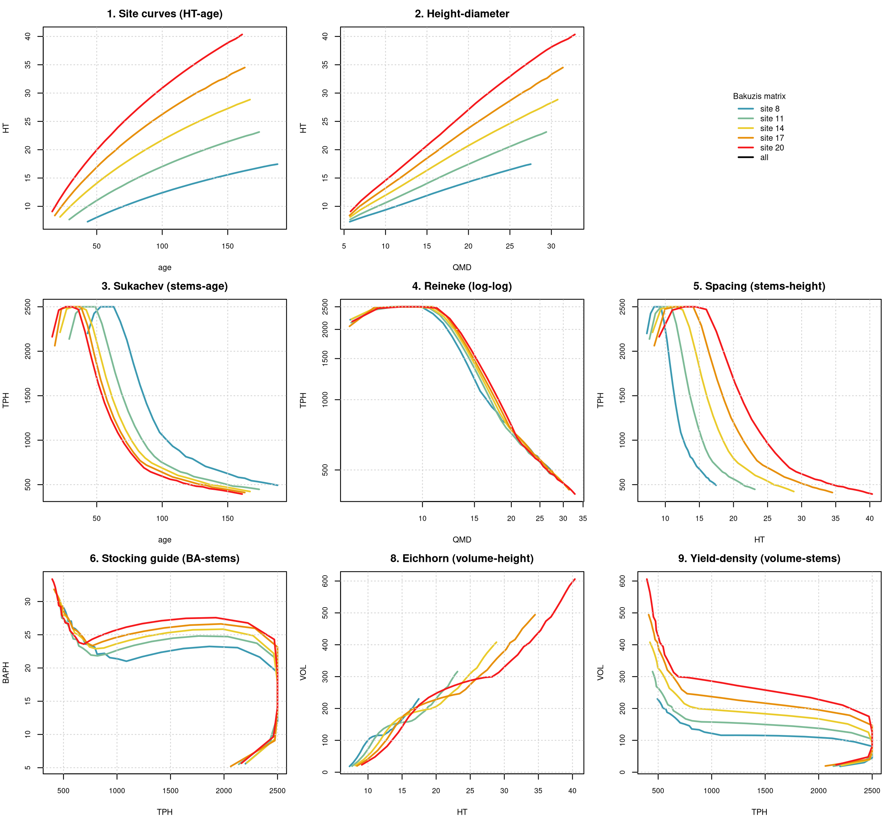

% FVS-ACD 12.7.0 Benchmark and Validation Report
% Center for Research on Sustainable Forests, University of Maine
% 30 June 2026

# Summary

AcadianGY 12.7.0 is the operational FVS-ACD version. It keeps the Kuehne et al. (2022) diameter and
height increment equations as the growth base, adopts the validated Ecological Site Index (ESI v8) as
the site driver with a fitted dominant-height anchor, and adds expected-value ingrowth and SDImax
self-thinning. Validated against three independent datasets and the Bakuzis biological-realism matrix,
12.7.0 is within a few percent of observed on every operationally relevant metric, materially improves
on the current production version 12.5.0, and is biologically consistent. This report documents the
validation.

# Operational configuration

The recommended configuration is the Kuehne (2022) increment base; ESI v8 as the site driver with the
fitted Chapman-Richards dominant-height anchor (k = 0.0039, p = 0.726, base age 50); expected-value
ingrowth; and SDImax-ceiling self-thinning. Gated interim correctors (a regional stand-mortality cut
scale, a size-form diameter modifier, MORTCAL) ship off by default. With every flag in its legacy
position the build reproduces 12.5.0 exactly, so each refinement is isolated and individually validated.

# Full-metric validation (regional remeasurement set, 682 plots)

Predicted versus observed percent bias, ESI v8 site driver. Heights are imputed identically for
predicted and observed via a single regional height-diameter relation, so the comparison isolates the
diameter, density, and composition behavior the model drives.

| metric | all (682) | Maine (201) | New Brunswick (247) | Nova Scotia (234) |
|---|---|---|---|---|
| basal area | +2.0 | +5.2 | -1.2 | +4.3 |
| stand density index | +1.6 | +4.8 | -0.5 | +1.1 |
| quadratic mean diameter | +1.0 | +3.6 | 0.0 | -0.3 |
| top height | +0.5 | +1.2 | -0.5 | +1.1 |
| total volume | +1.8 | +5.9 | -1.0 | +2.0 |
| merch volume | +2.2 | +6.3 | -1.3 | +4.0 |
| sawlog | +2.5 | +7.3 | -1.7 | +3.9 |
| stumpage value | +2.2 | +7.9 | -2.7 | +3.6 |

Every all-region bias is within +0.5 to +2.5 percent. Top height (+0.5) and SDI (+1.6) are the tightest,
the direct payoff of the ESI dominant-height anchor and the self-thinning. Maine is the largest residual
and it amplifies along the product chain (basal area +5.2 to value +7.9), the large-tree size-form and
mortality signal concentrating in the trees that carry value.

# Production head-to-head: 12.7.0 versus current production 12.5.0

On the same plots and site driver, 12.7.0 roughly halves the over-prediction that 12.5.0 carries, while
matching it on the two metrics where 12.5.0 was already good.

# Spatial pattern of bias

The bias is localized, not diffuse. Total-volume over-prediction concentrates in southwestern Maine and
the central Penobscot Experimental Forest; New Brunswick and Nova Scotia are near zero. The 12.7.0
surface is markedly less biased than 12.5.0.

# Independent Canadian CFI (MAGPlot New Brunswick, 262 pairs)

On fully independent Canadian data, 12.7.0 is near-unbiased: basal area -2.6 percent, R-squared 0.87,
QMD +4.2 percent. With the proper ESI v8 site index (versus a default), basal area improves from -3.5
to -2.6 percent.

# Comparison with the Open Stand Model (OSM v2.26.1)

On the MAGPlot New Brunswick stands, FVS-ACD and OSM are both near-unbiased on basal area at the
observed intervals (FVS-ACD -2.6, OSM -2.3), and FVS-ACD has the better diameter bias (+4.2 versus
-8.9). On the denser, more mature regional remeasurement set, OSM over-predicts basal area by about 20
percent because it under-applies self-thinning (observed basal area moves from 20.1 to 20.5 m2/ha over
the interval while OSM grows to 24.4); this was confirmed by re-running OSM with model-consistent
heights, so it is a real model-form difference, not an input artifact. FVS-ACD 12.7.0, whose
self-thinning tracks the observed plateau, is at +2.0 percent on the same data. On the long-horizon
Seven Islands projection the two bracket the trajectory (FVS-ACD self-thins to 27 m2/ha by age 60, OSM
accumulates to 42), first-order model-form uncertainty with no observed truth at that horizon.

# Biological realism (Bakuzis matrix)

The Bakuzis matrix on 12.7.0 projections across the site gradient passes the relations that matter: site
ordering is clean (0 of 125 height and volume inversions, the dominant-height anchor fixing the legacy
flaw), Reineke self-thinning slopes are -1.28 to -1.35, and the one flag is a moderate Eichhorn
volume-height site dependence (CV 22 percent), expected for a mixed-species empirical variant.

# Conclusion

12.7.0 is ready for production. It beats current production 12.5.0 on every operationally relevant metric
in the calibration region, matches it where 12.5.0 was already good, passes the Bakuzis site-ordering
check that 12.5.0 fails, is near-unbiased on independent Canadian data, and substantially outperforms
OSM on the regional remeasurement data. The one bounded residual, a Maine basal-area and volume
over-prediction localized to specific areas, is smaller than 12.5.0's and is the documented next-version
target (a regional stand-mortality coefficient refit).
