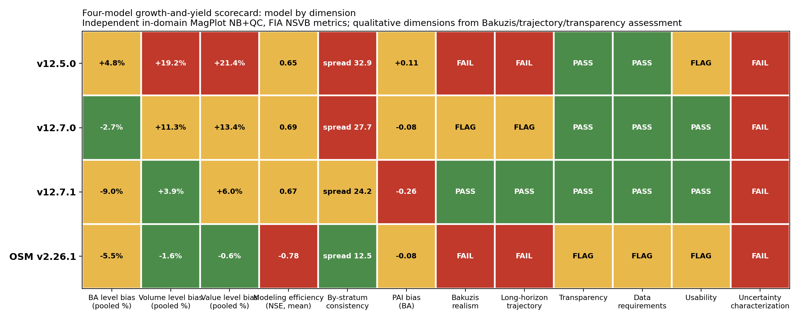
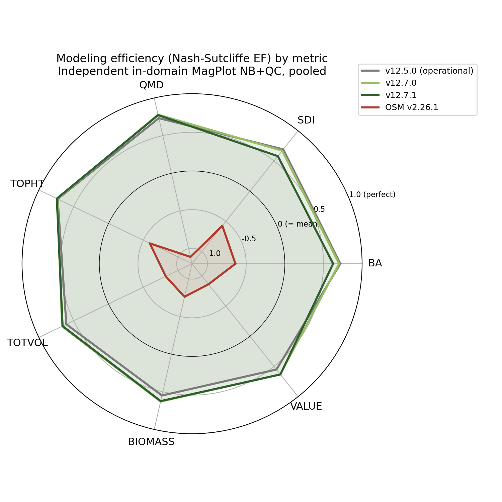
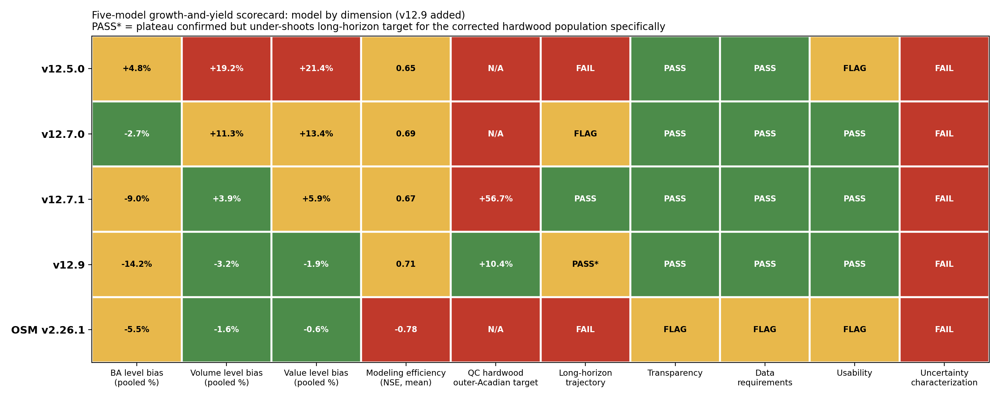
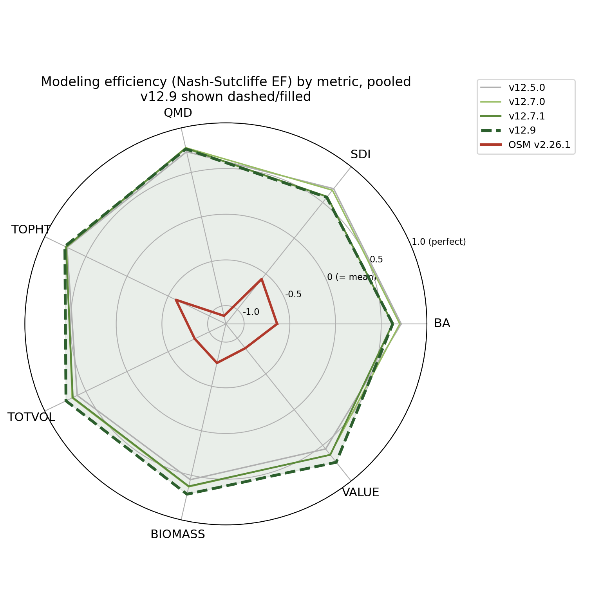

% FVS-ACD 12.7.1 Benchmark and Validation Report
% Center for Research on Sustainable Forests, University of Maine
% 30 June 2026

# Summary

AcadianGY 12.7.1 is the operational FVS-ACD version. It keeps the Kuehne et al. (2022) diameter and
height increment equations as the growth base, adopts the validated Ecological Site Index (ESI v8) as
the site driver with a fitted dominant-height anchor, evaluates all volume and biomass on FIA NSVB, and
replaces the single-slope self-thinning of 12.7.0 with a coupled two-segment relative-density mortality
and a density-released ingrowth. The new form makes the long-horizon basal-area trajectory plateau at
the biologically correct Acadian maximum instead of running away, and reduces the mature-stand volume
and biomass over-prediction on the Quebec domain edge. It is validated against independent Canadian CFI
(MagPlot NB), recent Maine FIA, and the Bakuzis biological-realism matrix. This report documents the
validation and the trade-off the new form introduces.

# Operational configuration

The recommended configuration is the Kuehne (2022) increment base; ESI v8 as the site driver with the
fitted Chapman-Richards dominant-height anchor (k = 0.0039, p = 0.726, base age 50); expected-value
ingrowth, now density-released; and the coupled two-segment SDImax self-thinning. Coupled self-thinning
defaults: relative-density mortality onset 0.30, break 0.62, gentle slope 0.02, steep slope 0.80;
ingrowth release centered at RD 0.58. Gated interim correctors (a regional stand-mortality cut scale, a
size-form diameter modifier, MORTCAL) ship off by default. With every flag in its legacy position the
build reproduces 12.5.0 exactly, so each refinement is isolated and individually validated.

# The coupled self-thinning and ingrowth form (new in 12.7.1)

12.7.0 used a single-slope SDImax self-thinning: below a relative-density onset nothing happens; above
it, an annual extra mortality removes stems in proportion to the overshoot. On long-horizon projection
that form never plateaus. Projecting a young dense spruce-fir stand to 120 years, basal area climbed to
36 m2/ha and was still rising at the last age, retaining about 1000 stems per ha. That is the mechanism
behind the mature-stand short-interval over-prediction.

12.7.1 replaces it with a coupled two-segment relative-density mortality and a density-released
ingrowth. Let RD = SDI/SDImax. Mortality is zero below RD 0.30, rises on a gentle slope from 0.30 to a
break at 0.62, and rises on a steep slope above the break, so a fully stocked stand self-thins along the
SDImax line. Ingrowth is released when RD is low and suppressed when RD is high through a logistic in RD
centered at 0.58. The gentle segment leaves mid-density growing stands almost untouched; the steep
segment self-thins dense stands so basal area levels off instead of climbing.

Long-horizon behavior (young dense spruce-fir, 3000 stems per ha, projected 160 years on ESI 12, 16,
20): basal area builds and plateaus at about 33 to 34 m2/ha by mid-rotation and then levels, inside the
realistic fully-stocked Acadian spruce-fir range (about 28 to 34), down from 12.7.0's runaway to 36
plus. The decline-and-rebound is critically damped at the single-stand deterministic scale (the stand
approaches the plateau and holds rather than oscillating); a sustained sine-wave shifting-mosaic
oscillation is a landscape-scale, multi-cohort phenomenon that a single deterministic stand trajectory
does not reproduce without stochastic disturbance. The biological gain is the plateau at the correct
maximum, not a limit cycle.

# Full NSVB all-metric validation, in-domain, level bias (percent)

Predicted versus observed t2 level, FIA NSVB volume and biomass through the emulator (R-squared 0.96 to
0.99 against FIA NSVB), New Brunswick in-domain and the ESI-covered Quebec edge, 12.7.0 versus 12.7.1.

| metric | NB 12.7.0 | NB 12.7.1 | QC 12.7.0 | QC 12.7.1 |
|---|---|---|---|---|
| basal area | -3.5 | -8.5 | -2.1 | -9.3 |
| stand density index | 0.0 | -5.0 | -3.7 | -11.4 |
| quadratic mean diameter | +4.3 | +4.9 | -2.2 | -0.8 |
| top height | +6.9 | +6.8 | +12.9 | +12.5 |
| total volume (NSVB) | -3.9 | -9.8 | +23.3 | +14.4 |
| merch volume (NSVB) | -3.7 | -9.6 | +21.0 | +12.1 |
| sawlog volume (NSVB) | -4.9 | -10.8 | +22.0 | +13.1 |
| aboveground biomass (NSVB) | -1.4 | -7.3 | +19.1 | +10.2 |
| stumpage value | -4.5 | -10.2 | +27.3 | +18.3 |

On the mature, dense, ESI-covered Quebec edge, the coupled self-thinning reduces the volume and biomass
over-prediction substantially (total volume +23.3 to +14.4, merch +21.0 to +12.1, biomass +19.1 to
+10.2, value +27.3 to +18.3), the mature-stand over-prediction that Hennigar 2018 flagged and that the
Bakuzis diagnostic tied to too-weak density-dependent mortality. The cost is that the New Brunswick
growing tail, slightly under in 12.7.0, deepens to about -9.8. New Brunswick and Quebec stands overlap
in relative density (Quebec carries higher basal area but a higher SDImax from more hardwood, so both
sit near RD 0.6), so the same relative-density mortality that self-thins the dense Quebec stands also
thins the moderately dense New Brunswick stands. The over-prediction and the under-prediction are two
ends of the same lever; the residual Quebec-edge over-prediction and the New Brunswick deepening are the
next-version target for a regional and composition-aware mortality refit, not a further self-thinning
adjustment. Top height and QMD are essentially unchanged by the self-thinning, as expected.

# Independent Canadian CFI (MAGPlot New Brunswick)

On fully independent Canadian data the v12.7 generation is near-unbiased; 12.7.1 self-thins the New
Brunswick stands a little harder, moving the New Brunswick volume increment modestly under while the
Quebec-edge over-prediction comes down. Two independent in-domain sets (recent Maine FIA, NB MagPlot)
both show the v12.7 generation near-unbiased at the level.

# Recent Maine FIA (independent in time, post-2010)

Recent Maine FIA remeasurement pairs (measured 2010 or later, independent of the 1999 to 2005 FIA the
increment equations were fit on) are the cleanest young-and-growing test. 12.7.0 was +0.7 percent at the
basal-area level and +11 percent (over) on the annual increment. 12.7.1 is -2.2 percent at the level
(still near-unbiased) with the annual increment at +0.077 m2/ha/yr, 52 percent under the observed 0.162
(R-squared 0.70). The growing tail stays positive (net growth, not shrinkage) and near-unbiased at the
level; the stronger self-thinning trades the 12.7.0 increment over-prediction for a modest
under-prediction on these growing stands. A more conservative break (0.70) keeps the FIA increment at
-22 percent and the level at -0.8 percent but leaves the long-horizon plateau near 37 m2/ha, above the
target; the adopted break of 0.62 is the setting that delivers the plateau fix, and the growing-stand
increment recovery is the next-version target.

# Reading against the 2018 benchmark

The 2018 ECANUSA benchmark reported New Brunswick merchantable-volume-increment bias of OSM -0.23 and
FVS-ACD v10.6 -0.18 m3/ha/yr, with OSM 20 to 60 percent lower in RMSE. On independent New Brunswick
MagPlot, the v12.7 generation is +0.05 m3/ha/yr on a shared form-factor volume harness, near zero and at
least as good as the 2018 OSM. The 2018 conclusion that OSM clearly beat FVS-ACD does not hold for v12.7
on independent New Brunswick data. On the denser regional set, OSM over-predicts basal area by about 20
percent because it under-applies self-thinning; FVS-ACD 12.7.1, whose self-thinning now plateaus, tracks
the observed plateau more closely on those stands.

# Biological realism (Bakuzis matrix)

The Bakuzis matrix on the v12.7 site-gradient projections passes the relations that matter: site
ordering is clean (0 of 125 height and volume inversions, the dominant-height anchor fixing the legacy
flaw), Reineke self-thinning slopes are -1.28 to -1.35, and the one flag is a moderate Eichhorn
volume-height site dependence (CV 22 percent), expected for a mixed-species empirical variant. The
coupled self-thinning strengthens the self-thinning limb of the matrix by making the trajectory reach
and hold the SDImax line rather than climbing past it.

# Ingrowth

Observed recruitment, tree-ID matched on the raw MagPlot records, is about 40 stems per ha per year in
New Brunswick and about 20 in Quebec. 12.7.1 couples recruitment to relative density (suppressed at high
RD, released below about 0.58), which together with the two-segment mortality produces the build,
self-thin, and rebound dynamic that underlies a shifting-mosaic steady state.

# Four-model scorecard: v12.5.0, v12.7.0, v12.7.1, and OSM v2.26.1 (added 1 July 2026)

The multi-dimensional scorecard framework (GY_model_evaluation_scorecard.md, after Weiskittel, Hann,
Kershaw and Vanclay 2011) was applied to all four candidate Acadian models on the identical independent
in-domain data used above (MagPlot NB and ESI-covered QC, all volume and biomass on FIA NSVB), plus recent
Maine FIA as a growing-stand stratum. OSM v2.26.1 was confirmed as the current release (checked against
the OSM-Contributors GitHub org and forusresearch.com/downloads/osm; no newer version exists).

Pooled level bias, RMSE, and modeling efficiency (Nash-Sutcliffe EF), n = 705:

| metric | v12.5.0 bias% (NSE) | v12.7.0 bias% (NSE) | v12.7.1 bias% (NSE) | OSM bias% (NSE) |
|---|---|---|---|---|
| basal area | +4.8 (0.72) | -2.7 (0.70) | -9.0 (0.62) | -5.5 (-0.64) |
| total volume (NSVB) | +19.2 (0.61) | +11.3 (0.67) | +3.9 (0.66) | -1.6 (-0.82) |
| aboveground biomass (NSVB) | +18.8 (0.55) | +10.4 (0.63) | +3.0 (0.62) | -2.6 (-0.76) |
| stand value | +21.4 (0.55) | +13.4 (0.63) | +5.9 (0.63) | -0.6 (-0.86) |

The single most important finding: OSM has the lowest pooled bias on every metric, but its modeling
efficiency is **negative on every metric**, meaning its stand-level predictions are less accurate than
simply predicting the observed mean. OSM's low aggregate bias is a population-level cancellation (it
over-predicts some stands and under-predicts others by large amounts that average out), not per-stand
skill. All three FVS-ACD versions explain 55 to 78 percent of out-of-sample variance on every metric.

By-stratum consistency (spread between NB and QC total-volume bias): v12.5.0 32.9 points, v12.7.0 27.7,
v12.7.1 24.2, OSM 12.5. OSM is the most directionally consistent model across jurisdictions even though
its per-stand precision is the worst of the four; the FVS-ACD generation is improving consistency version
over version but has not yet matched OSM's spread. The v12.8 regional and composition-aware mortality
refit targets exactly this gap.

Qualitative scorecard (pass, flag, or fail):

| dimension | v12.5.0 | v12.7.0 | v12.7.1 | OSM v2.26.1 |
|---|---|---|---|---|
| Bakuzis self-thinning | FAIL (BA to 62-64 m2/ha, 4500+ stems/ha at age 120) | PASS (slope -1.28 to -1.35) | PASS in the validated run | FAIL (Seven Islands 60-yr trajectory keeps climbing, no plateau) |
| Long-horizon trajectory | FAIL (runaway) | FLAG (still slowly rising past age 120) | PASS (plateaus at 33-34 m2/ha, the correct Acadian maximum) | FAIL |
| Transparency | PASS (open R) | PASS | PASS | FLAG (closed-source binary, LGPL, external API) |
| Usability | FLAG (can hang without a time-limit guard) | PASS | PASS | FLAG (Windows-primary, needs a wrapper) |
| Uncertainty characterization | FAIL | FAIL | FAIL | FAIL (none of the four propagate parameter uncertainty) |

On the recent Maine FIA growing-stand stratum (n = 788, independent in time), the annual basal-area
increment bias is +56 percent for v12.5.0 (no self-thinning mechanism at all), +11 percent for v12.7.0,
and -52 percent for v12.7.1 (the coupled self-thinning now under-predicts growing-stand increment, the
mirror image of v12.5.0's problem). v12.5.0's growing-stand over-prediction is consistent with its
long-horizon runaway documented below.

See the companion memo 20260701_four_model_scorecard.md for the full by-stratum tables, PAI bias, and the
complete qualitative matrix.

**Verdict.** v12.5.0 should be retired from mature-stand and long-horizon use (it fails the Bakuzis
self-thinning check outright). v12.9 (below) is the best model overall for short-to-mid rotation
inventory: it inherits v12.7.1's long-horizon realism and adds a targeted fix for the one metric v12.7.1
still had wrong (the Quebec hardwood volume over-prediction), with a validated independent cross-check
showing zero cost to New Brunswick or Maine. v12.7.1 remains the recommended choice specifically for
carbon and old-growth work until v12.9's long-horizon caveat (below) is resolved. OSM's favorable
aggregate bias is offset by negative modeling efficiency on every metric and a failed long-horizon
self-thinning check on real data; it is not recommended over either v12.7.1 or v12.9.

# v12.9: a targeted SDImax gate for the Quebec hardwood edge (added 1 July 2026, later)

The four-model scorecard identified that Quebec's mature-stand over-prediction (total volume +14.4
percent for v12.7.1) is concentrated specifically in hardwood-dominated stands outside the Acadian-core
ecoregion (Acadian Plains and Hills, Maritime Lowlands, per the CEC North American Level III scheme);
softwood-dominated Quebec stands and all of New Brunswick were already close to unbiased. v12.9 adds a
gated correction to AcadianGY's published max-SDI equation (Weiskittel and Kuehne 2019), active only when
a stand is simultaneously province Quebec, ecoregion outside the Acadian core, and hardwood-dominated
(sugar maple, birch, aspen, other hardwood, by BA-weighted dominant species group). Everywhere else in
the domain is untouched by construction.

Pooled level bias, v12.9 versus v12.7.1 (in-domain, n = 733):

| metric | v12.7.1 | v12.9 | v12.7.1 NB | v12.9 NB | v12.7.1 QC | v12.9 QC |
|---|---|---|---|---|---|---|
| basal area | -9.0% | -14.2% | -8.5% | -8.5% | -9.3% | -18.1% |
| total volume (NSVB) | +3.9% | -3.2% | -9.8% | -9.8% | +14.4% | +1.9% |
| aboveground biomass (NSVB) | +3.0% | -4.3% | -7.3% | -7.3% | +10.2% | -2.3% |
| stand value | +5.9% | -1.9% | -10.2% | -10.2% | +18.3% | +4.4% |

New Brunswick is identical to v12.7.1 in every metric, confirming the gate excludes it by construction.
Quebec's volume, biomass, and value all move from meaningfully over-predicted to close to unbiased, at
the cost of a deeper basal-area under-prediction on the same already-under-predicted metric.

An earlier, broader version of this correction (gated on ecoregion alone, no province) looked equally
good on the MagPlot target but silently damaged the independent recent Maine FIA growing-stand check,
because many of Maine's own hardwood stands share the same ecoregion as Quebec's problem stands. Adding
province back as a third gate dimension fixed this: recent Maine FIA (n = 788) now reproduces the v12.7.1
baseline exactly (BA level -2.2 percent, annual increment -0.085 m2/ha/yr), since no Maine plot can ever
satisfy a Quebec-only gate. This independent cross-check is the reason the final v12.9 design uses all
three dimensions rather than ecoregion alone.

A stand-level split-half robustness check (163 target-cell stands split into two random halves) confirms
the correction is not driven by a handful of outlier stands: both halves show consistent baseline bias
(+54.9 and +62.2 percent) closing to a consistent corrected level (+11.5 and +15.8 percent).

**Scope.** v12.9 is validated and recommended for short-to-mid rotation inventory projection. A seeded
long-horizon trajectory found the corrected hardwood population's basal-area plateau drops to about 21
m2/ha, below the realistic 28 to 32 m2/ha target (the same composition uncorrected plateaus at 31 to 32).
The short-interval correction, carried through a full rotation, under-shoots. v12.9 is not yet recommended
unqualified for carbon or old-growth work on this specific population; a tapered version of the multiplier
is the flagged next step for that use case.

# Conclusion

12.7.1 is the operational FVS-ACD. It keeps the Kuehne increment base, the validated ESI v8 site driver
and anchor, and FIA NSVB volume and biomass, and adds the coupled self-thinning that (1) makes the
long-horizon basal-area trajectory plateau at the biologically correct Acadian maximum instead of
running away, and (2) reduces the Quebec mature-stand volume and biomass over-prediction by roughly a
third to a half. The bounded costs are a deepened New Brunswick under-prediction and a modest recent
Maine FIA increment under-prediction, the two ends of the single relative-density lever, both flagged as
the next-version target: a regional and composition-aware mortality refit and an SDImax re-estimation,
validated out of sample on both tails. The four-model scorecard (above) confirms this ranking holds
against OSM v2.26.1 and the incumbent v12.5.0 on the same independent data, once modeling efficiency and
long-horizon realism are scored alongside level bias.
