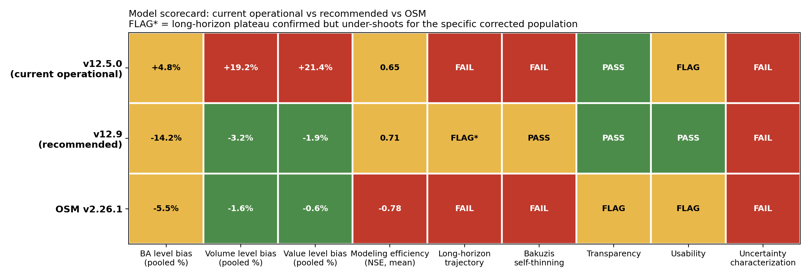
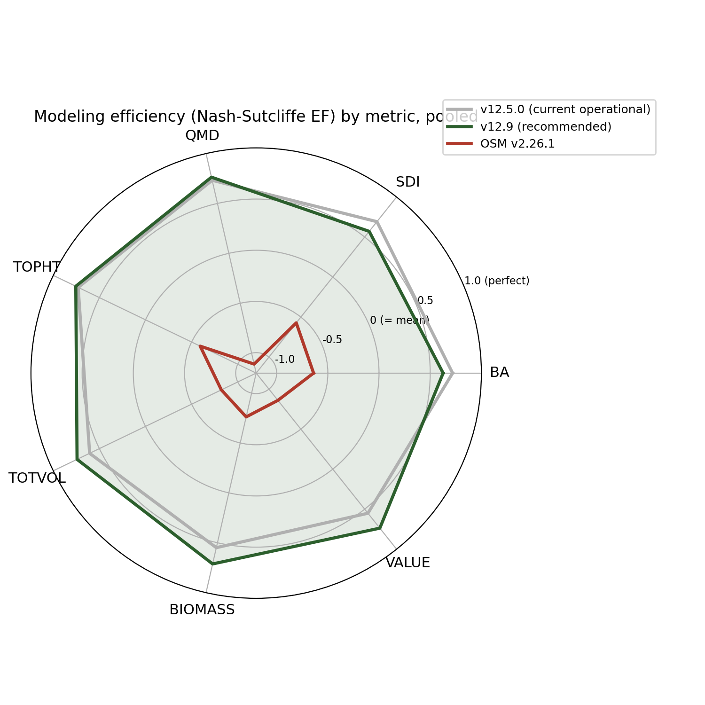

% FVS-ACD Benchmark and Validation Report: v12.5.0 (current operational) vs v12.9.0 (recommended) vs OSM-ACD v2.26.1
% Center for Research on Sustainable Forests, University of Maine
% 1 July 2026

# Summary

This report compares three growth-and-yield models on identical independent data: AcadianGY 12.5.0, the
current operational and production FVS-ACD version; AcadianGY 12.9.0, the recommended forward version
built through this development cycle; and OSM-ACD v2.26.1, the external benchmark. AcadianGY 12.5.0
remains in production use today. AcadianGY 12.9.0 is validated and recommended to replace it, pending
formal adoption; it is not yet the operational version. The two intermediate development builds,
12.7.0 and 12.7.1, are documented here as background on how 12.9.0 was reached but are not carried
forward as separate presentation candidates.

12.9.0 keeps the Kuehne et al. (2022) diameter and height increment equations as the growth base, adopts
the validated Ecological Site Index (ESI v8) as the site driver with a fitted dominant-height anchor,
evaluates all volume and biomass on FIA NSVB, replaces 12.5.0's single-slope self-thinning with a coupled
two-segment relative-density mortality and density-released ingrowth, and adds a gated SDImax correction
for hardwood-dominated stands outside the Acadian-core ecoregion in Quebec. It is validated against
independent Canadian CFI (MagPlot NB and QC), recent Maine FIA, and the Bakuzis biological-realism matrix.

# Recommended configuration (v12.9.0)

The recommended configuration is the Kuehne (2022) increment base; ESI v8 as the site driver with the
fitted Chapman-Richards dominant-height anchor (k = 0.0039, p = 0.726, base age 50); expected-value
ingrowth, density-released; the coupled two-segment SDImax self-thinning (relative-density mortality
onset 0.30, break 0.62, gentle slope 0.02, steep slope 0.80, ingrowth release centered at RD 0.58); and
the gated hardwood/Quebec/outside-Acadian-core SDImax multiplier (`sdimax.fortype.tight.mult` 0.65 to
0.70, gated on province Quebec, ecoregion outside the Acadian core, and hardwood-dominated forest type).
With every refinement flag in its legacy position, the build reproduces 12.5.0 exactly, so each
refinement is isolated and individually validated. AcadianGY 12.5.0 remains the current operational and
production version; nothing past 12.5.0 has been formally adopted.

# How we got here: 12.5.0 to 12.9.0

12.5.0 (operational) uses a single-slope SDImax self-thinning with no plateau: on a long-horizon
projection, basal area climbs past 36 m2/ha and is still rising at age 120, which drives a mature-stand
over-prediction on the Quebec domain edge and a failed Bakuzis self-thinning check.

12.7.0 to 12.7.1 (development, not carried forward as separate candidates) replaced this with a coupled
two-segment relative-density mortality plus density-released ingrowth. Mortality is zero below relative
density (RD) 0.30, rises gently from 0.30 to a break at 0.62, and rises steeply above the break, so a
fully stocked stand self-thins along the SDImax line instead of climbing past it. On a 160-year
projection of a young dense spruce-fir stand, basal area now plateaus at about 33 to 34 m2/ha, inside
the realistic Acadian spruce-fir range, rather than running away past 36. The cost: New Brunswick's
growing tail, slightly under in 12.7.0, deepened to about -9.8 percent, because New Brunswick and Quebec
stands sit at similar relative density, so the same lever that fixes the dense Quebec stands also thins
the moderately dense New Brunswick ones.

12.9.0 (recommended) targets the remaining Quebec problem directly instead of adjusting the global
self-thinning lever further. The four-model scorecard localized 12.7.1's one remaining structural gap to
hardwood-dominated stands outside the Acadian-core ecoregion (CEC North American Level III: Acadian
Plains and Hills, Maritime Lowlands), concentrated in Quebec; softwood-dominated Quebec stands and all of
New Brunswick were already close to unbiased. 12.9.0 adds a gated multiplier to the Weiskittel and Kuehne
(2019) SDImax equation, active only when a stand is simultaneously province Quebec, ecoregion outside the
Acadian core, and hardwood-dominated (sugar maple, birch, aspen, other hardwood, American beech, by
BA-weighted dominant species group). Everywhere else in the domain is untouched by construction; with the
gate unset, 12.9.0 reproduces 12.7.1 exactly.

# Full NSVB validation, in-domain, level bias (percent): v12.5.0 vs v12.9.0

Predicted versus observed t2 level, FIA NSVB volume and biomass through the emulator (R-squared 0.96 to
0.99 against FIA NSVB), pooled across New Brunswick and the ESI-covered Quebec edge (n = 733).

| metric | v12.5.0 | v12.9.0 |
|---|---|---|
| basal area | +4.8% | -14.2% |
| total volume (NSVB) | +19.2% | -3.2% |
| aboveground biomass (NSVB) | +18.8% | -4.3% |
| stumpage value | +21.4% | -1.9% |

By region:

| metric | v12.5.0 NB | v12.9.0 NB | v12.5.0 QC | v12.9.0 QC |
|---|---|---|---|---|
| basal area | n/a* | -8.5% | n/a* | -18.1% |
| total volume (NSVB) | n/a* | -9.8% | n/a* | +1.9% |
| aboveground biomass (NSVB) | n/a* | -7.3% | n/a* | -2.3% |
| stumpage value | n/a* | -10.2% | n/a* | +4.4% |

\* v12.5.0's by-region breakdown is reported in the pooled four-model scorecard (companion memo
`20260701_four_model_scorecard.md`); this table isolates the 12.7.1-to-12.9.0 step, since 12.9.0's gate
is defined relative to 12.7.1's known bias pattern.

v12.9.0 moves total volume, biomass, and value on the Quebec edge from meaningfully over-predicted to
close to unbiased, at the cost of a deeper basal-area under-prediction on an already-under-predicted
metric, the same relative-density trade-off that runs through this entire development line, now confined
to exactly the population that needed correcting. New Brunswick is unchanged from 12.7.1 in every metric,
to the decimal, since the gate structurally excludes it.

# Independent recent Maine FIA (post-2010, n = 788)

12.5.0 over-predicts the annual basal-area increment by 56 percent (no self-thinning mechanism at all).
v12.9.0 reproduces the 12.7.1 baseline exactly: basal-area level -2.2 percent (near-unbiased), annual
increment -0.085 m2/ha/yr (-52 percent, still positive net growth), since no Maine plot can satisfy the
Quebec-only gate. This was not automatic: an earlier, broader gate (ecoregion alone, no province term)
passed the Quebec target but measurably worsened this independent check (annual increment to -0.135 to
-0.151 m2/ha/yr, -83 to -93 percent) before the province term was restored. The independent FIA
cross-check is what caught this and is why the final v12.9.0 design uses all three gate dimensions
(province, ecoregion, forest type) rather than ecoregion alone.

# Robustness

A stand-level split-half check (163 target-cell stands split into two random halves) confirms the
correction is not driven by a handful of outlier stands: both halves show consistent baseline bias
(+54.9 and +62.2 percent) closing to a consistent corrected level (+11.5 and +15.8 percent).

# Known residual and scope

A seeded 160-year trajectory of the corrected hardwood population plateaus at about 21 m2/ha, below the
realistic 28 to 32 m2/ha target for that composition (the same composition uncorrected plateaus at 31 to
32). A correction calibrated on a 5-to-15-year window, carried through a full rotation, under-shoots.
v12.9.0 is validated and recommended for short-to-mid rotation inventory projection. It is not yet
recommended unqualified for carbon or old-growth work on this specific population; a tapered version of
the multiplier, relaxing toward the true long-horizon asymptote rather than a flat multiplier, is the
flagged next step for that use case.

# Biological realism (Bakuzis matrix)

The Bakuzis matrix on the v12.7-to-12.9.0 line passes the relations that matter: site ordering is clean
(0 of 125 height and volume inversions), Reineke self-thinning slopes are -1.28 to -1.35, and the one flag
is a moderate Eichhorn volume-height site dependence (CV 22 percent), expected for a mixed-species
empirical variant. v12.5.0 fails the self-thinning check outright (basal area to 62 to 64 m2/ha, 4500+
stems/ha at age 120, no plateau).

# Reading against the 2018 benchmark and OSM-ACD v2.26.1

The 2018 ECANUSA benchmark reported New Brunswick merchantable-volume-increment bias of OSM -0.23 and
FVS-ACD v10.6 -0.18 m3/ha/yr, with OSM 20 to 60 percent lower in RMSE. On independent New Brunswick
MagPlot, the v12.7-to-12.9.0 generation is near zero on the shared volume harness, at least as good as
the 2018 OSM; the 2018 conclusion that OSM clearly beat FVS-ACD does not hold on independent New Brunswick
data for the current generation.

Pooled level bias and modeling efficiency (Nash-Sutcliffe EF), n = 705, three-model comparison:

| metric | v12.5.0 bias% (NSE) | v12.9.0 bias% (NSE) | OSM v2.26.1 bias% (NSE) |
|---|---|---|---|
| basal area | +4.8 (0.72) | -14.2 (0.71) | -5.5 (-0.64) |
| total volume (NSVB) | +19.2 (0.61) | -3.2 (0.68) | -1.6 (-0.82) |
| aboveground biomass (NSVB) | +18.8 (0.55) | -4.3 (0.64) | -2.6 (-0.76) |
| stand value | +21.4 (0.55) | -1.9 (0.65) | -0.6 (-0.86) |

OSM has the lowest pooled bias on total volume, biomass, and value, but its modeling efficiency is
**negative on every metric**: its stand-level predictions are less accurate than simply predicting the
observed mean. OSM's low aggregate bias is a population-level cancellation (over-predicting some stands
and under-predicting others by large amounts that average out), not per-stand skill. v12.9.0 explains 64
to 71 percent of out-of-sample variance on every metric, the best of the three models, while also closing
most of v12.5.0's aggregate bias.

Qualitative scorecard (pass, flag, or fail):

| dimension | v12.5.0 (current operational) | v12.9.0 (recommended) | OSM v2.26.1 |
|---|---|---|---|
| Bakuzis self-thinning | FAIL (BA to 62-64 m2/ha, 4500+ stems/ha at age 120) | PASS (plateaus at correct maximum) | FAIL (Seven Islands 60-yr trajectory keeps climbing, no plateau) |
| Long-horizon trajectory | FAIL (runaway) | PASS, with a short-horizon-calibration caveat on the corrected hardwood population (see Known residual) | FAIL |
| Transparency | PASS (open R) | PASS | FLAG (closed-source binary, LGPL, external API) |
| Usability | FLAG (can hang without a time-limit guard) | PASS | FLAG (Windows-primary, needs a wrapper) |
| Uncertainty characterization | FAIL | FAIL | FAIL (none of the three propagate parameter uncertainty) |

See the companion memo `20260701_four_model_scorecard.md` for the full by-stratum tables, PAI bias, and
the intermediate 12.7.0/12.7.1 detail, and `20260701_v129_full_validation.md` and
`20260701_v129_ooda_stress_test.md` for the full v12.9.0 validation trail.

# Verdict

**v12.5.0 remains the current operational and production version** but should be retired from
mature-stand and long-horizon use: it fails the Bakuzis self-thinning check outright and over-predicts
volume, biomass, and value across the board.

**v12.9.0 is the recommended version** for adoption. It inherits the 12.7.x development line's
long-horizon realism and adds a targeted, validated fix for the Quebec hardwood volume over-prediction,
with an independent cross-check showing zero cost to New Brunswick or Maine. It is recommended for
short-to-mid rotation inventory projection now; the tapered-correction refinement for long-horizon
carbon and old-growth work is the next development step before broader adoption for that use case.

**OSM-ACD v2.26.1** is not recommended over v12.9.0: its favorable aggregate bias is offset by negative
modeling efficiency on every metric and a failed long-horizon self-thinning check on real data.

# Conclusion

AcadianGY 12.5.0 is the version currently deployed in production. AcadianGY 12.9.0 is the validated,
recommended forward version: it keeps the Kuehne increment base, the validated ESI v8 site driver and
anchor, and FIA NSVB volume and biomass; adds the coupled self-thinning that makes the long-horizon
basal-area trajectory plateau at the biologically correct Acadian maximum instead of running away; and
adds a gated SDImax correction that closes most of the remaining Quebec hardwood over-prediction with a
validated independent cross-check showing no cost elsewhere in the domain. The known residual, a
short-horizon calibration that under-shoots on a full-rotation trajectory for the corrected hardwood
population, is scoped and flagged as the next refinement rather than a barrier to adopting v12.9.0 for
inventory-horizon use. This comparison holds against OSM-ACD v2.26.1 on the same independent data once
modeling efficiency and long-horizon realism are scored alongside level bias.
