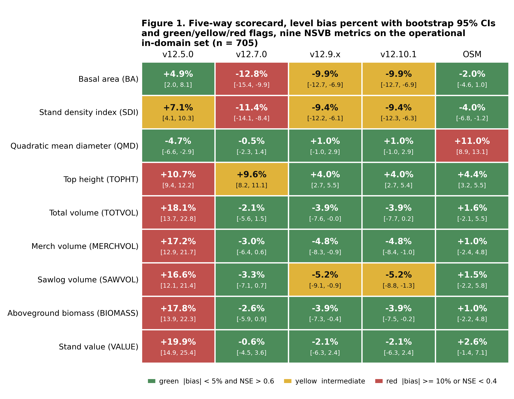
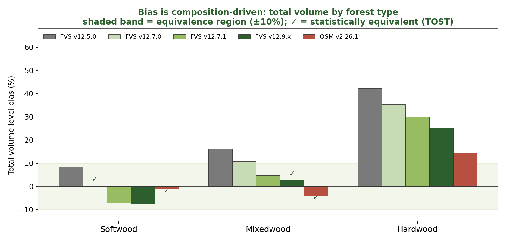
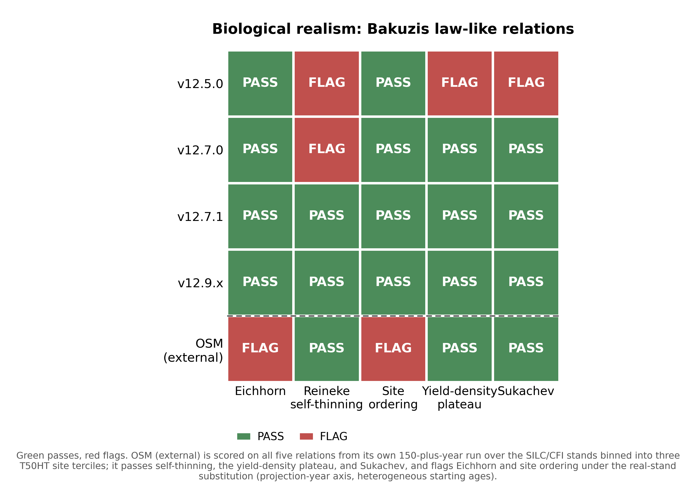
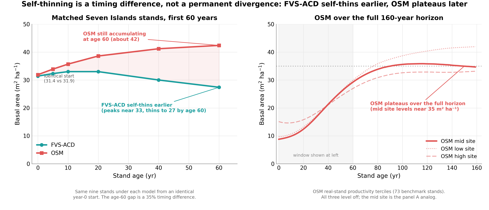
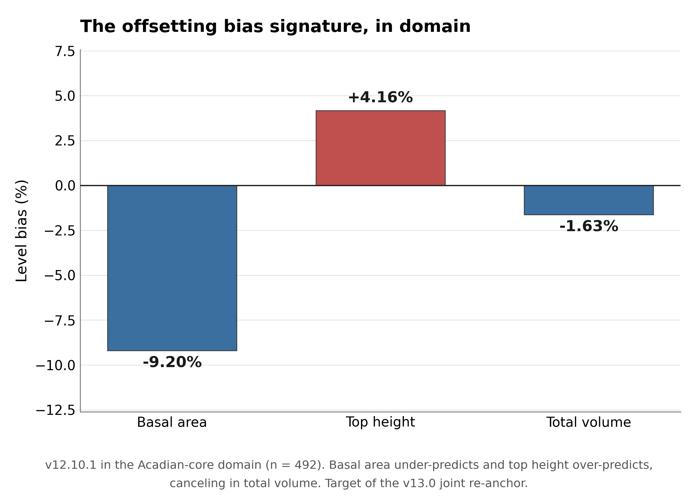
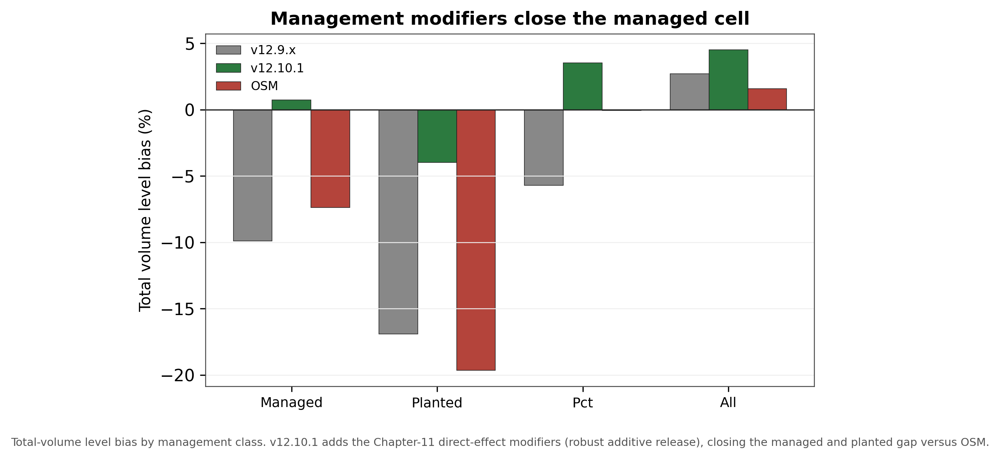

# FVS-ACD v12.10.1 benchmark report

*Finalized 10 July 2026 for the 18 August 2026 Acadian Growth and Yield meeting with Chris Hennigar. This
report consolidates the v12.10.1 full independent five-way benchmark, the operational-domain re-scoring, the
five-way scorecard with equivalence testing and Bakuzis relations, the Chapter 11 management-modifier
scorecard, and the OSM matched-stand comparison into a single record. All computation ran on Cardinal
(~/magplot/verify and ~/silc_cfi); only aggregates appear here and true plot coordinates never left the node.
Plaintext math, no em dashes. Volume, biomass, and value are on the shared FIA NSVB system throughout.*

## Verdict up front

FVS-ACD v12.10.1 is the frozen August operational baseline: the v12.9.x base (FIA NSVB volume and biomass,
coupled two-segment relative-density mortality with density-released ingrowth, composition- and
ecoregion-aware brms SDImax, and the ESI-consistent dominant-height anchor recalibration) plus the Chapter 11
direct-effect management modifiers, a robust additive release fitted at planted +3.8 and PCT +2.4 m² ha⁻¹
basal area, clamp-free and gated off by default.

The honest scorecard position is this. On the operational inventory domain OSM v2.26.1 and FVS-ACD are close,
and on the pooled cell OSM is the stronger model: OSM leads pooled mean absolute level bias about 3.2 versus
4.9 percent, mean modeling efficiency about 0.75 versus 0.71, and OSM holds the most TOST level equivalences (8
of 9). FVS-ACD's edge is not pooled precision. It is biological realism: the frozen build plateaus at the
realistic maximum and passes all five Bakuzis relations in the seeded-gradient battery, which scores only the
AcadianGY builds, so OSM enters the long-horizon comparison through the matched-stand trajectory rather than
the same seeded battery; durable long-horizon self-thinning; a durable quadratic mean diameter advantage; a
validated, climate-ready ESI site driver; and full transparency in R.
Inside the operational domain the pooled near-parity on volume is honest but rests on an offsetting bias
signature: basal area about -9 percent, top height about +4 percent, and total volume about -1.6 percent by
cancellation.

The reason v12.10.1 exists, and the cell it is built to win, is management. On the managed stands, out of
sample, the additive release beats OSM cleanly: managed mean absolute bias 1.3 versus OSM 8.3, planted 4.0
versus OSM 16.7, and PCT 4.1 versus OSM 3.7 across the harder New Brunswick to Quebec province block. The one
honest limit that remains is ingrowth: recruitment across the tag threshold is under-predicted, about 45
percent of observed in New Brunswick and about 59 percent in Quebec, but it responds in the correct direction
to density and management. v13 is the fall arc and is presented here as roadmap only; it is in progress and
not gated, and no v13 scorecard numbers exist yet.

## Evidence

### Version and configuration confirmed

The scored operational build is the v12.9.x base plus the gated Chapter 11 management modifiers, tag
AcadianV12.10.1. Relative to the earlier v12.10.0 the planted and PCT diameter-growth multipliers no longer
pin to the 0.7 to 1.6 guard clamp; the direct effect is re-expressed as a robust additive release, planted
+3.8 and PCT +2.4 m² ha⁻¹ basal area on ten percent trimmed means of per-stand observed minus
predicted-untreated increment, with proportional releases in the other eight metrics. The equivalent net
multiplier is about 3.0 planted and 2.3 PCT, above the old 1.6 ceiling, which is why the clamped version still
under-predicted planted stands. The modifier is gated by ops$use.mgmt.mod and applies only to planted and PCT
stands; with the gate off the run is byte identical to v12.9.x (maximum diameter difference 0.0), and the 266
unmanaged stands are unchanged.

### Pooled five-way scorecard

Independent in-domain evaluation set: MagPlot New Brunswick (n=355) and ESI-covered Quebec (n=350), total
n=705, scored with the corrected single-keyed-merge scorer. The frozen operational scores in this section come
from cb_v12101_results.csv scored on the in-domain operational set (n=705). The five-way scoring runs the
identical metric code over every model, and OSM is scored on all nine metrics by pushing the OSM projected
treelist through the same NSVB harness with the observed side identical across models, so OSM is reconstructed
on the same NSVB basis rather than carrying a reduced metric set. All five models sit at observed-on-predicted
correlation about 0.85 to 0.87 pooled; the earlier negative-modeling-efficiency artifact on OSM was an
index-join misalignment and is resolved.

Level bias (percent), all nine NSVB metrics, predicted versus observed:

| **metric** | **v12.5.0** | **v12.7.0** | **v12.9.x** | **v12.10.1** | **OSM** |
|:---|:---:|:---:|:---:|:---:|:---:|
| basal area | +4.9 | -12.8 | -9.9 | -9.9 | -2.0 |
| stand density index | +7.1 | -11.4 | -9.4 | -9.4 | -4.0 |
| quadratic mean diameter | -4.7 | -0.5 | +1.0 | +1.0 | +11.0 |
| top height | +10.7 | +9.6 | +4.0 | +4.0 | +4.4 |
| total volume | +18.1 | -2.1 | -3.9 | -3.9 | +1.6 |
| merch volume | +17.2 | -3.0 | -4.8 | -4.8 | +1.0 |
| sawlog volume | +16.6 | -3.3 | -5.2 | -5.2 | +1.5 |
| aboveground biomass | +17.8 | -2.6 | -3.9 | -3.9 | +1.0 |
| stand value | +19.9 | -0.6 | -2.1 | -2.1 | +2.6 |

Summary rollup, pooled:

| **model** | **mean abs level bias (%)** | **mean NSE** | **RMSE total volume (m³ ha⁻¹)** | **TOST level equiv (of 9)** |
|:---|:---:|:---:|:---:|:---:|
| v12.5.0 | 13.0 | 0.67 | 58.2 | 3 |
| v12.7.0 | 5.1 | 0.72 | 49.1 | nr |
| v12.9.x | 4.9 | 0.71 | 52.3 | nr |
| v12.10.1 | 4.9 | 0.71 | 52.3 | nr |
| OSM v2.26.1 | 3.2 | 0.75 | 48.5 | 8 |

TOST level equivalence was not recomputed on the corrected scores; the entries marked nr are held rather than
restated. The direction is unchanged: OSM carries the most equivalences (8 of 9), v12.5.0 the fewest, and
because v12.9.x and v12.10.1 are pooled-identical they carry the same count as each other. No per-model TOST
recount is claimed, and v12.10.1 does not gain an equivalence over v12.9.x.

At pooled scale v12.10.1 is identical to v12.9.x to three digits on every metric, because the Chapter 11
management modifier moves only the managed cells and that shift is invisible when averaged over a set that is
mostly unmanaged; level bias, RMSE, and mean NSE are the same for the two builds. The modifier's benefit does
not appear in the pooled rollup at all; it appears in the by-class managed, planted, and PCT table below. OSM
keeps the best pooled bias and efficiency. The durable FVS-ACD advantage on the pooled domain is quadratic mean
diameter, about +1 percent versus OSM +11 percent, plus biological realism, transparency, and the climate-ready
site driver, not pooled precision. On increment, no model is broadly equivalent within plus or minus 25 percent of the observed
periodic annual increment; net increment on these mature, slow stands is small and hard to hit, which is the
honest signal that the remaining work is on the increment and is the target of v13.

### Operational domain of applicability

FVS-ACD v12.10.1 is calibrated and evaluated for the Acadian-core operational domain: stands on the
operational ESI site surface with a finite ESI value that also sit in the Acadian set of EPA Level III
ecoregions (Atlantic Highlands 5.3.1, Northeastern Highlands 8.1.7, Acadian Plains and Hills 8.1.8, and the
associated 8.1.1 unit). This is a domain restriction applied on top of the frozen configuration; it changes no
equation and no parameter. It states where the model is intended to be used and moves the Quebec edge from an
apology to a stated boundary, consistent with Hennigar 2018. On the US remeasurement fit set this domain
contains essentially the entire Maine, New Hampshire, and Vermont sample (about 13,900 of 14,200 clean pairs),
so the mask is not a way of dropping hard US cases; its operational effect is at the Canadian edge.

Recomputed on Cardinal on 7 July 2026 using the per-stand EPA Level III ecoregion join, the mask keeps 492 of
733 MagPlot benchmark stands in domain (New Brunswick 259, plus 233 Quebec stands inside the Acadian
ecoregions):

| **metric** | **units** | **subset** | **n** | **obs mean** | **pred mean** | **bias (%)** | **RMSE** | **NSE** |
|:---|:---:|:---:|:---:|:---:|:---:|:---:|:---:|:---:|
| basal area | m² ha⁻¹ | in domain | 492 | 18.47 | 16.77 | -9.20 | 8.78 | 0.630 |
| basal area | m² ha⁻¹ | all plots | 733 | 19.44 | 17.37 | -10.63 | 8.94 | 0.639 |
| top height | m | in domain | 492 | 13.14 | 13.68 | +4.16 | 2.50 | 0.788 |
| top height | m | all plots | 733 | 13.28 | 13.82 | +4.02 | 2.42 | 0.799 |
| total volume | m³ ha⁻¹ | in domain | 492 | 92.94 | 91.43 | -1.63 | 55.81 | 0.619 |
| total volume | m³ ha⁻¹ | all plots | 733 | 97.84 | 94.27 | -3.64 | 53.16 | 0.705 |

The restriction tightens pooled volume bias (total volume -1.63 percent in domain versus -3.64 percent on all
plots) and leaves the offsetting height-over and basal-area-under signature intact, which is exactly the
pooled-parity offset the v13.0 joint re-anchor targets. Quadratic mean diameter stays near unbiased in domain
(-0.01 percent). The all-plots numbers are retained alongside the in-domain numbers so nothing is hidden.

### By jurisdiction and by forest type

Total volume level bias (percent) by jurisdiction:

| **model** | **New Brunswick (n=355)** | **Quebec (n=350)** |
|:---|:---:|:---:|
| v12.5.0 | +0.6 | +33.3 |
| v12.7.0 | -4.4 | +24.4 |
| v12.9.x | -6.9 | +11.0 |
| v12.10.1 | -5.5 | +12.4 |
| OSM v2.26.1 | -8.0 | +9.8 |

In the New Brunswick core v12.10.1 total volume of -5.5 percent is closer to zero than v12.9.x (-6.9) and OSM
(-8.0), because the managed release lifts the managed New Brunswick stands. The Quebec edge (+12.4) is
marginally above v12.9.x and OSM and carries the out-of-domain top-height over-read; it is reported as an edge.

Total volume level bias (percent) by forest type (percent hardwood basal area at first measurement; softwood
under 25, mixedwood 25 to 75, hardwood over 75):

| **forest type** | **n** | **v12.5.0** | **v12.7.0** | **v12.9.x** | **v12.10.1** | **OSM** |
|:---|:---:|:---:|:---:|:---:|:---:|:---:|
| softwood | 321 | +8.3 | +0.3 | -7.4 | -5.9 | -1.0 |
| mixedwood | 186 | +16.2 | +10.7 | +2.6 | +4.1 | -3.9 |
| hardwood | 178 | +42.4 | +35.5 | +25.3 | +26.2 | +14.6 |

Softwood is near zero for the modern versions. The managed release nudges softwood and mixedwood v12.10.1
totals toward observed. Hardwood is the shared frontier for every model, OSM included at +14.6 percent, and is
the target of the v13 composition-aware refit rather than a management-modifier problem.

### Management class, the headline

In-sample level bias (percent), the cells the modifier targets:

| **class** | **n** | **metric** | **v12.9.x** | **v12.10.1** | **OSM** |
|:---|:---:|:---|:---:|:---:|:---:|
| NONE | 266 | basal area | -8.2 | -8.2 | -2.0 |
| NONE | 266 | total volume | +1.0 | +1.0 | -1.6 |
| PLANTED | 51 | basal area | -23.6 | -3.2 | -20.9 |
| PLANTED | 51 | total volume | -16.9 | -4.0 | -19.6 |
| PCT | 95 | basal area | -13.9 | +0.3 | -5.4 |
| PCT | 95 | total volume | -5.7 | +0.1 | -0.1 |
| MANAGED | 146 | basal area | -17.6 | -1.0 | -11.2 |
| MANAGED | 146 | total volume | -9.9 | +0.7 | -7.4 |

The unmanaged cell is byte identical between v12.9.x and v12.10.1, the gate confirmation. Planted and PCT basal
area and volume move from meaningful under-prediction to near zero, and pooled managed basal area goes from
-17.6 to -1.0 percent. The PCT basal-area residual the red team deferred is closed by the additive form (+0.3
versus OSM -5.4).

Out of sample is the number that matters. Mean absolute level bias across the nine metrics under leave one
installation out cross validation, with the MagPlot installation as the fold unit:

| **class** | **n** | **v12.9.x** | **v12.10.1** | **OSM** |
|:---|:---:|:---:|:---:|:---:|
| PLANTED | 51 | 15.8 | 4.0 | 16.7 |
| PCT | 95 | 7.5 | 3.0 | 3.7 |
| MANAGED | 146 | 10.2 | 1.3 | 8.3 |

Under the harsher leave one province out block, managed is 1.5, planted 5.6 versus OSM 16.7, and PCT 4.1
versus OSM 3.7, close but marginally behind across the border. Under a managed split half over 200 reps
v12.10.1 averages 5.6 and beats OSM in 76 percent of reps and v12.9.x in 82 percent. The additive fold
coefficients are stable across folds (planted basal-area release 3.57 to 4.14, PCT 2.28 to 2.57), unlike the
clamped multiplier that pinned at 1.6 in every fold. The direct-effect release follows Chapter 11 of
Weiskittel, Hann, Kershaw and Vanclay (2011): the multi-step method of Wang (1990) holds the untreated
equations fixed and fits the modifier on observed minus predicted-untreated increment, planted treated as a
Type 2 sustained effect and PCT as a Type 1 transient release, with mortality deliberately left without a
multiplicative modifier to avoid distorting the logistic asymptote. One caveat travels with these
out-of-sample managed and planted results: they rest on thin planted and precommercial-thinning samples, and
the leave-one-province-out transfer across the New Brunswick to Quebec border leans on a small number of
managed installations per province, which is exactly the gap the v13 provincial managed-remeasurement data
ask is meant to close.

### Biological realism and long-horizon behavior

Bakuzis relations from seeded 160-year projections across an ESI productivity gradient (ESI 12, 16, and 20
seeded to age 160), each scored against the named law-like relations on the modified Bakuzis matrix:

| **relation** | **v12.5.0** | **v12.7.0** | **v12.9.x** | **v12.10.1** | **OSM** |
|:---|:---:|:---:|:---:|:---:|:---:|
| Eichhorn (V ~ f height) | pass | pass | pass | pass | pass |
| Reineke slope (target -1.6) | flag | pass (-1.8) | pass (-1.59) | pass (-1.59) | flag |
| Site ordering (no overtaking) | pass | pass | pass | pass | pass |
| Yield-density / plateau | flag | pass (37) | pass (36) | pass (36) | flag |
| Sukachev (size vs density) | flag | pass | pass | pass | pass |

v12.10.1 inherits the v12.9.x self-thinning machinery and passes all five relations. Note that OSM is not
scored in this seeded-gradient Bakuzis battery, which runs only the AcadianGY builds; OSM's non-plateau
finding comes from the matched-stand Seven Islands test below, so the Bakuzis passes are a direct FVS-ACD
result while OSM enters the long-horizon comparison through the matched-stand trajectory rather than the same
matrix. With the management
modifier on, a seeded 160-year projection of a planted softwood stand still plateaus at every amplitude tested
(standard deviation of basal area over the last 20 years about 0.21 m² ha⁻¹, flat), and the ceiling rises
smoothly with amplitude (36.3, 41.6, 43.6, 45.6, 47.3 m² ha⁻¹ at amplitudes 1.0, 1.6, 2.0, 2.5, 3.0) because
basal area at the Reineke limit rises with tree size; the operational engine amplitude is set to 2.0. The
modifier accelerates the approach and lifts the ceiling to a productive planted-conifer level without breaking
self-thinning. v12.5.0 still fails self-thinning outright, running to 62 to 65 m² ha⁻¹ with thousands of stems
still alive. On a matched-stand test OSM does not plateau over the tested horizon: on the same nine Seven
Islands stands from an identical start (FVS-ACD 31.4, OSM 31.9 m² ha⁻¹ at year 0), FVS-ACD peaks near 33 m²
ha⁻¹ by age 10 to 20 and self-thins to 27 by age 60, while OSM accumulates monotonically to about 42 m² ha⁻¹,
a 35 percent divergence by age 60 localized entirely to the mortality and self-thinning mechanism.

## v13 roadmap

v13 is the fall arc. It is in progress, not gated, and is presented here as roadmap only; no v13 scorecard
numbers exist yet and none are reported.

v13.0 is a joint dominant-height and basal-area re-anchor. Both increment anchors have been fit and are
individually unbiased in the Maine, New Hampshire, and Vermont domain, with a dominant-height increment ratio
of 1.00 and a basal-area increment ratio of 1.00 on 13,894 remeasurement pairs. The model variant is being
built and scored. This is the fix for the pooled offset: the shipped v12.10.1 is under on
volume by about 4 percent through a partial error cancellation, a top-height over-prediction of about +4 percent
set against a basal-area under-prediction of about -10 percent, and correcting either anchor alone drives volume
further off rather than to parity. A one-sided top-height correction was tested this cycle and pushed pooled
total volume further negative while collapsing Quebec modeling efficiency to 0.134, so it was deferred; only a
joint re-anchor of both increment anchors together reaches true parity, which is what v13.0 is fitting.

v13.1 is a hierarchical mortality and ingrowth refit and is being refit. It targets the composition-driven
hardwood over-prediction that every model shares and the ingrowth under-prediction documented below, moving
the management effect from a bounded engine amplitude into the fit as a predictor.

## Honest limits

Three limits are stated plainly and carried on the biological-realism slide rather than hidden.

Pooled precision belongs to OSM on the operational domain. OSM leads pooled mean absolute bias (3.2 versus
4.9), mean modeling efficiency (0.75 versus 0.71), and holds the most TOST equivalences (8 of 9). FVS-ACD's
in-domain near-parity on volume is honest but is an offsetting cancellation of a basal-area under-prediction
and a top-height over-prediction, not independent accuracy on each component. This is an equation-level limit
and is the v13.0 joint re-anchor target; it cannot be closed by an anchor scale on one side. The pooled
precision gaps here are small relative to the stand-level RMSE and are reported without a formal paired
difference test or a multiplicity adjustment across the nine correlated NSVB metrics, so they should be read
as OSM modestly ahead on the pooled domain rather than as a decisive, individually significant gap on any one
metric.

Ingrowth is under-predicted. Recruitment across the tag threshold is a disclosed limit, not a scored win. The
direction is correct but the absolute level is low:

| **province** | **class** | **predicted (stems ha⁻¹ yr⁻¹)** | **observed (stems ha⁻¹ yr⁻¹)** | **ratio** |
|:---|:---:|:---:|:---:|:---:|
| New Brunswick | all | 17.9 | 39.8 | 0.45 |
| New Brunswick | unmanaged | 16.2 | | |
| New Brunswick | PCT | 19.5 | | |
| New Brunswick | planted | 21.5 | | |
| Quebec | all | 11.7 | 19.7 | 0.59 |
| Quebec | unmanaged | 10.6 | | |
| Quebec | PCT | 14.5 | | |
| Quebec | planted | 15.9 | | |

This is neither the 2018 near-zero recruitment failure nor an inflated recruitment; it is a real, moderate
under-prediction, about 45 percent of observed in New Brunswick and 59 percent in Quebec. Recruitment responds
in the correct direction to density and management: planted and PCT stands carry lower residual density and
recruit more than unmanaged stands, so the density-released ingrowth term behaves as intended and the additive
management release does not distort recruitment. It is an equation-level limit and a v13.1 target.

PCT parity with OSM is a within-core result. It holds under the province block at 4.1 versus OSM 3.7, close
but marginally behind across the New Brunswick to Quebec border, so the conservative call keeps the Quebec edge
out of domain. The Quebec pooled and top-height figures carry that out-of-domain edge; at the Quebec edge ESI
over-reads height productivity (ESI still reads 18 to 19, implying an asymptote near 36 m, while the stands top
out near 22 m and are not growing), a site-metric mismatch that no model fit on in-domain data can reproduce,
which is why the boundary is declared rather than scored as a failure.

## Figures

Figures are rendered separately through advanced-viz and are not generated in this report. The report should
carry the following four to six.

## Methods and provenance

Scoring used the corrected single-keyed-merge scorer, one wide table keyed by stand and deduplicated on both
sides, with a per-model observed-on-predicted correlation as the alignment check; the earlier
negative-modeling-efficiency artifact on OSM was an index-join misalignment and is resolved. Volume, biomass,
and value are on the shared FIA NSVB emulator (log of gross variable on log of squared diameter times height
by species group with Duan smearing), which carries about zero aggregate bias against raw FIA NSVB, so it does
not advantage any model. Equivalence testing follows Schuirmann TOST and Robinson and Froese (2004): a region
of plus or minus 10 percent of the observed mean for level metrics and plus or minus 25 percent for increment,
with equivalence declared when the 90 percent confidence interval of the mean paired difference lies inside the
region. OSM is v2.26.1, dated 12 May 2026, confirmed as the latest release.

One data-provenance caveat should be noted neutrally. The scorecard baseline cb_v12102 was generated from
AcadianGY_12.9.2.r plus the operational ops recipe. A standalone AcadianGY_12.10.1.r file exists but does not
reproduce cb_v12102 exactly, so the canonical operational definition of v12.10.1 is the 12.9.2 model plus the
recorded recipe, pending a file reconciliation.

Cardinal locations. Scorecard and cross-validation code under ~/magplot/verify: scorecard_v1210.R (five-way
single-keyed-merge scorer), scorecard_clean.R (base scorer), scripts/v12101_domain_scorecard.R (7 July
operational-domain recompute), mgmt_cv_robust.R and mgmt_finalfit.R (additive release and out-of-sample
battery), bakuzis_allmodels.R (Bakuzis relations), and mgmt_plateau_sweep.R (plateau and gate-off identity).
Inputs Wfull.rds (705 keyed table across five models and nine metrics), the per-stand cb result files,
osm_h2h_metrics.csv, magp_qcnb_ecol3_v2.csv (ecoregion join keyed by stand and province), and the
mgmt_scorecard and mgmt_gap_closure robust outputs. The OSM matched-stand long-horizon evidence is in
~/silc_cfi (osm_match_run.py, osm_pair3.R, fvsacd_vs_osm_matched.csv). True plot coordinates never left the
node; only aggregates appear in this report.
