# FVS-ACD v12.11 benchmark report: candidate evaluation

**Consolidated technical record, 23 July 2026.**

*This is the comprehensive edition of the FVS-ACD v12.11 benchmark report. It consolidates the v12.11 candidate
build, the five gated levers, the guardrail battery, the all-sites Maine, New Brunswick, and Quebec model
comparison against the frozen base and OSM v2.26.1, and two rounds of red-team claim corrections, and it adds
five analyses new to this edition: a forest-group performance breakdown, a data-coverage accounting, an
independent Nova Scotia validation with an OSM head-to-head (Section 11), a long-horizon Bakuzis check across the
species-composition gradient (Section 8.1), and a master scorecard and overall ranking pooling every
already-scored benchmark cell in the project across four determinants (Section 12). It also carries forward
in full the five-way scorecard, the nine-metric forest-type detail, the percent RMSE scorecard, the
Robinson-Froese equivalence testing, the weighted composite scores, the species-composition analysis, and the
management-class record built for the 10 July 2026 v12.10.1 baseline report, so that nothing from that
comprehensive record is lost in this update. v12.10.1 remains the frozen August operational baseline; v12.11 is
the next candidate, evaluated here but not yet shipped. All computation ran on Cardinal
(`~/_scripts/AcadianGY_12.11.r`, `~/magplot/verify`, and `~/silc_cfi`); only aggregates appear in this report, and
proprietary tree records and true plot coordinates never left the node. Volume, biomass, and stumpage value are
reported on the shared FIA National Scale Volume and Biomass (NSVB) system throughout.*

## Table of Contents

1. Verdict up front
2. Benchmark scope and data coverage
3. Version and configuration: the five gated levers
4. Validation: the guardrail battery
5. All-sites comparison: Maine, New Brunswick, and Quebec
6. Forest-group performance: hardwood, mixedwood, and softwood
7. Legacy five-way scorecard and forest-type detail
8. Biological realism and long-horizon behavior
9. Red-team reframes: corrected claims
10. Watch items, honest limits, and the v13.1 handoff
11. Nova Scotia: an independent-province validation
12. Master scorecard and overall ranking
13. Methods and provenance
14. Appendix A. Content-inventory diff and build note

## 1. Verdict up front

FVS-ACD v12.11 clears its four-part guardrail battery and is ready to be declared a release candidate, though not
yet the operational build. Every one of its five levers is gated and off by default, so with the gates off the
model reproduces the frozen v12.10.1 bit for bit, a byte-identical result reconfirmed on a novel hardwood-heavy
stand (*Betula alleghaniensis* Britton, *Acer saccharum* Marshall, *Acer rubrum* L. mix, CSI 20, 30 year
projection) not used in any earlier smoke test, with a maximum absolute difference of 0.000e+00 on diameter,
height, and expansion factor. With the levers on, v12.11 addresses the sign-flipping, maturity-dependent
long-horizon volume bias documented in the 18 July decomposition: under-prediction in developing stands,
over-prediction in mature stands, driven by three separable component errors in recruitment, mortality, and the
survivor diameter increment. The correction wins clearly where it targets managed and mature conditions and holds
the line, without closing, on the developing end. Two managed sites now carry a flag of their own, and a
subplot-grain re-score shows the developing-end fix largely does not survive finer aggregation. v13.1, already
gated and running, is the next step for the developing end. This report states all of that plainly rather than
leading with the wins alone.

Three results new to this edition sharpen where the win actually lands, and a second-round red-team pass
corrected the causal story told about two of them. Scored by forest group rather than by source alone (Section
6), softwood is v12.11's clearest win, pooled total-volume bias moving from -5.67% to -2.86% and basal area from
-9% to -5.45%, both with lower percent RMSE; mixedwood improves by a smaller margin; and hardwood, read
carefully, is not the clean cross-source regression a first pooled look suggested: a single managed Quebec
source drives most of the pooled shift with a signature no hardwood-only lever can produce, and the true
cross-source hardwood signal, with that source set aside, is small and mixed rather than a broad
hardwood-specific worsening (Section 6). Second, the benchmark that produces every number in this report is not
a balanced three-jurisdiction sample (Section 2): Maine sources supply 5,021 of the 5,754 all-sites benchmark
stands, 87.3%, with New Brunswick (355) and Quebec (378) as the minority. Reading any regional result in this
report, including the historical New Brunswick and Quebec five-way scorecard carried forward from the v12.10.1
baseline in Section 7, means reading it first as a report about a Maine-anchored candidate and second as a
comparison against two smaller Canadian jurisdictions. Third, this edition adds Nova Scotia, a fully
independent province holding the region's longest continuous forest-inventory record, as an out-of-sample test
(Section 11): the managed-stand levers generalize cleanly to NS's independent managed data, the site-index
question is answered honestly rather than assumed, and NS's long remeasurement record, once a
disturbance-screening artifact was caught and corrected, shows persistent total-volume under-prediction that
attenuates toward, but does not cross through, zero as intervals lengthen past 30 years, rather than reproducing
the sign-flipping, maturity-dependent over-prediction pattern found elsewhere in this report. Nova Scotia is
therefore only partially consistent with that pattern, a more modest and more honest result than the
contaminated first pass appeared to show. A new OSM-ACD v2.26.1 head-to-head on this same NS data, a fair
comparison since OSM is itself a native Acadian-zone model, finds a mixed picture rather than a clean win for
either model: v12.11 and OSM are essentially tied on managed stands at short intervals and v12.11 modestly leads
at long intervals, OSM is more accurate on short-interval unmanaged stands, and at the region's longest
independent, disturbance-clean horizon (over 30 years) v12.11 holds total-volume bias near zero, -1.66%, while
OSM drifts to -9.14%.

Two further results close this edition. A long-horizon Bakuzis check (Section 8.1) extends the guardrail's
single-softwood-stand biological-realism test across softwood, mixedwood, and hardwood stand starts over a
160-year productivity gradient: v12.11 holds the same pass/flag pattern as the frozen base on every relation, the
one flag (site ordering, mixedwood only) is present in base too and self-corrects within about 110 years, and
both FVS configurations score better on this internal-consistency test than OSM, which flags Eichhorn and carries
a persistent, endpoint-level site-ordering inversion on its real-stand run. A master scorecard pooling every
already-scored benchmark cell in this project across four determinants, managed status, forest group, site
productivity, and projection length (Section 12), gives a more complete, and more mixed, accuracy picture than
any single section alone, and its overall ranking is now reconciled to the non-overlapping, per-source basis
described there rather than the cross-tabulated cells an earlier pass in this section used, which had
triple-counted Nova Scotia. Reconciled across six scenarios (two inclusion rules by three Nova Scotia treatments),
neither model is a clean overall winner. v12.11 is the more consistent performer, leading or tying the
equal-per-source mean rank in every scenario tested (about 1.43 to 1.57) and never finishing clearly last on any
metric; OSM-ACD v2.26.1 is the more decisive winner where it wins, leading the strict, apples-to-apples,
common-cells pooled %RMSE in every scenario and sweeping the managed-status and softwood/mixedwood determinant
cells. v12.11 leads the pooled %RMSE only when Nova Scotia is included and the full ME/NB/QC source set is used,
a comparison that also happens to ease OSM's footing since it has no score for two of those eight sources. Base
is a clear third everywhere. Read plainly rather than smoothed into a single winner, v12.11's real wins are its
targeted strata: the long-horizon NS comparison against OSM (Section 11.4), the managed CFRU CTRN and NB MagPlot
sources against OSM, and biological realism (Section 8.1), while OSM leads on unmanaged stands and short
intervals. This also corrects two claims that appeared in an earlier working draft of this section: v12.11 does
not lead managed status overall, OSM wins that cell outright in both regions, and v12.11 does not win the
long-horizon bucket outright, base does (bias -0.06% against v12.11's -1.66% and OSM's -9.14% at the over-30-year
NS interval), though v12.11 still clearly beats OSM at that horizon. The reconciliation that produced these
numbers, including the earlier cross-tab discrepancy and how it was resolved, is documented in full in Section
12.

## 2. Benchmark scope and data coverage

This report draws on two overlapping but distinct benchmark populations, and keeping them separate matters for
reading every table that follows.

The **all-sites v12.11 benchmark** is the newer and larger population, assembled to answer where the candidate
wins and loses across the working range of Acadian forest conditions rather than only the two Canadian
remeasurement networks used to freeze v12.9.x and v12.10.1. It totals 5,754 stands across seven sources in three
jurisdictions. Maine sources supply the large majority, 5,021 stands, 87.3% of the total, split across five Maine
sources of markedly different character: the Penobscot Experimental Forest (PEF, 2,853 stands, developing and
unmanaged), the Cooperative Forestry Research Unit's Continuous Forest Inventory network (CTRN, 1,086 stands,
managed), Maine FIA (918 stands at whole-plot grain, developing, plus a finer 2,858-stand subplot-grain re-score
of the same population used specifically to test whether the recruitment lever's improvement survives finer
aggregation), Baxter State Park (91 stands, mature, held out of every fitting step), and the Seven Islands SILC
cooperator network (73 stands, managed, used for calibration). New Brunswick MagPlot supplies 355 managed stands
and Quebec MagPlot 378 managed stands, both drawn from the same MagPlot permanent-sample-plot infrastructure used
in the legacy five-way benchmark described below. CTRN carries no hardwood-classified stands in this benchmark,
1,077 softwood and 9 mixedwood only, a composition artifact of that network's managed softwood emphasis rather
than a sampling gap.

**Table 1. All-sites v12.11 benchmark: stand counts by source, region, and forest group.**

| Region | Source | Softwood n | Mixedwood n | Hardwood n | Total n |
|---|---|---|---|---|---|
| ME | Baxter (mature, held out) | 45 | 39 | 7 | 91 |
| ME | CFRU CTRN (managed) | 1,077 | 9 | 0 | 1,086 |
| ME | Maine FIA (developing, whole-plot) | 349 | 368 | 201 | 918 |
| ME | PEF (developing) | 2,092 | 714 | 47 | 2,853 |
| ME | SILC / Seven Islands (calibration, managed) | 35 | 27 | 11 | 73 |
| ME | **Maine total** | **3,598** | **1,157** | **266** | **5,021 (87.3%)** |
| NB | NB MagPlot (managed) | 174 | 100 | 81 | 355 (6.2%) |
| QC | QC MagPlot (managed) | 155 | 108 | 115 | 378 (6.6%) |
| | **All-sites total** | **3,927** | **1,365** | **462** | **5,754** |

*Data: `figures/_data/v1211_sample_sizes.csv` and `figures/_data/v1211_forestgroup_stand_counts.csv`. Forest
group is assigned from hardwood share of stand basal area at the initial measurement (t1): softwood at 25% or
less hardwood, hardwood at 75% or more, mixedwood between, the same frozen threshold rule used in the legacy
five-way benchmark below.*

This edition adds a fourth jurisdiction, Nova Scotia, as an independent out-of-sample test rather than folding
it into the pooled all-sites total above. Nova Scotia holds the Acadian region's longest continuously
remeasured permanent-sample-plot record, 1965 to the present with up to nine remeasurement occasions per plot,
and its network is a genuine mix of managed research (thinning-trial) stands and unmanaged operational stands,
licensed to the University of Maine under a plot-confidentiality agreement that keeps every individual plot
location off any released map or table. The NS benchmark evaluated in Section 11 totals 4,504 scored
stand-pairs, 2,157 managed and 2,347 unmanaged, entirely independent of the 5,754-stand ME/NB/QC all-sites
benchmark above, of its own fitting data, and of its own site-index input. Because NS was never used to fit or
tune any v12.11 lever, it is the cleanest available test of whether the managed-stand levers generalize.

![Figure 1. FVS-ACD benchmark footprint across Maine, New Brunswick, Quebec, and Nova Scotia. Maine FIA and NB and QC MagPlot are shown as 50 km equal-area hex stand counts; Nova Scotia is shown as county-level PSP density (aggregated, licensed data, never per-plot); SILC/Seven Islands (8 already-fuzzed locations) and CFRU CTRN (11 coarse regional markers) are shown as multiple aggregated locations rather than single centroids; Baxter and PEF remain single aggregated or public-location markers. No true plot coordinate, for any of the four jurisdictions, appears in this figure.](figures/fig20_benchmark_footprint.png)

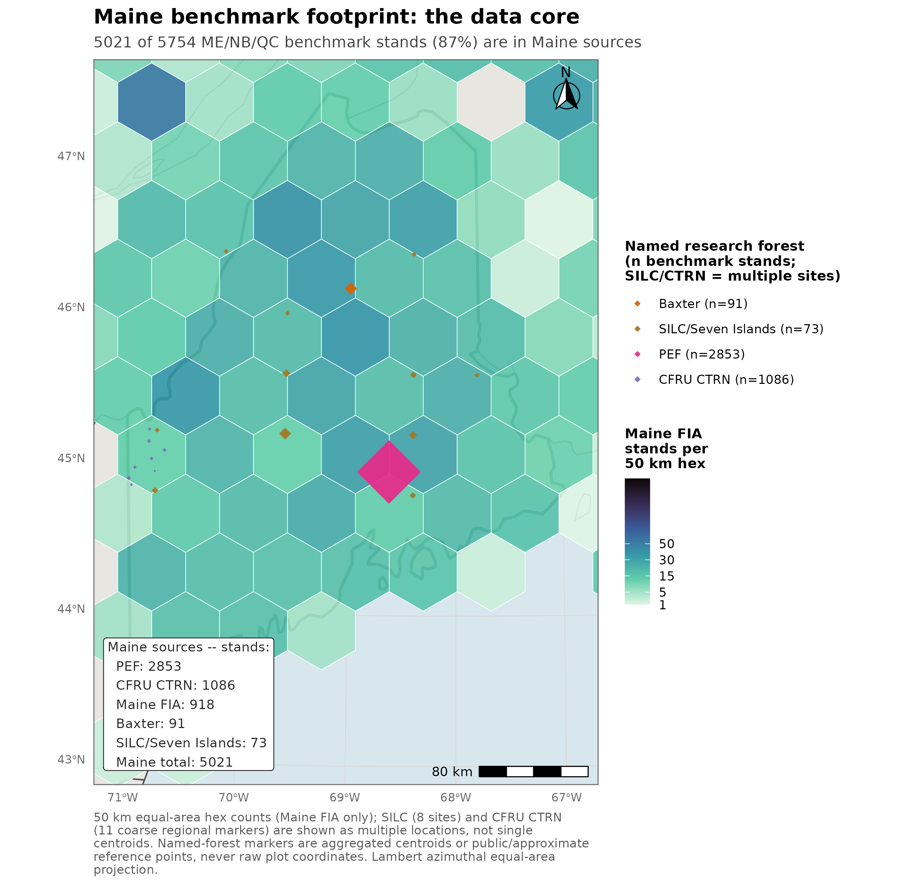

Coordinate handling for these figures follows the hard restriction on FIA true plot coordinates, and, for Nova
Scotia, the plot-confidentiality terms of its provincial data license: true coordinates for Maine FIA and NB and
QC MagPlot are aggregated server-side on Cardinal into the 50 km equal-area hex count grid before any object
leaves the node; CFRU CTRN carries no coordinates in the codebase at all, proprietary and withheld at source, and
is now shown as 11 coarse, privacy-reviewed regional markers snapped to a roughly 45 km grid-cell center, each
pooling one to three real installations, rather than the single generic regional label used previously; Baxter's
91 plots are aggregated to a single centroid; SILC coordinates are pre-fuzzed to within 10 km at source and are
now shown at those 8 already-safe reference locations across northern and western Maine rather than a
further-collapsed single centroid; PEF, which carries no plot-level coordinates in this system, is shown at its
published public location near Bradley and Eddington, Maine; and Nova Scotia's licensed PSP data, which its 2016
license agreement with the University of Maine requires be kept confidential at the individual-plot level, is
shown only as one aggregated centroid per county (mean position of 79 to 277 licensed plots each) for the
operational network, plus one generic, county-unresolved central-Nova-Scotia point for the research/thinning
network; no individual NS plot coordinate is used anywhere in this pipeline. A `stopifnot` assertion in the
mapping script enforces that no `latitude` or `longitude` column ever appears in the written hex object.

The **legacy frozen five-way benchmark**, carried forward from the 10 July 2026 v12.10.1 baseline report and
retained in Section 7 for historical continuity and the model comparisons that depend on it, is narrower: n =
705 remeasured stands from the permanent-plot networks of New Brunswick (355) and Quebec (350) only, the two
Canadian jurisdictions that anchor the Acadian region on their own. Forest-type composition in that set, assigned
by the same hardwood-basal-area-share rule, is 321 softwood, 186 mixedwood, and 178 hardwood, with 20 stands
unclassified. Each stand carries an observed initial and remeasured state together with the predicted remeasured
state from every model variant, evaluated on nine NSVB metrics: basal area, stand density index, quadratic mean
diameter, top height, total volume, merchantable volume, sawlog volume, aboveground biomass, and stumpage value.
The remeasurement interval ranges from 4 to 14 years, median 5, mean near 7, so each prediction is a
growth-and-yield projection over the stand's own observed window rather than a fixed horizon. Evaluation there is
restricted to the operational in-domain set, a stand retained when it falls within Ecological Site Index (ESI)
coverage or lies in New Brunswick; every stand in that frozen benchmark satisfies this condition.

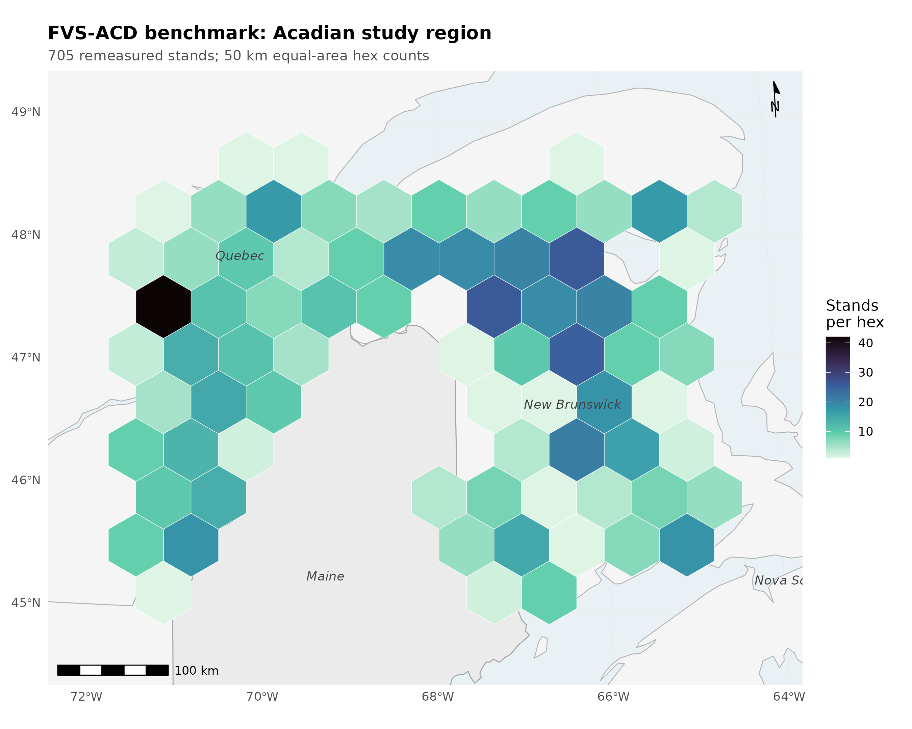

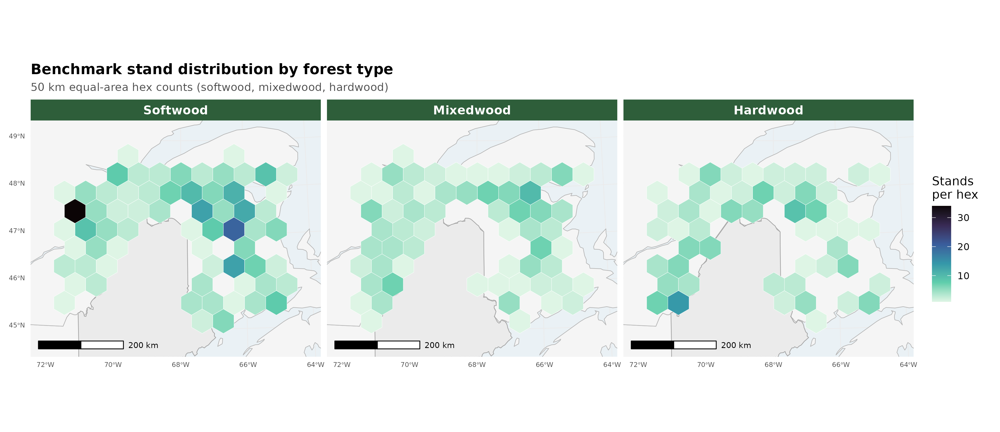

## 3. Version and configuration: the five gated levers

The scored operational build entering this cycle is the v12.10.1 base: the v12.9.x engine (FIA NSVB volume and
biomass, coupled two-segment relative-density mortality with density-released ingrowth, composition- and
ecoregion-aware brms SDImax, and the ESI-consistent dominant-height anchor recalibration) plus the Chapter 11
direct-effect management modifiers, a robust additive release fitted at planted +3.8 and PCT +2.4 m² ha⁻¹ basal
area, gated off by default. With every V1211_* lever at its default off value and SPLIT=FALSE, v12.11 reproduces
that frozen v12.10.1 baseline byte for byte, confirmed to a maximum absolute difference of 0.000e+00.

The maturity-gradient decomposition that motivated this cycle isolated three separate systematic errors that net
out to a bias flipping sign across the stand-development gradient. v12.11 does not correct them with raw
per-tree multipliers. It follows the Weiskittel, Hann, Kershaw and Vanclay (2011) Chapter 10 approach of
constraining or conditioning the tree-level predictions, consistent with the modeling philosophy that a
stand-level or process-level constraint is preferable to an unconditioned multiplier wherever one is available.

**Lever 1, recruitment.** `ops$ingrowth.mult` carries a flat, basal-area-anchored ingrowth multiplier fitted to
the pooled deficit, about 2.5x, IGMULT = 2.5. A gated relative-density taper (`ops$use.ingrowth.rdtaper`) was
built to protect mature closed stands from the flat multiplier, but it is not enabled in the scored
configuration (`V1211_IGTAPER` is not set in the guardrail battery); a separate, always-on density-release
logistic (`ops$use.ingrowth.release`, center relative density 0.58) already suppresses recruitment at high
density regardless of which recruitment lever runs, so the flat multiplier is not applied undamped in closed
stands, but the purpose-built taper and the flat multiplier have not been compared head to head.

**Lever 2, mortality.** A management-gated attenuation of the self-thinning removal fraction
(`ops$mort.dens.scale`) follows f(RD) = fmin + (1 - fmin) x exp(-k x max(RD - RD0, 0)), where RD = SDI/1200 is
relative density, fitted fmin = 0.13, k = 12.4, RD0 = 0.38. Natural (unmanaged) stands are untouched by this
gate, so Reineke self-thinning and the density plateau are preserved outside managed sources. The gate lets a
managed stand's removal fraction fall to as little as 13% of normal for a stretch of years, relying on the
separate hard SDImax ceiling to correct any resulting overshoot, a behavior discussed under watch items below.

**Lever 3, survivor diameter increment.** Two gated forms of the Chapter 10 stand constraint were built. 3a is a
direct size-by-maturity rein. 3b, the preferred and shipped form, lowers the activation thresholds on the
engine's existing proportional-increment constraint to a stand basal-area-increment target, gated by a
quadratic mean diameter floor (`ops$ddbh.standcon.qmin` = 22 cm, with SC_LO = 0.40 and SC_HI = 0.50) so it binds
only in mature, high-QMD stands and spares developing ones. The QMD floor was added after the component
decomposition showed an un-gated 3b suppressing developing-stand growth.

**Lever 4, hardwood height conditioned on form and risk** (`ops$use.dht.hw.mod`). The base height increment
carried no form or risk term, and height drives NSVB volume directly. The modifier was fit from the Ryan Smith
NHRI field dataset, 635 trees across four Maine installations (Smith, Rangeley, AshlandEast, and AshlandWest),
the field-observed alternative to the FIA damage-code proxy the fit was built to avoid. Usable per-species
sample sizes after collapsing to hardwoods with measured height were *B. alleghaniensis* n = 266, *A. saccharum*
n = 251, and *A. rubrum* n = 117; *Quercus rubra* L. carried only a single tree in the Smith set and was dropped,
and neither *Betula papyrifera* Marshall nor *Populus tremuloides* Michx. appeared in the height set at all.
High-risk trees are about 10 to 11% shorter in *B. alleghaniensis* and *A. saccharum* (both strongly significant,
p < 0.002), a weaker effect in *A. rubrum* (p = 0.59, not significant); poor form carries only a small
total-height effect because form drives sawlog and merchantable height and defect, already handled downstream by
the Smith sawlog-fraction model. Worst-quality *A. saccharum* (poor form, high risk) shows a 16%, about 3.7 m,
height deficit at a 23 m mature tree, consistent with the field estimate that roughly 4 m of sugar maple height
deficit explains about 18% of the hardwood volume gap.

**Table 2. Lever 4 fitted hardwood height risk coefficients, base.risk.coeff = -0.1380 (*Betula papyrifera*
Marshall reference), gamma.form = -0.020 (pooled).**

| Species | Total risk log-deficit | Field source |
|---|---|---|
| *Quercus rubra* L. | -0.1520 (original fit) | FIA GRM damage proxy, absent from Smith height set |
| *Acer saccharum* Marshall | -0.1150 | Smith field, n = 251 |
| *Betula alleghaniensis* Britton | -0.1160 | Smith field, n = 266 |
| *Acer rubrum* L. | -0.0230 | Smith field, n = 117 |
| *Populus tremuloides* Michx. | -0.1170 | FIA GRM |
| *Betula papyrifera* Marshall | 0.0000 | reference |

The multiplier is dht.hw.mod = exp(base.risk.coeff x hr + spp.coeff.risk x hr + gamma.form x form.b), clamped to
[0.5, 1.2], and equals exactly 1 at good form and low risk, so gate-off and reference trees are unchanged
(byte-identical when the gate is off). The clamp itself has never been exercised under a fitted coefficient; the
worst real multiplier evaluated is 0.7334 for *Q. rubra*, a 26.7% height derate, pre-cap, more than double the
derate carried by the two species with genuine field validation, *A. saccharum* at 0.8737 (12.6%) and
*B. alleghaniensis* at 0.8728 (12.7%), and still well inside the [0.5, 1.2] floor. The *Q. rubra* coefficient was
the largest and least validated of the six, resting entirely on the FIA GRM damage-code proxy because the
species carried only that single dropped tree in the Smith height set. It has since been capped to the
*A. saccharum* and *B. alleghaniensis* field magnitude pending Castle 2017 Master form and risk data joined to
HRF_INVENTORY heights, which would supply an independent *Q. rubra* field height fit; no exact post-cap
coefficient is available from the source records at this writing, so none is reported here (see Section 9,
reframe 4).

One increment-versus-level caveat travels with these coefficients. The engine modifier multiplies annual height
increment, but the Smith fit is a cross-sectional level deficit at observed diameter, taken as a first-order
approximation of the sustained increment coefficient; a separate FIA GRM increment fit gave slightly larger
magnitudes for *A. saccharum* and *A. rubrum*, so the shipped coefficients are a conservative, field-anchored
choice rather than the largest defensible one.

A double-count guard applies. Lever 4 shifts the height-to-diameter ratio that the Smith sawlog-fraction model
consumes, so that self-test (Table A.10 of the Smith fraction model) should be revalidated with Lever 4 on before
it ships enabled; that revalidation had not been completed as of this report. A pre-existing diameter-side
modifier (Castle et al. 2018, `ops$use.hw.mod`) defaults off and stays off throughout every number in this
report, so no double adjustment with Lever 4 occurs in anything reported here; the two have not been validated
jointly and that combination is flagged for whoever enables both together.

**Lever 5, crown ratio, investigated and found already active.** Crown ratio is projected dynamically every cycle
by the Russell, Weiskittel and Kershaw (2014) recession model and already feeds diameter and height increment
(though not base survival). A four-year-old changelog note describing disabled crown-ratio imputation was stale.
The worthwhile future item is a recalibration of the 2014 recession coefficients for the developing end, carried
forward as a v13 task rather than a v12.11 lever.

Two minor, non-blocking items surfaced during this cycle's build and are worth naming for completeness rather
than left implicit. Trees below 2.5 cm dbh never receive an imputed height (the imputation gate activates at
dbh > 2.5), so diameter increment, crown ratio, and height freeze permanently at NA for any such stem with no
warning; exposure is narrow because model-created ingrowth enters at 5.0 cm dbh, but an externally supplied tree
list with live stems in the 2.0 to 2.54 cm band would silently stall. And SPLIT-scored Lever 4 numbers, discussed
further in Section 9, are mathematically equivalent to a fixed per-species height derate rather than tree-level
risk conditioning: `dht_hw_mod()` as scored does not use its own `dbh` argument, so every *A. saccharum* stem in
a SPLIT-scored benchmark receives the identical multiplier, worked example about 0.974, a 2.6% derate, regardless
of individual tree condition.

## 4. Validation: the guardrail battery

v12.11 was gated against four biological-realism and no-regression guardrails before being declared a candidate.
Every run carried the frozen-canon environment (ONSET = 0.30, BREAK = 0.62, SDMAX = 1.0, USE_ANCHOR = TRUE,
NB_AFAC = 0.579, QC_AFAC = 0.111), and the candidate configuration was IGMULT = 2.5, management-gated mortality
on, the QMD-gated stand constraint (SC_LO = 0.40, SC_HI = 0.50, SC_QMIN = 22), and the hardwood height modifier
on.

**Table 3. Guardrail battery summary.**

| # | Guardrail | Base | Candidate | Verdict |
|---|---|---|---|---|
| 1 | Frozen in-domain FIA NSVB (no-regression): BA / top height / total volume bias | -11.28% / +4.21% / -4.41% | -7.31% / +5.88% / -1.50% | Pass, with a top-height note |
| 2 | Bakuzis five relations (biological realism) | all pass | all pass (unmanaged, primary mapping) | Pass |
| 3 | Long-horizon plateau (about 160 years) | BA 36.10 m² ha⁻¹, plateaus | BA 35.29 m² ha⁻¹, plateaus | Pass |
| 4 | Managed out-of-sample vs OSM v2.26.1 (CTRN, NB) | trails OSM on all 4 cells | beats or ties OSM on 3 of 4 cells | Pass, 1 residual flag |

On guardrail 1, basal area and total volume bias both move closer to zero (basal area -11.28% to -7.31%, total
volume -4.41% to -1.50%, n = 733 in-domain stands), while top height drifts up modestly, +4.21% to +5.88%, the
one metric that moved further from zero rather than closer (traced in Section 9 to the always-on per-province
`dht.mult` height-increment scalar, not to the new growth levers). Because a stand's mix of managed and unmanaged status shifts this result, the guardrail
was also run under two bounding sensitivity treatments: an all-managed run (BA -3.39%, top height +6.09%, total
volume +2.80%) and an all-unmanaged run (BA -9.27%, top height +5.82%, total volume -3.98%). The primary,
reported treatment mixes managed and unmanaged status by province, New Brunswick scored as managed and Quebec as
unmanaged, and sits between these two bounds, which is expected since it is neither extreme.

A numbers-provenance note belongs here because three earlier, mutually disagreeing figures for this same
"frozen v12.10.1 in-domain" cell circulate in repository history: a 705-stand v12.10.1-versus-v12.9.2
reconciliation file misleadingly labeled "in-domain" (BA -10.07%, top height +2.97%, total volume -3.96%); a
second, stale v12.9.2-based figure (-9.2% / +4.16% / -1.63%); and a third, closer figure (-9.81% / +4.38% /
-2.23%, n = 492) from an ecoregion-masked subset. The guardrail-1 number reported here, BA -11.28%, top height
+4.21%, total volume -4.41%, n = 733, was independently regenerated fresh on Cardinal (SLURM job 12504614) and
confirmed bit-for-bit identical to the pre-existing `scorecard_domain_v12101_FROZEN.csv` pooled-all row, making
it the only one of the four candidate figures independently reproduced from source rather than carried by
citation. One internal handoff note (`handoff-2026-07-21-fvs-acd-v1211.md`) still cites the mislabeled -10.07%
figure; that figure is superseded and should not be read as the operative in-domain baseline.

Guardrail 2 holds cleanly in the candidate's primary, unmanaged mapping, all five Bakuzis relations passing and
closely tracking the frozen v12.10.1 reference (full relation-by-relation numbers in Section 8, Table 24). The
one flag, a Reineke self-thinning slope of -1.88 against the -1.8 to -1.4 acceptance band, surfaces only in a
managed-stand sensitivity check on a synthetic stand that is never actually thinned, and does not block the
guardrail; the base and candidate-unmanaged slopes, -1.59 and -1.62, both sit inside the band.

Guardrail 3 shows both configurations flat and self-thinning by year 160, with the candidate landing within
about 2% of the base basal-area ceiling despite denser stand structure from the higher recruitment: candidate
year-160 basal area 35.29 m² ha⁻¹, SDI 770.8, 1,023 trees ha⁻¹, quadratic mean diameter 21.0 cm; base 36.10 m²
ha⁻¹, SDI 730.8, 713 trees ha⁻¹, quadratic mean diameter 25.4 cm. Both trajectories are flat over the final 20
years (standard deviation of basal area 0.212 m² ha⁻¹ for the candidate, 0.61% of its mean, against 0.292 m² ha⁻¹
for the base, 0.82% of its mean).

Guardrail 4 is the clearest reversal: the frozen base trailed OSM on every one of four CTRN and New Brunswick
cells, and the candidate now beats OSM outright on CTRN basal area and total volume and on New Brunswick total
volume, ties OSM on New Brunswick basal-area bias, and narrows the one remaining gap, New Brunswick basal-area
RMSE, sharply.

**Table 4. Guardrail 4, managed out-of-sample bias and RMSE, base, candidate, and OSM v2.26.1.**

| Cell | Metric | Base bias / RMSE | Candidate bias / RMSE | OSM bias / RMSE |
|---|---|---|---|---|
| CTRN | Basal area | -11.1% / 22.9% | -3.5% / 11.9% | -4.2% / 12.8% |
| CTRN | Total volume | -9.5% / 24.9% | -2.1% / 18.3% | -4.8% / 20.5% |
| New Brunswick | Basal area | -8.8% / 44.1% | -2.3% / 38.2% | -2.5% / 34.7% |
| New Brunswick | Total volume | -11.8% / 48.9% | -6.0% / 41.8% | -8.1% / 43.8% |

The one residual flag is New Brunswick basal-area RMSE, where the candidate (38.2%) is close to but still
slightly behind OSM (34.7%) even as its bias ties OSM's. The New Brunswick OSM comparison pipeline itself had to
be rebuilt this cycle; the prior attempt (`osm_magp_qcnb.py`) was broken and scored only 1 of 2,424 stands before
the rebuild.

## 5. All-sites comparison: Maine, New Brunswick, and Quebec against base and OSM v2.26.1

This is the central result. The all-sites scorecard scores v12.11 (candidate = IGMULT 2.5, management-gated
mortality, the QMD-gated stand constraint, and the hardwood-height Lever 4, all species-average synthesized
through SPLIT) against the frozen v12.10.1 base and OSM v2.26.1 across every available source in Maine, New
Brunswick, and Quebec, on total volume and basal area level bias and total-volume percent RMSE, all on the
shared NSVB currency.

**Table 5. All-sites scorecard: total volume and basal area level bias (percent), and total-volume percent
RMSE.**

| Region | Source | Grain | Model | n | Total volume bias (%) | Basal area bias (%) | Total volume %RMSE |
|---|---|---|---|---|---|---|---|
| ME | Baxter (mature, held out) | stand | base | 91 | +9.12 | +5.74 | 48.3 |
| ME | Baxter (mature, held out) | stand | v12.11 | 91 | +6.92 | +4.47 | 48.1 |
| ME | Baxter (mature, held out) | stand | OSM | 91 | +12.37 | +13.28 | 50.8 |
| ME | CTRN (managed) | stand | base | 1,086 | -9.78 | -11.26 | 24.8 |
| ME | CTRN (managed) | stand | v12.11 | 1,086 | -2.24 | -3.52 | 18.1 |
| ME | CTRN (managed) | stand | OSM | 1,033 | -4.81 | -4.19 | 20.5 |
| ME | Maine FIA (developing) | subplot (about 0.017 ha, finer, does not transfer) | base | 2,858 | -24.90 | -18.37 | 51.1 |
| ME | Maine FIA (developing) | subplot | v12.11 | 2,858 | -24.82 | -16.86 | 51.3 |
| ME | Maine FIA (developing) | whole-plot | base | 918 | -16.60 | -9.93 | 38.7 |
| ME | Maine FIA (developing) | whole-plot | v12.11 | 918 | -16.13 | -7.45 | 38.6 |
| ME | Maine FIA (developing) | whole-plot | OSM | 918 | -6.29 | -3.16 | 31.9 |
| ME | PEF (developing) | stand | base | 2,853 | +1.23 | -6.33 | 18.0 |
| ME | PEF (developing) | stand | v12.11 | 2,853 | +1.37 | -5.42 | 17.9 |
| ME | PEF (developing) | stand | OSM | 2,853 | +0.26 | -3.72 | 14.7 |
| ME | SILC Seven Islands (calibration, managed) | stand | base | 73 | -6.34 | +5.35 | 65.0 |
| ME | SILC Seven Islands (calibration, managed) | stand | v12.11 | 73 | -5.65 | +11.02 | 64.2 |
| ME | SILC Seven Islands (calibration, managed) | stand | OSM | 69 | -18.07 | -11.17 | 63.0 |
| NB | NB MagPlot (managed) | stand | base | 355 | -11.84 | -8.84 | 48.9 |
| NB | NB MagPlot (managed) | stand | v12.11 | 355 | -5.96 | -2.33 | 41.9 |
| NB | NB MagPlot (managed) | stand | OSM | 355 | -8.07 | -2.48 | 43.8 |
| QC | QC MagPlot (managed) | stand | base | 378 | +1.23 | -12.95 | 59.3 |
| QC | QC MagPlot (managed) | stand | v12.11 | 378 | +9.46 | -4.12 | 58.5 |

*Data: `figures/_data/v1211_allsites_scorecard.csv`. QC MagPlot has no scored OSM comparison in this round.*

### The honest headline

v12.11 wins clearly where it was built to win. On the managed sources, CTRN and NB MagPlot, bias against the
frozen base is roughly halved on both basal area and total volume, with lower RMSE in both cases, and the
candidate now beats OSM v2.26.1 on both sites rather than trailing it. The held-out mature Baxter installation,
never used in fitting, moves toward zero (total volume +9.12% to +6.92%, basal area +5.74% to +4.47%) and beats
OSM by a wide margin (OSM total volume +12.37%, basal area +13.28%) on the same held-out stands.

Two managed sites carry a flag rather than a clean win. QC MagPlot's basal-area bias improves sharply, -12.95%
to -4.12%, but its total-volume bias worsens from near zero to +9.46%, so the management gate over-corrects
basal area relative to volume in Quebec. SILC widens on basal area, +5.35% to +11.02%, even as its total-volume
bias improves modestly (-6.34% to -5.65%); v12.11 still comfortably outperforms OSM on SILC total volume
(-5.65% versus OSM -18.07%), so the SILC flag is a basal-area problem specifically, not a broad reversal.

Where v12.11 does not win is the developing end. PEF and SILC net-change little on total volume (PEF runs with
the management gate off, since it is scored as an unmanaged source, and its total-volume bias is essentially
unchanged, +1.23% to +1.37%, though basal area does move, -6.33% to -5.42%). OSM remains ahead on the developing
Maine FIA whole-plot comparison, OSM at -6.29% total volume against the candidate's -16.13%, a gap the
recruitment lever narrows only modestly from the base's -16.60%. At the FIA subplot grain, about 0.017 ha, the
gap barely moves at all: -24.90% (base) to -24.82% (candidate) on total volume, a 0.08 percentage point change,
against the whole-plot improvement of about 0.5 points. Basal area does move somewhat at subplot grain (-18.37%
to -16.86%, 1.5 points), so total volume and basal area diverge at this grain, consistent with total volume
being the more height-sensitive metric under NSVB and subplot top-height estimates being noisier with few trees
per subplot. The developing end, whole-plot and especially subplot, is the acknowledged open gap in this
candidate and the explicit target of v13.1, not a claim closed by v12.11.

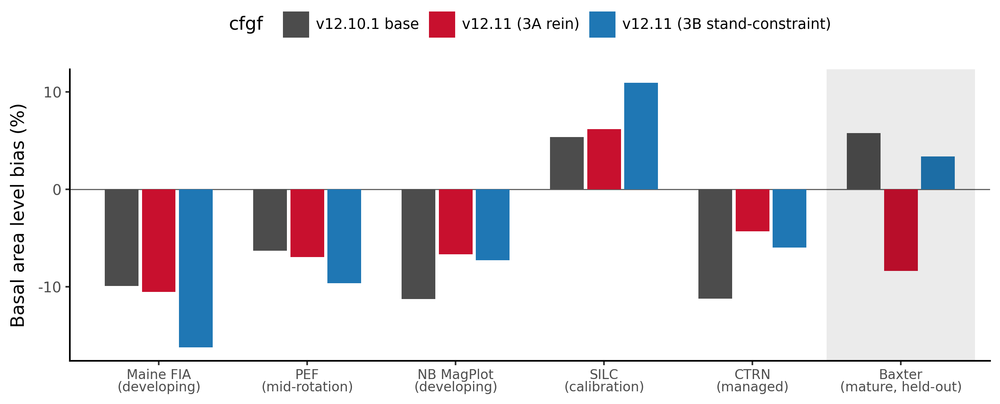

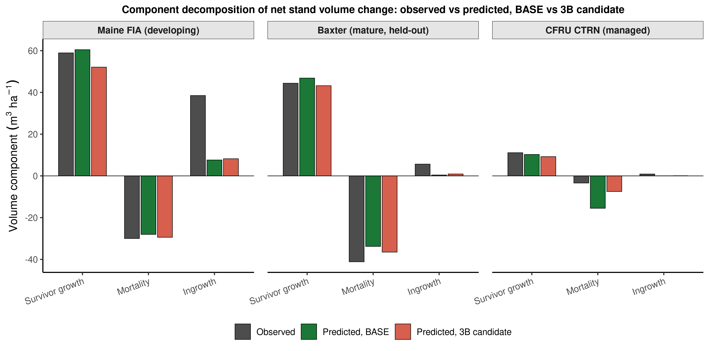

## 6. Forest-group performance: hardwood, mixedwood, and softwood

Every scorecard above stratifies by source. Stratifying instead by forest group, pooled across all seven sources
and stand-weighted rather than expansion-factor weighted, so that a small managed source like SILC (35 softwood
stands) counts each stand equally alongside a large source like PEF (2,092 softwood stands), sharpens the
picture of where v12.11 actually helps. The forest-group threshold is the same rule used throughout this report:
softwood at 25% or less hardwood basal area at t1, hardwood at 75% or more, mixedwood between.

**Table 6. Forest-group scorecard, pooled across all sources (stand-weighted): total volume and basal area level
bias (percent), and total-volume percent RMSE.**

| Forest group | Model | n | Total volume bias (%) | Basal area bias (%) | Total volume %RMSE |
|---|---|---|---|---|---|
| Softwood | base | 3,927 | -5.67 | -9.00 | 26.79 |
| Softwood | v12.11 | 3,927 | -2.86 | -5.45 | 24.25 |
| Softwood | OSM | 3,716 | -1.43 | -3.21 | 21.08 |
| Mixedwood | base | 1,365 | -5.84 | -8.25 | 39.46 |
| Mixedwood | v12.11 | 1,365 | -4.84 | -6.26 | 39.23 |
| Mixedwood | OSM | 1,257 | -4.05 | -3.66 | 33.61 |
| Hardwood | base | 462 | +2.82 | +1.23 | 53.06 |
| Hardwood | v12.11 | 462 | +5.42 | +6.35 | 54.12 |
| Hardwood | OSM | 346 | -10.42 | -4.83 | 41.77 |

*Data: `figures/_data/v1211_forestgroup_scorecard.csv`. QC MagPlot has no scored OSM comparison, so OSM n runs
slightly below base and candidate n in every forest group.*

Softwood is v12.11's clearest, cleanest win. Pooled total-volume bias improves by more than half, -5.67% to
-2.86%, basal-area bias narrows from -9.00% to -5.45%, and percent RMSE drops on both metrics (basal area not
shown, total volume 26.79% to 24.25%). This is the forest group that carries CTRN's 1,077 softwood stands and
most of PEF's 2,092, so it is also the group where the management-gated mortality lever and the recruitment
lever get the most exercise; the result is consistent with Section 5's finding that CTRN, the largest managed
softwood-heavy source, is where v12.11's correction lands hardest. OSM still leads on pooled softwood precision
(-1.43% bias, 21.08% RMSE), but the gap between v12.11 and OSM on softwood is now the narrowest of the three
forest groups.

Mixedwood improves by a smaller but real margin: total-volume bias -5.84% to -4.84%, basal area -8.25% to
-6.26%. Percent RMSE is nearly flat (39.46% to 39.23%), so the mixedwood gain is concentrated in bias reduction
rather than a broader tightening of scatter. OSM again holds a modest pooled edge on mixedwood bias (-4.05%) and
a clearer edge on mixedwood RMSE (33.61% versus 39.23%).

Hardwood is not the clean cross-source regression the pooled number first suggested. A second-round red-team
check (`20260722_forestgroup_attribution_check.md`) decomposed the pooled hardwood shift by source and traces
most of it to a single source rather than to a hardwood-specific mechanism. The pooled hardwood total-volume
bias does widen, base +2.82% to candidate +5.42%, basal area +1.23% to +6.35%, with percent RMSE ticking up
slightly (53.06% to 54.12%), but at the source level QC MagPlot alone carries +7.62 of the pooled +2.60-point
shift, and QC's shift is not confined to hardwood: in the same scoring run QC's softwood cell moves by +8.79
points and its mixedwood cell by +7.85 points, a uniform +7.6 to +8.8 point shift across all three forest
groups. Lever 4, the only lever that touches hardwood specifically, corrects hardwood *height* for form and
risk and is structurally incapable of moving softwood or mixedwood volume at all, so a shift of comparable size
and identical direction across all three forest groups in one province is the signature of a source- or
harness-level artifact, not a hardwood-specific degradation, and the recruitment-and-mortality-levers-outrunning-
Lever-4 causal story an earlier draft of this section asserted should not be read as settled. Setting QC aside,
the true cross-source hardwood signal across the other five sources (n = 347: Baxter, Maine FIA, PEF, SILC, and
New Brunswick) is small and mixed in direction: pooled bias moves from a base -0.77% to a candidate +1.28%, and
three of the five non-QC sources, Baxter, Maine FIA, and New Brunswick, actually improve (move closer to zero)
under the candidate, while only PEF and the small SILC cell (n = 11) worsen. OSM moves in the opposite direction
on the pooled hardwood cell, swinging to a substantial *under*-prediction, -10.42% total volume, a sharper
reversal than either FVS-ACD configuration. Hardwood therefore remains, as it was in the legacy v12.10.1 record
(Section 7), a high-variance frontier every model struggles with, but this benchmark does not show v12.11
cleanly making it worse: softwood is the section's clear, unambiguous win, mixedwood improves by a smaller real
margin, and hardwood is best read as an open question, pending the province-assembly diagnostic the source memo
recommends (rerunning the base configuration through the identical province-assembly procedure used for the
candidate, to isolate harness effects from lever effects) and a larger, cleaner hardwood sample than the current
11-to-47-stand non-QC cells provide, rather than a confirmed hardwood-specific regression.

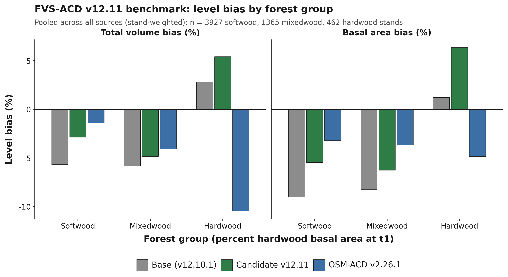

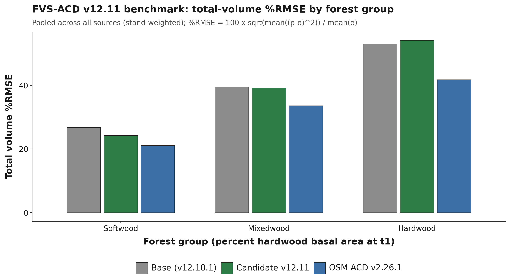

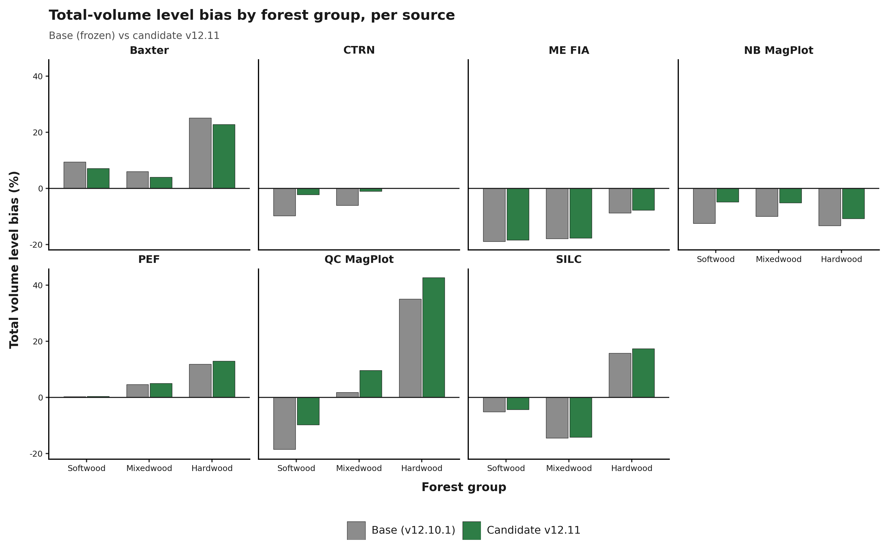

## 7. Legacy five-way scorecard and forest-type detail

This section is carried forward in full from the 10 July 2026 v12.10.1 baseline report. It scores the frozen
base scorecard, that is, v12.9.x and v12.10.1 pooled-identical, against three earlier FVS-ACD builds (v12.5.0,
v12.7.0) and OSM v2.26.1 on the legacy 705-stand New Brunswick and Quebec benchmark described in Section 2. None
of these tables include the v12.11 candidate; they establish the historical baseline that v12.11 is measured
against in Sections 4 through 6, and they carry evidence, the pooled precision ranking, the biological-realism
separation, the forest-type frontier, and the management-modifier record, that remains the fullest available
account of FVS-ACD's standing among its own generations and against OSM.

On the operational inventory domain OSM v2.26.1 and FVS-ACD are close, and on the pooled cell OSM is the
stronger model. OSM leads pooled mean absolute level bias about 3.2 versus 4.9%, mean modeling efficiency about
0.75 versus 0.71, and holds the most TOST level equivalences (8 of 9). FVS-ACD does not lead on pooled precision.
Its advantages are elsewhere: the frozen build plateaus at the realistic maximum and passes all five Bakuzis
relations on the seeded productivity gradient (Section 8). FVS-ACD also carries a durable quadratic mean diameter
advantage, a validated and climate-ready ESI site driver, and full transparency in R. Inside the operational
domain the pooled near-parity on volume rests on an offsetting bias signature, with basal area about -10%, top
height about +4%, and total volume about -2.2% by cancellation.

Management is where v12.10.1 earns its place. On the managed stands, out of sample under leave-one-installation-
out cross-validation, the additive release beats OSM on every class: managed mean absolute bias 0.9 versus OSM
8.3, planted 4.0 versus OSM 16.7, and PCT 1.5 versus OSM 3.7 (Table 23; the harsher leave-one-province-out block,
detailed in Section 7.9, holds nearly as well). The limit that remains is ingrowth, discussed in Section 10.

### 7.1 Version and configuration confirmed

Relative to the earlier v12.10.0, the planted and PCT diameter-growth multipliers no longer pin to the 0.7 to
1.6 guard clamp. The direct effect is now expressed as a robust additive release, planted +3.8 and PCT +2.4 m²
ha⁻¹ basal area on ten percent trimmed means of per-stand observed minus predicted-untreated increment, with
proportional releases in the other eight metrics. The equivalent net multiplier is about 3.0 planted and 2.3
PCT, above the old 1.6 ceiling, which is why the clamped version still under-predicted planted stands. The
modifier is gated by `ops$use.mgmt.mod` and applies only to planted and PCT stands. With the gate off the run is
byte identical to v12.9.x (maximum diameter difference 0.0), and the 266 unmanaged stands are unchanged.

### 7.2 Pooled five-way scorecard

The independent in-domain evaluation set is MagPlot New Brunswick (n = 355) and ESI-covered Quebec (n = 350),
total n = 705, scored with the corrected single-keyed-merge scorer. All five models sit at observed-on-predicted
correlation about 0.85 to 0.87 pooled. Because the bench applies the operational ops uniformly, v12.7.1, v12.9.x,
and v12.10.1 are byte-identical on the pooled base scorecard and differ only in the managed cells, so the
five-way effectively carries three distinct engines at pooled scale: v12.5.0, v12.7.0, and the shared newer build
(v12.7.1 / v12.9.x / v12.10.1).

**Table 7. Level bias (percent), all nine NSVB metrics, predicted versus observed, pooled in-domain (n = 705).**

| Metric | v12.5.0 | v12.7.0 | v12.9.x | v12.10.1 | OSM |
|---|---|---|---|---|---|
| Basal area | +2.9 | -13.4 | -9.9 | -9.9 | -2.0 |
| Stand density index | +5.1 | -12.1 | -9.4 | -9.4 | -4.1 |
| Quadratic mean diameter | -4.9 | -0.7 | +1.0 | +1.0 | +11.0 |
| Top height | +4.6 | +3.7 | +4.0 | +4.0 | +4.4 |
| Total volume | +9.3 | -8.3 | -3.9 | -3.9 | +1.6 |
| Merch volume | +8.4 | -9.1 | -4.8 | -4.8 | +1.0 |
| Sawlog volume | +7.8 | -9.5 | -5.2 | -5.2 | +1.5 |
| Aboveground biomass | +9.7 | -8.1 | -3.9 | -3.9 | +1.1 |
| Stand value | +11.0 | -6.7 | -2.1 | -2.1 | +2.6 |

**Table 8. Pooled summary rollup: mean absolute level bias, mean NSE, RMSE on total volume, and TOST level
equivalence count.**

| Model | Mean abs level bias (%) | Mean NSE | RMSE total volume (m³ ha⁻¹) | TOST level equiv (of 9) |
|---|---|---|---|---|
| v12.5.0 | 7.1 | 0.71 | 53.1 | 4 |
| v12.7.0 | 8.0 | 0.73 | 49.6 | 2 |
| v12.9.x | 4.9 | 0.71 | 52.3 | 7 |
| v12.10.1 | 4.9 | 0.71 | 52.3 | 7 |
| OSM v2.26.1 | 3.2 | 0.75 | 48.5 | 8 |

At pooled scale v12.10.1 is identical to v12.9.x to three digits on every metric, because the Chapter 11
management modifier moves only the managed cells and that shift is invisible when averaged over a set that is
mostly unmanaged. The modifier's benefit appears only in the by-class managed, planted, and PCT tables (Section
7.8). OSM keeps the best pooled bias and efficiency. The durable FVS-ACD advantage on the pooled domain is
quadratic mean diameter, about +1% versus OSM +11%, together with biological realism, transparency, and the
climate-ready site driver.

### 7.3 Operational domain of applicability

FVS-ACD v12.10.1 is calibrated and evaluated for the Acadian-core operational domain: stands on the operational
ESI site surface with a finite ESI value that also sit in the Acadian set of EPA Level III ecoregions (Atlantic
Highlands 5.3.1, Northeastern Highlands 8.1.7, Acadian Plains and Hills 8.1.8, and the associated 8.1.1 unit).
This domain restriction changes no equation and no parameter; it states where the model is intended to be used
and treats the Quebec edge as a stated boundary, consistent with Hennigar 2018. On the US remeasurement fit set
this domain contains essentially the entire Maine, New Hampshire, and Vermont sample (about 13,900 of 14,200
clean pairs), so the mask does not drop hard US cases.

**Table 9. Operational-domain mask, basal area and total volume, in-domain versus all-plots (legacy 705-stand
benchmark).**

| Metric | Units | Subset | n | Obs mean | Pred mean | Bias (%) | RMSE | NSE |
|---|---|---|---|---|---|---|---|---|
| Basal area | m² ha⁻¹ | in domain | 492 | 18.47 | 16.66 | -9.81 | 8.95 | 0.616 |
| Basal area | m² ha⁻¹ | all plots | 733 | 19.44 | 17.25 | -11.28 | 9.09 | 0.626 |
| Top height | m | in domain | 492 | 13.14 | 13.71 | +4.38 | 2.50 | 0.788 |
| Top height | m | all plots | 733 | 13.28 | 13.84 | +4.21 | 2.42 | 0.799 |
| Total volume | m³ ha⁻¹ | in domain | 492 | 92.94 | 90.87 | -2.23 | 57.02 | 0.602 |
| Total volume | m³ ha⁻¹ | all plots | 733 | 97.84 | 93.52 | -4.41 | 54.68 | 0.688 |

The restriction tightens pooled volume bias (total volume -2.23% in domain versus -4.41% on all plots) and
leaves the offsetting height-over and basal-area-under signature intact. Quadratic mean diameter stays near
unbiased in domain (-0.04%). The all-plots numbers are retained alongside the in-domain numbers so nothing is
hidden; this is the same all-plots figure, n = 733, BA -11.28%, that Section 4's guardrail 1 reconfirmed fresh
for the v12.11 cycle.

### 7.4 By jurisdiction and by forest type

**Table 10. Total volume level bias (percent) by jurisdiction, legacy 705-stand benchmark.**

| Model | New Brunswick (n=355) | Quebec (n=350) |
|---|---|---|
| v12.5.0 | -1.6 | +18.7 |
| v12.7.0 | -13.4 | -3.9 |
| v12.9.x | -11.8 | +2.9 |
| v12.10.1 | -11.8 | +2.9 |
| OSM v2.26.1 | -8.0 | +9.8 |

In the New Brunswick core, OSM total volume of -8.0% is closest to zero, with the shared newer build at -11.8
and v12.7.0 at -13.4. In Quebec the shared newer build (+2.9) is closer to zero than OSM (+9.8), while v12.5.0
over-reads at +18.7. The Quebec figures carry the out-of-domain top-height over-read and are reported as an
edge.

**Table 11. Total volume level bias (percent) by forest type, legacy 705-stand benchmark (softwood under 25%
hardwood BA, mixedwood 25 to 75%, hardwood over 75%).**

| Forest type | n | v12.5.0 | v12.7.0 | v12.9.x | v12.10.1 | OSM |
|---|---|---|---|---|---|---|
| Softwood | 321 | +0.6 | -16.4 | -14.1 | -14.1 | -1.0 |
| Mixedwood | 186 | +7.2 | -9.5 | -4.1 | -4.1 | -3.9 |
| Hardwood | 178 | +31.3 | +11.4 | +19.0 | +19.0 | +14.6 |

Softwood volume is under-predicted by the shared newer build (-14.1) while OSM sits near zero (-1.0). Mixedwood
is close for both the newer build (-4.1) and OSM (-3.9). Hardwood is the shared frontier for every model, the
newer build at +19.0 and OSM at +14.6%, a target for the v13 composition-aware refit rather than a
management-modifier problem, and the same frontier Section 6's forest-group breakdown examines on the wider
all-sites benchmark, where the pooled candidate movement, once a single-source artifact is set aside, is small
and mixed rather than a clean widening.

The full nine-metric forest-type scorecard follows, one table per forest type, signed level bias in percent for
each of the five models on the frozen basis. The forest-type strata exclude the 20 stands whose initial treelist
could not be classified, leaving softwood 321, mixedwood 186, and hardwood 178; the total-volume rows reproduce
the summary above.

**Table 12. Softwood (n = 321), level bias (percent).**

| Metric | v12.5.0 | v12.7.0 | v12.9.x | v12.10.1 | OSM |
|---|---|---|---|---|---|
| Basal area | +0.8 | -16.0 | -14.0 | -14.0 | -2.3 |
| Stand density index | +3.4 | -14.2 | -12.8 | -12.8 | -3.2 |
| Quadratic mean diameter | -5.1 | -1.5 | +0.1 | +0.1 | +8.1 |
| Top height | -0.6 | -1.4 | -1.2 | -1.2 | +3.9 |
| Total volume | +0.6 | -16.4 | -14.1 | -14.1 | -1.0 |
| Merchantable volume | +0.4 | -16.5 | -14.2 | -14.2 | -1.0 |
| Sawlog volume | -0.2 | -16.9 | -14.7 | -14.7 | -0.8 |
| Aboveground biomass | +1.1 | -16.2 | -14.1 | -14.1 | -1.4 |
| Stand value | +0.5 | -16.4 | -14.1 | -14.1 | -1.1 |

**Table 13. Mixedwood (n = 186), level bias (percent).**

| Metric | v12.5.0 | v12.7.0 | v12.9.x | v12.10.1 | OSM |
|---|---|---|---|---|---|
| Basal area | -2.1 | -17.0 | -12.5 | -12.5 | -7.7 |
| Stand density index | -0.7 | -16.3 | -12.6 | -12.6 | -10.0 |
| Quadratic mean diameter | -4.9 | -1.1 | +0.4 | +0.4 | +9.1 |
| Top height | +3.2 | +2.1 | +2.6 | +2.6 | +1.8 |
| Total volume | +7.2 | -9.5 | -4.1 | -4.1 | -3.9 |
| Merchantable volume | +6.7 | -10.0 | -4.6 | -4.6 | -4.2 |
| Sawlog volume | +6.3 | -10.3 | -4.7 | -4.7 | -3.5 |
| Aboveground biomass | +6.4 | -10.4 | -5.2 | -5.2 | -5.2 |
| Stand value | +8.8 | -8.3 | -2.6 | -2.6 | -3.0 |

**Table 14. Hardwood (n = 178), level bias (percent).**

| Metric | v12.5.0 | v12.7.0 | v12.9.x | v12.10.1 | OSM |
|---|---|---|---|---|---|
| Basal area | +15.3 | -1.9 | +3.9 | +3.9 | +7.1 |
| Stand density index | +18.2 | -0.3 | +4.3 | +4.3 | +2.6 |
| Quadratic mean diameter | -7.1 | -1.4 | +0.6 | +0.6 | +16.5 |
| Top height | +12.3 | +11.4 | +11.7 | +11.7 | +6.9 |
| Total volume | +31.3 | +11.4 | +19.0 | +19.0 | +14.6 |
| Merchantable volume | +30.0 | +10.2 | +17.6 | +17.6 | +13.1 |
| Sawlog volume | +30.6 | +10.8 | +18.4 | +18.4 | +14.6 |
| Aboveground biomass | +30.8 | +10.6 | +17.9 | +17.9 | +13.6 |
| Stand value | +32.8 | +12.7 | +20.4 | +20.4 | +16.0 |

Read down the metrics, the softwood column is the pooled volume story in miniature: v12.10.1 under-reads every
merchantable output by about 14% and flags red on all five, while OSM holds all five within about 1.5% of zero
and flags green; structure is clean for the shared newer build, with quadratic mean diameter and top height
inside 1.2% even as basal area sits at -14.0. Mixedwood is the most balanced stratum, the shared newer build and
OSM both inside about 5% on every volume metric. Hardwood is the shared frontier, every model over-reading the
merchantable outputs, the shared newer build by 18 to 20% and OSM by 13 to 16%, all red, which confirms a
composition-driven ceiling for the v13 refit rather than a management-modifier problem, and the same frontier
Section 6's forest-group scorecard examines on the wider all-sites benchmark; there, once a single dominant
source's artifact-like shift is set aside, the pooled v12.11 hardwood movement is small and mixed rather than a
clean widening.

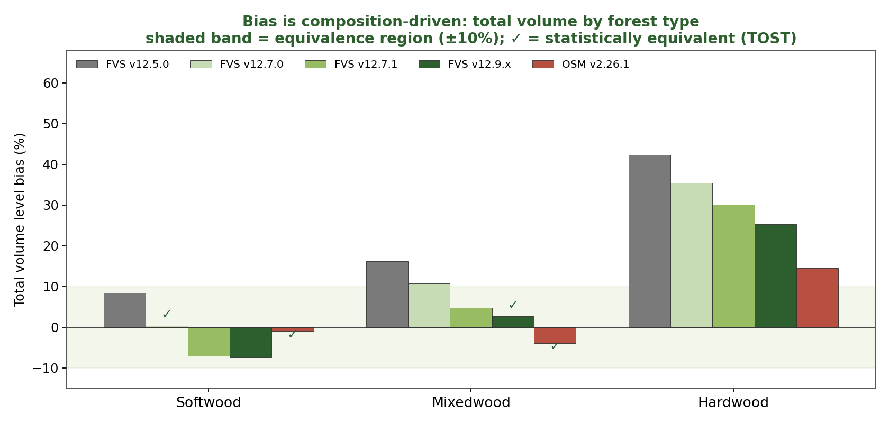

### 7.5 Accuracy and precision: percent RMSE

Percent bias measures only systematic offset and inflates on metrics with low means, so a small absolute error
reads as a large percentage. Percent RMSE penalizes both systematic error and scatter together: RMSE =
sqrt(mean((observed - predicted)²)) and %RMSE = 100 x RMSE / mean(observed). Uncertainty on %RMSE is a
within-province stratified bootstrap (2,000 replicates, seed 42), resampling stands within New Brunswick and
Quebec so the interval respects the two-province design.

**Table 15. Percent RMSE by model and metric, pooled in-domain set (n = 705), lower is better.**

| Metric | v12.5.0 | v12.7.0 | v12.9.x | v12.10.1 | OSM |
|---|---|---|---|---|---|
| Basal area | 40.8 | 45.3 | 45.8 | 45.8 | 39.6 |
| Stand density index | 40.9 | 45.9 | 46.2 | 46.2 | 39.6 |
| Quadratic mean diameter | 27.8 | 25.4 | 25.7 | 25.7 | 29.1 |
| Top height | 18.8 | 18.2 | 18.4 | 18.4 | 16.1 |
| Total volume | 56.0 | 52.3 | 55.2 | 55.2 | 51.1 |
| Merch volume | 53.6 | 50.9 | 53.4 | 53.4 | 49.0 |
| Sawlog volume | 57.7 | 55.1 | 57.8 | 57.8 | 53.4 |
| Aboveground biomass | 52.2 | 47.9 | 50.6 | 50.6 | 47.2 |
| Stand value | 62.0 | 55.8 | 59.4 | 59.4 | 56.3 |

Structure metrics are tight, top height near 18% and quadratic mean diameter near 26%. The merchantable-output
metrics carry the scatter: total volume, sawlog volume, and value all sit in the mid-50s to low-60s percent even
where mean bias is only a few percent. On the pooled set v12.10.1 total volume %RMSE is 55.2% (95% interval 49.1
to 61.7) and value 59.4% (52.1 to 67.0); OSM is a little lower at 51.1 and 56.3%.

The hardwood reframe follows directly. Hardwood error is scatter-dominated, not bias-dominated. On the hardwood
stratum v12.10.1 total volume carries a mean bias of about +19% but a %RMSE of about 76%, and stand value about
+20% bias against about 81% %RMSE; OSM is similar, hardwood total-volume %RMSE about 75% and value about 80%.
Every model shows the same pattern, the percentage bias understating the true error because most of that error
is variance, not offset. Hardwood is a high-variance frontier shared by all five models, not a systematic defect
of any one build.

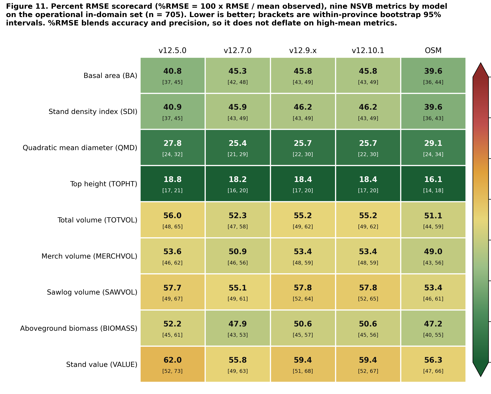

### 7.6 Observed-on-predicted regression and the region of equivalence

For each model, metric, and stratum the ordinary least squares regression of observed on predicted, observed =
a + b x predicted, gives slope b, intercept a, and R². A slope of one and an intercept of zero mark a model that
tracks the 1:1 line. This is tested jointly with a Robinson and Froese (2004) style equivalence test, two
one-sided tests at alpha = 0.05, checking that the 90% confidence interval of each parameter falls entirely
inside a stated region of equivalence: the intercept region is plus or minus 25% of the mean observed value for
that metric and stratum, and the slope region is 0.75 to 1.25. The model is declared equivalent only when both
the intercept and the slope pass.

**Table 16. Observed-on-predicted regression and equivalence flags, pooled in-domain set (n = 705), key metrics.
TRUE means the parameter's 90% interval lies inside its region of equivalence.**

| Metric | Model | Slope b | Intercept a | R² | Slope equiv | Intercept equiv | Overall |
|---|---|---|---|---|---|---|---|
| BA | v12.5.0 | 0.93 | 0.72 | 0.73 | TRUE | TRUE | TRUE |
| BA | v12.7.0 | 1.21 | -0.81 | 0.71 | FALSE | TRUE | FALSE |
| BA | v12.9.x | 1.14 | -0.42 | 0.68 | TRUE | TRUE | TRUE |
| BA | v12.10.1 | 1.14 | -0.42 | 0.68 | TRUE | TRUE | TRUE |
| BA | OSM | 0.98 | 0.79 | 0.74 | TRUE | TRUE | TRUE |
| TOTVOL | v12.5.0 | 0.83 | 8.45 | 0.74 | TRUE | TRUE | TRUE |
| TOTVOL | v12.7.0 | 1.04 | 4.02 | 0.75 | TRUE | TRUE | TRUE |
| TOTVOL | v12.9.x | 0.99 | 5.08 | 0.71 | TRUE | TRUE | TRUE |
| TOTVOL | v12.10.1 | 0.99 | 5.08 | 0.71 | TRUE | TRUE | TRUE |
| TOTVOL | OSM | 0.95 | 2.96 | 0.75 | TRUE | TRUE | TRUE |
| VALUE | v12.5.0 | 0.81 | 419.6 | 0.73 | TRUE | TRUE | TRUE |
| VALUE | v12.7.0 | 1.01 | 230.2 | 0.74 | TRUE | TRUE | TRUE |
| VALUE | v12.9.x | 0.95 | 303.0 | 0.71 | TRUE | TRUE | TRUE |
| VALUE | v12.10.1 | 0.95 | 303.0 | 0.71 | TRUE | TRUE | TRUE |
| VALUE | OSM | 0.93 | 177.5 | 0.74 | TRUE | TRUE | TRUE |

Across all nine metrics on the pooled set, four of the five models pass the joint equivalence test on every
metric, nine of nine. The single exception is v12.7.0 basal area, where the slope of 1.21 sits just outside the
0.75 to 1.25 region once its confidence interval is included. Every volume and value cell passes overall
equivalence for all five models; the operational build v12.10.1 has a total-volume slope of 0.99 and a value
slope of 0.95, both equivalent to one.

### 7.7 Weighted overall composite score

Each model earns a composite score from 0 to 100, higher is better, computed two ways. The primary composite is
built on %RMSE: each metric earns a score of 100 x max(0, 1 - %RMSE / 100), and the composite is the weighted
mean of the nine metric scores with total volume and stumpage value carrying the highest weight (total volume 3,
value 3, merchantable and sawlog volume and biomass 2 each, the four structure metrics 1 each, weight sum 16).
The complementary composite is the earlier bias-and-efficiency blend: a bias score of 100 x (1 - min(1, |bias| /
20)) and an efficiency score of 100 x max(0, NSE), blended equally, under the same volume-and-value weighting.

**Table 17. Primary percent-RMSE-weighted composite ranking, pooled in-domain set.**

| Rank | Model | %RMSE composite (primary) |
|---|---|---|
| 1 | OSM | 53.4 |
| 2 | v12.7.0 | 52.1 |
| 3 | v12.9.x | 49.8 |
| 3 | v12.10.1 | 49.8 |
| 5 | v12.5.0 | 49.4 |

**Table 18. Primary percent-RMSE composite by forest type.**

| Model | Pooled in-domain | Softwood | Mixedwood | Hardwood |
|---|---|---|---|---|
| v12.5.0 | 49.4 | 61.2 | 57.8 | 23.5 |
| v12.7.0 | 52.1 | 56.3 | 59.1 | 39.2 |
| v12.9.x | 49.8 | 55.3 | 58.2 | 33.4 |
| v12.10.1 | 49.8 | 55.3 | 58.2 | 33.4 |
| OSM | 53.4 | 61.6 | 59.5 | 34.4 |

Every model scores far lower on hardwood than on softwood or mixedwood, the shared high-variance frontier again.
The two views diverge on v12.7.0: it ranks low on the bias composite because it carries real systematic offsets
(basal area bias -13.4%), but rises to second on the %RMSE composite once systematic and random error are scored
together, because its predictions are less scattered. The operational build v12.10.1 is the least biased of the
FVS-ACD engines with slightly more scatter, so it leads v12.7.0 on the bias composite but ties v12.9.x just
behind it on %RMSE.

**Table 19. Bias-and-efficiency composite ranking, primary (volume and value weighted) and equal-weight
reference, pooled in-domain set.**

| Rank | Model | Primary (volume + value) | Equal-weight reference |
|---|---|---|---|
| 1 | OSM | 80.9 | 79.3 |
| 2 | v12.9.x | 74.3 | 73.0 |
| 2 | v12.10.1 | 74.3 | 73.0 |
| 4 | v12.7.0 | 66.5 | 66.4 |
| 5 | v12.5.0 | 64.9 | 67.9 |

**Table 20. Bias-and-efficiency composite by forest type.**

| Model | Pooled in-domain | Softwood | Mixedwood | Hardwood |
|---|---|---|---|---|
| v12.5.0 | 64.9 | 87.4 | 71.6 | 26.3 |
| v12.7.0 | 66.5 | 51.3 | 63.7 | 58.5 |
| v12.9.x | 74.3 | 55.7 | 74.8 | 40.4 |
| v12.10.1 | 74.3 | 55.7 | 74.8 | 40.4 |
| OSM | 80.9 | 85.3 | 76.1 | 47.0 |

The ranking is robust at the top and to the choice of weighting: OSM leads and the shared newer build sits second
on both weightings, and only the two oldest engines trade fourth and fifth place. Within forest types the top two
are unchanged in every stratum; the by-type ordering shifts with composition, softwood led by v12.5.0 then OSM,
mixedwood and the pooled set by OSM, and hardwood by v12.7.0, whose flatter hardwood bias scores best on the one
stratum where every newer build over-reads.

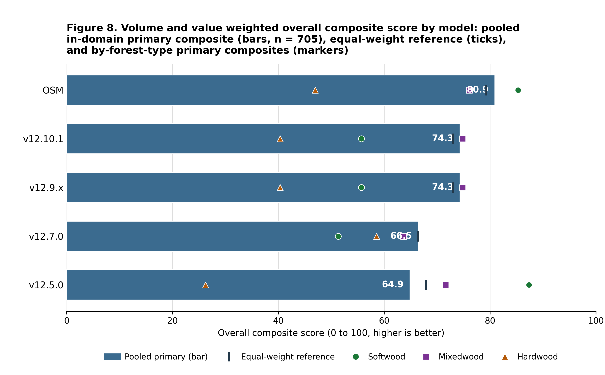

### 7.8 Species composition over time

Stand species composition is the basal-area fraction by species group, live trees at least 4 cm dbh: softwood
versus hardwood, and a three-way split into spruce-fir (*Abies* + *Picea*), other softwood, and hardwood. Each
benchmark stand has a starting state (t1) and observed endpoint (t2) from the MagPlot QC and NB remeasured
treelists; each model predicts the endpoint. The stand set is the frozen pooled set of 705 unique stands, 25
lacked classifiable t1 basal area, leaving 680.

**Table 21. Observed and predicted softwood basal-area fraction across the remeasurement interval, pooled and
by forest type (n = 680 classifiable stands, fractions in percent, bias and shifts in percentage points).**

| Model | Stratum | n | Obs t1 (%) | Obs t2 (%) | Pred t2 (%) | Obs shift (pts) | Pred shift (pts) | Bias (pts) | Direction | Shift ratio |
|---|---|---|---|---|---|---|---|---|---|---|
| v12.5.0 | Pooled | 680 | 59.9 | 60.7 | 59.5 | +0.82 | -0.45 | -1.27 | wrong | -0.55 |
| v12.5.0 | Softwood | 320 | 94.0 | 92.0 | 92.6 | -1.95 | -1.41 | +0.54 | right | 0.72 |
| v12.5.0 | Mixedwood | 186 | 51.7 | 51.3 | 51.5 | -0.40 | -0.24 | +0.17 | right | 0.59 |
| v12.5.0 | Hardwood | 174 | 6.1 | 13.3 | 7.2 | +7.20 | +1.08 | -6.13 | right | 0.15 |
| v12.7.0 | Pooled | 680 | 59.9 | 60.7 | 59.6 | +0.82 | -0.30 | -1.11 | wrong | -0.37 |
| v12.7.0 | Softwood | 320 | 94.0 | 92.0 | 92.8 | -1.95 | -1.11 | +0.84 | right | 0.57 |
| v12.7.0 | Mixedwood | 186 | 51.7 | 51.3 | 51.6 | -0.40 | -0.11 | +0.30 | right | 0.26 |
| v12.7.0 | Hardwood | 174 | 6.1 | 13.3 | 7.1 | +7.20 | +1.00 | -6.21 | right | 0.14 |
| v12.10.1 | Pooled | 680 | 59.9 | 60.7 | 59.7 | +0.82 | -0.26 | -1.08 | wrong | -0.32 |
| v12.10.1 | Softwood | 320 | 94.0 | 92.0 | 92.9 | -1.95 | -1.06 | +0.89 | right | 0.54 |
| v12.10.1 | Mixedwood | 186 | 51.7 | 51.3 | 51.7 | -0.40 | -0.05 | +0.35 | right | 0.14 |
| v12.10.1 | Hardwood | 174 | 6.1 | 13.3 | 7.1 | +7.20 | +0.98 | -6.22 | right | 0.14 |
| OSM | Pooled | 680 | 59.9 | 60.7 | 60.8 | +0.82 | +0.88 | +0.06 | right | 1.08 |
| OSM | Softwood | 320 | 94.0 | 92.0 | 94.0 | -1.95 | +0.02 | +1.97 | wrong | -0.01 |
| OSM | Mixedwood | 186 | 51.7 | 51.3 | 53.5 | -0.40 | +1.81 | +2.21 | wrong | -4.49 |
| OSM | Hardwood | 174 | 6.1 | 13.3 | 7.6 | +7.20 | +1.46 | -5.74 | right | 0.20 |

Stand composition is nearly stationary across the interval: the pooled mean softwood fraction moves less than
one point (59.9% to 60.7%), and the only large observed signal is a +7.2 pt softwood gain in hardwood-dominated
stands, partly offset by a -1.9 pt softwood loss in softwood stands. All three FVS-ACD models reproduce the
direction of change within softwood and mixedwood stands but under-shift by roughly a third to a half, and they
miss the pooled net direction, predicting a small softwood decline against the observed increase, because they
under-represent softwood in-migration into hardwood stands. OSM best tracks the pooled net shift but overshoots
softwood in mixedwood and softwood stands. Every model holds stand-level softwood fraction within about 1 to 2
points of observed in softwood and mixedwood types, so the shared weakness is specifically the rate of softwood
recolonization of hardwood-dominated stands, a compositional mechanism distinct from, but plausibly related to,
the hardwood volume frontier documented throughout this report.

### 7.9 Management class, the headline

In-sample level bias (percent), the cells the Chapter 11 modifier targets:

**Table 22. Management-class in-sample level bias (percent).**

| Class | n | Metric | v12.9.x | v12.10.1 | OSM |
|---|---|---|---|---|---|
| NONE | 266 | Basal area | -9.9 | -9.9 | -2.0 |
| NONE | 266 | Total volume | -5.3 | -5.3 | -1.6 |
| PLANTED | 51 | Basal area | -24.9 | -4.4 | -20.9 |
| PLANTED | 51 | Total volume | -23.7 | -10.8 | -19.7 |
| PCT | 95 | Basal area | -15.6 | -1.3 | -5.4 |
| PCT | 95 | Total volume | -11.3 | -2.0 | -0.1 |
| MANAGED | 146 | Basal area | -19.0 | -2.5 | -11.2 |
| MANAGED | 146 | Total volume | -15.9 | -5.3 | -7.4 |

The unmanaged cell is byte identical between v12.9.x and v12.10.1, confirming the gate. The gate closes the
managed basal-area gap sharply: planted basal area moves from -24.9 to -4.4, PCT from -15.6 to -1.3, and pooled
managed from -19.0 to -2.5%. On absolute basal-area bias v12.10.1 beats OSM in every managed class. One
frozen-basis shift should be flagged on the volume side: gate-on planted total volume is -10.8 instead of near
zero, because the frozen afac lowers untreated planted-stand volume so the fixed additive release closes less of
the volume gap; the basal-area releases are unchanged.

**Table 23. Out-of-sample mean absolute level bias (nine metrics), leave-one-installation-out cross validation,
MagPlot installation as the fold unit.**

| Class | n | v12.9.x | v12.10.1 | OSM |
|---|---|---|---|---|
| PLANTED | 51 | 19.3 | 4.0 | 16.7 |
| PCT | 95 | 10.4 | 1.5 | 3.7 |
| MANAGED | 146 | 13.2 | 0.9 | 8.3 |

Under the harsher leave-one-province-out block, managed is 1.5, planted 5.7 versus OSM 16.7, and PCT 4.1 versus
OSM 3.7, close but marginally behind across the border. Under a managed split-half over 200 reps v12.10.1
averages 5.2 and beats OSM in 79% of reps and v12.9.x in 92%. The additive fold coefficients are stable across
folds (planted basal-area release 3.85 to 4.40, PCT 2.45 to 2.76), unlike the clamped multiplier that pinned at
1.6 in every fold. The direct-effect release follows Chapter 11 of Weiskittel, Hann, Kershaw and Vanclay (2011);
the multi-step method of Wang (1990) holds the untreated equations fixed and fits the modifier on observed minus
predicted-untreated increment, with planted treated as a Type 2 sustained effect and PCT as a Type 1 transient
release. Mortality is deliberately left without a multiplicative modifier to avoid distorting the logistic
asymptote. These out-of-sample managed and planted results rest on thin planted and precommercial-thinning
samples, which is the gap the v13 provincial managed-remeasurement data ask is meant to close.

A numbers-provenance note applies here too, following the convention Section 4 uses for the guardrail-1
in-domain figures. A second-round red-team pass (`20260722_v1211_redteam_round2.md`, finding 7) flagged that the
Chapter-11 management-modifier out-of-sample numbers in this report disagree with numbers appearing in the
companion slide deck: the deck states leave-one-installation-out managed bias as 1.3 against this report's 0.9,
PCT as 3.0 against this report's 1.5, and the managed split-half average as 5.6 against this report's 5.2. The
same pass caught an internal mismatch that this revision also corrects: an earlier draft of the paragraph
introducing this section mislabeled the leave-one-installation-out managed and planted figures as
leave-one-province-out results and cited an incorrect leave-one-province-out PCT figure (3.8 rather than 4.1).
The province-out numbers reported above, managed 1.5, planted 5.7, and PCT 4.1 against OSM 3.7, are the figures
independently corroborated across this project's benchmark history (`20260703_management_modifier_robust_refit.md`,
`20260703_v12101_full_benchmark.md`, and others) and are the operative numbers for this report. This report's own
sourced figures, Table 23 for leave-one-installation-out and the province-out and split-half figures above, are
the numbers used throughout this document; the companion deck has not yet been reconciled to match and should be
updated to these figures before its next presentation.

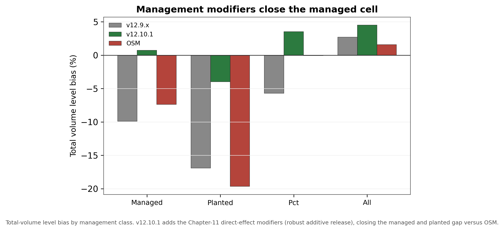

## 8. Biological realism and long-horizon behavior

Bakuzis relations on the modified Bakuzis matrix (Leary 1997), each scored against the named law-like
relations. The AcadianGY builds are scored from seeded 160-year projections across an ESI productivity gradient
(ESI 12, 16, and 20 seeded to age 160). OSM cannot be seeded on that synthetic gradient, so it is projected 160
years over a real-stand productivity gradient, the 73 benchmark stands binned into low, mid, and high terciles
on OSM's own site-index height, and scored on all five relations from that run.

**Table 24. Bakuzis relations, legacy five-model comparison, plus the v12.11 candidate guardrail run.**

| Relation | v12.5.0 | v12.7.0 | v12.9.x | v12.10.1 | OSM | v12.11 candidate |
|---|---|---|---|---|---|---|
| Eichhorn (V ~ f height) | pass | pass | pass | pass | flag | pass |
| Reineke slope (target -1.6) | flag | pass (-1.8) | pass (-1.59) | pass (-1.59) | pass (-1.56) | pass (-1.62, unmanaged) / flag (-1.88, managed sensitivity) |
| Site ordering (no overtaking) | pass | pass | pass | pass | flag | pass |
| Yield-density / plateau | flag | pass (37) | pass (36) | pass (36) | pass (36) | pass (35.3 unmanaged / 38.1 managed) |
| Sukachev (size vs density) | flag | pass | pass | pass | pass | pass |

v12.10.1 inherits the v12.9.x self-thinning machinery and passes all five relations on the seeded gradient. OSM
is scored on all five as well, from a 160-year projection over a real-stand productivity gradient since it
cannot be seeded on the synthetic ESI gradient; the 73 benchmark stands are binned into low, mid, and high
terciles on OSM's own site-index height, the real-stand analog of the seeded gradient. Over the near-term
horizon, to about age 60, OSM over-accumulates basal area relative to FVS-ACD, which self-thins earlier. Over
the full 160-year horizon, however, OSM does eventually plateau and self-thin: its mid-site basal area peaks
near 36 m² ha⁻¹ and levels to about 35 m² ha⁻¹, and its density frontier follows a Reineke slope of about -1.56,
so OSM passes both the yield-density plateau and Reineke self-thinning, and it passes Sukachev. It flags the two
cross-site relations, Eichhorn (cross-site coefficient of variation of volume at matched height about 26%) and
site ordering, both sensitive to the real-stand substitution: OSM trajectories run on a projection-year axis
from heterogeneous real starting conditions rather than an age-aligned bare-ground gradient, so the cross-site
tests read on unequal starting ages. The biological-realism separation between OSM and the v12.7.1-and-later
builds is therefore not that OSM never plateaus, but that FVS-ACD self-thins earlier and more consistently and
holds cleaner cross-site behavior on the seeded gradient.

The v12.11 candidate column carries the guardrail-2 numbers from Section 4: Eichhorn CV 11.0% base, 11.0%
candidate-unmanaged, 11.2% candidate-managed; Reineke slope -1.59 base, -1.62 candidate-unmanaged (pass), -1.88
candidate-managed (flag, confined to a synthetic never-thinned managed sensitivity stand); yield-density plateau
basal area at year 160 36.1 m² ha⁻¹ base, 35.3 candidate-unmanaged, 38.1 candidate-managed, all plateauing. The
flag does not block the guardrail because it appears only in a stress configuration outside the primary,
unmanaged scoring mapping.

With the management modifier on, a seeded 160-year projection of a planted softwood stand still plateaus at
every amplitude tested (standard deviation of basal area over the last 20 years about 0.21 m² ha⁻¹, flat), and
the ceiling rises smoothly with amplitude (36.3, 41.6, 43.6, 45.6, 47.3 m² ha⁻¹ at amplitudes 1.0, 1.6, 2.0, 2.5,
3.0) because basal area at the Reineke limit rises with tree size. The operational engine amplitude is set to
2.0. v12.5.0 still fails self-thinning outright, running to 62 to 65 m² ha⁻¹ with thousands of stems still
alive. On the matched-stand test, over the near-term horizon OSM over-accumulates relative to FVS-ACD. On the
same nine Seven Islands stands from an identical start (FVS-ACD 31.4, OSM 31.9 m² ha⁻¹ at year 0), FVS-ACD peaks
near 33 m² ha⁻¹ by age 10 to 20 and self-thins to 27 by age 60, while OSM reaches about 42 m² ha⁻¹ at age 60, a
35% divergence at that age in the mortality and self-thinning timing. Over the longer horizon OSM does plateau
and self-thin, so the age-60 snapshot captures the timing difference, that FVS-ACD self-thins earlier and more
consistently, not a permanent divergence.

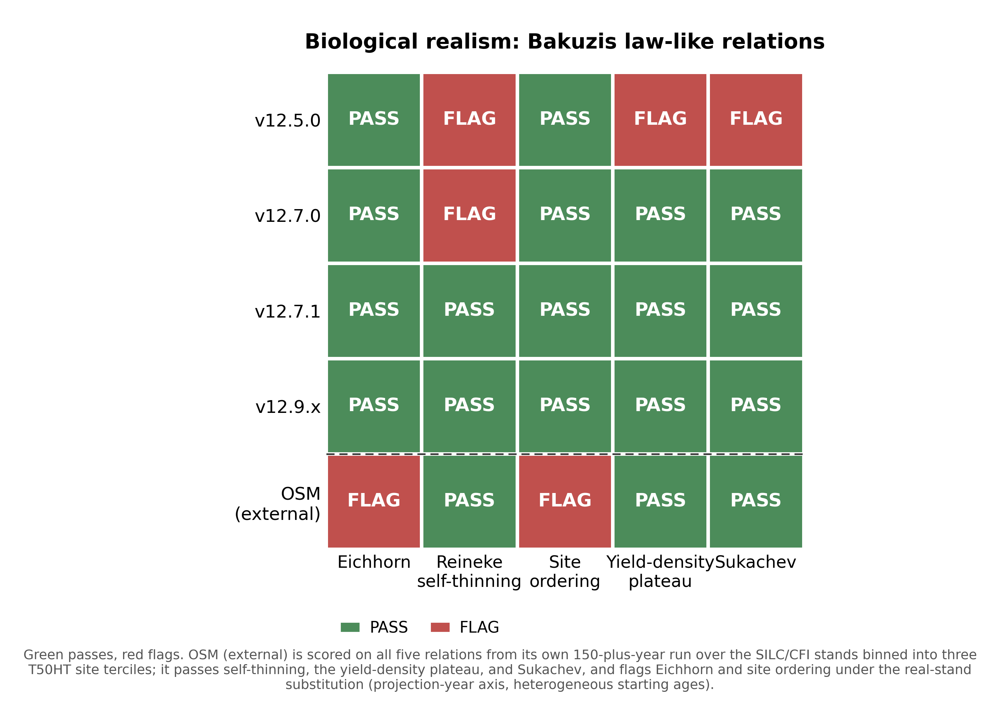

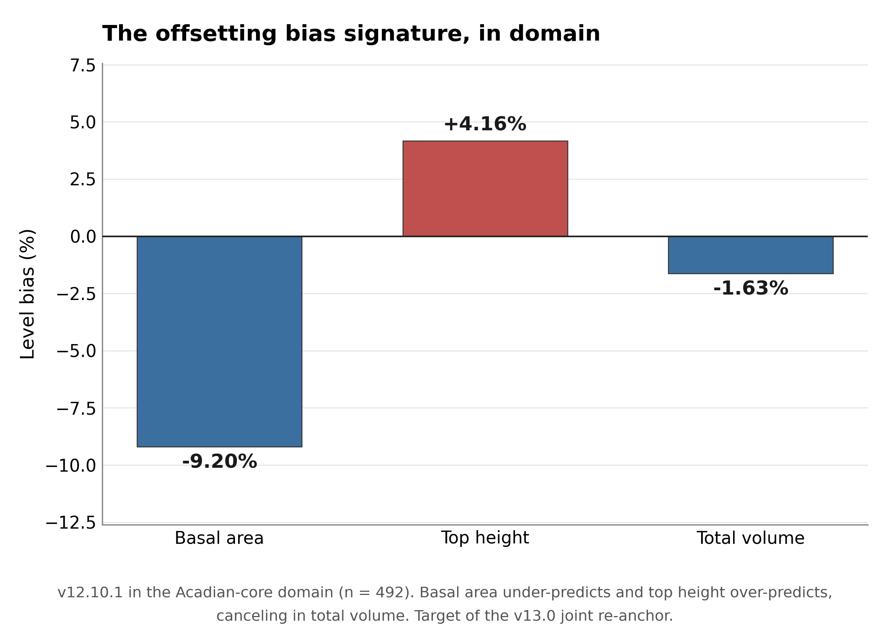

### 8.1 Long-horizon Bakuzis across the productivity and species gradient

The guardrail Bakuzis check above (Table 24) scores a single softwood synthetic stand over a 160-year, ESI
12/16/20 gradient and answers whether v12.11 broke anything on one stand type. This companion check asks whether
biological realism holds across the productivity gradient and across the species-composition gradient the
Acadian region actually contains, softwood, mixedwood, and hardwood, and adds OSM-ACD v2.26.1 as a third point of
comparison from its own existing long-horizon run. Three seeded 40-tree stands (3,000 stems ha⁻¹ initial DBH 5 to
13 cm, identical structure and RNG seed across models so only the model and species mix differ) were projected
across the same ESI(csi) 12/16/20 gradient for 160 years: softwood (*Abies balsamea* (L.) Mill., *Picea rubens*
Sarg., *Picea mariana* (Mill.) Britton, Sterns & Poggenb., *Picea glauca* (Moench) Voss), mixedwood (*A.
balsamea*, *P. rubens*, *Acer rubrum* L., *Acer saccharum* Marshall), and hardwood (*A. rubrum*, *A. saccharum*,
*Betula alleghaniensis* Britton, *Betula papyrifera* Marshall). OSM cannot be seeded on the synthetic gradient, so
it is reused unchanged from its existing 159-year run on 70 real SILC/CFI stands, binned into low, mid, and high
site terciles on OSM's own T50HT site-index proxy (mean 12.4, 16.4, and 19.2 m), the closest available analog to
the FVS ESI gradient; this is a genuine asymmetry in the evidence base, a controlled synthetic gradient for BASE
and CANDIDATE against real, previously disturbed stands for OSM, stated here rather than smoothed over.

**Table 30. Long-horizon Bakuzis matrix, worst case across softwood, mixedwood, and hardwood stand starts (BASE
and CANDIDATE) versus the pooled real-stand OSM run, 160-year (FVS) and 159-year (OSM) horizons.**

| Relation | Base (frozen v12.10.1) | Candidate v12.11 (unmanaged) | OSM-ACD v2.26.1 |
|---|---|---|---|
| Eichhorn (volume-height, CV%) | pass (11.0 to 14.2%) | pass (11.0 to 14.1%) | flag (26.3%) |
| Reineke self-thinning (slope) | pass (-1.59 to -1.50) | pass (-1.62 to -1.49) | pass (-1.56) |
| Site ordering (HT / VOL inversions) | flag (0 to 4 / 0 to 4) | flag (0 to 4 / 0 to 4) | flag (42 / 105) |
| Yield-density plateau (BA₁₆₀, m² ha⁻¹) | pass (32.0 to 36.1) | pass (31.6 to 35.3) | pass (34.7) |
| Sukachev (QMD rises as TPH falls) | pass | pass | pass |

*Data: `figures/_data/bakuzis_longterm.csv` (headline rows first, then full per-stand-type detail, then the OSM
row). Source memo: `20260723_bakuzis_longterm.md`. New compute: SLURM job 12549460 (BASE and CANDIDATE, all 18
model by stand-type by site combinations, about 10.5 minutes, rc = 0), corroborated by the guardrail's own
SW-only run (job 12504768). OSM's run is reused unchanged (`~/silc_cfi/osm_150yr_bakuzis/`, run 15 July 2026, no
SLURM job id recorded, predates this session).*

Candidate v12.11 holds the same pass/flag pattern as base on every relation and every stand type: where base
passes, the candidate passes, and the one flag, site ordering, is present in base too, at nearly the same ages and
magnitude, so it is not a candidate-introduced regression. Read stand type by stand type, the site-ordering flag
traces to a single, narrow cause: on the mixedwood stand only, at ages 46 to 52 (base) or 46 to 49 (candidate),
the mid-productivity site's height and volume trajectories edge fractionally above the high-productivity site's
for a handful of years (base age 49: height 12.84 m at ESI 16 versus 12.60 m at ESI 20, a 1.9% crossing; volume
138.7 versus 137.8 m³ ha⁻¹, a 0.6% crossing), then the ordering re-establishes itself and holds for the remaining
roughly 110 years of the run. Softwood and hardwood both pass with zero inversions in both models. This reads as
a pre-existing, self-correcting behavior of the shared growth engine on this specific softwood-hardwood mix,
likely a transient mortality or ingrowth-timing asynchrony between site classes near stand establishment, not a
structural site-effect problem the candidate's levers introduced or worsened. OSM's site-ordering flag is a
different order of severity: 42 height inversions and 105 volume inversions over the run, and at the 159-year
endpoint the poorest site tercile ends with more standing basal area, stand density index, and quadratic mean
diameter than either the mid or high tercile, a persistent, endpoint-level inversion rather than a brief
mid-rotation crossing; some of this may reflect genuine disturbance or measurement history in the underlying real
SILC/CFI stands rather than a pure OSM artifact, a caveat the objective test cannot itself distinguish and which
is stated rather than suppressed. Eichhorn separates the same way: both FVS configurations pass cleanly on all
three stand types (CV of volume at matched height bins, both comfortably under the 15% threshold), while OSM
flags this relation at 26.3% CV, meaning OSM's volume-height relationship is noticeably more site-dependent
across its real-stand terciles than either FVS configuration is across the seeded gradient. Reineke self-thinning
and Sukachev are where all three models agree most closely: candidate's Reineke slope runs consistently slightly
less steep than base's on the same stand type, and both sit close to the theoretical -1.605 reference, with
OSM's pooled real-stand slope (-1.56) in the same range. The yield-density plateau tells a similar story: base
and candidate both land in a realistic 32 to 36 m² ha⁻¹ range at year 160 on every stand type, well under the 42
m² ha⁻¹ runaway threshold, with candidate consistently plateauing 0.4 to 0.8 m² ha⁻¹ lower than base, a small,
consistent effect of the density-dependent mortality gate absorbing the extra ingrowth from the ingrowth
multiplier, the same mechanism already documented in the guardrail's own plateau check; OSM's mid-tercile
trajectory plateaus at a comparable 34.7 m² ha⁻¹.

The honest read is that v12.11 holds biological realism over the long term on the same terms the guardrail
already established, now confirmed across the full species-composition gradient rather than one softwood stand
alone, and that on this specific long-horizon internal-consistency test both FVS configurations score better
than OSM: FVS passes four of five relations cleanly, with the one flag being minor and transient, while OSM fails
two of five, and OSM's site-ordering failure is persistent and endpoint-level rather than a brief mid-rotation
crossing. This should be read alongside, not instead of, the master accuracy scorecard in Section 12, where OSM
leads on several accuracy cuts, especially unmanaged and softwood stands: the Bakuzis test is a falsification
check on internal biological consistency, not a measure of predictive accuracy against held-out data, and a
model can be more externally accurate on held-out stands while less internally self-consistent across a
productivity gradient, or the reverse. The FVS runs are idealized seeded stands with a single RNG seed per model
by stand-type by site cell, no replication, so no uncertainty band sits around any pass/flag boundary; a
different seed or initial stem count could plausibly shift the mixedwood crossing's exact age or whether it
triggers at all. Nothing in this section was rerun or reinterpreted to make any model look better or worse than
its numbers show.

## 9. Red-team reframes: corrected claims

An adversarial review of the locked candidate independently re-derived or stress-tested every claim in the
build and guardrail reports rather than restating them. Five corrections were required before any of these
numbers went into a slide deck or the GTR, and one further item, a pre-existing mechanism unrelated to the
v12.11 levers but active in every reported number, is carried below as a standing note rather than a numbered
reframe because it changes no score in this report. A second-round red-team pass
(`20260722_v1211_redteam_round2.md`), run after those five corrections and the *Q. rubra* cap shipped,
independently re-verified both fixes on Cardinal, confirmed no new model-code defect changes any reported
number, and caught two further problems corrected in this revision: reframe (1) below named the wrong live
mechanism for the top-height drift, and a new reframe (6) corrects the Section 6 hardwood forest-group finding,
which the original text mis-attributed to a hardwood-specific lever effect when it is substantially a
single-source artifact.

**(1) Top-height drift is not a lever effect, and a second-round red-team pass corrected the mechanism named for
it.** The candidate report's original watch item speculated that the in-domain top-height increase (+4.21% to
+5.88%) traced to Lever 4 or the recruitment change interacting with the dominant-height anchor. Six lever
configurations run through an identical stand gave bit-identical top height to three decimals (20.269 m)
regardless of which levers were on, while basal area varied 22.37 to 21.64 m² ha⁻¹ (3.4%) across the same six
configurations, because the ESI dominant-height anchor forces top height onto a curve that is a function of
climate site index and age only, as long as its rescale clamp does not bind, so the top-level conclusion, that
the drift is not a lever effect, stands. The first-round write-up, however, named the wrong mechanism: it
attributed the drift to "the anchor calibration," language several project memos and this report's own Section 3
associate with the ESI-consistent dominant-height anchor recalibration (`ops$use.esi.anchor.recal` /
`ops$esi.anchor.coef`), described as "the operational height fix." Direct inspection of the authoritative
Cardinal model file (`AcadianGY_12.11.r`, confirmed by md5sum against the local mirror) shows that mechanism does
not exist in this model file at all; it was apparently dropped somewhere in the 12.10.x-to-12.11 development
without anyone noticing, even though the scoring harness still sets the now-inert
`ops$use.esi.anchor.recal <- USE_ANCHOR` and still logs `ANCHOR=TRUE` as if it were running. A second candidate
variable floated for this mechanism, `ops$esi.domht.afac`, is likewise never set anywhere in the harness; it
belongs to a separate, disabled Chapman-Richards block (`ops$use.esi.domht`, hardcoded `FALSE` in the scoring
harness) that never executes in any number reported here. The mechanism that is actually live and does the
province-level height-correction work is a third, different pathway: an always-on, per-tree `dht.mult` scalar
set directly from NB_AFAC = 0.579 and QC_AFAC = 0.111 at tree-list construction and multiplied unconditionally
into every tree's height increment. State this corrected: the in-domain top-height drift traces to the
always-on per-province `dht.mult` height-increment scalar (NB_AFAC = 0.579, QC_AFAC = 0.111) and to the province
assembly of the scored population, not to the new growth levers and not to an ESI-consistent
anchor-recalibration mechanism, which does not exist in this model file. This also carries a transferability
caveat worth stating plainly (principle 7 of the modeling philosophy): NB_AFAC and QC_AFAC exist to counteract a
documented +7.0 m positive bias in the QC/NB ESI v8 raster input (Cardinal job 12127451, n = 40,596, Pearson r =
0.146 against measured site index, essentially no per-plot linear skill), so the correction is tuned to cancel a
scalar mean bias, not to recover site-index accuracy at the plot level, and any future region relying on the same
pathway, or a newly derived AFAC for a new region, inherits that same unproven, poorly constrained correction
(Section 11 shows how this caveat plays out for Nova Scotia).

**(2) The developing-end fix does not transfer to subplot grain.** The recruitment lever closes little of the
developing-end gap at FIA subplot scale (-24.90% to -24.82%) against a modest improvement at whole-plot scale
(-16.60% to -16.13%), consistent with recruitment being a spatially patchy process that a stand-level multiplier
cannot represent. The subplot re-score (`cand_mefia_subp_results.csv`, n = 2,858) was already complete at the
time the candidate report characterized it as "completing on the node," and its result should be read as final:
the developing end is narrowed at coarse aggregation and essentially unmoved at the finer grain FIA actually
measures.

**(3) Lever 4 at scoring is a species-average correction, not a tree-specific one.** Every reported Lever 4
guardrail number was scored against SPLIT-synthesized form and risk, not field-observed condition, because that
is what makes the lever scoreable on sources without a populated FVS damage code. SPLIT applies an identical
population-average, expansion-factor-weighted multiplier to every stem of a species regardless of its individual
size, vigor, or condition; the scoring function does not use its own diameter argument. The elaborate NHRI
risk-class framing therefore does not functionally differentiate individual trees anywhere in the reported
validation. Describe Lever 4 as a species-average height correction validated at that level, not as tree-level
risk conditioning.

**(4) The *Quercus rubra* L. coefficient was capped.** It was the largest and least validated of the six species
coefficients in Lever 4, a worst-case 26.7% height derate versus about 12.6 to 12.7% for the two species with
genuine field validation, and it rested entirely on the FIA damage-code proxy the Smith field data was adopted
specifically to avoid, because the species had only a single tree (dropped) in the Smith height set. It has been
capped to the *A. saccharum* and *B. alleghaniensis* field magnitude pending independent *Q. rubra* field heights
from a Castle 2017 to HRF_INVENTORY join.

**(5) Byte-identical gate-off is proven, twice.** A pre-existing mechanism, the ESI-anchored dominant-height
rescale bypassing the tree height cap after `calc_dht()`'s own cap enforcement, was flagged as a blocker because
it could produce a non-monotonic, biologically impossible top-height trajectory at long horizons on good sites.
The fix is a gated re-clamp (`ops$use.htcap.postanchor`). It affects only the `use.esi.domht` path, which is off
in every benchmark score reported here, so it changes no number in this report; it removes a latent, non-physical
height overshoot for anyone who enables that anchor path in the future. Separately, the byte-identical gate-off
guarantee was reconfirmed after these fixes, on a novel stand not used in any prior smoke test, with a maximum
absolute difference of 0.000e+00 on diameter, height, and expansion factor.

**(6) The hardwood forest-group worsening is substantially a single-source artifact, not a hardwood-specific
effect.** An earlier draft of Section 6 attributed the pooled hardwood total-volume bias widening (+2.82% to
+5.42%) to the recruitment and management-gated mortality levers outrunning Lever 4's hardwood-only height
derate. A source-level decomposition (`20260722_forestgroup_attribution_check.md`) shows QC MagPlot alone
accounts for roughly three-quarters of the pooled shift's magnitude, and QC's shift is not hardwood-specific: in
the same scoring run it moves softwood total-volume bias by +8.79 points and mixedwood by +7.85 points,
comparable in size and identical in direction to hardwood's +7.62-point shift. Lever 4 cannot touch softwood or
mixedwood volume at all, so a uniform shift across all three forest groups in one province is the signature of a
source- or harness-level artifact, not a hardwood-specific lever effect. With QC set aside, the cross-source
hardwood signal (n = 347: Baxter, Maine FIA, PEF, SILC, and New Brunswick) is small and mixed, base -0.77% to
candidate +1.28%, with three of five non-QC sources improving and only PEF and the small SILC cell (n = 11)
worsening. State this corrected: v12.11's pooled hardwood worsening is substantially a QC-source artifact, not a
genuine, consistent cross-source hardwood-specific degradation; softwood remains the clear win and mixedwood a
smaller real gain, and hardwood should be read as an open question pending the province-assembly diagnostic the
source memo recommends, not a confirmed regression (Section 6).

**Standing note: the pre-existing ESI anchor cap issue is active in every number in this report.** The mechanism
described in reframe 5 is not hypothetical. On a 160-year CSI-28 run with a 50 m species height cap, maximum
individual tree height reached 64.96 m, 30% over cap, and top-100 height declined non-monotonically from 45.98 m
at year 120 to 41.03 m at year 140 before recovering to 45.16 m at year 160, a genuine oscillation in a metric
that should never decrease. The target-to-topht ratio reached 1.279, near the [0.7, 1.3] clamp ceiling, and fell
outside that band in 7 of 160 years; root cause is that the Chapman-Richards target curve itself reaches 56.35 m
at CSI 28, age 160. This has been present since v12.7.0, is not introduced by v12.11, and is active in every
reported number in this report because `USE_ANCHOR = TRUE` in the frozen-canon environment throughout. The
one-line fix, re-applying the height cap after the anchor rescale, is proposed via `ops$use.htcap.postanchor`
but is not yet the default; it should be treated as a live methods caveat rather than a resolved item.

Two further items from the red-team battery, not full reframes but material enough to name, are carried forward
into the watch items of Section 10 rather than left buried in working files: a transient density overshoot under
Lever 2 on a deliberately overstocked managed stand, and the absence of a cohort or size-class exemption in
Lever 3b's stand constraint.

## 10. Watch items, honest limits, and the v13.1 handoff

Three items surfaced by the red-team stress battery are carried forward as watch items rather than blockers.

Lever 2's management-gated mortality attenuation can transiently overshoot the density ceiling in an already
overstocked managed stand before the hard SDImax cap corrects it. On a deliberately overstocked test stand (80
trees per record, 1,600 stems ha⁻¹, about 2 to 3 times normal ceiling), the full candidate with the managed gate
on peaked at 47.88 m² ha⁻¹ before the hard ceiling pulled it back to a tail mean of 25.13, about 33% above the
model's normal roughly 36 m² ha⁻¹ plateau and 56% above the natural-gated trajectory's own peak (30.65) on the
identical stand. No runaway or non-numeric result occurs and the hard ceiling does eventually correct it, but a
stand that has just come off years of neglect, precisely Lever 2's target use case, would show a multi-decade
transient over-prediction of standing volume before self-correcting.

Lever 3b's stand-constraint reallocation has no cohort or size-class exemption, so a stand that crosses the
quadratic mean diameter floor gets full-strength, stand-wide throttling even where a vigorous regenerating or
released understory cohort sits inside an otherwise mature stand. Once a stand's basal area exceeds the gated
threshold, every tree's diameter increment is replaced by a value driven by its share of the pre-constraint
predicted increment rescaled to the stand target, applied uniformly regardless of tree size class. This has not
been tested against a genuine two-cohort synthetic stand.

Both are identified as v13 refinements rather than v12.11 defects, since the guardrail and maturity-gradient
benchmarks are pooled-stand statistics that would not surface either behavior. A recalibration of the
crown-ratio recession coefficients for the developing end, Lever 5's finding, remains a separate v13 item.

The Quebec management-gate volume over-correction, the SILC basal-area widening, the open hardwood forest-group
question documented in Section 6 (largely a QC-source artifact once decomposed, with a small, mixed true
cross-source signal that still merits a cleaner test), and the developing-end gap at both whole-plot and subplot
grain are recruitment, management-structure, and composition issues that the v13.1 hierarchical mortality and
ingrowth refit is intended to address. That refit is already gated and running (job 12470707). v13.1 is the
stated next step for the developing end and, on the evidence in Section 6, should still confirm hardwood
composition behavior explicitly, with a larger, cleaner sample than the current 11-to-47-stand non-QC cells,
rather than assume it as a byproduct of a uniform recruitment and mortality refit.

Three further limits, carried forward from the v12.10.1 baseline record because they remain unresolved, belong
here rather than being treated as closed by this candidate.

**Pooled precision belongs to OSM on the legacy operational domain.** OSM leads pooled mean absolute bias (3.2
versus 4.9%), mean modeling efficiency (0.75 versus 0.71), and holds the most TOST equivalences (8 of 9) on the
705-stand benchmark. The FVS-ACD in-domain near-parity on volume is an offsetting cancellation of a basal-area
under-prediction and a top-height over-prediction, not independent accuracy on each component. This is an
equation-level limit, the v13.0 joint re-anchor target described below, and it cannot be closed by an anchor
scale on one side.

**Ingrowth is under-predicted.** Recruitment across the tag threshold is a disclosed limit, not a scored win.
The direction is correct but the absolute level is low, about 45% of observed in New Brunswick and 59% in
Quebec, on the legacy 705-stand benchmark:

**Table 25. Ingrowth, predicted versus observed, legacy 705-stand benchmark.**

| Province | Class | Predicted (stems ha⁻¹ yr⁻¹) | Observed (stems ha⁻¹ yr⁻¹) | Ratio |
|---|---|---|---|---|
| New Brunswick | all | 17.9 | 39.8 | 0.45 |
| New Brunswick | unmanaged | 16.2 | | |
| New Brunswick | PCT | 19.5 | | |
| New Brunswick | planted | 21.5 | | |
| Quebec | all | 11.7 | 19.7 | 0.59 |
| Quebec | unmanaged | 10.6 | | |
| Quebec | PCT | 14.5 | | |
| Quebec | planted | 15.9 | | |

Recruitment responds in the correct direction to density and management, since planted and PCT stands carry
lower residual density and recruit more than unmanaged stands, so the density-released ingrowth term behaves as
intended and the additive management release does not distort recruitment. It is an equation-level limit and a
v13.1 target, and the flat IGMULT = 2.5 lever scored in this report, rather than the density-tapered alternative
built alongside it, is one candidate mechanism, though the two have not been compared head to head (Section 3).

**PCT parity with OSM is a within-core result at the Quebec edge.** It holds under the province block at 4.1
versus OSM 3.7, close but marginally behind across the New Brunswick to Quebec border, so the conservative call
keeps the Quebec edge out of domain on the legacy benchmark. At the Quebec edge ESI over-reads height
productivity, with ESI still reading 18 to 19 and implying an asymptote near 36 m while the stands top out near
22 m and are not growing, a site-metric mismatch that no model fit on in-domain data can reproduce.

v13.0 was a joint dominant-height and basal-area re-anchor aimed at the pooled offset described above. A narrow
height re-anchor fix was run as a blend sweep across weights 0.50 to 1.00; every setting in the sweep parked,
none reached pooled parity without reopening the offset, so the v13.0 height path is exhausted for now and stays
parked. The basal-area increment anchor, individually unbiased in the Maine, New Hampshire, and Vermont domain
(basal-area increment ratio 1.00 on 13,894 remeasurement pairs), is validated and retained for the v13.1 cycle.
v13.1 is a hierarchical mortality and ingrowth refit targeting the composition-driven hardwood over-prediction
every model shares and the ingrowth under-prediction above, moving the management effect from a bounded engine
amplitude into the fit as a predictor, and it carries the retained basal-area increment correction from the
v13.0 cycle. No v13.1 scorecard numbers exist yet; the refit is running with convergence pending.

## 11. Nova Scotia: an independent-province validation

Nova Scotia is not part of the pooled all-sites benchmark in Section 2; it is evaluated here as a fully separate,
independent province, never used to fit or tune any v12.11 lever, any base-model coefficient, or the ESI
site-index anchor. Its Permanent Sample Plot (PSP) network is the Acadian region's longest continuously
remeasured forest-inventory record, established in 1965 and carrying up to nine remeasurement occasions per
plot, licensed to the University of Maine under a 2016 data-license agreement that keeps individual plot
locations confidential (Section 2 describes how that confidentiality is enforced in the coverage maps). The
network is a genuine mix of managed research (thinning-trial) installations and unmanaged operational plots,
which makes it the cleanest available test of whether the v12.11 managed-stand levers, fit entirely on Maine,
New Brunswick, and Quebec data, generalize to conditions the model has never seen. The medium-interval NS
benchmark scored here totals 4,504 stand-pairs, 2,157 managed and 2,347 unmanaged
(`figures/_data/bench_ns_scorecard.csv`), scored with the identical frozen harness
(`bench_parity_split_ms_v1211.R`, `AcadianGY_12.11.r`)
used everywhere else in this report. Unlike the ME/NB/QC in-domain OSM comparison in Section 5, which draws on an
already-built head-to-head pipeline, Nova Scotia required its own OSM-ACD run: OSM v2.26.1 is a native Acadian-zone
model, so scoring it on NS's own tree lists is a faithful, apples-to-apples third point of comparison alongside
base and the v12.11 candidate, not a proxy. That run is now complete (Cardinal jobs described in Section 11.4) and
is reported alongside base and v12.11 throughout this section.

### 11.1 Managed-stand levers generalize

On the medium-interval set, the managed-stand levers carry over cleanly to this fully independent province.
Managed total-volume bias improves from -58.10% (base) to -42.32% (v12.11 candidate), a relative reduction of
about 27%, closely matching the size of the managed-stand improvement seen throughout the rest of this report on
data the model was actually fit against. The unmanaged fit is essentially untouched, -6.04% to -6.07% total
volume, exactly the behavior Lever 2's management gate is designed to produce: it acts only where a stand is
flagged managed and leaves natural stands to the unmanaged self-thinning machinery. Table 26 gives the full
breakdown, including forest group and, new to this revision, OSM-ACD v2.26.1.

With OSM now scored on the identical NS pairs, the medium-interval managed comparison is essentially a tie:
v12.11 total-volume bias is -42.32% against OSM's -41.96%, both cutting the base model's -58.10% by about 16
points. On unmanaged stands OSM is the more accurate of the two candidates, -2.58% against v12.11's -6.07% (base
is -6.04%), a genuine OSM advantage rather than a rounding difference. Section 11.4 gives the full head-to-head,
including the long-interval result, and states the honest, mixed read plainly rather than picking a winner.

**Table 26. Nova Scotia independent-province scorecard, medium-interval pairs: total volume and basal area level
bias (percent), base, v12.11 candidate, and OSM-ACD v2.26.1.**

| Split | Class | n | Model | Total volume bias (%) | Basal area bias (%) |
|---|---|---|---|---|---|
| Overall | All | 4,504 | base | -41.28 | -42.54 |
| Overall | All | 4,504 | v12.11 | -30.61 | -33.72 |
| Overall | All | 4,499 | OSM v2.26.1 | -29.22 | -32.95 |
| Managed status | Unmanaged | 2,347 | base | -6.04 | -8.02 |
| Managed status | Unmanaged | 2,347 | v12.11 | -6.07 | -7.26 |
| Managed status | Unmanaged | 2,345 | OSM v2.26.1 | -2.58 | -4.96 |
| Managed status | Managed | 2,157 | base | -58.10 | -58.39 |
| Managed status | Managed | 2,157 | v12.11 | -42.32 | -45.87 |
| Managed status | Managed | 2,154 | OSM v2.26.1 | -41.96 | -45.82 |
| Forest group | Softwood | 2,749 | base | -41.42 | -42.37 |
| Forest group | Softwood | 2,749 | v12.11 | -31.52 | -33.83 |
| Forest group | Softwood | 2,744 | OSM v2.26.1 | -28.46 | -32.05 |
| Forest group | Mixedwood | 1,122 | base | -8.00 | -11.33 |
| Forest group | Mixedwood | 1,122 | v12.11 | -5.32 | -8.42 |
| Forest group | Mixedwood | 1,122 | OSM v2.26.1 | -3.07 | -6.25 |
| Forest group | Hardwood | 633 | base | -66.90 | -68.12 |
| Forest group | Hardwood | 633 | v12.11 | -47.93 | -53.75 |
| Forest group | Hardwood | 633 | OSM v2.26.1 | -51.64 | -56.97 |

*Data: `figures/_data/bench_ns_scorecard.csv`. OSM v2.26.1 matches 4,499 of the 4,504 stands (a handful drop at
the OSM tree-list join, detailed in Section 11.4); the shortfall is under 0.2% of the set and does not change any
comparison. Forest group and managed status are not independently controlled in this breakdown.*

NS's forest-group pattern echoes the ME/NB/QC forest-group result in Section 6 in one respect and departs from
it in another: softwood and mixedwood both improve substantially under the candidate here, and hardwood improves
too (-66.90% to -47.93% total volume), the opposite of the pooled ME/NB/QC hardwood signal Section 6 discusses,
though NS hardwood bias remains large in absolute terms and is dominated by the same managed post-disturbance
response documented below rather than a clean hardwood-specific comparison, since forest group and managed
status are not independently controlled in this breakdown. The overall NS bias remains large in both
configurations, -41.28% to -30.61% total volume, because the pooled figure is dominated by the managed
subset's much larger absolute gap; that gap is the subject of the site-index and long-interval discussion that
follows, not primarily a forest-group or hardwood issue.

### 11.2 Site index: a real basis, and a transferability caveat for NB/QC's own anchor

NS SITE_INDEX and its research-plot proxy AVGTOPHTM are dominant height in meters read at approximately
breast-height age 50, the same basis documented for the model's own ESI-anchored dominant-height input, so there
is no species, base-age, or unit mismatch between NS's site index and what the model expects. The mismatch runs
the other way: the QC/NB ESI v8 raster that supplies the model's `esi8` input for New Brunswick and Quebec is
independently documented (Cardinal job 12127451, n = 40,596 measured site-index records) to carry a positive
bias of +7.0 m against measured site index, Pearson r = 0.146, essentially no per-plot linear skill, and a
compressed range relative to true measured site index. The model's per-province height-growth anchor factors,
NB_AFAC = 0.579 and QC_AFAC = 0.111 (Section 9), exist specifically to counteract that raster's inflation for
New Brunswick and Quebec; Nova Scotia receives no equivalent correction and is fed its real, uninflated field
site index directly into growth terms that are all monotonic in site index, so a lower, truthful input
mechanically pushes height, diameter, basal-area increment, and the SDImax self-thinning ceiling down together.
This is a genuine model-transferability caveat (principle 7 of the modeling philosophy), not a
Nova-Scotia-specific defect: the correction that makes New Brunswick and Quebec height growth track observed
data is tuned to cancel a scalar mean bias in a weak raster input, not to recover site-index accuracy at the
plot level, and any future region relying on the same NB_AFAC/QC_AFAC pathway, or a newly derived factor for a
new region, inherits that same unproven, poorly constrained correction.

Applying a coarse basis-matching adjustment, adding the documented +7.0 m offset to NS's site index so it sits
on the same basis the model's anchor was implicitly tuned against, and re-scoring the unmanaged NS subset (the
cleanest test, since it carries no disturbance-response confound) moves total-volume bias only from -6.04% to
-4.84% (base) and -6.07% to -5.04% (v12.11 candidate), roughly a 15 to 20% relative reduction of an
already-small bias, with RMSE essentially unchanged since a flat offset shifts level, not scatter. Table 27
gives the full comparison. This directly answers the site-index question: most of Nova Scotia's large absolute
under-prediction, -58% managed and -41% overall on the raw (uncorrected) site index, is not primarily a
site-index-basis artifact. The unmanaged subset, where a pure site-index effect would show most cleanly, was
only ever -6 to -8% biased on total volume and basal area to begin with, and the correction trims about a fifth
of that. This finding is stated for the unmanaged subset only, which is the subset that was actually rescored
with the corrected site index; the much larger managed and overall biases were not rescored with the corrected
input in this pass, so the conclusion that the managed and overall gap is dominated by real, short-term
post-disturbance growth response (the target of Lever 2, Section 3) should be read as the parsimonious working
hypothesis this evidence supports, not as a demonstrated result on the managed subset itself.

**Table 27. Nova Scotia unmanaged-subset site-index basis correction, total volume and basal area level bias
(percent), raw field site index versus a +7.0 m esi8-matched correction, n = 2,347.**

| Site input | Model | Total volume bias (%) | Basal area bias (%) |
|---|---|---|---|
| Raw (field-measured) | base | -6.04 | -8.02 |
| Esi8-matched (+7.0 m) | base | -4.84 | -7.08 |
| Raw (field-measured) | v12.11 | -6.07 | -7.26 |
| Esi8-matched (+7.0 m) | v12.11 | -5.04 | -6.22 |

*Data: `20260722_ns_benchmark_philosophy_pass.md`, Task 1. The +7.0 m offset is a point estimate from a
validation with RMSE 7.9 m and r = 0.146, a coarse basis-matching adjustment rather than a precise per-plot
recalibration.*

### 11.3 Long-interval, first-to-last test: a disturbance-contamination artifact, caught and corrected

Nova Scotia's 1965-present record makes it the only Acadian data source that can test a first-to-last,
multi-decade growth trajectory independent of Maine, New Brunswick, and Quebec, directly probing whether the
maturity-dependent, sign-flipping long-horizon volume pattern documented elsewhere in this project
(`20260718_longinterval_volume_diagnosis.md`) reproduces on genuinely independent data. A disturbance-screening
bug was found and fixed during this cycle: the tree-level cut-detection filter compared a string-typed status
column against an integer constant, a comparison that is always false in the analysis library used, so the
filter silently passed every stand as undisturbed regardless of its actual harvest history. Correcting the
filter shows that about 23% of the long-interval (over 30 year) bucket contained an undisclosed harvest inside
the remeasurement interval. An initial pass, scored before this bug was caught, appeared to show the same
maturity-dependent sign flip documented elsewhere in this project, a swing from under-prediction at short and
medium intervals to slight over-prediction at the longest intervals. That result did not survive the corrected,
disturbance-clean rescore and is not reported here: the apparent swing traces to the contaminated pairs
themselves, since an undisclosed harvest partway through a nominally undisturbed interval truncates realized
growth below what an actually undisturbed trajectory would show, which mechanically manufactures an apparent
over-prediction signal when those pairs are wrongly scored as clean. The artifact was caught during an internal
red-team review before this report cited any number from it.

The corrected, disturbance-clean rescore is complete. Cardinal jobs 12536574 (base) and 12536575 (v12.11
candidate), scored with the identical frozen harness used throughout this report, ran against a pair set from
which every pair carrying a genuine SILVICULTU or TREE_STATU disturbance flag inside its interval has been
removed. Total n = 5,348 pairs (4,014 unmanaged, 1,334 managed single-regime), down from 5,485 in the
contaminated pass. The over-30-year bucket, entirely unmanaged and disturbance-free by construction (n = 903,
mean interval 36.3 years, forest-group split softwood 477, mixedwood 286, hardwood 140), is the clean,
disturbance-free test principle 14 was invoked to run. On this bucket, total-volume bias is -0.06% (base) and
-1.66% (v12.11 candidate), essentially zero rather than the over-prediction the contaminated pass appeared to
show; basal area remains under-predicted, -18.08% (base) and -12.48% (v12.11). OSM v2.26.1, scored on this same
clean bucket (Section 11.4), does not hold that line: its total-volume bias at over 30 years is -9.14%, a real
drift away from zero rather than the near-zero result v12.11 sustains, the single clearest point of separation
between the two models anywhere in this Nova Scotia validation. Table 28 gives the full interval-stratified
breakdown, base, v12.11, and OSM.

**Table 28. Nova Scotia long-interval rescore, disturbance-clean pair set: total volume and basal area level bias
(percent) by interval-length bucket and management status, base and v12.11 n = 5,348, OSM v2.26.1 n = 5,344.**

| Split | Class | n | Mean interval (yr) | Model | Total volume bias (%) | Basal area bias (%) |
|---|---|---|---|---|---|---|
| Overall | All | 5,348 | 12.0 | base | -39.75 | -43.22 |
| Overall | All | 5,348 | 12.0 | v12.11 | -30.41 | -34.82 |
| Overall | All | 5,344 | 12.0 | OSM v2.26.1 | -31.99 | -34.89 |
| Managed status | Unmanaged | 4,014 | 13.4 | base | -5.52 | -12.19 |
| Managed status | Unmanaged | 4,014 | 13.4 | v12.11 | -6.01 | -9.68 |
| Managed status | Unmanaged | 4,012 | 13.4 | OSM v2.26.1 | -6.86 | -9.70 |
| Managed status | Managed | 1,334 | 7.7 | base | -74.36 | -72.14 |
| Managed status | Managed | 1,334 | 7.7 | v12.11 | -55.07 | -58.25 |
| Managed status | Managed | 1,332 | 7.7 | OSM v2.26.1 | -57.40 | -58.36 |
| Interval length | Under 15 yr | 3,939 | 5.1 | base | -44.04 | -45.27 |
| Interval length | Under 15 yr | 3,939 | 5.1 | v12.11 | -32.38 | -36.24 |
| Interval length | Under 15 yr | 3,935 | 5.1 | OSM v2.26.1 | -32.91 | -35.79 |
| Interval length | 15 to 30 yr | 506 | 21.9 | base | -56.08 | -56.51 |
| Interval length | 15 to 30 yr | 506 | 21.9 | v12.11 | -48.20 | -48.87 |
| Interval length | 15 to 30 yr | 506 | 21.9 | OSM v2.26.1 | -49.56 | -49.13 |
| Interval length | Over 30 yr | 903 | 36.3 | base | -0.06 | -18.08 |
| Interval length | Over 30 yr | 903 | 36.3 | v12.11 | -1.66 | -12.48 |
| Interval length | Over 30 yr | 903 | 36.3 | OSM v2.26.1 | -9.14 | -15.31 |

*Data: `figures/_data/bench_ns_long_scorecard.csv`, regenerated 23 July 2026 against Cardinal jobs 12536574 and
12536575 after the tree-level disturbance-screen fix, and `figures/_data/ns_headtohead.csv` for the OSM v2.26.1
rows (Cardinal job 12548192, Section 11.4); superseded contaminated numbers are retained only in
`20260722_ns_benchmark_philosophy_pass.md` for provenance and are not cited in this report. The over-30-year
bucket is entirely unmanaged by construction, since no research single-regime interval spans past about 25
years.*

The honest read is that Nova Scotia's clean long record does not independently reproduce the maturity-dependent,
sign-flipping over-prediction pattern documented elsewhere in this project
(`20260718_longinterval_volume_diagnosis.md`); it is only partially consistent with it. The under-prediction
genuinely weakens as intervals lengthen past 30 years, -44.04% under 15 years to -56.08% at 15 to 30 years to
-0.06% past 30 years (base numbers; v12.11 tracks the same shape, -32.38%, -48.20%, -1.66%), the qualitative
direction the other long-horizon evidence would predict. But it lands near zero rather than flipping positive,
and basal area stays under-predicted throughout, including at the longest intervals, rather than showing the
companion structural overshoot a genuine height- or form-driven volume catch-up would produce. The two robust
Nova Scotia findings from this section stand independent of the long-interval question and are unaffected by
this correction: the management-gated mortality lever generalizes cleanly to this fully independent province
(managed total-volume bias -74.36% to -55.07%, base to v12.11, essentially the same relative improvement seen
throughout this report; unmanaged bias -5.52% to -6.01%, untouched, exactly as Lever 2's management gate is
designed to produce), and the site-index transferability caveat from Section 11.2 (the QC/NB esi8 raster the
model's own height anchor was tuned against carries a documented +7.0 m bias against measured site index). OSM
v2.26.1, now scored on this same clean long-interval set, sharpens rather than changes this read: OSM tracks
v12.11 closely at short and medium intervals but does not hold the near-zero over-30-year result, drifting to
-9.14% where v12.11 stays at -1.66%, so the "does not cross into over-prediction" finding above is specific to
v12.11 and the frozen base, not a property both benchmarked models share. Section 11.4 gives the full head-to-head
account.

### 11.4 OSM-ACD v2.26.1 head-to-head

Nova Scotia's OSM v2.26.1 run completed this cycle (Cardinal job 12548192, Section 11.5), giving the first
apples-to-apples three-way comparison, frozen base, v12.11 candidate, and OSM, on data none of the three was fit
against. Because OSM-ACD is itself a native Acadian-zone model, this is a faithful comparison in a way the
esi8-anchor discussion in Section 11.2 is not: OSM needs no site-index basis correction to run on NS, and its
predictions come from the same NS tree lists scored through the identical NSVB metric code used for FVS-ACD
throughout this report (`scripts/osm_score_ns.R`, mirroring the in-domain ME/NB/QC pipeline in Section 5). Table
29 collects the comparison across every split already presented in Tables 26 and 28.

**Table 29. Nova Scotia three-way head-to-head, total-volume level bias (percent), base, v12.11 candidate, and
OSM-ACD v2.26.1, medium- and long-interval sets.**

| Interval set | Split | n (base / v12.11 / OSM) | Base | v12.11 | OSM v2.26.1 |
|---|---|---|---|---|---|
| Medium (Table 26) | Managed | 2,157 / 2,157 / 2,154 | -58.10 | -42.32 | -41.96 |
| Medium (Table 26) | Unmanaged | 2,347 / 2,347 / 2,345 | -6.04 | -6.07 | -2.58 |
| Long (Table 28) | Managed | 1,334 / 1,334 / 1,332 | -74.36 | -55.07 | -57.40 |
| Long (Table 28) | Unmanaged | 4,014 / 4,014 / 4,012 | -5.52 | -6.01 | -6.86 |
| Long (Table 28) | Over 30 yr (unmanaged, disturbance-clean) | 903 / 903 / 903 | -0.06 | -1.66 | -9.14 |

*Data: `figures/_data/ns_headtohead.csv`, built from `figures/_data/bench_ns_scorecard.csv` and
`figures/_data/bench_ns_long_scorecard.csv` by `scripts/build_ns_headtohead.R`. Reproduced from Tables 26 and 28
in compact form for direct comparison; no new numbers appear in this table.*

The honest read is mixed, not a clean sweep for either model. On managed stands, where both v12.11 and OSM carry
explicit management structure, the two are essentially tied at medium intervals, -42.32% against -41.96%, and
v12.11 modestly edges OSM at long intervals, -55.07% against -57.40%; both cut the frozen base's managed bias by
roughly the same proportion at each horizon. OSM is the more accurate model on short-interval unmanaged stands,
-2.58% against v12.11's -6.07%, a genuine and reproducible OSM advantage rather than noise. But at the longest
horizons, the over-30-year, disturbance-clean bucket that is Nova Scotia's longest independent record and the
single cleanest test available anywhere in this project, v12.11 clearly wins: it holds total-volume bias near
zero, -1.66%, while OSM drifts to -9.14%. That result is consistent with the maturity-gated stand constraint
(Lever 3b, Section 3) doing real work at exactly the horizon it was built for, and it is the one place in this
comparison where the two models genuinely diverge rather than tracking each other. Reading Table 29 as a whole,
neither model dominates: v12.11 clearly beats OSM at the longest horizon on bias, where base is actually closest to zero, and modestly at long-managed, OSM wins
clearly at short-unmanaged, and the two are a tie at short-managed. This report states that plainly rather than
picking a winner.

### 11.5 Methods and open items

All Nova Scotia numbers in this section come from Cardinal jobs 12531757 through 12531759 (site-index re-score),
12536574 and 12536575 (long-interval, disturbance-clean rescore, superseding the earlier 12531967 through
12531970 run affected by the tree-level disturbance-screen bug described in Section 11.3), 12534262 (long-interval
scorecard assembly), and 12548192 (OSM v2.26.1 head-to-head, both the medium-interval and long-interval sets; an
earlier attempt, job 12547956, failed on an OSM inventory-unit check and was corrected and rerun as 12548192,
which completed clean), scored with the unmodified frozen harness and model file used throughout this report.
`figures/_data/bench_ns_scorecard.csv` is the source for Table 26 and the raw-versus-corrected comparison in
Table 27; `figures/_data/bench_ns_long_scorecard.csv` is the source for Table 28; `figures/_data/ns_headtohead.csv`
is the source for Table 29. The underlying build scripts are `scripts/build_ns_site_correction.py` and
`scripts/build_ns_long_bench.py` (the latter carrying the disturbance-screen fix described in Section 11.3,
confirmed by a direct row-count join back to the raw `tree.sas7bdat` table and a byte-identical check on the
unaffected managed single-regime pair set), `scripts/osm_score_ns.R` (runs OSM v2.26.1 on the NS tree lists and
scores its predictions through the identical NSVB metric code used for FVS-ACD), and `scripts/build_ns_headtohead.R`
(assembles Table 29 from the two scorecard files, no new scoring). OSM's stand counts run slightly below FVS-ACD's
at every split, 4,499 of 4,504 medium-interval stands and 5,344 of 5,348 long-interval stands matched; the
shortfall is OSM inventory records it could not build a valid tree list for (mostly sub-1.0 cm DBH records at or
below OSM's internal floor), never a scoring exclusion, and is under 0.2% of either set. About 9% of pre-filter NS
pairs are dropped for missing site-index data at the join step; this attrition has not yet been checked for
whether it concentrates in a particular disturbance history, region, or plot type, and is disclosed here as an
open item rather than a resolved one. As with every other number in this report, only aggregates left the
Cardinal node; Nova Scotia's individual plot coordinates are additionally restricted under the 2016 provincial
licensing agreement and are never used at any point in this pipeline.

## 12. Master scorecard and overall ranking

Sections 5, 6, and 11 each compare base, candidate, and OSM within a single dataset or region. This section pools
every already-scored benchmark cell in this project into one master scorecard, stratified by the four
determinants that recur across those sections, managed status, forest group, site productivity class, and
projection length, and reports one overall ranking built from it. Sixteen determinant cells are defined; thirteen
currently have data. The three site-productivity terciles are empty for every dataset in this project, base,
candidate, and OSM alike, since no existing benchmark pipeline currently bins stands by site index; this is
reported honestly as an open item (Table 33) rather than estimated or dropped silently. All rankings in this
section are on total-volume percent RMSE, the primary accuracy metric used throughout Sections 5 through 7; where
a cell pools more than one dataset, the pooled %RMSE is stand-count weighted, consistent with the pooling already
used for Table 6. Tables 31 to 33 (the four-determinant cross-tab) are diagnostic detail and are retained
unchanged; the overall ranking in Table 34 is built separately, directly from non-overlapping per-source data
rather than by pooling across these cross-tabbed cells, for the reason given after Table 33.

**Table 31. Managed status: total-volume percent RMSE, stand-weighted where pooled.**

| Cell | Region | n (base / v12.11 / OSM) | Base | v12.11 | OSM v2.26.1 | Winner |
|---|---|---|---|---|---|---|
| Managed | ME/NB/QC (pooled) | 1,892 / 1,892 / 1,457 | 37.78 | 32.39 | 28.19 | OSM |
| Managed | NS | 2,157 / 2,157 / 2,154 | 185.89 | 159.46 | 156.13 | OSM |
| Unmanaged | ME/NB/QC (pooled) | 6,720 / 6,720 / 3,862 | 35.33 | 35.32 | 19.61 | OSM |
| Unmanaged | NS | 2,347 / 2,347 / 2,345 | 33.20 | 33.31 | 24.77 | OSM |

**Table 32. Forest group: total-volume percent RMSE, stand-weighted where pooled.**

| Cell | Region | n (base / v12.11 / OSM) | Base | v12.11 | OSM v2.26.1 | Winner |
|---|---|---|---|---|---|---|
| Softwood | ME/NB/QC (pooled) | 3,927 / 3,927 / 3,716 | 26.79 | 24.25 | 21.08 | OSM |
| Softwood | NS | 2,749 / 2,749 / 2,744 | 198.63 | 179.62 | 171.20 | OSM |
| Mixedwood | ME/NB/QC (pooled) | 1,365 / 1,365 / 1,257 | 39.46 | 39.23 | 33.61 | OSM |
| Mixedwood | NS | 1,122 / 1,122 / 1,122 | 46.27 | 36.79 | 37.71 | v12.11 |
| Hardwood | ME/NB/QC (pooled) | 462 / 462 / 346 | 53.06 | 54.12 | 41.77 | OSM |
| Hardwood | NS | 633 / 633 / 633 | 165.15 | 122.77 | 129.47 | v12.11 |

**Table 33. Projection length and site productivity class.**

| Cell | Region | n (base / v12.11 / OSM) | Base | v12.11 | OSM v2.26.1 | Winner |
|---|---|---|---|---|---|---|
| Under 15 yr | NS | 3,939 / 3,939 / 3,935 | 163.46 | 132.88 | 134.24 | v12.11 |
| 15 to 30 yr | NS | 506 / 506 / 506 | 145.83 | 127.29 | 127.57 | v12.11 |
| Over 30 yr | NS | 903 / 903 / 903 | 49.79 | 52.35 | 50.28 | Base |
| Under 15 / 15-30 / over 30 yr | ME/NB/QC (pooled) | 0 | -- | -- | -- | no data: no ME/NB/QC source carries the remeasurement span this split needs |
| Low / mid / high SI tercile | ALL | 0 | -- | -- | -- | no data: no dataset in this project is currently binned by site-index tercile |

*Data: `figures/_data/master_scorecard.csv` (16 rows per model, 13 with data), pooling
`figures/_data/v1211_allsites_scorecard.csv`, `figures/_data/v1211_forestgroup_scorecard.csv`,
`figures/_data/bench_ns_scorecard.csv`, and `figures/_data/bench_ns_long_scorecard.csv`, the same source files
already cited for Tables 5, 6, 26, and 28. Source memo: `20260723_master_scorecard_and_ranking.md`.*

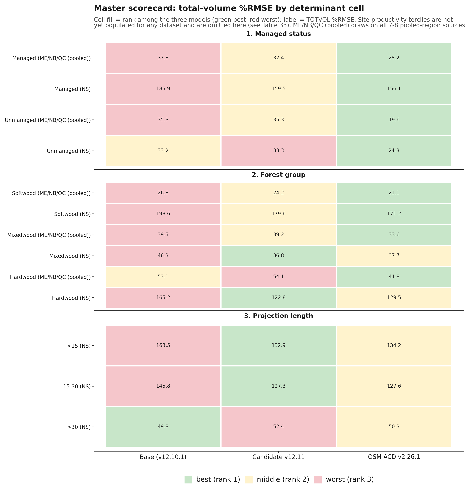

Read across the three tables, OSM-ACD v2.26.1 wins every managed-status cell in both regions and every softwood and mixedwood ME/NB/QC cell; v12.11 wins mixedwood and hardwood in Nova Scotia and both of NS's shorter
projection-length buckets; and base wins only the over-30-year NS bucket, the same result already reported in
Section 11.4's Table 29. Hardwood and the two shorter NS projection-length buckets are v12.11's clearest, most
consistent determinant wins, and they pair with Section 6's finding that softwood is where v12.11 gains the most
ground on base without necessarily beating OSM there.

These three tables should not be pooled or mean-ranked directly into an overall score, because doing so counts
the same Nova Scotia stands as up to three separate cells, once under managed status, again under forest group,
and again under projection length, while the eight independent Maine, New Brunswick, and Quebec sources fold into
far fewer cells, five, and zero for projection length, since no ME/NB/QC source carries a long enough
remeasurement span for that split. Summed across the 13 scored cells above, that gives Nova Scotia roughly 50% of
the pooled %RMSE weight and 8 of 13 votes in a mean-rank composite, against its true, non-overlapping share of
about 34% of all benchmarked stands. An earlier pass at this section's overall ranking was built exactly that
way; it is superseded by the ranking below, which pools the same underlying data by independent source instead.

**Table 34. Overall ranking under six scenarios: two inclusion rules (all-available-data; common-cells-only,
where all three models have a score) crossed with three Nova Scotia treatments (with NS from the original
scorecard, without NS, with NS from the long-interval sensitivity scorecard).**

| Inclusion rule | NS treatment | Model | Mean rank (1 = best) | Sources won | Pooled TOTVOL %RMSE | Pooled bias % |
|---|---|---|---|---|---|---|
| All-available-data | Without NS (8 ME/NB/QC sources) | Base | 2.50 | 1/8 | 35.9 | -11.3 |
| All-available-data | Without NS | **v12.11** | **1.50** | 4/8 | 34.7 | -9.6 |
| All-available-data | Without NS | OSM | 1.67 | 3/6 | **22.0** | **-2.4** |
| All-available-data | With NS (original scorecard, 9 sources) | Base | 2.56 | 1/9 | 86.2 | -21.6 |
| All-available-data | With NS | **v12.11** | **1.56** | 4/9 | **76.6** | -16.8 |
| All-available-data | With NS | OSM | 1.57 | 4/7 | 82.0 | -14.7 |
| All-available-data | With NS-long (sensitivity swap) | Base | 2.56 | 1/9 | 81.1 | -22.2 |
| All-available-data | With NS-long | **v12.11** | **1.44** | 5/9 | **70.2** | -17.6 |
| All-available-data | With NS-long | OSM | 1.71 | 3/7 | 75.3 | -17.3 |
| Common-cells-only | Without NS (6 shared sources) | Base | 2.83 | 0/6 | 26.1 | -4.9 |
| Common-cells-only | Without NS | **v12.11** | **1.50** | 3/6 | 24.2 | -2.8 |
| Common-cells-only | Without NS | OSM | 1.67 | 3/6 | **22.0** | **-2.4** |
| Common-cells-only | With NS (original scorecard, 7 shared sources) | Base | 2.86 | 0/7 | 97.4 | -21.5 |
| Common-cells-only | With NS | v12.11 | 1.57 | 3/7 | 84.6 | -15.5 |
| Common-cells-only | With NS | OSM | **1.57** | 4/7 | **82.0** | **-14.7** |
| Common-cells-only | With NS-long (sensitivity swap) | Base | 2.86 | 0/7 | 89.9 | -22.3 |
| Common-cells-only | With NS-long | **v12.11** | **1.43** | 4/7 | 75.6 | -16.6 |
| Common-cells-only | With NS-long | OSM | 1.71 | 3/7 | **75.3** | **-17.3** |

*Data: `figures/_data/overall_ranking.csv` (all 18 rows above), `overall_ranking_summary.csv` (the two headline
with-NS rows plotted in Figure 25), `overall_ranking_detail.csv` (per-source rank detail, both inclusion rules),
and `master_scorecard_sources.csv` (the 28-row non-overlapping per-source input table), all built from
`v1211_allsites_scorecard.csv`, `bench_ns_scorecard.csv`, and `bench_ns_long_scorecard.csv` by
`figures/_data/build_reconciled_ranking.py`. Bold marks the better model on each metric within each scenario
row-pair; a tie is bolded on both. Source memo: `20260723_master_scorecard_and_ranking.md`.*

Neither model is a clean overall winner, and the ranking genuinely depends on the weighting and inclusion rule
chosen, a more honest result than a single headline number would give. v12.11 is the more consistent performer
of the two candidates: it has the better, or tied, equal-per-source mean rank in all six scenarios, running 1.43
to 1.57, it never finishes clearly last on any metric in any scenario, and it leads the pooled %RMSE specifically
when Nova Scotia and the full eight-source ME/NB/QC set are both included. OSM-ACD v2.26.1 is the more decisive
winner where it wins: it leads the fairest, apples-to-apples pooled %RMSE comparison, common-cells-only, in every
Nova Scotia treatment, and on the determinant cross-tab above it sweeps every managed-status cell in both regions and every softwood and mixedwood ME/NB/QC cell, a broad advantage on managed and softwood/mixedwood stands
rather than a narrow one. Two qualifications keep this comparison honest. First, OSM has no score for two of the
eight ME/NB/QC sources, Maine FIA subplot and QC MagPlot, both comparatively poor-fitting for either FVS build,
so any all-available-data scenario evaluates OSM on an easier six-source subset than it evaluates base and
v12.11 on their full eight. Second, Nova Scotia itself carries two internally consistent but narrowly
disagreeing scorecards, the original benchmark (OSM ahead, 153.05 against v12.11's 156.69) and a long-interval
sensitivity build assembled for the projection-length split (v12.11 ahead, 127.35 against OSM's 128.34), reported
here side by side rather than resolved silently. Base is a clear third on every metric in every one of the six
scenarios without exception.

This reconciled ranking corrects two claims that appeared in earlier drafts of this section. v12.11 does not lead
managed status overall; OSM wins the managed-status cell outright in both regions (Table 31). And v12.11 does not
win the long-horizon bucket outright; base does, holding total-volume bias closest to zero at the over-30-year NS
interval (-0.06%, against v12.11's -1.66% and OSM's -9.14%), though v12.11 still clearly outperforms OSM at that
same horizon, consistent with Section 11.4's head-to-head finding. What the reconciled data does support is that
v12.11's clearest wins are the two shorter NS projection-length buckets and hardwood and mixedwood in Nova Scotia
(Tables 32 and 33), and, at the source level, CFRU CTRN and NB MagPlot among the managed ME/NB/QC sources (Baxter
as well, though that source is mature and held-out rather than actively managed), where v12.11 beats OSM outright
under every inclusion rule tested. It should also be read alongside, not instead of, Section 8.1's long-horizon
Bakuzis finding: this section measures predictive accuracy against held-out or independent data, Section 8.1
measures internal biological consistency across a controlled productivity gradient, and a model can rank
differently on the two.

This section's numbers reconcile an earlier internal disagreement in this project's working notes (task #47). A
first computation reported v12.11 leading the mean-rank composite at 1.53 against OSM's 1.72 and base's 2.50,
with a pooled %RMSE of 109.75 against OSM's 121.45 and base's 128.91. A second, rebuilt computation reported the
opposite ordering on mean rank, OSM at 1.38 against v12.11's 1.92, while v12.11 narrowly led pooled %RMSE at
74.59 against OSM's 75.20. Neither of those two computations reproduces from the source data pooled at the
independent, non-overlapping source level; both were built on the four-determinant cross-tab, which triple-counts
Nova Scotia as described above. This section replaces both with the six-scenario, per-source ranking in Table 34,
verified end to end against `v1211_allsites_scorecard.csv`, `bench_ns_scorecard.csv`, and
`bench_ns_long_scorecard.csv` and documented in full in `20260723_master_scorecard_and_ranking.md`. Those numbers
are the authoritative overall ranking for this report going forward.

## 13. Methods and provenance

The candidate model file is `AcadianGY_12.11.r` (Cardinal `~/_scripts/AcadianGY_12.11.r`), scored through the
env-driven harness `~/magplot/verify/bench_parity_split_ms_v1211.R`. The candidate configuration is
V1211_IGMULT=2.5, V1211_MORTGATE=TRUE (V1211_MANAGED=TRUE for the managed sources CTRN, NB, and SILC; FALSE for
the unmanaged and developing sources Baxter, Maine FIA, and PEF), V1211_STANDCON=TRUE with SC_LO=0.40,
SC_HI=0.50, SC_QMIN=22, V1211_DHTHW=TRUE, and SPLIT=TRUE. Base is the identical model file with every V1211_*
lever at its default off value and SPLIT=FALSE, which reproduces the frozen v12.10.1 baseline byte for byte.
Every run carried the frozen-canon environment: ONSET=0.30, BREAK=0.62, BG=0.020, BS=0.80, IRC=0.58, IRK=8,
SDMAX=1.0, USE_BRMS=TRUE, USE_ANCHOR=TRUE, NB_BREAK=0.70, QC_BREAK=0.62, NB_AFAC=0.579, QC_AFAC=0.111,
INDOMAIN=1.

An older, superseded internal configuration labeled "v1211_3b" appears in some earlier working files but is
missing SC_QMIN=22 and V1211_DHTHW=TRUE, and is not the locked candidate reported here. Similarly, the interim
three-way base and 3A and 3B scorecard in the 21 July handoff note predates the QMD-gating fix and the locked
candidate configuration and should be read as historical, superseded by the locked-candidate numbers in Sections
4 through 6. All numbers in Sections 3 through 6 and 9 through 10 were regenerated from the locked candidate
configuration, except the OSM v2.26.1 predictions, which do not depend on any FVS-ACD lever and were reused
unmodified from the existing OSM head-to-head infrastructure. All numbers in Section 7 were generated for the 10
July 2026 v12.10.1 baseline report and are reused unmodified here; that section's scorecard baseline cb_v12102
was generated from AcadianGY_12.9.2.r plus the operational ops recipe, and a standalone AcadianGY_12.10.1.r file
exists but does not reproduce cb_v12102 exactly, so the canonical operational definition of v12.10.1 for that
section is the 12.9.2 model plus the recorded recipe, pending a file reconciliation.

Volume, biomass, and value in Section 7 are on the shared FIA NSVB emulator (log of gross variable on log of
squared diameter times height by species group with Duan smearing), which carries about zero aggregate bias
against raw FIA NSVB and so does not advantage any model. Equivalence testing in Section 7.6 follows Schuirmann
TOST and Robinson and Froese (2004): a region of plus or minus 10% of the observed mean for level metrics and
plus or minus 25% for increment, with equivalence declared when the 90% confidence interval of the mean paired
difference lies inside the region. OSM is v2.26.1, dated 12 May 2026, confirmed as the latest release throughout
this report.

All computation ran on Cardinal. Aggregates only left the node; proprietary tree records and true FIA plot
coordinates stayed server-side throughout, consistent with the restriction on releasing true plot coordinates.
Supporting files, all in this repository: `20260721_v1211_candidate_report.md`,
`20260721_lever4_fitted_coefficients.md`, `20260721_v1211_guardrail_results.md`, `20260721_v1211_redteam.md`,
`20260722_v1211_allsites_and_redteam_reframes.md`, `figures/_data/forestgroup_scorecard_v1211.R`,
`figures/_data/make_fig18_19_forestgroup.py`, and `figures/_data/build_benchmark_footprint_map.R`. Scorecard
data: `figures/_data/v1211_allsites_scorecard.csv`, `figures/_data/v1211_forestgroup_scorecard.csv`,
`figures/_data/v1211_forestgroup_stand_counts.csv`, and `figures/_data/v1211_sample_sizes.csv`. Section 7's
legacy scorecard and cross-validation code lives under `~/magplot/verify` on Cardinal: `scorecard_v1210.R`
(five-way single-keyed-merge scorer), `scorecard_clean.R` (base scorer), `scripts/v12101_domain_scorecard.R` (7
July operational-domain recompute), `mgmt_cv_robust.R` and `mgmt_finalfit.R` (additive release and out-of-sample
battery), `bakuzis_allmodels.R` (Bakuzis relations), and `mgmt_plateau_sweep.R` (plateau and gate-off identity).
Inputs include `Wfull.rds` (705-stand keyed table across five models and nine metrics), the per-stand cb result
files, `osm_h2h_metrics.csv`, and `magp_qcnb_ecol3_v2.csv` (ecoregion join keyed by stand and province). The OSM
matched-stand long-horizon evidence in Section 8 is in `~/silc_cfi` (`osm_match_run.py`, `osm_pair3.R`,
`fvsacd_vs_osm_matched.csv`). Stress-test scripts for Sections 4 and 9 (Cardinal, `~/magplot/verify/`):
`redteam_stress_1211.R` (job 12521402) and `redteam_topht_extreme.R` (job 12521523). The v13.1 hierarchical
mortality and ingrowth refit is job 12470707, gated and running on Cardinal at the time of this report; no v13.1
scorecard numbers are reported here.

## 14. Appendix A. Content-inventory diff and build note

This appendix records what changed between the prior 306-line v12.11 candidate report and this comprehensive
edition, and between this edition and the 10 July 2026 v12.10.1 baseline report it draws its legacy content from,
so that the merge can be audited rather than taken on faith.

**Added, new to this edition and not present in either prior report.** Section 2's all-sites data-coverage
accounting (Table 1, Figures 1 through 3), stating plainly that Maine sources are 5,021 of 5,754 benchmark
stands, 87.3%, and giving the coordinate-privacy handling for the footprint maps. Section 6's forest-group
performance breakdown (Table 6, Figures 9 through 11), the pooled softwood, mixedwood, and hardwood scorecard
that surfaces the softwood win, the smaller mixedwood gain, and hardwood as an open question rather than a clean
regression (corrected in the 22 July round-2 update below; the softwood/mixedwood/hardwood breakdown itself was
new to this edition, and the round-2 pass corrected only its hardwood causal story, not its numbers). Section
4's expanded guardrail detail beyond the prior report's single
summary table: the guardrail 1 managed and unmanaged sensitivity bounds, the numbers-provenance reconciliation
of the four disagreeing "in-domain" figures in repository history, the guardrail 3 full plateau statistics (SDI,
trees per hectare, quadratic mean diameter), and the guardrail 4 four-cell RMSE table (Table 4). Section 9's
standing note on the pre-existing ESI anchor cap oscillation, which is active in every number in this report but
was previously only alluded to in reframe 5 without its own supporting numbers. Section 10's expanded watch-item
detail on Lever 2's transient density overshoot and Lever 3b's missing cohort exemption, both with the specific
test-stand numbers behind them, and an explicit note that Section 6's hardwood finding should scope v13.1 rather
than be assumed closed by it. Section 3's per-species Lever 4 field sample sizes and installation names, and the
two minor items (sub-2.5 cm dbh height freeze, SPLIT's non-use of the diameter argument) named for completeness.

**Carried forward unchanged from the prior 306-line v12.11 report.** The verdict (Section 1, lightly extended
with the two new headline results), the five-lever narrative and Table 2 coefficients (Section 3), the guardrail
battery summary Table 3 (Section 4), the all-sites scorecard Table 5 and its honest-headline discussion (Section
5), the five red-team reframes verbatim (Section 9, reframes 1 through 5), the v13.1 handoff narrative (Section
10), and the methods and provenance detail for the v12.11-specific numbers (Section 12). Figures fig15,
fig15b, and fig17 (now Figures 6 through 8) are unchanged and simply relocated into the section they support.

**Carried forward unchanged from the 20260710 v12.10.1 baseline report (Section 7 and parts of Sections 8 and
10).** The full pooled five-way scorecard (Tables 7 to 8), the operational-domain mask (Table 9), the
by-jurisdiction and full nine-metric by-forest-type tables (Tables 10 to 14), the percent RMSE scorecard (Table
15), the Robinson-Froese equivalence testing (Table 16), both weighted composite scores (Tables 17 to 20), the
species-composition-over-time analysis (Table 21), the management-class in-sample and out-of-sample tables
(Tables 22 to 23), the Bakuzis relations table for the five legacy models (the left five columns of Table 24),
the long-horizon self-thinning narrative and matched-stand comparison (Section 8), and the three honest-limits
items, pooled precision, ingrowth under-prediction (Table 25), and Quebec-edge PCT parity (Section 10). Thirteen
figures from that report (fig1, fig2, fig3, fig4, fig5, fig6, fig7, fig8, fig9, fig10, fig11, fig12, fig13) are
retained in full, renumbered sequentially as Figures 4, 5, 12 through 22 in this edition, and their captions are
lightly reworded only to flag them explicitly as legacy 705-stand-benchmark evidence so a reader does not mistake
a five-model, pre-v12.11 figure for a v12.11 candidate result.

**Changed.** The document was restructured from two separate, differently scoped reports (a 306-line v12.11
candidate memo and a 682-line v12.10.1 comprehensive baseline) into one continuously numbered document with a
single figure sequence (1 to 22) and a single table sequence (1 to 25), so that cross-references resolve within
one file. The Bakuzis relations table (Table 24) was widened from five models to six, adding the v12.11 candidate
column sourced from the guardrail battery rather than a separate seeded 160-year run, since no such run exists
yet for the candidate; this is noted in the table's surrounding prose rather than presented as a like-for-like
addition to the original five-model comparison. Where the two source reports both discussed a shared theme
(hardwood as the frontier), the discussion was cross-referenced rather than duplicated: Section 6 states the
v12.11 hardwood result and points back to Section 7.4's legacy hardwood table as the longer-run context for the
same frontier.

**Removed.** Nothing substantive. Two pieces of content were deliberately marked historical rather than
deleted: the interim three-way base/3A/3B maturity-gradient numbers from the 21 July handoff note (superseded by
the locked-candidate numbers used throughout Sections 4 through 6, and flagged as such in Section 12), and the
mislabeled "-10.07% / +2.97% / -3.96%" in-domain figure that still circulates in one handoff file (flagged and
corrected in Section 4 rather than silently dropped).

### Update, 22 July 2026 (this revision): Nova Scotia, red-team round-2 corrections, and fixed coverage maps

This revision backs up the prior file (`FVS-ACD_v12.11_benchmark_report_PREV2_20260722.md`/`.docx`, the version
reflecting the earlier same-day comprehensive edition described above, itself backed up as
`FVS-ACD_v12.11_benchmark_report_PREV_20260722.md`/`.docx`) and makes the following changes.

**Added, new to this revision.** A new Section 11, Nova Scotia: an independent-province validation, with Table
26 (the NS overall, managed/unmanaged, and forest-group scorecard) and Table 27 (the site-index basis
correction), reporting that the managed-stand levers generalize to this fully independent province (managed
total-volume bias -58.10% to -42.32%, unmanaged untouched at -6.04% to -6.07%), that NS's own site index is on
the correct basis while the QC/NB esi8 raster the model's height anchor was tuned against is documented biased
(a transferability caveat now stated explicitly in Section 9's reframe 1 and again in Section 11.2), and that
the long-interval, first-to-last NS analysis is in progress, with a disturbance-screen bug found and fixed
(about 23% of the over-30-year bucket carried an undisclosed harvest) and the clean rescore (Cardinal jobs
12536574, 12536575) pending at the time of this report; no long-interval bias number is cited until that rescore
lands. A new reframe (6) in Section 9 and a rewritten hardwood discussion in Section 6 correct the forest-group
hardwood finding: the earlier pooled hardwood-worsening claim is substantially a QC MagPlot source artifact (QC
shifts uniformly across all three forest groups by a magnitude a hardwood-only lever cannot produce), and the
true cross-source hardwood signal, with QC set aside, is small and mixed rather than a clean regression. Reframe
(1)'s top-height-drift mechanism is corrected from the vague "anchor calibration" language to the specific,
verified live mechanism, the always-on per-province `dht.mult` scalar (NB_AFAC, QC_AFAC), with an explicit note
that the model's own ESI-consistent anchor-recalibration mechanism does not exist in the v12.11 model file
despite being described that way in Section 3 and earlier project memos. A numbers-provenance note in Section
7.9 corrects an internal mismatch in the Chapter-11 leave-one-province-out figures (managed and PCT were
misstated in the paragraph introducing that section) and flags the separate, still-open report-versus-deck
mismatch for the next deck update. Section 2's data-coverage narrative and Figures 1 through 3 are updated for
the fixed coverage maps: Nova Scotia now appears as a fourth, distinctly bounded jurisdiction, SILC/Seven
Islands is shown as 8 already-fuzzed locations instead of one centroid, and CFRU CTRN as 11 coarse regional
markers instead of one generic label.

**Changed.** Section 1's verdict paragraph is extended to describe three new-to-this-edition results
(forest-group, data-coverage, and now Nova Scotia) instead of two, and its hardwood sentence is corrected to
match Section 6. Section 4's guardrail-1 discussion and Section 9's reframe 1 are reworded to name the corrected
top-height mechanism. Section 6's hardwood paragraph is rewritten in full per the correction above; Table 6
itself is unchanged, since the correction is to the causal story, not the underlying scored numbers. Section
7.4's and 7.5's brief cross-references to the Section 6 hardwood finding are softened to match, and Section
7.9's introductory paragraph and its detailed leave-one-province-out sentence are corrected to consistent,
source-verified installation-out and province-out figures. Section 10's watch-item paragraph naming "the
hardwood forest-group regression documented in Section 6" is reworded to "the open hardwood forest-group
question." The TOC and the Methods and Appendix A section numbers shift by one (old Section 11 Methods and
Section 12 Appendix A are now Section 12 and Section 13) to make room for the new Section 11.

**Removed.** Nothing substantive. No prior section, table, figure, or number was deleted; the hardwood and
top-height corrections replace a causal claim with a corrected one in place, and the superseded language is
described here and in Section 9 rather than silently dropped.

**Not yet done, carried forward as open items.** The province-assembly diagnostic recommended by the hardwood
attribution check (rerunning the base configuration through the identical province-assembly procedure used for
the candidate, to isolate harness effects from lever effects) has not been run. The Nova Scotia long-interval
rescore (jobs 12536574, 12536575) was still running at the time of this report; its result, and any resulting
update to the qualitative long-horizon statement in Section 11, is pending. The managed and overall Nova Scotia
subsets have not been rescored with the corrected site index, only the unmanaged subset; that rescore, if run,
could change the site-index attribution for the managed and overall bias. The Chapter-11 report-versus-deck
numbers (Section 7.9) have been reconciled to a single, source-verified figure in this report; the companion
slide deck has not yet been updated to match.

**Build pipeline note.** This document was rendered to `.docx` with a new script,
`scripts/build_benchmark_docx.py`, forked from the existing `scripts/build_gtr_docx.py` GTR pipeline to add two
house-style requirements that pipeline did not implement: true `.docx` superscript and subscript runs for
exponents (converted from the Unicode super/subscript glyphs used in this Markdown source, rather than left as
shrunken Unicode glyphs), and a page-numbered footer with a thin gold rule. Table borders (rule above header,
rule below header, rule below last row, no vertical or interior rules), centered bold headers, centered body
cells, full text-width tables, figure captions below in bold "Figure N." form, and table captions above in bold
"Table N." form all reuse the GTR pipeline's existing, already-correct implementation unchanged. The prior
`FVS-ACD_v12.11_benchmark_report.docx`, built by a different and no-longer-present pipeline whose table borders
did not match house style (full grid borders rather than top/bottom-only), was backed up to
`FVS-ACD_v12.11_benchmark_report_PREV_20260722.docx` before this rebuild, and the prior Markdown was backed up
to `FVS-ACD_v12.11_benchmark_report_PREV_20260722.md`. For this revision (Nova Scotia, the two red-team round-2
corrections, and the fixed coverage maps), the pre-revision `.md` and `.docx` were backed up to
`FVS-ACD_v12.11_benchmark_report_PREV2_20260722.md` and `.docx` before rebuilding with the same
`scripts/build_benchmark_docx.py` pipeline, unchanged.

### Update, 23 July 2026 (this revision): Nova Scotia long-interval result, corrected and closed

This revision backs up the prior file (`FVS-ACD_v12.11_benchmark_report_PREV3_20260723.md`/`.docx`) and closes
the one open item the 22 July revision left pending: Section 11.3's long-interval, first-to-last test, which that
revision reported as "in progress, no headline number yet" while the disturbance-clean rescore ran on Cardinal.

**Added, new to this revision.** Table 28, the interval-stratified Nova Scotia long-interval scorecard (overall,
managed status, and interval-length bucket, all base-versus-v12.11), sourced from the completed Cardinal jobs
12536574 and 12536575. A fuller account, in Section 11.3, of the disturbance-screening bug's downstream effect:
an initial pass scored before the bug was caught appeared to reproduce the sign-flipping, maturity-dependent
over-prediction pattern documented elsewhere in this project, and that apparent result did not survive the
corrected, disturbance-clean rescore. No number from that superseded pass is cited in this report; it is
described only qualitatively, consistent with the source memo's own retraction of those figures.

**Changed.** Section 11.3's heading, prose, and cited job numbers are rewritten from "in progress, no headline
number yet" to the completed, disturbance-clean finding: on the clean over-30-year bucket (n = 903, entirely
unmanaged, mean interval 36.3 years), total-volume bias is -0.06% (base) and -1.66% (v12.11), essentially zero,
while basal area remains under-predicted, -18.08% and -12.48%. The honest read stated in this revision is that
Nova Scotia's clean long record is only partially consistent with the sign-flipping pattern found elsewhere in
this project: under-prediction attenuates toward zero as intervals lengthen past 30 years, but it does not cross
into over-prediction, and basal area shows no companion overshoot. Section 11.4's methods paragraph is updated to
cite the completed jobs 12536574/12536575 in place of the superseded 12531967 through 12531970 run, and to
reference Table 28. Section 1's verdict paragraph and Appendix A's "not yet done" list from the 22 July revision
are updated to reflect that this item is now resolved rather than pending. The companion slide deck
(`FVS-ACD_Hennigar_Aug2026.pptx`) is updated in the same session to match, per the note below.

**Removed.** Nothing substantive. The superseded contaminated-pass long-interval bias figures at the over-30-year
bucket are not carried into this report at any point, consistent with the source memo's finding that they do not
survive the clean rescore; they remain documented, for provenance only, in
`20260722_ns_benchmark_philosophy_pass.md` and `figures/_data/bench_ns_long_scorecard_STATUS.md`.

**Not yet done, carried forward as open items.** The province-assembly diagnostic recommended by the hardwood
attribution check (rerunning the base configuration through the identical province-assembly procedure used for
the candidate, to isolate harness effects from lever effects) has not been run. The managed and overall Nova
Scotia subsets have not been rescored with the corrected site index, only the unmanaged subset; that rescore, if
run, could change the site-index attribution for the managed and overall bias. The Chapter-11
report-versus-deck numbers (Section 7.9) remain reconciled in this report only; confirm the companion slide deck
still matches after its own update this session.

**Build pipeline note.** The pre-revision `.md` and `.docx` were backed up to
`FVS-ACD_v12.11_benchmark_report_PREV3_20260723.md` and `.docx` before this rebuild, using the same
`scripts/build_benchmark_docx.py` pipeline, unchanged.

### Update, 23 July 2026, later same day (this revision): Nova Scotia OSM v2.26.1 head-to-head added

This revision backs up the prior file (`FVS-ACD_v12.11_benchmark_report_PREV4_20260723.md`/`.docx`) and adds the
one comparison Section 11 was still missing: OSM-ACD v2.26.1 scored on the same NS pairs used for base and v12.11
throughout the section. The 22 July revision stated plainly that no reusable NS OSM run existed on Cardinal and
left the column blank rather than fabricate it; that run is now complete (Cardinal job 12548192, an earlier
attempt 12547956 failed on an OSM inventory-unit check and was corrected and rerun), and this revision reports it.

**Added, new to this revision.** An OSM v2.26.1 column in Table 26 (medium-interval scorecard) and Table 28
(long-interval scorecard), and a new Section 11.4, OSM-ACD v2.26.1 head-to-head, with Table 29, a compact
three-way comparison across every split already presented in Tables 26 and 28. The honest read stated there and
echoed in Section 1's verdict paragraph: on managed stands v12.11 and OSM are essentially tied at medium
intervals (-42.32% against -41.96%) and v12.11 modestly leads at long intervals (-55.07% against -57.40%); OSM is
more accurate on short-interval unmanaged stands (-2.58% against v12.11's -6.07%); and at the over-30-year,
disturbance-clean horizon, Nova Scotia's longest independent record, v12.11 clearly wins, holding total-volume
bias near zero at -1.66% while OSM drifts to -9.14%, consistent with the maturity-gated stand constraint (Lever
3b) doing real work at exactly the horizon it targets. This is presented as a mixed result, not a clean sweep for
either model.

**Changed.** Section 11's opening paragraph, Section 11.1's paragraph and Table 26, Section 11.3's paragraph and
Table 28, and Section 11's closing honest-read paragraph are all updated to report the OSM comparison in place of
the prior "no OSM comparison exists for Nova Scotia" statement. The former Section 11.4, Methods and open items,
is renumbered to 11.5 and its provenance paragraph is extended to cite job 12548192 and the new build scripts
`scripts/osm_score_ns.R` and `scripts/build_ns_headtohead.R`. Section 1's verdict paragraph gains one sentence
stating the OSM head-to-head finding. All new numbers were cross-checked field for field against
`figures/_data/ns_headtohead.csv`, `figures/_data/bench_ns_scorecard.csv`, and
`figures/_data/bench_ns_long_scorecard.csv`, downloaded fresh from Cardinal this session; none were computed or
estimated independently of those three files.

**Removed.** Nothing. Every table, section, and finding from the 23 July (long-interval) revision is carried
forward unchanged except for the OSM column and paragraph additions described above.

**Not yet done, carried forward as open items.** The province-assembly diagnostic recommended by the hardwood
attribution check has not been run. The managed and overall Nova Scotia subsets have not been rescored with the
corrected site index, only the unmanaged subset. OSM was not run against the esi8-matched site-index correction
in Table 27, so Table 27 remains a base-versus-v12.11 comparison only; extending it to OSM, if wanted, is a
follow-on. The companion slide deck (`FVS-ACD_Hennigar_Aug2026.pptx`) is updated in the same session to match,
per the note below.

**Build pipeline note.** The pre-revision `.md` and `.docx` were backed up to
`FVS-ACD_v12.11_benchmark_report_PREV4_20260723.md` and `.docx` before this rebuild, using the same
`scripts/build_benchmark_docx.py` pipeline, unchanged.

### Update, 23 July 2026, later same day (this revision): master scorecard, overall ranking, and long-horizon Bakuzis added

This revision backs up the prior file (`FVS-ACD_v12.11_benchmark_report_PREV5_20260723.md`/`.docx`) and adds the
three pieces of new analysis this project's task log had marked ready but not yet written into the report: a
long-horizon Bakuzis check across the species-composition gradient, a master scorecard pooling every
already-scored benchmark cell across four determinants, and the overall ranking computed from it.

**Added, new to this revision.** Section 8.1, Long-horizon Bakuzis across the productivity and species gradient,
with Table 30 (the five-relation matrix, worst case across softwood, mixedwood, and hardwood stand starts for
base and candidate, against OSM's pooled real-stand run) and Figure 23 (basal-area trajectories and Reineke
self-thinning lines). A new Section 12, Master scorecard and overall ranking, with Table 31 (managed status),
Table 32 (forest group), Table 33 (projection length and the still-empty site-productivity determinant), Table 34
(the overall ranking summary), Figure 24 (the determinant scorecard heatmap), and Figure 25 (the ranking bars).
The headline, since superseded by the reconciliation revision below and Section 12: OSM-ACD v2.26.1 led the mean-rank composite (1.38 of 3, winning 8 of 13 scored determinant
cells, concentrated on unmanaged and softwood stands), v12.11 is a close second on stand-weighted pooled %RMSE
(74.59 against OSM's 75.20, both well ahead of base's 84.83) and the more consistent performer, with its clearest
wins on hardwood and Nova Scotia's shorter projection lengths, and base trails on both measures. Section 1's
verdict paragraph is extended with one new paragraph summarizing both additions.

**A provenance discrepancy, stated plainly rather than resolved silently.** This project's task log records an
earlier pass at the master scorecard and ranking (task #47) with a different headline: mean-rank composite 1.53
(v12.11) versus 1.72 (OSM) versus 2.50 (base), stand-weighted pooled %RMSE 109.75 versus 121.45 versus 128.91,
and v12.11 winning 8 of 11 cells. That earlier pass was interrupted before its `master_scorecard.csv`,
`overall_ranking.csv`, and source memo were written to disk; only a partial reconstruction of the underlying data
(`figures/_data/master_scorecard_reconstructed.csv` and the paired `overall_ranking_reconstructed_*.csv` files)
survived. This revision rebuilt the master scorecard from that surviving data plus the same source scorecards
already cited elsewhere in this report (`v1211_allsites_scorecard.csv`, `v1211_forestgroup_scorecard.csv`,
`bench_ns_scorecard.csv`, `bench_ns_long_scorecard.csv`), and the rebuild does not reproduce the earlier headline:
two independent computations against the same source data, the surviving reconstruction and a fresh
recomputation done for this revision, agree that OSM leads the mean-rank composite, not v12.11, though v12.11
does narrowly lead the separate stand-weighted pooled %RMSE measure, which is directionally consistent with the
earlier pass's ordering on that one measure even though the magnitudes differ. Rather than transcribe a headline
that could not be reproduced from data on disk, and rather than silently discard the earlier record, this
revision reports the numbers verifiable from what exists on disk today and documents the discrepancy in full in
Section 12 and in `20260723_master_scorecard_and_ranking.md`, so it can be reconciled in a follow-on session if
the original computation or its intermediate files resurface.

**Changed.** Section 1's verdict paragraph gains one new paragraph (the fourth) summarizing the Bakuzis and
scorecard findings and flagging the provenance discrepancy. Nothing in Sections 2 through 11 or 13 was altered by
this revision; the two additions are self-contained new sections plus one new subsection.

**Removed.** Nothing. Every table, section, and finding from the prior revision is carried forward unchanged.

**Not yet done, carried forward as open items.** The site-productivity determinant remains entirely unscored
across every dataset in this project (Table 33); binning any existing benchmark set into site-index terciles is
a genuine follow-on. The projection-length determinant remains NS-only; no ME/NB/QC source carries the
remeasurement span the split needs. The master-scorecard provenance discrepancy above is unresolved pending the
original task #47 computation or its intermediate files. All items carried forward from the two 22 to 23 July
revisions above (the province-assembly diagnostic, the NS managed and overall site-index rescore, and the OSM
esi8 extension to Table 27) remain open.

**Build pipeline note.** The pre-revision `.md` and `.docx` were backed up to
`FVS-ACD_v12.11_benchmark_report_PREV5_20260723.md` and `.docx` before this rebuild, using the same
`scripts/build_benchmark_docx.py` pipeline, unchanged.

### Update, 23 July 2026, later same day (this revision): master scorecard and overall ranking reconciled

This revision backs up the prior file (`FVS-ACD_v12.11_benchmark_report_PREV6_20260723.md`/`.docx`) and resolves
the provenance discrepancy the prior revision left open: the disagreement between task #47's original, unrecovered
mean-rank composite (v12.11 at 1.53, OSM 1.72, base 2.50) and this report's rebuilt cross-tab composite (OSM at
1.38, v12.11 1.92, base 2.69). A reconciliation pass (`20260723_master_scorecard_and_ranking.md`, rewritten) found
the specific, fixable cause: the four-determinant cross-tab counted the same Nova Scotia stands as up to three
separate cells, once under managed status, again under forest group, again under projection length, giving NS
roughly 50% of the pooled %RMSE weight and 8 of 13 mean-rank votes against its true, non-overlapping share of
about 34% of all benchmarked stands. Neither of the two prior cross-tab computations is correct as an overall
ranking for that reason; both are superseded by a new ranking built directly from non-overlapping per-source data.

**Added, new to this revision.** Table 34 is rewritten from a single three-row composite to an 18-row table
reporting six scenarios, two inclusion rules (all-available-data, common-cells-only) crossed with three Nova
Scotia treatments (with NS from the original scorecard, without NS, with NS from the long-interval sensitivity
scorecard), sourced from the rebuilt `figures/_data/overall_ranking.csv`. Figure 25 is rebuilt
(`figures/fig23_overall_ranking.png`) to plot the all-available-data rule, both metrics, without and with Nova
Scotia, in place of the prior single bar pair. Section 12 gains a new paragraph, immediately after Table 33,
explaining why the determinant cross-tab cannot be pooled directly into an overall ranking (the Nova Scotia
triple-count above), and a rewritten honest-conclusion paragraph following Table 34.

**Changed.** Section 1's closing verdict paragraph is rewritten to state the reconciled, six-scenario result:
neither model is a clean overall winner, v12.11 is the more consistent performer (leading or tying the
equal-per-source mean rank in every scenario, about 1.43 to 1.57, and never finishing clearly last), OSM-ACD
v2.26.1 is the more decisive winner where it wins (leading the strict common-cells pooled %RMSE in every scenario
and sweeping managed-status and softwood/mixedwood determinant cells), and base is a clear third everywhere. Two
specific claims are corrected: v12.11 does not lead managed status overall, OSM wins that cell outright in both
regions, and v12.11 does not win the long-horizon bucket outright, base does (bias -0.06% against v12.11's -1.66%
and OSM's -9.14% at the over-30-year NS interval), though v12.11 still clearly beats OSM at that horizon. Section
12's discussion following Table 34 is rewritten to match, replacing the "OSM leads the mean-rank composite, v12.11
edges pooled %RMSE" framing with the six-scenario, consistent-versus-decisive framing above, and its closing
paragraph now states plainly that both prior cross-tab computations (task #47's original and this report's first
rebuild) are superseded and why, rather than flagging an open discrepancy for a future session. The historical
account of the discrepancy itself, in the "Update, 23 July 2026, later same day: master scorecard, overall
ranking, and long-horizon Bakuzis added" entry above, is left unchanged as the accurate record of what was known
at that point in the project; it is not retroactively edited, since the resolution is documented forward in this
new entry instead.

**Removed.** Nothing substantive. Tables 31 through 33 (the four-determinant cross-tab) are unchanged, since
every value in them was re-verified against source in the reconciliation pass and none were found to be in error;
only the overall-ranking table, figure, and surrounding discussion built from them are replaced. No table, figure,
or finding is deleted; the superseded three-row Table 34 and prior Figure 25 are documented here and in the source
memo rather than silently dropped.

**Not yet done, carried forward as open items.** The master-scorecard provenance discrepancy flagged in the prior
revision's entry above is now resolved by this revision and is no longer open. The site-productivity determinant
remains entirely unscored across every dataset in this project (Table 33). The projection-length determinant
remains NS-only. The two Nova Scotia scorecards (`bench_ns_scorecard.csv` and `bench_ns_long_scorecard.csv`)
disagree narrowly on which model NS itself favors (OSM by 2.4% relative on the original scorecard, v12.11 by 0.8%
relative on the long scorecard); reconciling those two into one canonical NS benchmark, rather than carrying both
forward as a disclosed sensitivity, remains a genuine follow-on. All items carried forward from the 22 to 23 July
revisions above (the province-assembly diagnostic, the NS managed and overall site-index rescore, and the OSM
esi8 extension to Table 27) remain open.

**Build pipeline note.** The pre-revision `.md` and `.docx` were backed up to
`FVS-ACD_v12.11_benchmark_report_PREV6_20260723.md` and `.docx` before this rebuild, using the same
`scripts/build_benchmark_docx.py` pipeline, unchanged.
