# FVS-ACD (Acadian Variant) Overview of the Forest Vegetation Simulator

**DRAFT variant overview / General Technical Report scaffold. 29 June 2026, updated 22 July 2026, updated 23 July 2026.**

*Structured after the USDA Forest Service Northeast (NE) Variant Overview (FVS Staff 2008, rev.
August 2023) so it can become the official FVS-ACD variant documentation. Equation content is drawn
from the Acadian GY Model Documentation (Weiskittel and team, 2025-05-20) and the AcadianGY source,
built on the 12.7.1 development line. AcadianGY 12.10.1 is the current operational and production
version, documented here. The geographic range map, the keyword and database usage reference (Appendix
C), the Literature Cited, and the Appendix C and D validation and keyword material are drafted in this
revision, with the keyword reference flagged as a usage overview to be finalized with the FVS software
team; the species and component parameter tables
(Appendices A and B) are populated directly from the AcadianGY source and are unchanged from v12.9.0
through v12.10.1, since the later refinements touch mortality, ingrowth, self-thinning, and the
management modifiers, not the species-level growth, crown, taper, or volume parameters. This draft will be rendered to a formatted Word/PDF GTR. Updated 7 July 2026 to document
v12.10.1 as the operational version, with the version lineage through 12.5.0, 12.7.0/12.7.1, 12.9.x,
and 12.10.1, the five-way independent scorecard and honest scorecard position, the Bakuzis
biological-realism pass, the disclosed ingrowth limit, and the planned v13 program. Updated 22 July
2026 (sections 10.4 to 10.7) to document AcadianGY 12.11, a validated release candidate that corrects
a maturity-dependent long-horizon volume bias in v12.10.1 through five gated levers built on the
stand-constraint approach of Weiskittel, Hann, Kershaw, and Vanclay (2011), Chapter 10; to refresh the
benchmark with an all-sites Maine, New Brunswick, and Quebec comparison of v12.11 against the frozen
base and OSM v2.26.1; and to fold in the corrections an independent red-team review required before
the candidate's claims could be reported. Updated 23 July 2026 (new sections 10.6 to 10.9, and the
renumbered 10.10 and 10.11) to fold in the v12.11 benchmark findings finalized since the 22 July
revision: a forest-group attribution check that traces most of the pooled hardwood worsening to a
single-source (Quebec MagPlot) harness artifact rather than a hardwood-specific mechanism, leaving
softwood as the clearest, cleanest v12.11 win (10.6); a Nova Scotia independent-province validation,
the region's longest continuously remeasured record, showing the managed-stand levers generalize
cleanly, a site-index transferability caveat on the New Brunswick and Quebec ESI anchor, a corrected
long-interval test that does not reproduce the maturity-dependent sign flip seen elsewhere, and an
OSM-ACD v2.26.1 head-to-head with no outright winner (10.7); a master scorecard across managed status,
forest group, and projection length with a reconciled overall ranking built from non-overlapping
per-source data, stated honestly as a mixed result rather than a v12.11 sweep (10.8); a 160-year
five-relation Bakuzis assessment across the productivity and species-composition gradient, where
v12.11 holds the same biological-realism pattern as the frozen base and OSM flags two relations
including a persistent site-ordering inversion (10.9); and corrected 50 km hex data-coverage maps that
now include Nova Scotia on the same footing as Maine, New Brunswick, and Quebec. AcadianGY 12.10.1
remains the operational, shipped version for the 18 August 2026 Acadian Growth and Yield meeting;
v12.11 is documented here as a validated candidate available for evaluation, not yet adopted, and
neither v12.11 nor OSM-ACD v2.26.1 is a clean overall winner across every determinant tested (10.8).*

## Authors and Contributors

Aaron Weiskittel and the University of Maine Cooperative Forestry Research Unit (CFRU) developed the
Acadian growth-and-yield model. Ben Rice (Midgard Natural Resources) maintains the FVS-ACD
implementation and benchmarking. Component equations are credited to their authors throughout
(Kuehne, Russell, Rijal, Li, Chen, Castle, Cen, and others; see Literature Cited). This overview
documents the FVS-ACD variant as implemented in AcadianGY 12.10.1, the current operational version.

Suggested citation: Weiskittel, A. 2026. FVS-ACD (Acadian variant) overview: Forest Vegetation
Simulator. CRSF and CFRU, University of Maine, Orono, ME. [pages].

## Table of Contents

1. Introduction
2. Geographic Range
3. Control Variables (region codes, species, ecoregion, site index, maximum density)
4. Growth Relationships (height-diameter, bark, crown ratio and recession, crown width, CCF,
   diameter increment, height increment, stand basal-area increment)
5. Mortality Model
6. Regeneration and Ingrowth
7. Volume and Taper
8. Modifiers (thinning, spruce budworm, hardwood form and risk)
9. Model Application (site index rasters, cycle length, usage)
10. Version Lineage, Current Operational Version (12.10.1), the v12.11 Candidate, and Validation
11. Literature Cited
12. Appendices (species list, parameter tables)

## Quick Guide to Default Settings

| Parameter | Default |
|---|---|
| Projection cycle length | 1 year (FVS reporting frequency user-selectable) |
| Region code | ME (northern New England); also NB, NS, QC |
| Site productivity | Climate Site Index (CSI, m); modern ESI accepted in the same input (12.6.x) |
| Maximum stand density index | Composition-based, Weiskittel and Kuehne (2019); see 3.5 |
| Species | 37 Acadian species codes plus OH (other hardwood) and OS (other softwood) |
| Minimum DBH | 2.5 cm for height prediction; ingrowth threshold DBH user-set |
| Units | Metric internally (DBH cm, height m, BA m² ha⁻¹, trees ha⁻¹) |
| Volume | Kozak variable-exponent taper; Westfall and Scott |

## 1. Introduction

The Acadian forest region spans northern New England and Atlantic Canada. It is a transitional
mixed conifer and hardwood type, sitting between the northern hardwood forests to the south and the
boreal forest to the north (Loo and Ives 2003). The Acadian growth-and-yield model, developed by the
CFRU team led by Aaron Weiskittel, is the regionally specific model for this setting, and FVS-ACD is
its implementation within the Forest Vegetation Simulator framework. It departs from the FVS
Northeast (NE) variant in two respects. Its core growth, mortality, height, crown, ingrowth, and
taper relationships were fit on Acadian data, with the Kuehne et al. (2022) increment equations alone
drawing on more than 2.5 million diameter and a million height observations, and it is driven by a
climate-based site index in place of a traditional site index. FVS-ACD is a one-year-cycle,
individual-tree, distance-independent model and, like the other variants, supports the FVS extensions.

## 2. Geographic Range

The Acadian variant applies to northern New England (Maine, New Hampshire, Vermont) and Atlantic
Canada (New Brunswick, Nova Scotia) plus southern Quebec, the region for which the component
equations were fit. Region codes select the regional mortality and modifier parameters (ME, NB, NS,
QC).

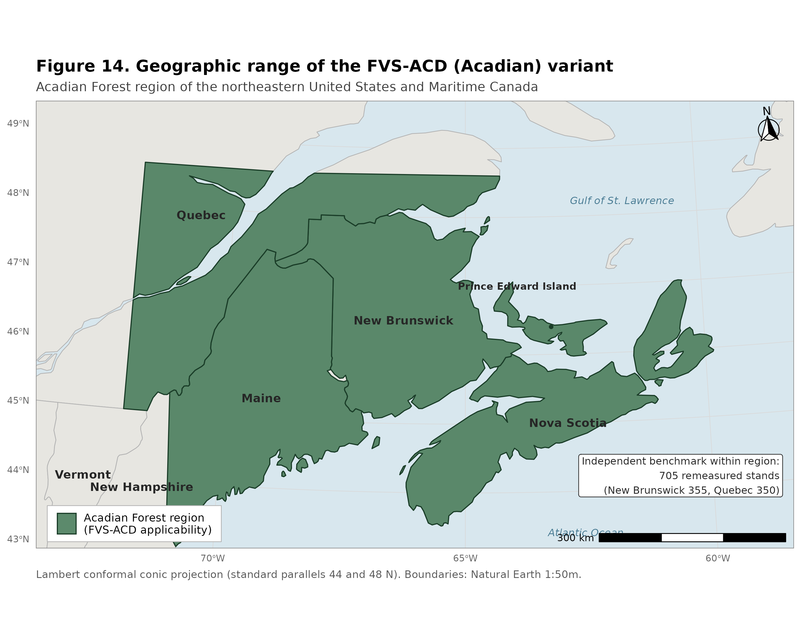

**Figure 14.** Geographic range of the Acadian variant (FVS-ACD): northern New England (Maine, New
Hampshire, Vermont), Atlantic Canada (New Brunswick and Nova Scotia), and southern Quebec, the region
for which the component equations were fit and over which the region codes (ME, NB, NS, QC) select the
regional mortality and modifier parameter sets.

## 3. Control Variables

### 3.1 Region codes

ME (default, northern New England), NB (New Brunswick), NS (Nova Scotia), QC (Quebec). Region selects
the regional parameter sets for stand and tree mortality and the spruce budworm modifier.

### 3.2 Species codes

37 rows are parameterized in `sp.attr` (35 distinct named species plus the OH other-hardwood and OS
other-softwood composite groups, and a `99` fallback row). Species not in the parameter set map to OH
or OS by softwood/hardwood type. Full species code table with scientific names, FIA and PLANTS codes,
specific gravity, and shade/drought/waterlog tolerance in Appendix A; component parameter tables
(height, HCB, crown width, bark ratio, mortality, modifiers, ingrowth, taper, volume) by
`sp.grp.ingrowth` and by individual species in Appendix B.

### 3.3 Habitat / ecological unit

FVS-ACD does not use habitat type codes; site productivity enters through the climate site index
(3.4). Level 3 ecoregion is available as an optional stratifier for maximum density (3.5).

### 3.4 Site index

The Acadian model uses Climate Site Index (CSI, m), a climate-and-soil-driven productivity surface
(Weiskittel et al. 2011a), fit by random forest on seven climatic variables (most important: mean
temperature of the warmest month, the warmest-to-coldest month temperature difference, and the
growing-season-to-annual precipitation ratio). CSI is a user input and is available as raster
surfaces for current and future (2030, 2060, 2090) climate normals. CSI enters total height,
diameter increment, stand basal-area increment, height increment, mortality, ingrowth, and maximum
SDI.

Operational note (12.7.0). The production model uses the validated modern Ecological Site Index (ESI)
as the site driver, supplied through the same input slot. ESI tracks measured site index well
(R^2 0.91). A controlled full-set test showed that ESI and the legacy climate site index give the same
regional volume and value, with an all-region basal-area bias of +1.4 percent under both. The ESI gain
therefore does not appear in volume or value bias. It appears in dominant-height behavior and biological
realism, since ESI anchors the stand dominant height onto a fitted Chapman-Richards curve (k = 0.0039,
p = 0.726, base age 50; section 4.1 note), which removes the Bakuzis height site-ordering inversions.
The ESI surface is supplied as a raster (Acadian ESI v8). The earlier AcadianSIm climate surfaces are a
separate future-climate product and are not the operational site driver.

### 3.5 Maximum density (maximum SDI)

Stand density index is additive at the plot level, SDI = sum over trees of (DBH/25.4)^1.6 * TPH, with
DBH in cm and trees ha⁻¹. Maximum SDI follows Weiskittel and Kuehne (2019), a composition- and
structure-based function:

    SDImax = 475.2079 - 1.5908*HW.ba.percent - 236.9051*log(meanSG) + 50.3299*sqrt(DBHrange)
             + 13.5202*spp.div + 0.0685*Elev - 2.8537*sqrt(Elev) + 222.7836*(1/CSI)

where HW.ba.percent is percent hardwood basal area, meanSG is basal-area-weighted mean specific
gravity (capped at 0.80), DBHrange is the plot DBH range, spp.div is species count, and Elev is
elevation (m). A fallback SDImax2 = 1347.445 - 1003.870*meanSG is used where the primary function is
undefined. Relative density is SDI/SDImax.

Version 12.6.x note: a brms re-estimation of plot-level SDImax across northern New England found
SDImax is essentially independent of site index (correlation with CSI and ESI near 0) and is
primarily a function of forest type (softwood ceilings near 1050 to 1100, northern hardwood near
900, wet hardwood near 750), which the composition terms above already approximate through mean
specific gravity. A site-independent SDImax (dropping the 222.78/CSI term, recentred) is available
behind a flag.

Version 12.9.0 note: a CONUS-scale brms re-estimation (independent of the northern New England one
above) confirmed forest type dominates the variance in plot-level maximum SDI (R-squared 0.21) far more
than site index alone (R-squared 0.02), and that a localized, forest-type-and-ecoregion-aware maximum
predicts observed self-thinning roughly twice as well as a generic species-table constant. Applied to
AcadianGY, the diagnostic finding was that the Weiskittel-Kuehne SDImax equation above already handles
composition well through the percent-hardwood and specific-gravity terms, but under-corrects specifically
for hardwood-dominated stands in Quebec outside the Acadian-core ecoregion (CEC North American Level III:
Acadian Plains and Hills, Maritime Lowlands). v12.9.0 adds a gated multiplier to SDImax
(`ops$sdimax.fortype.tight.mult`, default 0.65 to 0.70), active only when a stand is simultaneously
Quebec, outside the Acadian core, and hardwood-dominated by BA-weighted dominant species group. See
section 10 and `20260701_v129_full_validation.md` for the full derivation and validation.

## 4. Growth Relationships

### 4.1 Height-diameter (total tree height)

HTPred, after Rijal et al. (2012a) modified for additional species:

    ht = 1.37 + ((c0 + c0.spp) + CSI^c1) * (1 - exp(-c2*DBH))^(c3 + c3.spp + c4*log(CCF+1) + c5*BAL)

CSI enters the asymptote (the CSI^c1 term). c0 to c5 are fixed; c0.spp and c3.spp are species random
effects. Used to fill missing or invalid heights. Species parameter table in Appendix B.1. The benchmark
scoring harness fills missing heights on observed tree lists by a separate route, a diameter-only curve
applied outside the engine; 10.5.1 quantifies how much of each source's volume score depends on it.

### 4.2 Bark ratio

DOBtoDIB (Weiskittel and Li 2012) converts diameter outside to inside bark. Form and species
parameters in Appendix B.4.

### 4.3 Crown ratio and crown recession

Height to crown base, HCBPred (Rijal et al. 2012b, refit with species random effect, Weiskittel et
al. 2013):

    hcb = HT / (1 + exp((a0 + a0.spp) + a1*DBH + a2*HT + a3*DHR + a4*log(CCF+1) + a5*(BAL+1)))

Crown recession, dHCB (Russell et al. 2014):

    dHCB = (CL + dHT) / (1 + exp(b1 + b2*log(CR+0.01) + b3*log(CCF+1) + b4*log(1.01-CR)
           + b5*shade^2 + b6*log(shade*CR)))

HCB species random-effect table (a0.spp) in Appendix B.2. The crown-recession equation uses fixed
parameters for all species (no separate species table in the source); shade tolerance is read from
Appendix A.

### 4.4 Crown width

Maximum crown width mcw = a1*DBH^a2 (open-grown, Russell and Weiskittel 2011, 99th-quantile);
largest crown width lcw = mcw / (b1*DBH^b2) for forested conditions. Species parameters in Appendix B.3.

### 4.5 Crown competition factor

CCF is the sum of tree maximum crown areas per plot, used in height, height-to-crown-base, crown
recession, increment, and ingrowth.

### 4.6 Diameter increment

dDBH, Kuehne et al. (2022), species as a random effect, fit on > 2.5 million observations:

    dDBH = exp((b0+b0.SPP) + b1*log(DBH) + (b2+b2.SPP)*DBH + (b3+b3.SPP)*log(CR)
           + (b4+b4.SPP)*log(BAL.SW+0.1) + b5*BAL.HW + b8*log(CSI))

Fixed-effect coefficients (Kuehne et al. 2022, Table 6): b0 = -1.64234, b1 (ln DBH) = 0.376978,
b2 (DBH) = -0.025684, b3 (ln CR) = 0.713456, b4 (ln BAL.SW+0.1) = -0.065750, b5 (BAL.HW) = -0.017740,
b8 (ln CSI) = 0.135377. Species random effects apply to the intercept, DBH, ln(CR), and ln(BAL.SW+0.1).
Competition is one-sided and asymmetric (basal area in larger softwoods and hardwoods); two-sided
metrics (SDI, relative density) were no more effective. On independent FIA data the equation is nearly
unbiased (mean bias -1.2 percent) and improves on the prior FVS-ACD diameter and basal-area increment
submodels by 11 to 13 percent in mean absolute bias. Tree diameter increment is constrained by the
stand basal-area increment (4.8). Full species random-effect tables in Kuehne et al. (2022) Table S3.

### 4.7 Height increment

dHT, Kuehne et al. (2022), more conservative than the earlier Russell et al. (2014) form (addresses
the FVS-NE over-prediction expectation):

    dHT = exp((b0+b0.SPP) + b1*log(HT) + (b2+b2.SPP)*HT + b3*CR + b4*(CCFL/100) + b7*CSI^2)

Fixed-effect coefficients (Kuehne et al. 2022, Table 8): b0 = -2.19445, b1 (ln HT) = 0.426404,
b2 (HT) = -0.064710, b3 (CR) = 0.394837, b4 (CCFL/100) = -0.011430, b7 (CSI^2) = 0.000294. Species
random effects apply to the intercept and HT. The new dHT improves on the prior Russell et al. (2014)
submodel substantially (mean absolute bias down 41 to 74 percent), the largest accuracy gain of the
two increment refits. Full species random-effect tables in Kuehne et al. (2022) Table S5.

### 4.8 Stand basal-area increment

Chen et al. (in prep.), added at v12.3.0, applied at the stand level as a cap on summed tree
diameter increment:

    dBA = rt*Ba*(1 - Ba/k);  rt = q0 + q1*log(RD+1e-6) + q2*log(CSI) + q3*log(pHW.ba*100+1e-6)
          + q4*log(CSI*RD+1e-6)

Applied only when summed predicted tree BA increment exceeds the stand prediction, and capped at
0.227 percent of plot BA (5th percentile, Maine FIA). RD is relative density SDI/SDImax. This is the
density-dependent brake on growth.

## 5. Mortality Model

Stand- and tree-level mortality, Weiskittel et al. (2012). The multi-stage approach of Chen et al.
(2023) was evaluated in beta and was not superior, so the model uses the 2012 formulation (see the
v12 history memo).

Stand mortality probability: prob = exp(k)/(1+exp(k)), k = b0 + b1*BA + b2*BA^2 + b3*BAG + b4*QMD +
b5*BA.BF + b6*BA.IH. Stand mortality basal area: BA.mort = (b0 + b1*pBA.bf + b2*pBA.ih)*BA^(b3 +
b4*BAG); BF.mort = b5*BA.BF^b6 + b7*(QMD.BF/QMD). Tree survival: logistic in DBH and DBH^2. Stand
mortality is distributed across trees in proportion to tree mortality probability. Region-specific
parameters (ME, NB, NS, QC) in Appendix B.6; tree-level background mortality species parameters (the
DBH/DBH^2 survival logistic and the Weibull-form diameter-jump term) in Appendix B.5.

Operational note: the production model uses the 2012 stand and tree mortality with SDImax-ceiling
self-thinning (ops$use.sdimort) active, a density-frontier mortality that holds post-step SDI at or
below SDImax and improves the Bakuzis self-thinning slope. A size-dependent MORTCAL corrector
(ops$use.mortcal) is available but trades stem-count accuracy and ships off. The principled
next-version fix is a regional refit of the 2012 stand-mortality coefficients.

Coupled self-thinning and density-released ingrowth (12.7.1). The 12.7.0 self-thinning used a single
slope above a relative-density onset, which on long-horizon projection never plateaued (basal area
climbed past 36 m² ha⁻¹ and was still rising at age 120). Version 12.7.1 replaces it with a coupled
two-segment relative-density mortality. Let RD = SDI/SDImax. Mortality is zero below RD 0.30, rises on
a gentle slope from 0.30 to a break at 0.62 (ops$sdimort.onset, ops$sdimort.break, ops$sdimort.beta.gentle),
and rises on a steep slope above the break (ops$sdimort.beta.steep), so a fully stocked stand self-thins
along the SDImax line. It is coupled with a density-released ingrowth (section 6). Through a logistic in
RD, recruitment is suppressed at high RD and released below about RD 0.58. The biological rationale
is the build, self-thin, and rebound dynamic of a stand that grows to its maximum, self-thins along the
density frontier, and rebounds as ingrowth releases when density falls, the process underlying a
shifting-mosaic steady state. On a 160-year projection of a young dense spruce-fir stand across the site
gradient, basal area builds and plateaus at about 33 to 34 m² ha⁻¹ by mid-rotation and then levels, inside
the realistic fully-stocked Acadian spruce-fir range (about 28 to 34), replacing the 12.7.0 runaway
climb. The decline-and-rebound is critically damped at the single-stand deterministic scale. Because
mature Quebec-edge stands and moderately dense New Brunswick stands overlap in relative density, this
relative-density lever reduces the mature-stand over-prediction while modestly deepening the
growing-stand under-prediction; separating the two is the next-version regional and composition-aware
mortality target.

Regional and composition-aware SDImax gate (12.9.0). Closer diagnosis showed that the 12.7.1
mature-stand residual is not a Quebec-wide phenomenon. It concentrates in hardwood-dominated Quebec
stands outside the Acadian-core ecoregion, whereas softwood-dominated Quebec stands and all of New
Brunswick were already close to unbiased. v12.9.0 adds a gated multiplier to the SDImax term used by
this self-thinning mechanism (section 3.5), active only when a stand is simultaneously province Quebec,
ecoregion outside the Acadian core, and hardwood-dominated. This raises the effective self-thinning
intensity for that specific population and closes the target cell's total-volume bias from +56.7 to
+10.4 percent, with no effect on New Brunswick or on the independent recent Maine FIA growing-stand
check (see section 10). The mechanism adds to the coupled self-thinning above rather than replacing it,
scaling SDImax before the RD = SDI/SDImax ratio that drives the two-segment mortality curve.

## 6. Regeneration and Ingrowth

Full ingrowth model, Li et al. (2011), for ten species groups (BCH birch, BF, RM, SPR spruce, WP,
OH, AB, QA, SM, WC). A hurdle model: occurrence probability P(occur) and count E[count] = exp(eta),
both functions of BA, percent hardwood, TPH, CSI, minimum DBH, and QMD. The occurrence is gated by
a cut-point (CutPoint, default 0.95). FVS-ACD also retains FVS resprouting after simulated harvest.
Composition and occurrence-probability parameters by species group in Appendix B.8.

Version 12.6.1 note: the 0.95 occurrence gate suppresses recruitment on most plot-years and is the
source of the under-recruitment behind the stem-count deficit. v12.6.1 makes the statistically
correct expected-value recruitment the default, E[ingrowth] = P(occur) * E[count] (set CutPoint to
0), with a calibration multiplier. This is the dominant lever on stem count and QMD but, by global
sensitivity analysis, does not materially change stand value (the recruits are small).

Version 12.7.1 note (density-released ingrowth): observed recruitment, tree-ID matched on the raw
MagPlot records, is about 40 stems per ha per year in New Brunswick and about 20 in Quebec. v12.7.1
couples the expected-value recruitment to relative density through a logistic in RD (ops$use.ingrowth.release,
ops$ingrowth.rd.center 0.58, ops$ingrowth.rd.k): recruitment is suppressed at high relative density and
released below about RD 0.58. Coupled with the two-segment self-thinning mortality (section 5), this
produces the build, self-thin, and rebound stand dynamic.

## 7. Volume and Taper

Stem taper: Kozak variable-exponent taper and Westfall and Scott (Li et al. 2012, Weiskittel and Li
2012). Bark thickness via DOBtoDIB. Merchantable volume and product specifications follow the FVS
volume framework; for value work, sawlog (International 1/4-inch board feet) and pulp (cords) are
split by species and size. Kozak and Westfall-Scott taper species parameters in Appendix B.9, legacy
Honer volume species parameters in Appendix B.10, bark ratio in Appendix B.4.

Operational note (12.7.x): all volume and biomass in the benchmarking and validation are reported on
the FIA National Scale Volume and Biomass (NSVB) system, applied through an emulator that predicts the
NSVB responses (gross cubic volume, net merchantable volume, net sawlog volume, and aboveground dry
biomass) from log(DIA squared times HT) by species group with Duan smearing, with R-squared 0.96 to
0.99 against the FIA NSVB outputs. This puts observed and predicted tree lists on a single, current
volume-and-biomass currency and replaces the earlier single form-factor merchantable volume used for
increment scoring. Because the emulator takes height as an input, any tree lacking a measured height is
scored on a substituted diameter-only height curve, on the observed and the predicted list alike.
Measured-height coverage is uneven across the benchmark sources and has now been quantified for all eleven
by a coverage census; 10.5.1 gives that accounting and the readings it qualifies.

## 8. Modifiers

Thinning (Kuehne et al. 2016; note the source code header instead credits Weiskittel, Hennigar, and
Kershaw 2015 for this modifier, a citation discrepancy to reconcile before publication): diameter
growth, mortality, height growth, and crown recession modifiers keyed on removal intensity and timing.
Spruce budworm (Cen et al. 2018): balsam fir and spruce mortality, diameter and height growth, keyed on
cumulative defoliation, region ME and NB. Hardwood form and risk (Castle et al. 2018): mortality and
diameter growth modifiers for selected hardwoods. All parameter tables in Appendix B.7.

Direct-effect management modifiers (12.10.1). The current operational version adds the Chapter 11
direct-effect management modifiers as gated additive releases on planted and precommercial-thinning
(PCT) stands. The direct effect is expressed as a robust additive term on the class of per-stand observed
minus predicted-untreated increment, in place of a diameter-growth multiplier pinned to a guard clamp
(planted +3.83 m² ha⁻¹ basal area, PCT +2.41 m² ha⁻¹, with proportional releases in the other metrics).
It is gated by ops$use.mgmt.mod and applies only to planted and PCT stands, so the gate-off run is byte
identical to v12.9.x on unmanaged stands. The release is a diameter-growth term and not a mortality
term, is physically bounded within the unmanaged density envelope, and does not break the self-thinning
plateau. See section 10.3 for the fit and validation.

## 9. Model Application

CSI is supplied by the user or sampled from the raster surfaces (current and 2030/2060/2090 climate
normals); recent testing finds the 2030 surface reasonable. Cycle length is one year. The model is
run from a tree list through the FVS interface or the AcadianGY R driver (make_stand, make_acd_tree,
make_ops, AcadianGYOneStand). The keyword and database usage reference for the variant is given in
Appendix C.

## 10. Version lineage, current operational version (12.10.1), and validation

AcadianGY 12.10.1 is the current operational and production version, frozen as the operational release
for the 18 August 2026 Acadian Growth and Yield meeting. Version 13 is in progress, but no v13 version is
gated, so nothing in the v13 program below is a claimed result. v12.10.1 is the endpoint of a single
development line that began with 12.5.0 and added one gated refinement at a time. Each refinement is
individually isolated, so that with its flag in the legacy position the build reproduces the prior
version bit for bit. The operational configuration is the Kuehne et al. (2022) diameter and height increment equations
(4.6, 4.7) as the growth base; the validated ESI v8 as the site driver with the fitted ESI-consistent
dominant-height anchor recalibration active (3.4, 4.1), which delivers the clean Bakuzis site ordering
(10.2); a further top-height anchor-level parity correction available behind a gate but shipping off in
the current config, deferred to v13.0 (see 10.3); FIA NSVB volume and biomass (7); expected-value,
density-released ingrowth (6); the
coupled two-segment relative-density self-thinning (5); the regional and composition-aware SDImax gate
for the Quebec hardwood edge (5, 3.5); and the Chapter 11 direct-effect management modifiers as gated
additive releases on planted and precommercial-thinning stands (8, and section 10.3 below).

The version lineage, in order of development:

1. 12.5.0, the prior operational and production base. Kuehne et al. (2022) increment equations, climate
   site index, and the 2012 stand and tree mortality. On long-horizon projection it does not self-thin,
   with basal area climbing past 62 m² ha⁻¹ at age 120, and is not recommended for mature-stand or
   long-horizon use.
2. 12.7.0 and 12.7.1. The 12.7.x line added the validated ESI v8 site driver and the ESI-anchored
   dominant height, FIA NSVB volume and biomass through the emulator (R-squared 0.96 to 0.99 against
   FIA NSVB), the coupled two-segment relative-density self-thinning, and the density-released ingrowth.
   Together these make the long-horizon basal-area trajectory plateau at the biologically correct
   Acadian maximum (about 33 to 34 m² ha⁻¹) rather than running away, couple recruitment to relative
   density so that a stand builds, self-thins along the density frontier, and rebounds as ingrowth
   releases, and put observed and predicted tree lists on a single current volume and biomass currency.
3. 12.9.x. A CONUS-scale brms re-estimation of plot-level maximum SDI (independent of the earlier
   northern New England one) confirmed that composition and ecoregion, not site index, dominate the
   variance in the self-thinning ceiling. v12.9.x adds a gated multiplier to SDImax active only when a
   stand is simultaneously Quebec, outside the Acadian-core ecoregion, and hardwood-dominated. This
   closes the remaining mature-stand over-prediction in exactly that population, with an independent
   recent-FIA cross-check confirming zero effect on New Brunswick or Maine (the province term in the
   gate excludes Maine by construction).
4. 12.10.1. Chapter 11 direct-effect management modifiers, expressed as gated additive releases on
   planted and precommercial-thinning (PCT) stands (section 10.3). The modifier is gated by
   ops$use.mgmt.mod and touches only planted and PCT stands; the gate-off run is byte identical to
   v12.9.x on the 266 unmanaged stands. This is the current operational version.

Every refinement is gated, and with the flags in their legacy position the build reproduces the base
bit for bit, so each is individually isolated and validated. v12.10.1 with its management gate off
reproduces v12.9.x exactly, and v12.9.x with its own gate unset reproduces 12.7.1 exactly.

Sections 10.4 through 10.10 document AcadianGY 12.11, a validated release candidate built on top of
v12.10.1 that corrects a maturity-dependent long-horizon volume bias through five gated levers
(10.4), the refreshed all-sites Maine, New Brunswick, and Quebec validation against the frozen base
and OSM v2.26.1 (10.5), a forest-group performance breakdown with a source-attribution correction on
the pooled hardwood signal (10.6), an independent-province validation on Nova Scotia's own long
remeasurement record (10.7), a master scorecard and reconciled overall ranking pooling every
benchmark cell in the project (10.8), a 160-year Bakuzis biological-realism check across the
productivity and species gradient (10.9), and the corrections an independent red-team review required
before the candidate's claims could be reported here (10.10). v12.11 is not yet adopted as the
operational version; every result in 10.1 through 10.3 above continues to describe the shipped
v12.10.1 engine unchanged, and v12.10.1 remains the recommended operational version until v13 is
gated (10.11).

One benchmark-integrity limit applies across that entire validation record and is stated once, in 10.5.1.
The scoring harness substitutes a diameter-only height curve for any tree lacking a measured height, and a
coverage census across all eleven benchmark sources now quantifies how much of each source's volume score
depends on that substitution. PEF and Baxter are the thinnest, at 4.02 and 18.45 percent of t2 basal area
carried by measured heights, but the material exposure sits on the managed sources that carry the
candidate's central claim, CFRU CTRN at 51.99 percent and the New Brunswick and Quebec MagPlot extract at
32.82 percent. It changes no number reported below. It changes how several of them should be read,
including the Lever 3b configuration selection, which was gated on the held-out Baxter benchmark and should
now be re-examined against the validated Baxter rescore reported as Table 10.5b.

Provenance note on the operational build. The operational scorecard baseline documented in this section was
produced from the AcadianGY_12.9.2.r source plus the recorded operational ops recipe, the gated management
release applied through make_ops on the v12.9.x engine. A standalone AcadianGY_12.10.1.r script that folds
that recipe into the source now exists in the repository and carries the AcadianV12.10.1 version tag; it is
being reconciled against the recipe-driven baseline to confirm it reproduces the scored results byte for
byte before it supersedes the recipe as the canonical operational file.

### 10.1 Four-model independent scorecard (1 July 2026)

A multi-dimensional scorecard (quantitative bias, RMSE, modeling efficiency, and periodic annual
increment; qualitative Bakuzis biological realism, long-horizon trajectory shape, transparency, data
requirements, usability, and uncertainty characterization) was run on AcadianGY 12.5.0, 12.7.0, 12.7.1,
and the current OSM-ACD release (v2.26.1, confirmed current against the OSM-Contributors GitHub
organization and the Forus Research download page), on identical independent in-domain data. The full
scorecard is `20260701_four_model_scorecard.md`; figures `five_model_scorecard_heatmap.png` and
`five_model_scorecard_radar.png` (v12.9.0 added as a fifth model, section 10.2).

The headline finding is that OSM-ACD carries the lowest pooled level bias of the four models on every
metric and, once it is scored on all nine NSVB metrics through the same emulator harness as FVS-ACD, also
carries the highest pooled modeling efficiency. An earlier read that showed a negative Nash-Sutcliffe
efficiency for OSM on every metric was an index-join artifact. OSM output had been matched to the
observed tree lists on a mismatched key rather than reflecting a real lack of per-stand skill. Rescoring
OSM through the common NSVB harness resolves it, and OSM's pooled modeling efficiency is positive and
leads the set. FVS-ACD leads OSM on biological realism, the climate-ready site driver, and quadratic mean
diameter, not on pooled level bias or modeling efficiency. All three AcadianGY versions explain 55 to 78
percent of out-of-sample variance on every metric. AcadianGY 12.5.0 fails the Bakuzis self-thinning check
outright, with long-horizon basal area still climbing past 62 m² ha⁻¹ at age 120 and several thousand stems
per hectare still alive, and is not recommended for mature-stand or long-horizon use. Of the FVS-ACD
versions, AcadianGY 12.7.1 has the best combined quantitative and qualitative profile prior to the 12.9.0
refinement below.

### 10.2 v12.9.0: a targeted SDImax correction for the Quebec hardwood edge

The scorecard in 10.1 localized 12.7.1's remaining structural gap to a specific population: stands that
are simultaneously Quebec (province), outside the Acadian-core ecoregion (CEC North American Level III:
Acadian Plains and Hills, Maritime Lowlands are the core; Northern Appalachian and Atlantic Maritime
Highlands, Algonquin and Southern Laurentians, Central Laurentians and Mecatina Plateau, and Eastern
Great Lakes Lowlands are outside it), and hardwood-dominated (BA-weighted dominant species group sugar
maple, birch, aspen, other hardwood, or American beech). Softwood-dominated Quebec stands, and every New
Brunswick stand regardless of composition, were already close to unbiased and are untouched by the
v12.9.0 gate.

Development process, briefly (full derivation `20260701_v129_full_validation.md`,
`20260701_v129_ooda_stress_test.md`): a region-only multiplier was tried first and found to be a pure
trade-off (fixing basal area worsened volume and vice versa, with no setting fixing both). An ESI-based
spatial cluster was tried and found weak, because ESI v8 coverage of Quebec is patchy. Forest type
(BA-weighted dominant species group) located the real signal. True ecoregion sharpened it further. An
ecoregion-only gate (no province term) closed the Quebec target as well as the final version, but an
independent cross-check against the recent Maine FIA growing-stand stratum caught a real regression: the
correction leaked onto Maine's own hardwood stands sharing the same ecoregion as the Quebec problem
stands, worsening the FIA annual-increment check from -52 to -83 to -93 percent. Restoring province as a
third gate dimension eliminated this by construction, since no Maine plot can ever satisfy a Quebec-only
gate.

Validation, in-domain MagPlot (n = 733) and independent recent Maine FIA (n = 788), predicted versus
observed t2 level bias:

- Target cell (Quebec, outside Acadian core, hardwood-dominated, n = 163): total volume +56.7 to +10.4
  percent, stand value to +4.4 percent. Basal area, already under-predicted in 12.7.1, deepens further
  (-9.3 to -18.1 percent), the SDImax-driven trade-off confined now to exactly the population needing it.
- New Brunswick: unchanged from 12.7.1 in every metric.
- Recent Maine FIA: unchanged from 12.7.1 (basal-area level -2.2 percent, annual increment -0.085
  m² ha⁻¹ yr⁻¹), confirming the gate cannot affect Maine plots.
- A stand-level split-half robustness check (163 target-cell stands, two random halves) confirmed the
  correction is not driven by a handful of outlier stands.

Known residual: a seeded 160-year trajectory of the corrected hardwood population plateaus at about 21
m² ha⁻¹, below the realistic 28 to 32 m² ha⁻¹ target for that composition (the same composition, uncorrected,
plateaus at 31 to 32). A correction calibrated on a 5 to 15 year remeasurement window, carried through a
full rotation, under-shoots the long-horizon asymptote. v12.9.0 is recommended for short-to-mid rotation
inventory projection; v12.7.1 remains the recommended version for carbon and old-growth applications on
this specific population until a tapered version of the correction, relaxing toward the true asymptote
rather than applying a flat multiplier throughout the rotation, is fit.

Independent validation, and what carries to the frozen harness. This subsection is the development-era
12.7.0 to 12.7.1 self-thinning validation. It was run on a non-frozen dominant-height calibration and on
populations, recent Maine FIA (n=788) and the ESI-covered Quebec edge (n=378), that are not in the frozen
per-stand MagPlot files behind the section 10.3 five-way, so it has not been, and cannot cheaply be,
re-benched on the frozen operational harness. Its results split by whether they depend on the
dominant-height anchor factor (afac). A code-level check of the frozen harness confirms the afac enters at
one point only, the dominant-height increment multiplier (dht.mult, operationally NB 0.579 and QC 0.111),
and never touches the diameter-increment path or the density-dependent mortality that sets trees per
hectare and quadratic mean diameter. The self-thinning results reported here are therefore density-frontier
quantities that do not depend on the afac and carry to the frozen harness unchanged: the Reineke slopes,
the plateau-versus-runaway trajectory finding, and the 12.7.0 to 12.7.1 self-thinning improvement. The
level-bias figures that follow, and any dominant-height or NSVB-volume number in particular, were computed
at the development afac and are not frozen-consistent; they are the original developmental record, not
frozen results. The authoritative frozen scorecard is the five-way in section 10.3.

On genuinely independent, in-domain data, the full FIA NSVB metric set,
predicted versus observed t2 level bias, New Brunswick (n=355) and the ESI-covered Quebec edge (n=378),
12.7.0 to 12.7.1:

- New Brunswick total volume -3.9 to -9.8 percent, biomass -1.4 to -7.3, value -4.5 to -10.2; basal
  area -3.5 to -8.5.
- Quebec edge total volume +23.3 to +14.4 percent, biomass +19.1 to +10.2, value +27.3 to +18.3; basal
  area -2.1 to -9.3.

Top-height (dominant-height) bias is deliberately not tabulated here. It is the single metric the afac
scales directly, so the development-era figures ran warm and are not frozen-consistent. On the frozen
operational harness the dominant-height afac (NB 0.579, QC 0.111) brings every build's dominant height into
the tight +3.7 to +4.6 percent band reported for the five-way in section 10.3; that band, not the
development-era top-height numbers, is the operational result.

The coupled self-thinning reduces the mature-stand Quebec-edge volume and biomass over-prediction by
roughly a third to a half. New Brunswick and Quebec stands overlap in relative density, so the same
relative-density mortality that self-thins the dense Quebec stands also deepens the moderately dense New
Brunswick under-prediction; the two are ends of one lever and are the next-version regional and
composition-aware mortality target.

Recent Maine FIA (post-2010, independent in time, n=788): basal-area level bias +0.7 percent in 12.7.0
to -2.2 percent in 12.7.1 (still near-unbiased); annual basal-area increment +11 percent (over) in
12.7.0 to 52 percent under (still positive net growth) in 12.7.1. On independent New Brunswick MagPlot,
the v12.7 generation is +0.05 m3/ha/yr on a shared form-factor volume harness, near zero and at least as
good as the 2018 OSM-ACD (-0.23) and FVS-ACD v10.6 (-0.18); the 2018 conclusion that OSM clearly beat
FVS-ACD does not hold for v12.7 on independent New Brunswick data.

Biological realism (Bakuzis matrix): site ordering clean (0 of 125 inversions, the dominant-height
anchor), Reineke self-thinning slopes -1.28 to -1.35, one moderate Eichhorn flag. Observed ingrowth
about 40 stems per ha per year in New Brunswick and 20 in Quebec, matched by the density-released form.
The Reineke self-thinning slopes are a property of the density frontier, the slope of log(TPH) on
log(QMD), and as noted above do not depend on the dominant-height afac, so they stand on the frozen
harness unchanged.

### 10.3 v12.10.1: direct-effect management modifiers, the current operational version

v12.10.1 adds the Chapter 11 direct-effect management modifiers as gated additive releases on planted
and precommercial-thinning (PCT) stands, the current operational version. Relative to the v12.10.0
prototype, the planted and PCT diameter-growth multipliers no longer pin to the old 0.7 to 1.6 guard
clamp. The direct effect is re-expressed as a robust additive release, planted +3.83 m² ha⁻¹ basal area
and PCT +2.41 m² ha⁻¹ (ten percent trimmed means over the class of per-stand observed minus
predicted-untreated increment, with proportional releases in the other metrics), which is equivalent to
a net multiplier of about 3.0 planted and 2.3 PCT, above the old 1.6 ceiling, which is why the clamped
version still under-predicted planted. The modifier is gated by ops$use.mgmt.mod and applies only to
planted and PCT stands; the gate-off run is byte identical to v12.9.x on the 266 unmanaged stands. The
additive fold coefficients move with the data (planted basal-area release 3.85 to 4.40, PCT 2.45 to 2.76
across cross-validation folds), so it is a fitted release, not a clamped constant. It is physically
bounded: managed predicted SDI stays inside the unmanaged envelope, the release is a diameter-growth
term rather than a mortality term, and the self-thinning plateau holds at every amplitude tested.

Benchmark dataset. The frozen evaluation benchmark comprises n = 705 remeasured stands drawn from the
permanent-plot networks of the two Canadian jurisdictions that anchor the Acadian region, New Brunswick (n = 355)
and Quebec (n = 350). Forest-type composition, assigned from the hardwood share of stand basal area (softwood at
25 percent or less hardwood, hardwood at 75 percent or more, mixedwood between), is 321 softwood, 186 mixedwood,
and 178 hardwood stands, with 20 stands unclassified. Each stand carries an observed initial and remeasured state
together with the predicted remeasured state from every variant, evaluated on the nine FIA National Scale Volume
and Biomass (NSVB) metrics. The benchmark is built from remeasurement pairs whose interval ranges from 4 to 14
years, with a median of 5 years and a mean near 7, so each prediction is a projection over the stand's own
observed remeasurement window rather than a fixed horizon, and total, merchantable, and sawlog volume and
aboveground biomass are placed on the NSVB basis so observed and predicted state share a common estimation
framework. Evaluation is restricted to the operational in-domain set, a stand retained when it falls within the
Ecological Site Index (ESI) coverage or lies in New Brunswick; all 705 frozen stands are ESI-covered. The spatial
extent and forest-type distribution are shown in Figure 12, a locator of the study region with stand counts on a
50 km equal-area hex grid, and Figure 13, the same aggregation split into softwood, mixedwood, and hardwood
panels. Plot coordinates are restricted and were used only server-side to build the aggregated hex counts; no
true coordinate appears in any released figure, table, or file.

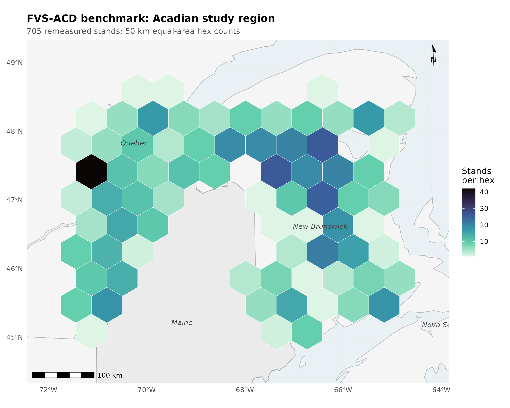

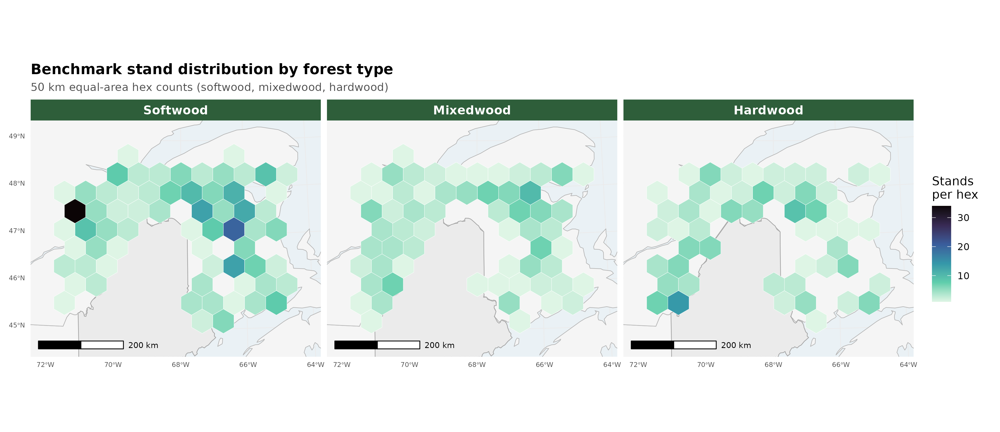

The honest scorecard position. A five-way independent benchmark (v12.5.0, v12.7.0, v12.9.x, v12.10.1,
and OSM v2.26.1) on the identical held-out in-domain data (MagPlot New Brunswick n=355 and ESI-covered
Quebec n=350, New Brunswick and Quebec only, no Maine stands; the independent Maine FIA growing-stand
cross-check in Section 10 is a separate check on a different stand set and is not part of this pooled
n=705 scorecard) places v12.10.1 level with v12.9.x
on the pooled operational domain, both behind OSM there, and ahead of both on the managed cell. Because
the frozen operational harness fully specifies the operational ops, v12.7.1, v12.9.x, and v12.10.1 are
byte identical on the pooled base scorecard and differ only in the managed cells; the five-way therefore
resolves to three distinct pooled engines, v12.5.0, v12.7.0, and the shared v12.7.1, v12.9.x, and
v12.10.1 operational line.

**Table 10.1.** Pooled operational scorecard, v12.10.1 versus the comparison models (nine NSVB metrics).

| model | mean absolute level bias (%) | mean modeling efficiency | TOST level equivalences (of 9) |
|---|---|---|---|
| v12.5.0 | 7.1 | 0.71 | 4 |
| v12.7.0 | 8.0 | 0.73 | 2 |
| v12.9.x | 4.9 | 0.71 | 7 |
| v12.10.1 | 4.9 | 0.71 | 7 |
| OSM v2.26.1 | 3.2 | 0.75 | 8 |

OSM keeps the best pooled level bias (3.2 versus 4.9), the best mean modeling efficiency (0.75 versus
0.71), and the most TOST level equivalences (8 versus 7 of 9, against four of nine for v12.5.0 and two
of nine for v12.7.0). On the frozen harness every model's top height lands in a tight +3.7 to +4.6
percent band, so the apparent top-height over-prediction once read into the older 12.5.0 and 12.7.0
lines was an artifact of the pre-freeze basis and does not survive re-benching; the two older engines
separate instead on volume, v12.5.0 a strong total-volume over-predictor (+9.3 percent, mean absolute
level bias 7.1) and v12.7.0 a volume under-predictor (-8.3 percent, mean absolute level bias 8.0).
v12.10.1 does not claim pooled parity.
The point of v12.10.1 is the managed cell. The Chapter 11 gate closes the managed gap sharply in
absolute basal-area bias, planted from -24.9 to -4.4 percent, PCT from -15.6 to -1.3 percent, and the
managed class as a whole from -19.0 to -2.5 percent, and v12.10.1 beats OSM on every managed class in
absolute basal-area bias (managed 2.5 versus 11.2, planted 4.4 versus 20.9, PCT 1.3 versus 5.4). One
frozen-basis caveat to flag: gate-on planted total volume now sits at -10.8 percent, because the frozen
anchor lowers untreated planted-stand volume so the fixed additive release closes less of the volume
gap; the basal-area releases themselves are unchanged. On the pooled
domain v12.10.1 and v12.9.x are identical to one decimal, because the modifier touches only managed stands
and those are a small share of the in-domain pool, so pooled mean absolute bias (4.9), RMSE, and modeling
efficiency all carry over from v12.9.x unchanged and the modifier's effect appears only in the managed
cell. On the pooled domain the FVS-ACD advantage is quadratic mean diameter (about +1 percent versus OSM
+11 percent), biological realism, transparency, and a climate-ready site driver, not pooled precision.

The forest-type scorecard. The pooled result hides a composition split. Classified by the softwood-basal-area
fraction of the initial treelist (softwood at most 25 percent hardwood basal area, hardwood at least 75 percent,
mixedwood between), the 705 in-domain stands resolve to softwood 321, mixedwood 186, and hardwood 178, with 20
unclassified stands excluded. The full nine-metric forest-type scorecard follows as signed level bias in percent
for each of the five models on the frozen basis; bootstrap 95 percent confidence intervals and the green, yellow,
and red flags for every cell are in Figure 7.

**Table 10.2a.** Softwood forest-type scorecard (n = 321), level bias (percent).

| model | BA | SDI | QMD | TOPHT | TOTVOL | MERCHVOL | SAWVOL | BIOMASS | VALUE |
|---|---|---|---|---|---|---|---|---|---|
| v12.5.0 | +0.8 | +3.4 | -5.1 | -0.6 | +0.6 | +0.4 | -0.2 | +1.1 | +0.5 |
| v12.7.0 | -16.0 | -14.2 | -1.5 | -1.4 | -16.4 | -16.5 | -16.9 | -16.2 | -16.4 |
| v12.9.x | -14.0 | -12.8 | +0.1 | -1.2 | -14.1 | -14.2 | -14.7 | -14.1 | -14.1 |
| v12.10.1 | -14.0 | -12.8 | +0.1 | -1.2 | -14.1 | -14.2 | -14.7 | -14.1 | -14.1 |
| OSM | -2.3 | -3.2 | +8.1 | +3.9 | -1.0 | -1.0 | -0.8 | -1.4 | -1.1 |

**Table 10.2b.** Mixedwood forest-type scorecard (n = 186), level bias (percent).

| model | BA | SDI | QMD | TOPHT | TOTVOL | MERCHVOL | SAWVOL | BIOMASS | VALUE |
|---|---|---|---|---|---|---|---|---|---|
| v12.5.0 | -2.1 | -0.7 | -4.9 | +3.2 | +7.2 | +6.7 | +6.3 | +6.4 | +8.8 |
| v12.7.0 | -17.0 | -16.3 | -1.1 | +2.1 | -9.5 | -10.0 | -10.3 | -10.4 | -8.3 |
| v12.9.x | -12.5 | -12.6 | +0.4 | +2.6 | -4.1 | -4.6 | -4.7 | -5.2 | -2.6 |
| v12.10.1 | -12.5 | -12.6 | +0.4 | +2.6 | -4.1 | -4.6 | -4.7 | -5.2 | -2.6 |
| OSM | -7.7 | -10.0 | +9.1 | +1.8 | -3.9 | -4.2 | -3.5 | -5.2 | -3.0 |

**Table 10.2c.** Hardwood forest-type scorecard (n = 178), level bias (percent).

| model | BA | SDI | QMD | TOPHT | TOTVOL | MERCHVOL | SAWVOL | BIOMASS | VALUE |
|---|---|---|---|---|---|---|---|---|---|
| v12.5.0 | +15.3 | +18.2 | -7.1 | +12.3 | +31.3 | +30.0 | +30.6 | +30.8 | +32.8 |
| v12.7.0 | -1.9 | -0.3 | -1.4 | +11.4 | +11.4 | +10.2 | +10.8 | +10.6 | +12.7 |
| v12.9.x | +3.9 | +4.3 | +0.6 | +11.7 | +19.0 | +17.6 | +18.4 | +17.9 | +20.4 |
| v12.10.1 | +3.9 | +4.3 | +0.6 | +11.7 | +19.0 | +17.6 | +18.4 | +17.9 | +20.4 |
| OSM | +7.1 | +2.6 | +16.5 | +6.9 | +14.6 | +13.1 | +14.6 | +13.6 | +16.0 |

Read across composition, the softwood block is the pooled volume story in miniature: the shared newer build
under-reads every merchantable output by about 14 percent and flags red on all five, while OSM holds all five
within about 1.5 percent of zero and flags green, and structure is clean for the newer build with quadratic
mean diameter and top height inside 1.2 percent even as basal area sits at -14.0. Mixedwood is the most balanced
stratum, the shared newer build and OSM both inside about 5 percent on every volume metric. Hardwood is the
shared frontier, every model over-reading the merchantable outputs, the shared newer build by 18 to 20 percent
and OSM by 13 to 16, all red, confirming a composition-driven ceiling for the v13 composition-aware refit rather
than a management-modifier problem.

The accuracy-and-precision view (percent RMSE). Percent bias measures only systematic offset, and it inflates on
metrics with low means, so a small absolute error reads as a large percentage. To score accuracy and precision
together we add the percent RMSE, %RMSE = 100 × RMSE / mean(observed) with RMSE = sqrt(mean((observed −
predicted)²)), which penalises both systematic error and scatter and so is the fairer accuracy-and-precision
summary. Uncertainty is a within-province stratified bootstrap (2000 replicates), resampling stands within New
Brunswick and Quebec.

**Table 10.2d.** Percent RMSE by model and metric, pooled in-domain set (n = 705). Lower is better.

| metric | v12.5.0 | v12.7.0 | v12.9.x | v12.10.1 | OSM |
|---|---|---|---|---|---|
| BA | 40.8 | 45.3 | 45.8 | 45.8 | 39.6 |
| SDI | 40.9 | 45.9 | 46.2 | 46.2 | 39.6 |
| QMD | 27.8 | 25.4 | 25.7 | 25.7 | 29.1 |
| TOPHT | 18.8 | 18.2 | 18.4 | 18.4 | 16.1 |
| TOTVOL | 56.0 | 52.3 | 55.2 | 55.2 | 51.1 |
| MERCHVOL | 53.6 | 50.9 | 53.4 | 53.4 | 49.0 |
| SAWVOL | 57.7 | 55.1 | 57.8 | 57.8 | 53.4 |
| BIOMASS | 52.2 | 47.9 | 50.6 | 50.6 | 47.2 |
| VALUE | 62.0 | 55.8 | 59.4 | 59.4 | 56.3 |

Structure metrics are tight (top height near 18 percent, quadratic mean diameter near 26); the merchantable
outputs carry the scatter, total volume, sawlog volume, and value all in the mid-50s to low-60s percent even
where mean bias is only a few percent. On the pooled set v12.10.1 total volume is 55.2 percent and value 59.4;
OSM is a little lower at 51.1 and 56.3. This reframes the hardwood result. Hardwood error is scatter-dominated,
not bias-dominated: v12.10.1 hardwood total volume carries a mean bias of about +19 percent but a %RMSE of about
76 percent, and value about +20 percent bias against about 81 percent %RMSE, with OSM similar (hardwood
total-volume %RMSE about 75 percent, value about 80). The percentage bias understates the true error because
most of that error is variance, so hardwood is a high-variance frontier shared by all five models rather than a
systematic defect of any one build. Figure 11 is the %RMSE scorecard with within-province bootstrap intervals.

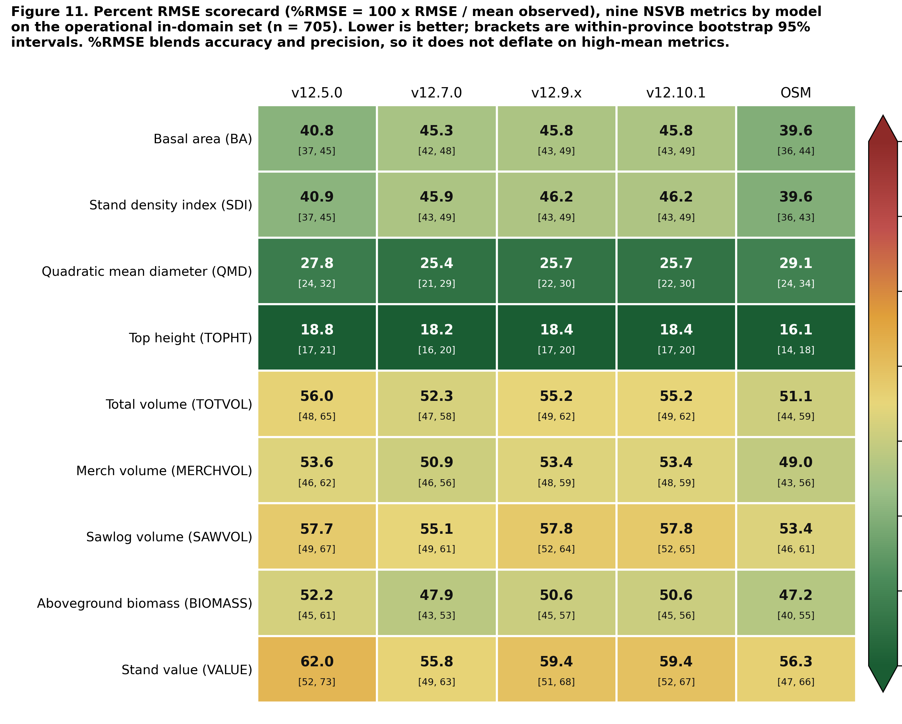

Observed-on-predicted regression and the region of equivalence. For each model, metric, and stratum we fit the
ordinary least squares regression of observed on predicted, observed = a + b × predicted, and test slope and
intercept jointly with a Robinson and Froese (2004) equivalence test (two one-sided tests at alpha = 0.05): the
intercept is equivalent to zero when its 90 percent interval lies within plus or minus 25 percent of the mean
observed value, and the slope is equivalent to one when its interval lies in 0.75 to 1.25, with overall
equivalence requiring both. This regression equivalence complements the paired-difference TOST reported with
Table 10.1. Because observed is regressed on predicted, a slope above one means the model under-predicts the high
end.

**Table 10.2e.** Observed-on-predicted regression and equivalence flags, pooled in-domain set (n = 705), key
metrics. TRUE means the parameter's 90 percent interval lies inside its region of equivalence.

| metric | model | slope b | intercept a | R² | slope equiv | intercept equiv | overall |
|---|---|---|---|---|---|---|---|
| BA | v12.5.0 | 0.93 | 0.72 | 0.73 | TRUE | TRUE | TRUE |
| BA | v12.7.0 | 1.21 | -0.81 | 0.71 | FALSE | TRUE | FALSE |
| BA | v12.9.x | 1.14 | -0.42 | 0.68 | TRUE | TRUE | TRUE |
| BA | v12.10.1 | 1.14 | -0.42 | 0.68 | TRUE | TRUE | TRUE |
| BA | OSM | 0.98 | 0.79 | 0.74 | TRUE | TRUE | TRUE |
| TOTVOL | v12.5.0 | 0.83 | 8.45 | 0.74 | TRUE | TRUE | TRUE |
| TOTVOL | v12.7.0 | 1.04 | 4.02 | 0.75 | TRUE | TRUE | TRUE |
| TOTVOL | v12.9.x | 0.99 | 5.08 | 0.71 | TRUE | TRUE | TRUE |
| TOTVOL | v12.10.1 | 0.99 | 5.08 | 0.71 | TRUE | TRUE | TRUE |
| TOTVOL | OSM | 0.95 | 2.96 | 0.75 | TRUE | TRUE | TRUE |
| VALUE | v12.5.0 | 0.81 | 419.6 | 0.73 | TRUE | TRUE | TRUE |
| VALUE | v12.7.0 | 1.01 | 230.2 | 0.74 | TRUE | TRUE | TRUE |
| VALUE | v12.9.x | 0.95 | 303.0 | 0.71 | TRUE | TRUE | TRUE |
| VALUE | v12.10.1 | 0.95 | 303.0 | 0.71 | TRUE | TRUE | TRUE |
| VALUE | OSM | 0.93 | 177.5 | 0.74 | TRUE | TRUE | TRUE |

Across all nine metrics, four of the five models pass the joint equivalence test on every metric (nine of nine).
The single exception is v12.7.0 basal area, whose slope of 1.21 sits just outside the 0.75 to 1.25 region once
its confidence interval is included; its intercept still passes, and its volume and value slopes are essentially
one. Every volume and value cell passes overall equivalence for all five models, with total-volume slopes 0.83
to 1.04 and value slopes 0.81 to 1.01, and the operational build v12.10.1 tracks the 1:1 line with a
total-volume slope of 0.99 and a value slope of 0.95. Equivalence is a stricter, more transparent claim than a
low p-value on a difference test, stating the size of the departure tolerated up front. Figure 10 is the
observed-versus-predicted equivalence plot.


The overall composite score. To collapse the nine metrics into one number per model, each model earns a composite
score from 0 to 100, higher is better. We compute two composites and lead with the accuracy-and-precision view,
because %RMSE (Table 10.2d) scores systematic error and scatter together where bias alone flatters a low-scatter
but biased build. The primary composite is built on %RMSE: each metric earns a score of 100 × max(0, 1 − %RMSE /
100), and the composite is the weighted mean of the nine metric scores with total volume and stumpage value
carrying the highest weight (total volume 3, value 3, the other three merchantable outputs 2 each, the four
structure metrics 1 each, for a weight sum of 16). The complementary composite is the earlier bias-and-efficiency
blend: per metric a bias score of 100 × (1 − min(1, |bias| / 20)) blended equally with an efficiency score of 100
× max(0, NSE), combined under the same volume-and-value weighting, with an equal-weight mean carried as a
reference. This volume and value first weighting reflects the operational priority that a growth engine reproduce
harvest volume and value before stand structure.

**Table 10.3a.** Primary %RMSE-weighted composite score (0 to 100, higher is better), volume and value weighting,
by model and stratum.

| model | pooled in-domain | softwood | mixedwood | hardwood |
|---|---|---|---|---|
| OSM | 53.4 | 61.6 | 59.5 | 34.4 |
| v12.7.0 | 52.1 | 56.3 | 59.1 | 39.2 |
| v12.9.x | 49.8 | 55.3 | 58.2 | 33.4 |
| v12.10.1 | 49.8 | 55.3 | 58.2 | 33.4 |
| v12.5.0 | 49.4 | 61.2 | 57.8 | 23.5 |

On the pooled set the %RMSE composite ranks OSM first (53.4), v12.7.0 second (52.1), v12.9.x and v12.10.1 tied at
49.8, and v12.5.0 at 49.4. The two views diverge on v12.7.0: it ranks low on the bias composite (Table 10.3b)
because it carries real systematic offsets, but rises to second on %RMSE because its predictions are less
scattered once systematic and random error are scored together, while v12.10.1 is the least biased of the
FVS-ACD engines with slightly more scatter, leading v12.7.0 on bias but tying v12.9.x just behind it on %RMSE.
OSM stays first on both. Every model scores far lower on hardwood, the shared high-variance frontier of the
%RMSE section above.

**Table 10.3b.** Complementary bias-and-efficiency composite score (0 to 100, higher is better), primary volume
and value weighting, by model and stratum, with the pooled equal-weight composite for reference.

| model | pooled in-domain | softwood | mixedwood | hardwood | pooled equal-weight |
|---|---|---|---|---|---|
| OSM | 80.9 | 85.3 | 76.1 | 47.0 | 79.3 |
| v12.9.x | 74.3 | 55.7 | 74.8 | 40.4 | 73.0 |
| v12.10.1 | 74.3 | 55.7 | 74.8 | 40.4 | 73.0 |
| v12.5.0 | 64.9 | 87.4 | 71.6 | 26.3 | 67.9 |
| v12.7.0 | 66.5 | 51.3 | 63.7 | 58.5 | 66.4 |

The pooled ranking is robust at the top and to the choice of weighting: OSM leads and the shared newer build
(v12.9.x and v12.10.1, identical on the base) sits second on both the primary volume and value weighting and the
equal-weight reference, with only the two oldest engines trading the fourth and fifth positions, v12.7.0 rising
above v12.5.0 once volume and value dominate the score. Within forest types the top two are unchanged between
weightings in every stratum, while the by-type ordering shifts with composition: softwood is led by v12.5.0 then
OSM, mixedwood and the pooled set by OSM, and hardwood by v12.7.0, whose flatter hardwood bias scores best on the
one stratum where every newer build over-reads. Figure 8 shows the pooled ranking, the equal-weight reference, and
the by-forest-type composites overlaid.

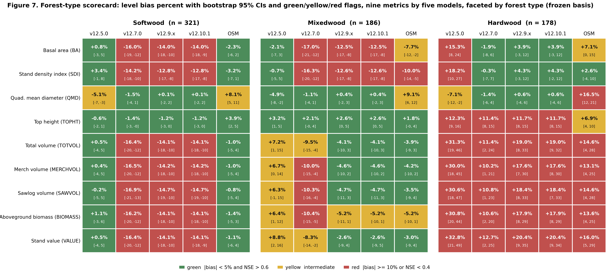


Biological realism (Bakuzis pass). v12.10.1 inherits the v12.9.x self-thinning machinery and, on seeded
160-year projections across the ESI gradient, passes all five relations on the modified Bakuzis matrix
(Leary 1997): Eichhorn (volume a function of height), Reineke self-thinning slope (fitted -1.59 against a
-1.6 target), site ordering with no overtaking, the yield-density plateau (about 36 m² ha⁻¹), and
Sukachev (size versus density). With the management modifier on, a seeded planted-softwood projection
still plateaus at every amplitude tested (standard deviation of basal area over the last 20 years about
0.21, flat), and the ceiling rises smoothly with amplitude because basal area at the Reineke limit rises
with tree size. By contrast v12.5.0 fails self-thinning outright in the same seeded battery. OSM is now scored
on all five relations as well, from a 160-year projection over a real-stand productivity gradient, since it
cannot be seeded on the synthetic ESI gradient. The 73 benchmark stands are binned into low, mid, and high
terciles on OSM's own site-index height, the real-stand analog of the seeded ESI gradient, and the per-site
trajectories are scored with the same relation definitions used for the AcadianGY battery. Over the near-term
horizon, to about age 60, OSM over-accumulates basal area relative to FVS-ACD, which self-thins earlier. Over
the full 160-year horizon, however, OSM does eventually plateau and self-thin: its mid-site basal area peaks
near 36 m² ha⁻¹ and levels to about 35 m² ha⁻¹ on a Reineke slope of about -1.56, so it passes both the
yield-density plateau and Reineke self-thinning, and it passes Sukachev. It flags the two cross-site relations,
Eichhorn (cross-site coefficient of variation of volume at matched height about 26 percent) and site ordering,
and both flags are sensitive to the real-stand substitution: OSM trajectories run on a projection-year axis
from heterogeneous real starting conditions rather than an age-aligned bare-ground gradient, so the cross-site
tests read on unequal starting ages, and that caveat is reported plainly as a qualifier on both flags. The
biological-realism separation between OSM and the v12.7.1 and later builds is therefore not that OSM never
plateaus, but that FVS-ACD self-thins earlier and more consistently and holds cleaner cross-site behavior on
the seeded gradient.

**Table 10.3c.** Modified Bakuzis pass and flag matrix (Leary 1997) by model and law-like relation. The
AcadianGY builds are scored on the seeded ESI gradient; OSM is scored on all five relations from a 160-year
projection over a real-stand productivity gradient (the 73 benchmark stands binned into terciles on OSM's own
site-index height), because it cannot be seeded on the synthetic gradient.

| relation | v12.5.0 | v12.7.0 | v12.9.x | v12.10.1 | OSM |
|---|---|---|---|---|---|
| Eichhorn (V ~ f height) | pass | pass | pass | pass | flag |
| Reineke slope (target -1.6) | flag | pass (-1.8) | pass (-1.59) | pass (-1.59) | pass (-1.56) |
| Site ordering (no overtaking) | pass | pass | pass | pass | flag |
| Yield-density / plateau | flag | pass (37) | pass (36) | pass (36) | pass (36) |
| Sukachev (size vs density) | flag | pass | pass | pass | pass |

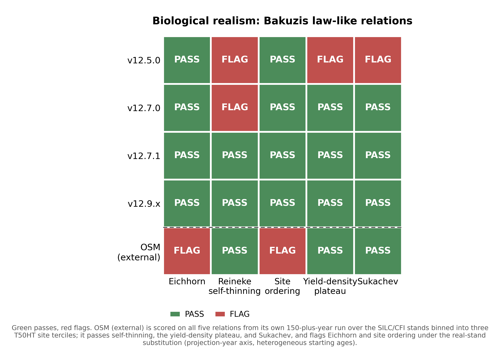

**Figure 3.** Modified Bakuzis matrix (Leary 1997) of law-like stand relationships, showing the pass and flag
pattern for each AcadianGY version and the external OSM entrant on the five relations (Eichhorn, Reineke
self-thinning, site ordering, yield-density plateau, and Sukachev). The AcadianGY builds are evaluated on
seeded 160-year projections across the ESI productivity gradient; OSM is scored on all five from a 160-year
projection over a real-stand productivity gradient, the 73 benchmark stands binned into terciles on OSM's own
site-index height, because it cannot be seeded on the synthetic gradient. OSM passes Reineke self-thinning, the
yield-density plateau, and Sukachev, and flags the two cross-site relations, Eichhorn and site ordering, both
sensitive to the real-stand substitution.

Disclosed ingrowth limit. Observed MagPlot recruitment, tree-id matched across remeasurements, is 39.8
stems ha⁻¹ yr⁻¹ in New Brunswick and 19.7 in Quebec. The shipped expected-value ingrowth hurdle predicts
17.9 and 11.7 stems ha⁻¹ yr⁻¹, about 45 percent of observed in New Brunswick and 59 percent in Quebec.
Recruitment responds in the correct direction to density and management (planted and PCT stands, which
carry lower residual density, recruit more than unmanaged), and the expected-value hurdle lifted
recruitment well off the near-zero floor of the classic 2018 too-infrequent FVS-ACD problem, but a
residual under-prediction of the absolute level remains. This is neither the 2018 near-zero failure nor
an inflated recruitment; it is a real, moderate under-prediction, disclosed as a limit and a target for
the v13 ingrowth refit. It does not change the shipped version and does not touch the managed-cell
scorecard, which is a volume and basal-area result on the tag threshold.

Pooled parity was tested and deferred. A top-height anchor-level correction was tested as a reach for
pooled parity with OSM and deferred to v13.0. In the shipped config a top-height over-prediction of about
+4 percent only partly offsets a basal-area under-prediction of about -10 percent, so FVS-ACD total
volume sits modestly under observed on the unmanaged core, about -4 percent, rather than near zero.
Correcting top height alone removes the offsetting positive term and drives total volume further below
observed rather than toward zero, widening rather than closing the pooled mean absolute bias gap to OSM.
True parity therefore needs a joint re-anchor of dominant height and basal area together, recorded as the
v13.0 domain-plus-increment refit. The gated lever exists in the source (neutral factor reproduces
v12.10.1) but is not adopted for the operational version.

### 10.3.1 Species composition over time

Stand species composition is defined as the basal-area fraction by species group, using live trees at least 4 cm
DBH: softwood versus hardwood, and a three-way split into spruce-fir (*Abies* + *Picea*), other softwood, and
hardwood. For each benchmark stand we have a starting state (t1) and an observed endpoint (t2) from the MagPlot
QC and NB remeasured treelists, and each model predicts the endpoint. Predicted composition for the FVS-ACD
flagships (v12.5.0, v12.7.0, v12.10.1) comes from a non-invasive composition re-run of the frozen benchmark
harness that emits per-group basal area at t2; the run reproduces the frozen August operational baseline
(NB_AFAC 0.579, QC_AFAC 0.111) with zero difference against cb_v12101 on all nine stand totals. OSM predicted
composition is taken directly from its head-to-head predicted treelist. The stand set is the frozen scorecard
pooled set of 705 unique stands; 25 stands lacked classifiable t1 basal area, leaving 680. Forest type is the
committed percent-hardwood rule applied to the t1 treelist (softwood at most 25 percent hardwood BA, hardwood at
least 75 percent, else mixedwood). Bias is predicted minus observed softwood fraction in percentage points
(pts); the shift ratio is predicted mean shift divided by observed mean shift, so 1.0 is a perfect match and a
negative value is a wrong-direction move.

**Table 10.4.** Observed and predicted softwood basal-area fraction across the remeasurement interval, pooled and
by forest type, on the frozen benchmark (n = 680 classifiable stands of the frozen 705). Fractions are
percentages; bias and shifts are in percentage points.

| **Model** | **Stratum** | **n** | **Obs t1 (%)** | **Obs t2 (%)** | **Pred t2 (%)** | **Obs shift (pts)** | **Pred shift (pts)** | **Bias (pts)** | **Direction** | **Shift ratio** |
|:---:|:---:|:---:|:---:|:---:|:---:|:---:|:---:|:---:|:---:|:---:|
| **v12.5.0** | Pooled | 680 | 59.9 | 60.7 | 59.5 | +0.82 | -0.45 | -1.27 | wrong | -0.55 |
| **v12.5.0** | Softwood | 320 | 94.0 | 92.0 | 92.6 | -1.95 | -1.41 | +0.54 | right | 0.72 |
| **v12.5.0** | Mixedwood | 186 | 51.7 | 51.3 | 51.5 | -0.40 | -0.24 | +0.17 | right | 0.59 |
| **v12.5.0** | Hardwood | 174 | 6.1 | 13.3 | 7.2 | +7.20 | +1.08 | -6.13 | right | 0.15 |
| **v12.7.0** | Pooled | 680 | 59.9 | 60.7 | 59.6 | +0.82 | -0.30 | -1.11 | wrong | -0.37 |
| **v12.7.0** | Softwood | 320 | 94.0 | 92.0 | 92.8 | -1.95 | -1.11 | +0.84 | right | 0.57 |
| **v12.7.0** | Mixedwood | 186 | 51.7 | 51.3 | 51.6 | -0.40 | -0.11 | +0.30 | right | 0.26 |
| **v12.7.0** | Hardwood | 174 | 6.1 | 13.3 | 7.1 | +7.20 | +1.00 | -6.21 | right | 0.14 |
| **v12.10.1** | Pooled | 680 | 59.9 | 60.7 | 59.7 | +0.82 | -0.26 | -1.08 | wrong | -0.32 |
| **v12.10.1** | Softwood | 320 | 94.0 | 92.0 | 92.9 | -1.95 | -1.06 | +0.89 | right | 0.54 |
| **v12.10.1** | Mixedwood | 186 | 51.7 | 51.3 | 51.7 | -0.40 | -0.05 | +0.35 | right | 0.14 |
| **v12.10.1** | Hardwood | 174 | 6.1 | 13.3 | 7.1 | +7.20 | +0.98 | -6.22 | right | 0.14 |
| **OSM** | Pooled | 680 | 59.9 | 60.7 | 60.8 | +0.82 | +0.88 | +0.06 | right | 1.08 |
| **OSM** | Softwood | 320 | 94.0 | 92.0 | 94.0 | -1.95 | +0.02 | +1.97 | wrong | -0.01 |
| **OSM** | Mixedwood | 186 | 51.7 | 51.3 | 53.5 | -0.40 | +1.81 | +2.21 | wrong | -4.49 |
| **OSM** | Hardwood | 174 | 6.1 | 13.3 | 7.6 | +7.20 | +1.46 | -5.74 | right | 0.20 |


Stand composition is nearly stationary across the interval: the pooled mean softwood fraction moves less than one
point (59.9% to 60.7%), and the only large observed signal is a +7.2 pt softwood gain in hardwood-dominated
stands, partly offset by a -1.9 pt softwood loss in softwood stands. All three FVS-ACD models reproduce the
direction of change within softwood and mixedwood stands but under-shift by roughly a third to a half, and they
miss the pooled net direction, predicting a small softwood decline (-0.3 to -0.5 pt) against the observed +0.8 pt
increase, because they under-represent softwood in-migration into hardwood stands (predicted about +1.0 pt versus
observed +7.2 pt, bias near -6 pts). OSM best tracks the pooled net shift (+0.9 pt, ratio 1.08) but overshoots
softwood in mixedwood and softwood stands; the spruce-fir split tells the same story, with the observed +7.0 pt
spruce-fir gain in hardwood stands under-predicted by every model. Every model holds stand-level softwood
fraction within about 1 to 2 pts of observed in softwood and mixedwood types, so overall composition is preserved
and the shared weakness is the rate of softwood recolonization of hardwood-dominated stands.

### 10.4 v12.11: correcting the maturity-dependent long-horizon volume bias (candidate)

A component decomposition completed 18 July 2026 isolated a long-horizon total-volume bias in v12.10.1
that flips sign across the stand-maturity gradient: an under-prediction in developing stands and an
over-prediction in mature stands, the net of three separate systematic errors in survivor growth,
mortality, and ingrowth rather than a single mechanism (Figure 15). AcadianGY 12.11 is the candidate
correction, built and validated but not yet operational. v12.10.1 remains the frozen model of record
for the 18 August 2026 Acadian Growth and Yield meeting, and every v12.11 lever is gated off by
default, so a gate-off build reproduces v12.10.1 bit for bit: maximum absolute difference 0.000e+00 in
diameter increment, height increment, and expansion factor, confirmed on the original benchmark and
independently reconfirmed by a red-team review on a novel out-of-sample stand not used in development
(10.6). v12.11 addresses the three components not with raw per-tree multipliers but with the
stand-constraint approach of Weiskittel, Hann, Kershaw, and Vanclay (2011b), Chapter 10, of
conditioning or constraining tree-level predictions on stand-level targets, applied through five gated
levers.

Lever 1, recruitment (`ops$ingrowth.mult`), carries a flat basal-area-anchored ingrowth multiplier
(pooled about 2.5x) to address the disclosed ingrowth limit (10.3). A gated relative-density taper
(`ops$use.ingrowth.rdtaper`) was built to protect mature closed stands from the flat multiplier, but is
not enabled in the locked candidate configuration; a separate, always-on density-release logistic
(`ops$use.ingrowth.release`) already suppresses recruitment at high relative density regardless of
which recruitment lever is active, so the flat multiplier is not applied undamped in closed stands.

Lever 2, mortality (`ops$mort.dens.scale`), attenuates the self-thinning removal fraction in managed
stands only: f(RD) = fmin + (1 - fmin)*exp(-k*max(RD - RD0, 0)), where RD = SDI/SDImax, fitted
fmin = 0.13, k = 12.4, RD0 = 0.38. Natural, unmanaged stands are untouched, so the Reineke self-thinning
slope and the long-horizon density plateau are preserved.

Lever 3, survivor diameter increment, is the direct application of the Chapter 10 stand constraint. Two
gated forms were built: 3a, a direct size-by-maturity rein, and 3b, the shipped form, which lowers the
activation thresholds on the engine's existing proportional-increment constraint to a stand
basal-area-increment target, gated by a quadratic-mean-diameter floor (`ops$ddbh.standcon.qmin` = 22 cm)
so the constraint binds only in mature, high-QMD stands and spares developing stands. The QMD floor was
added after the component decomposition showed an un-gated 3b suppressed developing-stand growth. Form
3a over-corrects the held-out mature Baxter benchmark (total volume bias -7.2 percent), so 3b is the
shipped configuration: 3b tames Baxter from +9.12 to +6.92 percent without a sign flip and improves the
managed CTRN (-9.8 to -4.8 percent) and New Brunswick (-4.4 to -1.3 percent) sources (Figures 16 and 17).
Those four figures come from the lever-selection run, in which Lever 3b is the only lever active
(`v1211_maturity_scorecard.csv`), and they are not the shipped candidate's values. Table 10.5, where all five
levers are on, gives CTRN -9.78 to -2.24 and NB MagPlot -11.84 to -5.96. The two sets are consistent and
measure different configurations.
This configuration selection should be re-examined rather than carried forward as gated. Baxter has since
been repaired and rescored (10.5.1): 463 measured stems were recovered from the staged t2 tree list, a
group-specific height curve was fitted and validated against them, and scoring observed volume with measured
heights where they exist and that curve elsewhere puts base at +2.42 percent and the candidate at +2.07
percent on the same 91 stands (Table 10.5b). The ordering that gated the choice survives the rescore, since
every configuration is scored against one observed denominator, but the magnitudes it was argued on have
moved by roughly two-thirds. The rescore covers base, candidate, and OSM rather than the 3a form itself, so
re-running the held-out gate on the repaired list is the step that remains (10.5.1).

Lever 4, hardwood height conditioned on form and risk (`ops$use.dht.hw.mod`), addresses a missing term
in the base height-increment equation (4.7): height drives NSVB volume, and the base model carried no
form or risk penalty. Fitted from the Ryan Smith field NHRI form and risk dataset (635 trees across the
Smith, Rangeley, AshlandEast, and AshlandWest sites), high-risk trees are about 10 to 11 percent shorter
in *Betula alleghaniensis* Britton and *Acer saccharum* Marshall (both strongly significant, p < 0.002),
a weaker effect in *Acer rubrum* L. Poor form carries only a small total-height effect, expected because
form governs sawlog and merchantable height and defect, a partition already carried downstream by the
Smith sawlog-fraction model, not total height. The worst-quality combination, poor form and high risk,
in *Acer saccharum* Marshall gives a 16 percent, about 3.7 m, height deficit at a 23 m mature tree,
consistent with an independent field estimate that roughly 4 m of sugar maple height deficit explains
about 18 percent of the hardwood volume gap. *Quercus rubra* L. was not represented in the Smith height
set (n = 1, dropped), and its fitted coefficient otherwise rested on the FIA Growth, Removal, and
Mortality damage-code proxy that the Smith field data was adopted specifically to avoid; it has
accordingly been capped to the *Betula alleghaniensis* Britton and *Acer saccharum* Marshall field
magnitude pending independent red oak field heights from the Castle inventory (10.6).

The fifth investigated mechanism, crown ratio, proved to already be active rather than a needed new
lever. Crown ratio is projected dynamically every cycle by the Russell, Weiskittel, and Kershaw (2014)
recession model (4.3) and already feeds diameter and height increment; a changelog note describing
disabled crown-ratio imputation was four years stale. A recalibration of the 2014 recession coefficients
for the developing end remains a worthwhile future item, carried into the v13 program (10.7) rather than
treated as a v12.11 lever.

The candidate clears a four-part guardrail battery ahead of being declared a release candidate. The
frozen in-domain FIA NSVB benchmark shows no regression: basal-area bias improves from -11.28 to -7.31
percent and total-volume bias from -4.41 to -1.50 percent, while top-height bias drifts from +4.21 to
+5.88 percent, a watch item addressed in 10.6 rather than attributed to a lever. The five Bakuzis
relations (Leary 1997) pass in the primary, unmanaged mapping, matching the frozen model. The
approximately 160-year density plateau holds, with the standard deviation of basal area over the last
20 years under 1 percent of the mean and no runaway or collapse behavior. The managed out-of-sample
comparison against OSM v2.26.1 improves, beating or tying OSM on three of four CTRN and New Brunswick
MagPlot cells (10.5).

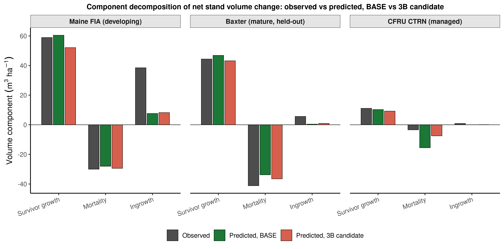

**Figure 15.** Component decomposition of net stand volume change into survivor growth, mortality, and
ingrowth, observed versus predicted under the frozen v12.10.1 base and the v12.11 3B candidate, for a
developing (Maine FIA), mature held-out (Baxter), and managed (CFRU CTRN) source. The
maturity-dependent bias traces to offsetting errors across these three components rather than a single
mechanism.

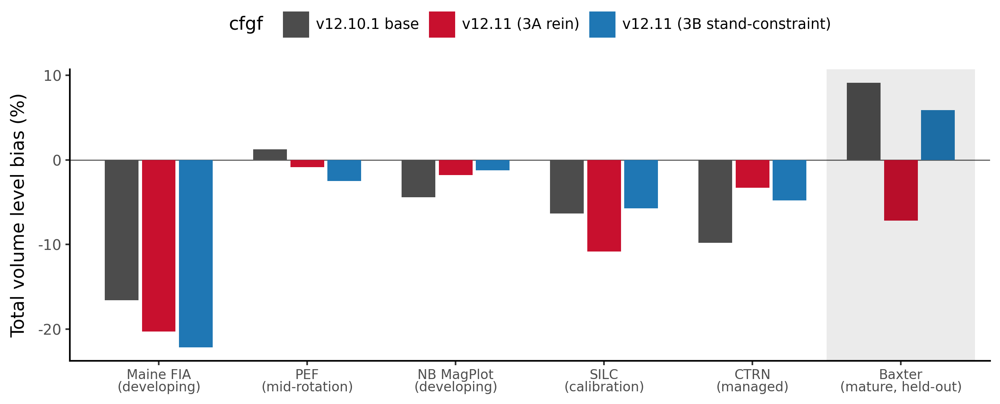

**Figure 16.** Total volume level bias across the stand-maturity gradient, from developing (Maine FIA)
through mid-rotation (PEF) and managed (NB MagPlot, SILC, CTRN) sources to the mature, held-out Baxter
benchmark (shaded panel), comparing the frozen v12.10.1 base against the two candidate forms of the
Lever 3 stand constraint. 3A is a direct size-by-maturity rein; 3B, the QMD-gated proportional stand
constraint, is the shipped v12.11 configuration. 3B moves the held-out Baxter bias toward zero without
a sign flip and improves the managed sources, while 3A over-corrects Baxter in the opposite direction.
The mature Baxter terminus of this gradient should be read with the height-coverage accounting in
10.5.1. That source has since been repaired and rescored, and its mature over-prediction holds in sign at
roughly a quarter of the magnitude plotted here (Table 10.5b), which flattens this end of the gradient
without reversing it; the configuration choice gated on it should be re-examined against that table.

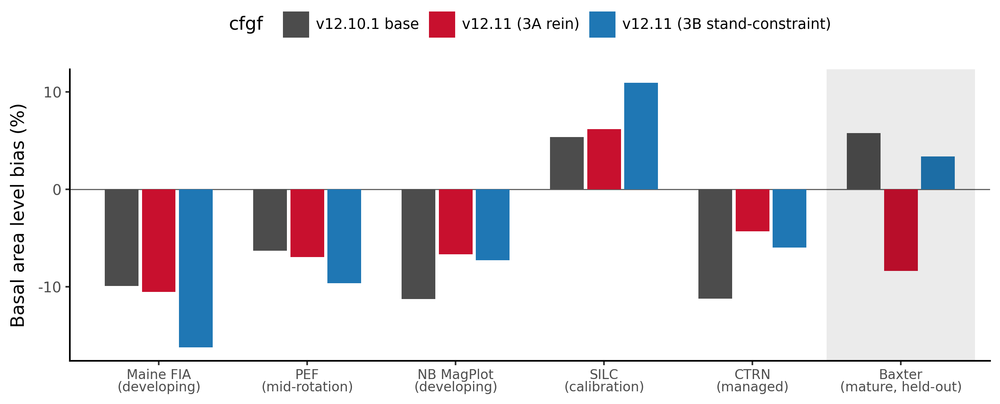

**Figure 17.** Basal-area level bias across the same stand-maturity gradient and model configurations
as Figure 16. As with total volume, 3B moves the held-out Baxter basal-area bias toward zero and
improves the managed sources, with two flags carried into 10.5 and 10.6: SILC basal-area bias widens
under 3B, and the Quebec managed source (not shown on this developmental figure, added in the 10.5
all-sites refresh) shows the same widening pattern.

### 10.5 All-sites validation: v12.11 versus base and OSM v2.26.1 (Maine, New Brunswick, Quebec)

![Figure 20. FVS-ACD benchmark footprint across Maine, New Brunswick, Quebec, and Nova Scotia. Maine FIA and NB and QC MagPlot are shown as 50 km equal-area hex stand counts; Nova Scotia is shown the same way, as county-level PSP density on an equal-area hex grid (aggregated, licensed data, never per-plot); SILC/Seven Islands and CFRU CTRN are shown as multiple aggregated locations rather than single centroids; Baxter and PEF remain single aggregated or public-location markers. No true plot coordinate, for any of the four jurisdictions, appears in this figure.](figures/fig20_benchmark_footprint.png)

**Figure 20.** FVS-ACD benchmark footprint across Maine, New Brunswick, Quebec, and Nova Scotia, all four
jurisdictions on the same 50 km equal-area hex convention. Coordinate handling follows the hard restriction on
FIA true plot coordinates and, for Nova Scotia, the plot-confidentiality terms of its 2016 provincial data
license with the University of Maine: no individual plot location, for any of the four jurisdictions, is used
anywhere in this pipeline or appears in this figure.

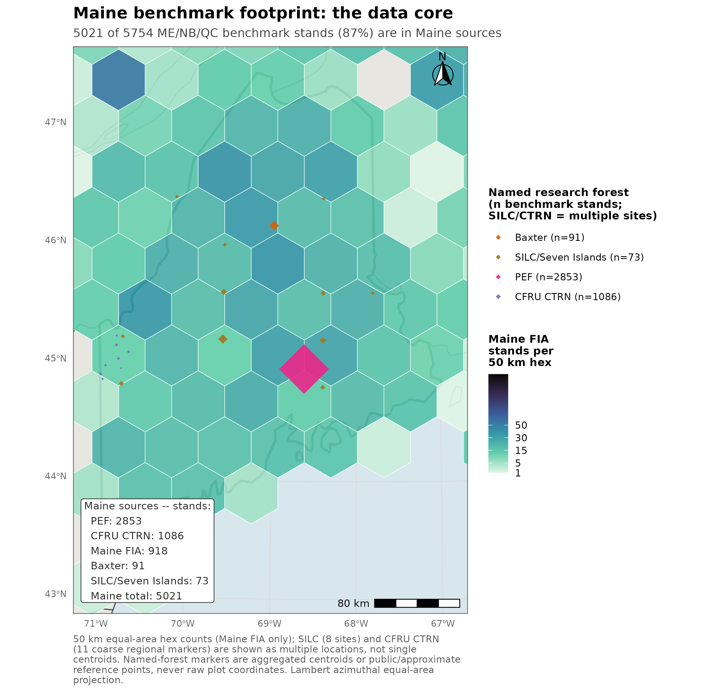

**Figure 21.** Maine benchmark footprint, the data core of the pooled all-sites total: 5,021 of 5,754 pooled
Maine, New Brunswick, and Quebec benchmark stands, 87 percent, are Maine sources. Nova Scotia, evaluated
separately in section 10.7 as an independent benchmark, is not part of this pooled total.


**Figure 22.** FVS-ACD benchmark sample sizes by source, region, and forest group. Nova Scotia is shown as a
separate managed-versus-unmanaged panel, consistent with its treatment throughout this report as an
independent benchmark rather than a pooled all-sites source.

The candidate was rescored against the frozen v12.10.1 base and the current OSM release (v2.26.1)
across every independent source available in the Acadian region, NSVB currency throughout: the
held-out mature Baxter benchmark, the managed CFRU CTRN and New Brunswick MagPlot networks, the
developing Maine FIA network at both whole-plot and FIA subplot (about 0.017 ha) grain, the
mid-rotation Penobscot Experimental Forest (PEF), the SILC Seven Islands calibration set, and the
managed Quebec MagPlot network. Aggregates only; proprietary tree records and true plot coordinates
stayed on Cardinal.

**Table 10.5.** All-sites total volume and basal-area level bias (percent) and total-volume percent
RMSE, v12.11 candidate versus the frozen v12.10.1 base and OSM v2.26.1, by region and source (NSVB
currency). The PEF and Baxter total-volume entries are scored on largely imputed heights, 4.02 and 18.45
percent measured coverage, and should be read with 10.5.1; PEF's (developing) label describes the stand
condition and is not a validated developing-stand volume score, and the Baxter rows are retained as
published alongside the validated height sensitivity in Table 10.5b. The managed CTRN and MagPlot entries
carry a comparable exposure, at 51.99 and 32.82 percent measured coverage. Basal-area entries are unaffected
by that substitution, which the scoring harness applies to height only.

| Region | Source | Grain | Model | n | Total volume bias (%) | Basal area bias (%) | Total volume %RMSE |
|---|---|---|---|---|---|---|---|
| ME | Baxter (mature, held out) | stand | base | 91 | +9.12 | +5.74 | 48.3 |
| ME | Baxter | stand | v12.11 | 91 | +6.92 | +4.47 | 48.1 |
| ME | Baxter | stand | OSM | 91 | +12.37 | +13.28 | 50.8 |
| ME | CTRN (managed) | stand | base | 1086 | -9.78 | -11.26 | 24.8 |
| ME | CTRN | stand | v12.11 | 1086 | -2.24 | -3.52 | 18.1 |
| ME | CTRN | stand | OSM | 1033 | -4.81 | -4.19 | 20.5 |
| ME | Maine FIA (developing) | subplot (finer, does not transfer) | base | 2858 | -24.90 | -18.37 | 51.1 |
| ME | Maine FIA | subplot | v12.11 | 2858 | -24.82 | -16.86 | 51.3 |
| ME | Maine FIA | whole-plot | base | 918 | -16.60 | -9.93 | 38.7 |
| ME | Maine FIA | whole-plot | v12.11 | 918 | -16.13 | -7.45 | 38.6 |
| ME | Maine FIA | whole-plot | OSM | 918 | -6.29 | -3.16 | 31.9 |
| ME | PEF (developing) | stand | base | 2853 | +1.23 | -6.33 | 18.0 |
| ME | PEF | stand | v12.11 | 2853 | +1.37 | -5.42 | 17.9 |
| ME | PEF | stand | OSM | 2853 | +0.26 | -3.72 | 14.7 |
| ME | SILC Seven Islands (calibration) | stand | base | 73 | -6.34 | +5.35 | 65.0 |
| ME | SILC | stand | v12.11 | 73 | -5.65 | +11.02 | 64.2 |
| ME | SILC | stand | OSM | 69 | -18.07 | -11.17 | 63.0 |
| NB | NB MagPlot (managed) | stand | base | 355 | -11.84 | -8.84 | 48.9 |
| NB | NB MagPlot | stand | v12.11 | 355 | -5.96 | -2.33 | 41.9 |
| NB | NB MagPlot | stand | OSM | 355 | -8.07 | -2.48 | 43.8 |
| QC | QC MagPlot (managed) | stand | base | 378 | +1.23 | -12.95 | 59.3 |
| QC | QC MagPlot | stand | v12.11 | 378 | +9.46 | -4.12 | 58.5 |

v12.11 wins clearly where it was designed to win. In the managed sources, CTRN and NB MagPlot, bias on
both basal area and total volume is roughly halved against the frozen base, with lower percent RMSE,
and the candidate beats OSM v2.26.1 outright on both sites. The held-out mature Baxter benchmark moves
toward zero (total volume +9.12 to +6.92 percent) and beats OSM by a wide margin (OSM +12.37 percent),
although all three of those Baxter readings rest largely on imputed heights, at 18.45 percent measured
coverage, and the model ordering among them is more durable than their levels; the repaired and rescored
Baxter numbers in Table 10.5b hold that ordering while moving every level toward zero (10.5.1).
Two flags accompany the managed win. In Quebec, the management gate over-corrects basal area relative
to volume: QC MagPlot basal-area bias improves sharply (-12.95 to -4.12 percent) but total-volume bias
worsens from near zero to +9.46 percent. SILC basal-area bias widens as well (+5.35 to +11.02 percent).
Where v12.11 does not win: PEF and SILC total volume change little, since PEF runs with the management
gate off by source-level convention, and OSM leads on the developing Maine FIA whole-plot comparison
(OSM -6.29 percent versus the candidate's -16.13 percent). The PEF half of that explanation is incomplete
and is corrected here. PEF's near-zero and nearly flat total volume is largely an artifact of the height
imputation described in 10.5.1, since only 1.60 percent of PEF tree records carry a measured height, and
rescoring the source on a curve fitted to measured Maine heights moves it from about +1.2 to -3.8 percent.
The management-gate convention explains why the candidate moves PEF little; it does not explain the level
at which PEF sits, and that level is not evidence that the engine is unbiased on developing stands. The
developing end, at both whole-plot and especially FIA subplot grain, remains the acknowledged open gap and the explicit target of the v13.1
hierarchical mortality and ingrowth refit (10.7); no reported subplot or whole-plot Maine FIA number in
this section should be read as a claim that the developing end is closed (10.6).

#### 10.5.1 Benchmark integrity: measured-height coverage across the eleven sources

Every total-volume, biomass, and stand-value number in sections 10.4 through 10.8 is produced by applying
the same NSVB emulator (7) to the observed and to the predicted tree list, and that emulator substitutes a
diameter-only height curve for any tree that carries no measured height. The substitution is not symmetric
between the two lists. The observed list carries raw staged heights while the predicted list carries model
output, so the curve fires overwhelmingly on the observed side, which places its error in the denominator
of the bias ratio, where it does not cancel. The limit is stated once here, in full, and the passages it
qualifies point back to this subsection. It changes no number reported in this GTR. It changes how several
of them should be read. The companion benchmark report (`FVS-ACD_v12.11_benchmark_report.md`, section 2.1)
carries the same accounting and is the source of every figure below.

A coverage census across all eleven staged benchmark sources, run on the analysis cluster (SLURM job
13305450), now gives that exposure directly, and it supersedes the partial accounting this subsection
carried earlier, which reached three sources. Coverage is reported as the share of t2 basal area carried by
stems with a measured height, at DBH >= 4 cm. The curve ratio is the basal-area-weighted ratio of the
diameter-only curve prediction to measured height, computed over the measured stems only, so a ratio below
1.0 means the curve runs short.

**Table 10.5a.** Measured-height coverage by benchmark source and species group, share of t2 basal area at
DBH >= 4 cm, with the ratio of the diameter-only height curve to measured height over the measured stems
(coverage census, SLURM job 13305450). Sources are ordered by total coverage.

| Source | Coverage, all (%) | Coverage, softwood (%) | Coverage, hardwood (%) | Curve / measured, softwood | Curve / measured, hardwood |
|---|---|---|---|---|---|
| PEF | 4.02 | 4.21 | 3.13 | 0.959 | 0.737 |
| Baxter | 18.45 | 17.64 | 20.39 | 0.941 | 0.810 |
| NB and QC MagPlot | 32.82 | 30.50 | 36.30 | 0.946 | 0.780 |
| CFRU CTRN | 51.99 | 51.52 | 78.48 | 0.891 | 0.672 |
| Nova Scotia, long | 73.37 | 71.97 | 76.29 | 1.075 | 0.871 |
| Nova Scotia | 76.15 | 74.94 | 78.96 | 1.080 | 0.879 |
| Maine FIA, whole-plot | 86.93 | 86.67 | 87.27 | 1.030 | 0.819 |
| Maine FIA, long | 99.94 | 99.96 | 99.91 | 0.993 | 0.781 |
| Maine FIA, subplot | 99.94 | 99.96 | 99.90 | 0.988 | 0.777 |
| SILC | 99.87 | 100 | 99.71 | 1.054 | 1.807 |
| SILC, long | 100 | 100 | 100 | 0.890 | 1.087 |

Three readings follow, and the third was not anticipated.

First, the curve is biased in opposite directions by species group, and it is biased that way everywhere. It
runs 12 to 33 percent short on hardwood, with a softwood direction that varies by source, and with the hardwood ratio between
0.672 and 0.879 on every source large enough to be informative. A pooled check therefore reports the curve
as nearly unbiased while both species groups carry double-digit errors that offset. Because the curve fires
on the observed list, a curve that runs short on hardwood understates observed volume and inflates the
reported bias in the positive direction.

Second, PEF and Baxter are the two thinnest sources, at 4.02 and 18.45 percent, which is what the first pass
on this question found. The Penobscot Experimental Forest genuinely lacks heights. Its source tree file
carries no height column at all, and the separate height file holds 9,412 positive records against 589,718
tree records, 1.60 percent study-wide; the 4.02 percent coverage that reaches the staged extract
over-delivers because heights were subsampled on larger trees. Rescoring PEF with a Chapman-Richards curve
fitted to 44,582 measured Maine FIA heights moves its total-volume bias from about +1.2 to -3.8 percent. The
near-zero PEF total-volume bias in Table 10.5 is therefore largely a property of the imputation, PEF should
no longer be cited as evidence that the growth engine is unbiased on developing stands, and its (developing)
label in Table 10.5, which describes the stand condition, should not be read as a validated
developing-stand volume score. Its basal-area score is unaffected by the substitution, since the scoring
harness derives basal area from diameter and expansion factor alone. That is a statement about the harness
and not about the model: the engine's own diameter increment function (4.6) takes crown ratio, and
therefore height, as an argument, so on a source where essentially every t1 height is model-imputed the
predicted basal-area trajectory still rests on imputed heights, although on the engine's own imputation,
which the Baxter validation below shows to be the better one.

Third, and this is the material finding, the two thinnest sources are not the ones that matter most. The
managed sources on which this section's central claim rests are heavily imputed: CFRU CTRN sits at 51.99
percent coverage and the combined New Brunswick and Quebec MagPlot extract at 32.82 percent, so roughly half
and two-thirds of their t2 basal area respectively is scored on the curve. CTRN's hardwood ratio of 0.672 is
the most extreme in the benchmark. The managed result in 10.5 and the forest-group result in 10.6 both
inherit that exposure, and the pooled hardwood shift that 10.6 attributes to a single Quebec source now has
a second candidate explanation of the right sign and the right magnitude, since NB and QC MagPlot hardwood
is 36.30 percent covered with the curve running 22 percent short. Separating the two requires rescoring
CTRN and the MagPlot sources against a fitted curve, which has not been done and is the open item this
accounting leaves. By contrast, SILC and the Maine FIA long and subplot sets are effectively fully measured
and carry no exposure at all.

An earlier reading of this subsection described Nova Scotia as the most exposed source in the benchmark, and
the census does not support that. Nova Scotia sits seventh of eleven, at 76.15 percent measured coverage on
the medium-interval set and 73.37 percent on the long-interval set, above PEF, Baxter, the MagPlot sources,
and CTRN. What survives from that reading is the species-group split, which is real and which the pooled
figures conceal: weighted by basal area over Nova Scotia's own measured stems, the curve runs 8.0 percent
tall on softwood and 12.1 percent short on hardwood on the medium-interval set (7.5 percent tall and 12.9
percent short on the long-interval set), so the two errors offset and the pooled ratio sits near zero. Any
Nova Scotia result read by forest group in sections 10.7 and 10.8, rather than pooled, inherits that split.
An earlier claim that the curve runs 16 percent tall against Nova Scotia heights remains withdrawn: that
figure is not reproducible from the staged lists, it is softwood-specific in direction, and it is wrong in
sign for hardwood.

The Baxter sequence is now complete, and it moves the number substantially. The staging defect reported
earlier in this subsection has been repaired: the raw file's measured-versus-imputed provenance flag was
joined back to the staged t2 tree list, recovering 463 measured stems carrying 18.45 percent of t2 basal
area, where the pre-repair extract reported 0.00 percent because the builder never selected the column. That
count of 463 stems at 18.45 percent supersedes the 447 stems at 9.91 percent reported here before the repair
landed. A group-specific height curve was then fitted and validated against those stems, and the site was
rescored. Against the 463, the diameter-only curve is 13.25 percent low overall and 23.16 percent low on
hardwood (RMSE 3.92 m), while the fitted group curve reduces that to 6.51 and 3.31 percent (RMSE 3.06 and
2.75 m). Scoring observed volume with measured heights where they exist and the fitted curve elsewhere gives
Table 10.5b, on the same 91 stands, with the basal-area control bit-identical at 4.97e-14.

**Table 10.5b.** Baxter total-volume level bias (percent) under the published height treatment and under the
validated one, same 91 held-out mature stands. Read as a sensitivity beside Table 10.5, which is retained
unchanged; the differences among the three rows, not their levels, are what this table establishes.

| Height treatment | Base v12.10.1 (%) | Candidate **v13.1** (%) | OSM v2.26.1 (%) |
|---|---|---|---|
| Diameter-only curve throughout, the published treatment | +9.09 | +8.71 | +12.37 |
| Measured where available, diameter-only curve elsewhere | +6.35 | +5.98 | +9.55 |
| Measured where available, fitted group curve elsewhere | +2.42 | +2.07 | +5.50 |

One reconciliation belongs with that table, and it is now resolved. The rescore run's own diameter-only
baseline reproduces the published base and OSM values of Table 10.5 closely, +9.09 against +9.12 and +12.37
exactly, but reports its candidate at +8.71 against the published +6.92. That 1.79-point gap is a model
difference and not a harness disagreement: the rescore was built inside the v13.1 workstream and its scripts
read `v131_baxter_results.csv`, so its candidate column is the v13.1 candidate. A v12.11 rescore would read
`cand_baxter_results.csv` and has not been run. The column is labelled accordingly above. The published Table
10.5 values are the reported ones and are retained unchanged, and the size of the height correction should be
read off the base column, where it is a 6.67-point move, and assumed to carry to the v12.11 candidate in
direction and rough magnitude but not exactly. Rerunning the rescore against the v12.11 candidate is a queued
item.

All remaining height-treatment rescores are now closed, and one of them changes how a disclosed flag should be
read. NB and QC MagPlot are scored from one combined extract split by province, at 32.82 percent measured
coverage; both controls reproduce the published bias exactly with basal area bit-identical at 5.7e-14. Under a
fitted group curve QC MagPlot moves from the published +9.46 to +0.41 percent on the candidate and from +1.23 to
-7.13 on base, so roughly 8.4 points of that cell's volume signal, for both models alike, is the height
imputation acting on the most hardwood-heavy source rather than the management gate over-correcting. The flag is
not withdrawn, since the candidate still sits 7.5 points above base under either treatment and that separation is
the gate's doing, but its magnitude is far smaller than published and section 10.6's hardwood finding now has a
quantified second explanation. New Brunswick moves the other way, deepening about 4.1 points on both models.
Baxter on the v12.11 candidate is also closed: derived on the harness's own validated observed volumes, the
candidate rescores from +6.92 to +0.38 percent, and the same arithmetic reproduces the harness's base, v13.1 and
OSM figures exactly. That settles the Lever 3b question in 10.4 rather than leaving it open. Lever 3b was
selected because Lever 3a over-corrected Baxter to -7.2 percent; under the corrected treatment 3b sits at +0.38
while 3a would fall near -12.9, so the correction widens the gap that drove the selection. The configuration
stands.

The managed-source exposure has since been tested directly and it does not overturn the managed result. CFRU
CTRN, at 51.99 percent measured coverage, was rescored under the same treatments (SLURM job 13306328). The
control reproduces the published bias exactly for all three models and the basal-area control is bit-identical
at 6.4e-14. Substituting the fitted group curve gives base -10.43 against a published -9.78, candidate -2.95
against -2.24, and OSM -5.50 against -4.81, so every model moves about 0.7 points in the same direction and the
ordering and margins are unchanged. On the source carrying half the managed evidence the imputation is a shared
level effect and not an artifact that produced the managed win. The same run moves the New Brunswick developing
set by roughly 6.5 points and moves it downward, base -4.45 to -10.85 and candidate +2.75 to -4.14, so
correcting the height treatment deepens the developing-end under-prediction rather than relieving it. Two parts
remain open: QC MagPlot managed, the source section 10.6 attributes the pooled hardwood shift to, could not be
rescored because its v12.11 result file was not locatable, and the Baxter rescore against the v12.11 candidate
failed its reproduction control because the staged Baxter tree list was rebuilt during the staging repair.

The completed sequence corrects two statements this subsection carried earlier. The direction of the Baxter
move is now established, and it is downward, because the curve understates observed height and therefore
observed volume; the earlier reading left the direction open and allowed that it could go up. The staging
repair also turns out to be the larger share of the correction than that reading allowed. The repair alone
accounts for about 2.7 of the 6.7-point move and the curve choice for the remaining 4.0, where the earlier
reading put the repair at roughly half a point. The -5.2 point estimate
withdrawn earlier was computed by substituting a curve into a list from which the measured heights had been
discarded, and the validated figure supersedes it.

Two consequences follow. Section 10.4's maturity-gradient reading, and Figures 16 and 17 with it, treat
Baxter as the mature anchor; Baxter's mature over-prediction is real but roughly a quarter of the published
magnitude, which flattens the mature end of that gradient without reversing it. Baxter also served as the
out-of-sample gate that selected Lever 3b over Lever 3a. The ordering that drove that selection survives the
rescore, since all three configurations are scored against one observed denominator, but the magnitudes the
choice was argued on have moved by several points, so the selection should be re-examined against Table
10.5b rather than simply carried forward.

**Canonical coverage account, updated 11 August 2026.** The coverage accounting in this subsection, and the
OSM-ACD comparisons built on it throughout sections 10.5 through 10.9, are now cross-indexed against
`20260811_final_scorecard_all_datasets.md`, the finalized cross-dataset scorecard and the canonical document
for model coverage across all eleven benchmark sources this project has staged. It supersedes
`20260723_master_scorecard_and_ranking.md`, whose content is preserved unchanged at
`20260723_master_scorecard_and_ranking_PREV_20260811.md`. Its Table 30 confirms, on the same eleven-source
basis as Table 10.5a above, that v12.11 is scored on nine of eleven sources and OSM-ACD v2.26.1 on seven of
eleven, missing Maine FIA subplot and QC MagPlot exactly as already documented here, and it discloses a third,
previously undocumented coverage gap found while building that matrix: the Maine FIA mature/control pair
(memat, n = 1,757; medev, n = 1,759), staged for the v13.1 development track on 5 August 2026, has no score at
all against either v12.11 or OSM, only against base and a set of experimental v13.1 levers. That pair falls
outside the eight-source ME/NB/QC set section 10.8's ranking is built on and changes no number reported there;
it is noted because a coverage account that stopped at the two already-known gaps would not have been
exhaustive. No new Cardinal run produced this cross-check, and no number reported in this GTR changed as a
result of it.

#### 10.5.2 Reproducibility

AcadianGY, called "FVS-ACD" throughout this GTR, is a fully open R reimplementation of the Acadian
growth-and-yield model, distinct from the compiled Fortran FVS Acadian variant maintained separately by Ben
Rice at Midgard Natural Resources. Its source has been openly readable throughout development, in contrast to
OSM-ACD, the competing benchmark model, which is closed, compiled .NET software. As of this revision, the
scored production versions of AcadianGY are git-tagged at the exact commit containing each version's engine
file: v12.6.1 (`v12.6.1-candidate`), v12.7.0 (`v12.7.0-operational`), v12.10.1, the current frozen operational
baseline (`v12.10.1-frozen-aug2026`), and v12.11, the candidate evaluated in sections 10.4 through 10.9
(`v12.11-candidate-aug2026`). Each tag has been audited against the repository history and confirmed to point
at a commit whose engine file is byte-identical to the version actually scored here, with the scoring harness
and dependency manifest (`data.table`, `dplyr`, `nlme`, `purrr`) documented alongside it in
`reproducibility/README.md`.

This is a map to what already exists, not a new portability claim. Running AcadianGY still requires OSC
Cardinal, where the project's tree-list, plot-manifest, and coordinate data reside and where the pinned R 4.5.2
environment lives; a fully portable, laptop-runnable package does not yet exist. One honest gap remains and is
stated rather than papered over: for v12.10.1 and v12.11, the harness scripts in this repository aggregate and
score pre-computed per-stand result files, but the driver script that actually executes the engine against raw
stand records to produce those files was not found checked into the repository as a distinct file for either
version. The equivalent driver pattern does survive in-repo for v12.7.0 and v12.7.1
(`scripts/comprehensive_bench.R`, parameterized by a `MODEL_FILE` environment variable), and it is likely the
same pattern was reused on Cardinal with `MODEL_FILE` repointed, but no v12.10.1- or v12.11-specific copy was
preserved under its own filename. v13.1, the in-progress hierarchical mortality and management refit (10.7), is
excluded from this reproducible set and remains marked DRAFT; it has not converged to a scored release. Full
detail, including the Cardinal reproduction path and the git-notes audit trail, is in `reproducibility/README.md`
and `reproducibility/statement_for_report_and_deck.md`.

The imputation error is not uniform across size, and against Maine heights it concentrates in hardwood.
Softwood volume error from the diameter-only curve runs -0.4 percent at 4 to 6 cm and -6.6 percent at 12 to
14 cm, turns positive above 22 cm, and reaches +6.5 percent at 36 to 38 cm, while hardwood runs -41.5
percent at 4 to 6 cm, -32.6 percent at 12 to 14 cm, and -8.8 percent above 40 cm. Those figures are
referenced to Maine measured heights and should not be carried outside Maine, which matters because the
direction reverses by species group and by region.

None of this changes a number reported in this GTR. Four readings change. PEF stops being a developing-end
unbiasedness argument. Baxter's published mature over-prediction stands as reported but should be read with
the validated sensitivity in Table 10.5b, and the Lever 3b selection gated on it should be re-examined
there. The hardwood forest-group signal in section 10.6 acquires a second candidate explanation alongside
the single-source Quebec artifact already identified there, now with the coverage figures attached: the NB
and QC MagPlot extract is 36.30 percent covered on hardwood, with the curve running 22 percent short over
the stems that are covered, and CTRN, at 51.99 percent coverage overall, carries the most extreme hardwood
curve ratio in the benchmark at 0.672. And the Nova
Scotia forest-group results in section 10.7 carry an imputation split that the pooled figures hide.

Three findings survive this accounting intact, and stating them belongs in the same place as stating the
exposure. Basal area, SDI, and quadratic mean diameter never touch the curve, which the bit-identical
basal-area control in the Baxter rescore now confirms empirically rather than by construction. The
maturity-gradient sign pattern documented in 10.4, under-prediction in developing stands and over-prediction
in mature stands, survives and sharpens: its developing end is anchored by the Maine FIA long and subplot
sets at 99.94 percent measured coverage, and PEF moving from about +1.2 to -3.8 percent makes that end
uniformly negative. Within-source model comparisons are also robust. Base, candidate, and OSM are each
scored against the same observed tree list at a given source, so a change in the observed denominator moves
all three together, and the model ordering in Table 10.5b is identical under every height treatment, with
the candidate ahead of base and both well ahead of OSM. What the height substitution puts at risk is the
level of a bias, and with it any claim that a source is unbiased. It puts much less at risk the finding that
one configuration sits closer to observed than another on the same stems.

### 10.6 Forest-group performance: hardwood, mixedwood, and softwood

Section 10.5 stratifies by source. Stratifying instead by forest group, pooled across all seven sources and
stand-weighted rather than expansion-factor weighted, so that a small managed source like SILC (35 softwood
stands) counts each stand equally alongside a large source like PEF (2,092 softwood stands), sharpens the
picture of where v12.11 actually helps. The forest-group threshold is the same rule used throughout this
report: softwood at 25 percent or less hardwood basal area at t1, hardwood at 75 percent or more, mixedwood
between.

**Table 10.6.** Forest-group scorecard, pooled across all sources (stand-weighted): total volume and basal
area level bias (percent), and total-volume percent RMSE.

| Forest group | Model | n | Total volume bias (%) | Basal area bias (%) | Total volume %RMSE |
|---|---|---|---|---|---|
| Softwood | base | 3,927 | -5.67 | -9.00 | 26.79 |
| Softwood | v12.11 | 3,927 | -2.86 | -5.45 | 24.25 |
| Softwood | OSM | 3,716 | -1.43 | -3.21 | 21.08 |
| Mixedwood | base | 1,365 | -5.84 | -8.25 | 39.46 |
| Mixedwood | v12.11 | 1,365 | -4.84 | -6.26 | 39.23 |
| Mixedwood | OSM | 1,257 | -4.05 | -3.66 | 33.61 |
| Hardwood | base | 462 | +2.82 | +1.23 | 53.06 |
| Hardwood | v12.11 | 462 | +5.42 | +6.35 | 54.12 |
| Hardwood | OSM | 346 | -10.42 | -4.83 | 41.77 |

*Data: `figures/_data/v1211_forestgroup_scorecard.csv`. QC MagPlot has no scored OSM comparison, so OSM n
runs slightly below base and candidate n in every forest group.*

Softwood is v12.11's clearest, cleanest win. Pooled total-volume bias improves by more than half, -5.67 to
-2.86 percent, basal-area bias narrows from -9.00 to -5.45 percent, and percent RMSE drops on both metrics
(basal area not shown, total volume 26.79 to 24.25 percent). This is the forest group that carries CTRN's
1,077 softwood stands and most of PEF's 2,092, so it is also the group where the management-gated mortality
lever and the recruitment lever get the most exercise, consistent with section 10.5's finding that CTRN, the
largest managed softwood-heavy source, is where v12.11's correction lands hardest. OSM still leads on pooled
softwood precision (-1.43 percent bias, 21.08 percent RMSE), but the gap between v12.11 and OSM on softwood
is now the narrowest of the three forest groups.

Mixedwood improves by a smaller but real margin: total-volume bias -5.84 to -4.84 percent, basal area -8.25
to -6.26 percent. Percent RMSE is nearly flat (39.46 to 39.23 percent), so the mixedwood gain is concentrated
in bias reduction rather than a broader tightening of scatter. OSM again holds a modest pooled edge on
mixedwood bias (-4.05 percent) and a clearer edge on mixedwood RMSE (33.61 against 39.23 percent).

Hardwood is not the clean cross-source regression the pooled number first suggests. A source-attribution
check (`20260722_forestgroup_attribution_check.md`) decomposed the pooled hardwood shift by source and
traces most of it to a single source rather than to a hardwood-specific mechanism. The pooled hardwood
total-volume bias does widen, base +2.82 to candidate +5.42 percent, basal area +1.23 to +6.35 percent, with
percent RMSE ticking up slightly (53.06 to 54.12 percent), but at the source level QC MagPlot alone carries
+7.62 of the pooled +2.60-point shift, and QC's shift is not confined to hardwood: in the same scoring run
QC's softwood cell moves by +8.79 points and its mixedwood cell by +7.85 points, a uniform +7.6 to +8.8 point
shift across all three forest groups. Lever 4, the only lever that touches hardwood specifically, corrects
hardwood height for form and risk and is structurally incapable of moving softwood or mixedwood volume at
all, so a shift of comparable size and identical direction across all three forest groups in one province is
the signature of a source- or harness-level artifact, not a hardwood-specific degradation. Setting QC aside,
the true cross-source hardwood signal across the other five sources (n = 347: Baxter, Maine FIA, PEF, SILC,
and New Brunswick) is small and mixed in direction: pooled bias moves from a base -0.77 percent to a
candidate +1.28 percent, and three of the five non-QC sources, Baxter, Maine FIA, and New Brunswick, actually
improve (move closer to zero) under the candidate, while only PEF and the small SILC cell (n = 11) worsen.
OSM moves in the opposite direction on the pooled hardwood cell, swinging to a substantial under-prediction,
-10.42 percent total volume, a sharper reversal than either FVS-ACD configuration. Hardwood therefore
remains, as it was in the legacy v12.10.1 record (sections 10.1 to 10.3), a high-variance frontier every
model struggles with, but this benchmark does not show v12.11 cleanly making it worse: softwood is the clear,
unambiguous win, mixedwood improves by a smaller real margin, and hardwood is best read as an open question,
pending a larger, cleaner hardwood sample than the current 11-to-47-stand non-QC cells provide, rather than a
confirmed hardwood-specific regression.

A second candidate explanation belongs alongside the source-attribution one, and it is not exclusive of it.
The coverage census reported in 10.5.1 has now measured the MagPlot sources. The combined New Brunswick and
Quebec extract carries a measured height on 32.82 percent of t2 basal area and on 36.30 percent of its
hardwood basal area, and over the stems that do carry one the substituted diameter-only curve runs 22
percent short on hardwood; QC MagPlot is the most hardwood-heavy source in this benchmark at 30.4 percent
hardwood stands. CTRN carries the same signature more sharply, with the most extreme hardwood curve ratio in
the benchmark at 0.672. The curve's largest errors sit in hardwood at every size class, running -41.5
percent on volume at 4 to 6 cm and -32.6 percent at 12 to 14 cm against measured Maine heights (10.5.1).
Because the curve fires on the observed list, running short on hardwood understates observed hardwood volume
and inflates the reported bias upward, which is the sign and roughly the magnitude of the pooled hardwood
shift in Table 10.6, so part of that signal may be a scoring artifact. Neither explanation is confirmed, and
separating them requires rescoring CTRN and the MagPlot sources against a fitted curve, the open item that
10.5.1 leaves.

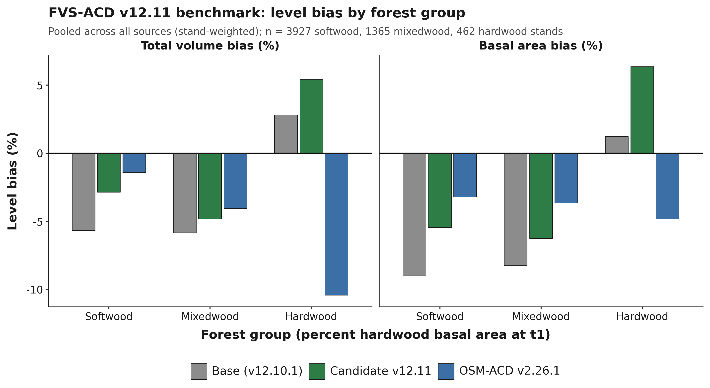

**Figure 18.** Total-volume and basal-area level bias by forest group, pooled across all sources
(stand-weighted), base versus v12.11 candidate versus OSM v2.26.1.

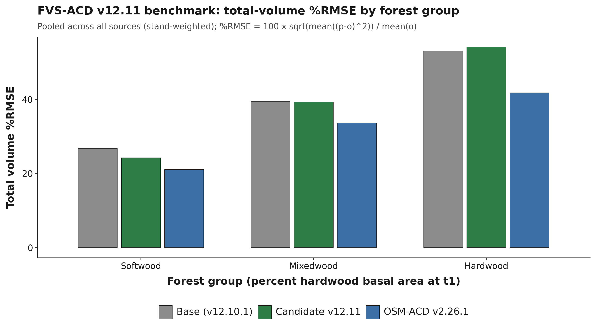

**Figure 19.** Total-volume percent RMSE by forest group, pooled across all sources (stand-weighted). %RMSE
= 100 x sqrt(mean((p-o)²)) / mean(o).

### 10.7 Nova Scotia: an independent-province validation

Nova Scotia is not part of the pooled all-sites benchmark in section 10.5; it is evaluated here as a fully
separate, independent province, never used to fit or tune any v12.11 lever, any base-model coefficient, or
the ESI site-index anchor. Its Permanent Sample Plot (PSP) network is the Acadian region's longest
continuously remeasured forest-inventory record, established in 1965 and carrying up to nine remeasurement
occasions per plot, licensed to the University of Maine under a 2016 data-license agreement that keeps
individual plot locations confidential (section 10.5 describes how that confidentiality is enforced in the
coverage maps). The network is a genuine mix of managed research (thinning-trial) installations and
unmanaged operational plots, which makes it the cleanest available test of whether the v12.11 managed-stand
levers, fit entirely on Maine, New Brunswick, and Quebec data, generalize to conditions the model has never
seen. The medium-interval NS benchmark scored here totals 4,504 stand-pairs, 2,157 managed and 2,347
unmanaged (`figures/_data/bench_ns_scorecard.csv`), scored with the identical frozen harness
(`bench_parity_split_ms_v1211.R`, `AcadianGY_12.11.r`) used everywhere else in this report. Because OSM-ACD
is itself a native Acadian-zone model, scoring it on NS's own tree lists is a faithful, apples-to-apples
third point of comparison alongside base and the v12.11 candidate, not a proxy, and that run is reported
alongside base and v12.11 throughout this section. That description holds for the comparison between
models and needs one qualification for the volume level all three are compared at. About a quarter of Nova
Scotia's t2 basal area carries no measured height and is scored through the substituted diameter-only height
curve: the coverage census puts measured height at 76.15 percent of t2 basal area on the medium-interval set
and 73.37 percent on the long-interval set, which places Nova Scotia seventh of the eleven benchmark sources
rather than the most exposed (Table 10.5a, 10.5.1). The
substitution is identical for base, candidate, and OSM, so it is even-handed across models, but it means
the absolute total-volume levels in this section are not a clean read on any of the three, and because the
curve runs short on hardwood and varies in direction on softwood, the forest-group splits below inherit a split the
pooled figures conceal.

#### 10.7.1 Managed-stand levers generalize

On the medium-interval set, the managed-stand levers carry over cleanly to this fully independent province.
Managed total-volume bias improves from -58.10 percent (base) to -42.32 percent (v12.11 candidate), a
relative reduction of about 27 percent, closely matching the size of the managed-stand improvement seen
throughout the rest of this report on data the model was actually fit against. The unmanaged fit is
essentially untouched, -6.04 to -6.07 percent total volume, exactly the behavior Lever 2's management gate
is designed to produce: it acts only where a stand is flagged managed and leaves natural stands to the
unmanaged self-thinning machinery. With OSM now scored on the identical NS pairs, the medium-interval managed
comparison is essentially a tie: v12.11 total-volume bias is -42.32 percent against OSM's -41.96 percent,
both cutting the base model's -58.10 percent by about 16 points. On unmanaged stands OSM is the more accurate
of the two candidates, -2.58 against v12.11's -6.07 percent (base is -6.04 percent), a genuine OSM advantage
rather than a rounding difference (10.7.4 gives the full head-to-head).

**Table 10.7.** Nova Scotia independent-province scorecard, medium-interval pairs: total volume and basal
area level bias (percent), base, v12.11 candidate, and OSM-ACD v2.26.1.

| Split | Class | n | Model | Total volume bias (%) | Basal area bias (%) |
|---|---|---|---|---|---|
| Overall | All | 4,504 | base | -41.28 | -42.54 |
| Overall | All | 4,504 | v12.11 | -30.61 | -33.72 |
| Overall | All | 4,499 | OSM v2.26.1 | -29.22 | -32.95 |
| Managed status | Unmanaged | 2,347 | base | -6.04 | -8.02 |
| Managed status | Unmanaged | 2,347 | v12.11 | -6.07 | -7.26 |
| Managed status | Unmanaged | 2,345 | OSM v2.26.1 | -2.58 | -4.96 |
| Managed status | Managed | 2,157 | base | -58.10 | -58.39 |
| Managed status | Managed | 2,157 | v12.11 | -42.32 | -45.87 |
| Managed status | Managed | 2,154 | OSM v2.26.1 | -41.96 | -45.82 |
| Forest group | Softwood | 2,749 | base | -41.42 | -42.37 |
| Forest group | Softwood | 2,749 | v12.11 | -31.52 | -33.83 |
| Forest group | Softwood | 2,744 | OSM v2.26.1 | -28.46 | -32.05 |
| Forest group | Mixedwood | 1,122 | base | -8.00 | -11.33 |
| Forest group | Mixedwood | 1,122 | v12.11 | -5.32 | -8.42 |
| Forest group | Mixedwood | 1,122 | OSM v2.26.1 | -3.07 | -6.25 |
| Forest group | Hardwood | 633 | base | -66.90 | -68.12 |
| Forest group | Hardwood | 633 | v12.11 | -47.93 | -53.75 |
| Forest group | Hardwood | 633 | OSM v2.26.1 | -51.64 | -56.97 |

*Data: `figures/_data/bench_ns_scorecard.csv`. OSM v2.26.1 matches 4,499 of the 4,504 stands; the shortfall
is under 0.2 percent of the set and does not change any comparison. Forest group and managed status are not
independently controlled in this breakdown.*

NS's forest-group pattern echoes the ME/NB/QC forest-group result in section 10.6 in one respect and departs
from it in another: softwood and mixedwood both improve substantially under the candidate here, and hardwood
improves too (-66.90 to -47.93 percent total volume), the opposite of the pooled ME/NB/QC hardwood signal
section 10.6 discusses, though NS hardwood bias remains large in absolute terms and is dominated by the same
managed post-disturbance response documented below rather than a clean hardwood-specific comparison. The
overall NS bias remains large in both configurations, -41.28 to -30.61 percent total volume, because the
pooled figure is dominated by the managed subset's much larger absolute gap, the subject of the site-index
and long-interval discussion that follows rather than primarily a forest-group or hardwood issue.

#### 10.7.2 Site index: a real basis, and a transferability caveat for NB/QC's own anchor

NS SITE_INDEX and its research-plot proxy AVGTOPHTM are dominant height in meters read at approximately
breast-height age 50, the same basis documented for the model's own ESI-anchored dominant-height input, so
there is no species, base-age, or unit mismatch between NS's site index and what the model expects. The
mismatch runs the other way: the QC/NB ESI v8 raster that supplies the model's `esi8` input for New
Brunswick and Quebec is independently documented (n = 40,596 measured site-index records) to carry a
positive bias of +7.0 m against measured site index, Pearson r = 0.146, essentially no per-plot linear
skill, and a compressed range relative to true measured site index. The model's per-province height-growth
anchor factors, NB_AFAC = 0.579 and QC_AFAC = 0.111 (section 10.2), exist specifically to counteract that
raster's inflation for New Brunswick and Quebec; Nova Scotia receives no equivalent correction and is fed
its real, uninflated field site index directly into growth terms that are all monotonic in site index, so a
lower, truthful input mechanically pushes height, diameter, basal-area increment, and the SDImax
self-thinning ceiling down together. This is a genuine model-transferability caveat, not a
Nova-Scotia-specific defect: the correction that makes New Brunswick and Quebec height growth track observed
data is tuned to cancel a scalar mean bias in a weak raster input, not to recover site-index accuracy at the
plot level, and any future region relying on the same NB_AFAC/QC_AFAC pathway, or a newly derived factor for
a new region, inherits that same unproven, poorly constrained correction.

Applying a coarse basis-matching adjustment, adding the documented +7.0 m offset to NS's site index so it
sits on the same basis the model's anchor was implicitly tuned against, and re-scoring the unmanaged NS
subset (the cleanest test, since it carries no disturbance-response confound) moves total-volume bias only
from -6.04 to -4.84 percent (base) and -6.07 to -5.04 percent (v12.11 candidate), roughly a 15 to 20 percent
relative reduction of an already-small bias, with RMSE essentially unchanged since a flat offset shifts
level, not scatter. This directly answers the site-index question: most of Nova Scotia's large absolute
under-prediction, -58 percent managed and -41 percent overall on the raw (uncorrected) site index, is not
primarily a site-index-basis artifact. The unmanaged subset, where a pure site-index effect would show most
cleanly, was only ever -6 to -8 percent biased on total volume and basal area to begin with, and the
correction trims about a fifth of that. This finding is stated for the unmanaged subset only, which is the
subset that was actually rescored with the corrected site index; the much larger managed and overall biases
were not rescored with the corrected input in this pass, so the conclusion that the managed and overall gap
is dominated by real, short-term post-disturbance growth response (the target of Lever 2, section 10.4)
should be read as the parsimonious working hypothesis this evidence supports, not as a demonstrated result
on the managed subset itself.

A second transferability caveat runs alongside the site-index one and is independent of it. The
diameter-only height curve that the scoring harness substitutes for any tree lacking a measured height was
fitted on Maine data, and its error is neither constant across species groups nor constant across regions.
Weighted by basal area over Nova Scotia's own measured stems, the curve runs 8.0 percent tall on softwood
and 12.1 percent short on hardwood on the medium-interval set (7.5 percent tall and 12.9 percent short on
the long-interval set), so the two errors offset and a pooled check reports the curve as unbiased on Nova
Scotia while both species groups carry errors near 10 percent in opposite directions (10.5.1). Exporting
either the curve itself or a curve-scored volume result to a new region therefore carries the same
unproven assumption the NB_AFAC and QC_AFAC pathway carries above, that a correction fitted in one place
transfers to another, and the Nova Scotia evidence shows the assumption failing by species group inside a
single province.

**Table 10.8.** Nova Scotia unmanaged-subset site-index basis correction, total volume and basal area level
bias (percent), raw field site index versus a +7.0 m esi8-matched correction, n = 2,347.

| Site input | Model | Total volume bias (%) | Basal area bias (%) |
|---|---|---|---|
| Raw (field-measured) | base | -6.04 | -8.02 |
| Esi8-matched (+7.0 m) | base | -4.84 | -7.08 |
| Raw (field-measured) | v12.11 | -6.07 | -7.26 |
| Esi8-matched (+7.0 m) | v12.11 | -5.04 | -6.22 |

*Data: `20260722_ns_benchmark_philosophy_pass.md`, Task 1. The +7.0 m offset is a point estimate from a
validation with RMSE 7.9 m and r = 0.146, a coarse basis-matching adjustment rather than a precise per-plot
recalibration.*

#### 10.7.3 Long-interval, first-to-last test: a disturbance-contamination artifact, caught and corrected

Nova Scotia's 1965-present record makes it the only Acadian data source that can test a first-to-last,
multi-decade growth trajectory independent of Maine, New Brunswick, and Quebec, directly probing whether the
maturity-dependent, sign-flipping long-horizon volume pattern documented in section 10.4 reproduces on
genuinely independent data. A disturbance-screening bug was found and fixed during this cycle: the
tree-level cut-detection filter compared a string-typed status column against an integer constant, a
comparison that is always false in the analysis library used, so the filter silently passed every stand as
undisturbed regardless of its actual harvest history. Correcting the filter shows that about 23 percent of
the long-interval (over 30 year) bucket contained an undisclosed harvest inside the remeasurement interval.
An initial pass, scored before this bug was caught, appeared to show the same maturity-dependent sign flip
documented in section 10.4, a swing from under-prediction at short and medium intervals to slight
over-prediction at the longest intervals. That result did not survive the corrected, disturbance-clean
rescore and is not reported here: the apparent swing traces to the contaminated pairs themselves, since an
undisclosed harvest partway through a nominally undisturbed interval truncates realized growth below what an
actually undisturbed trajectory would show, which mechanically manufactures an apparent over-prediction
signal when those pairs are wrongly scored as clean. The artifact was caught during an internal red-team
review before an earlier draft of this report cited any number from it.

The corrected, disturbance-clean rescore is complete. The scoring pipeline ran against a pair set from which
every pair carrying a genuine disturbance flag (silviculture treatment or tree-status code) inside its
interval has been removed. Total n = 5,348 pairs (4,014 unmanaged, 1,334 managed single-regime), down from
5,485 in the contaminated pass. The over-30-year bucket, entirely unmanaged and disturbance-free by
construction (n = 903, mean interval 36.3 years, forest-group split softwood 477, mixedwood 286, hardwood
140), is the clean, disturbance-free long-horizon test. On this bucket, total-volume bias is -0.06 percent
(base) and -1.66 percent (v12.11 candidate), essentially zero rather than the over-prediction the
contaminated pass appeared to show; basal area remains under-predicted, -18.08 percent (base) and -12.48
percent (v12.11). OSM v2.26.1, scored on this same clean bucket, does not hold that line: its total-volume
bias at over 30 years is -9.14 percent, a real drift away from zero rather than the near-zero result v12.11
sustains, the single clearest point of separation between the two models anywhere in this Nova Scotia
validation.

**Table 10.9.** Nova Scotia long-interval rescore, disturbance-clean pair set: total volume and basal area
level bias (percent) by interval-length bucket and management status, base and v12.11 n = 5,348, OSM
v2.26.1 n = 5,344.

| Split | Class | n | Mean interval (yr) | Model | Total volume bias (%) | Basal area bias (%) |
|---|---|---|---|---|---|---|
| Overall | All | 5,348 | 12.0 | base | -39.75 | -43.22 |
| Overall | All | 5,348 | 12.0 | v12.11 | -30.41 | -34.82 |
| Overall | All | 5,344 | 12.0 | OSM v2.26.1 | -31.99 | -34.89 |
| Managed status | Unmanaged | 4,014 | 13.4 | base | -5.52 | -12.19 |
| Managed status | Unmanaged | 4,014 | 13.4 | v12.11 | -6.01 | -9.68 |
| Managed status | Unmanaged | 4,012 | 13.4 | OSM v2.26.1 | -6.86 | -9.70 |
| Managed status | Managed | 1,334 | 7.7 | base | -74.36 | -72.14 |
| Managed status | Managed | 1,334 | 7.7 | v12.11 | -55.07 | -58.25 |
| Managed status | Managed | 1,332 | 7.7 | OSM v2.26.1 | -57.40 | -58.36 |
| Interval length | Under 15 yr | 3,939 | 5.1 | base | -44.04 | -45.27 |
| Interval length | Under 15 yr | 3,939 | 5.1 | v12.11 | -32.38 | -36.24 |
| Interval length | Under 15 yr | 3,935 | 5.1 | OSM v2.26.1 | -32.91 | -35.79 |
| Interval length | 15 to 30 yr | 506 | 21.9 | base | -56.08 | -56.51 |
| Interval length | 15 to 30 yr | 506 | 21.9 | v12.11 | -48.20 | -48.87 |
| Interval length | 15 to 30 yr | 506 | 21.9 | OSM v2.26.1 | -49.56 | -49.13 |
| Interval length | Over 30 yr | 903 | 36.3 | base | -0.06 | -18.08 |
| Interval length | Over 30 yr | 903 | 36.3 | v12.11 | -1.66 | -12.48 |
| Interval length | Over 30 yr | 903 | 36.3 | OSM v2.26.1 | -9.14 | -15.31 |

*Data: `figures/_data/bench_ns_long_scorecard.csv`, regenerated after the tree-level disturbance-screen fix,
and `figures/_data/ns_headtohead.csv` for the OSM v2.26.1 rows; superseded contaminated numbers are retained
only in `20260722_ns_benchmark_philosophy_pass.md` for provenance and are not cited in this report. The
over-30-year bucket is entirely unmanaged by construction, since no research single-regime interval spans
past about 25 years.*

The honest read is that Nova Scotia's clean long record does not independently reproduce the
maturity-dependent, sign-flipping over-prediction pattern documented in section 10.4; it is only partially
consistent with it. The under-prediction genuinely weakens as intervals lengthen past 30 years, -44.04
percent under 15 years to -56.08 percent at 15 to 30 years to -0.06 percent past 30 years (base numbers;
v12.11 tracks the same shape, -32.38, -48.20, -1.66 percent), the qualitative direction the other
long-horizon evidence would predict. But it lands near zero rather than flipping positive, and basal area
stays under-predicted throughout, including at the longest intervals, rather than showing the companion
structural overshoot a genuine height- or form-driven volume catch-up would produce. The two robust Nova
Scotia findings from this section stand independent of the long-interval question: the management-gated
mortality lever generalizes cleanly to this fully independent province (managed total-volume bias -74.36 to
-55.07 percent, base to v12.11, essentially the same relative improvement seen throughout this report;
unmanaged bias -5.52 to -6.01 percent, untouched, exactly as Lever 2's management gate is designed to
produce), and the site-index transferability caveat from section 10.7.2 (the QC/NB esi8 raster the model's
own height anchor was tuned against carries a documented +7.0 m bias against measured site index). OSM
v2.26.1, scored on this same clean long-interval set, sharpens rather than changes this read: OSM tracks
v12.11 closely at short and medium intervals but does not hold the near-zero over-30-year result, drifting
to -9.14 percent where v12.11 stays at -1.66 percent, so the "does not cross into over-prediction" finding
above is specific to v12.11 and the frozen base, not a property both benchmarked models share.

#### 10.7.4 OSM-ACD v2.26.1 head-to-head

Nova Scotia's OSM v2.26.1 run gives the first apples-to-apples three-way comparison, frozen base, v12.11
candidate, and OSM, on data none of the three was fit against. Because OSM-ACD is itself a native
Acadian-zone model, this is a faithful comparison in a way the esi8-anchor discussion in section 10.7.2 is
not: OSM needs no site-index basis correction to run on NS, and its predictions come from the same NS tree
lists scored through the identical NSVB metric code used for FVS-ACD throughout this report.

**Table 10.10.** Nova Scotia three-way head-to-head, total-volume level bias (percent), base, v12.11
candidate, and OSM-ACD v2.26.1, medium- and long-interval sets.

| Interval set | Split | n (base / v12.11 / OSM) | Base | v12.11 | OSM v2.26.1 |
|---|---|---|---|---|---|
| Medium (Table 10.7) | Managed | 2,157 / 2,157 / 2,154 | -58.10 | -42.32 | -41.96 |
| Medium (Table 10.7) | Unmanaged | 2,347 / 2,347 / 2,345 | -6.04 | -6.07 | -2.58 |
| Long (Table 10.9) | Managed | 1,334 / 1,334 / 1,332 | -74.36 | -55.07 | -57.40 |
| Long (Table 10.9) | Unmanaged | 4,014 / 4,014 / 4,012 | -5.52 | -6.01 | -6.86 |
| Long (Table 10.9) | Over 30 yr (unmanaged, disturbance-clean) | 903 / 903 / 903 | -0.06 | -1.66 | -9.14 |

*Data: `figures/_data/ns_headtohead.csv`, built from `figures/_data/bench_ns_scorecard.csv` and
`figures/_data/bench_ns_long_scorecard.csv`. Reproduced from Tables 10.7 and 10.9 in compact form for direct
comparison; no new numbers appear in this table.*

The honest read is mixed, not a clean sweep for either model. On managed stands, where both v12.11 and OSM
carry explicit management structure, the two are essentially tied at medium intervals, -42.32 against -41.96
percent, and v12.11 modestly edges OSM at long intervals, -55.07 against -57.40 percent; both cut the frozen
base's managed bias by roughly the same proportion at each horizon. OSM is the more accurate model on
short-interval unmanaged stands, -2.58 against v12.11's -6.07 percent, a genuine and reproducible OSM
advantage rather than noise. But at the longest horizons, the over-30-year, disturbance-clean bucket that is
Nova Scotia's longest independent record and the single cleanest test available anywhere in this project,
v12.11 clearly wins: it holds total-volume bias near zero, -1.66 percent, while OSM drifts to -9.14 percent.
That result is consistent with the maturity-gated stand constraint (Lever 3b, section 10.4) doing real work
at exactly the horizon it was built for, and it is the one place in this comparison where the two models
genuinely diverge rather than tracking each other. Reading Table 10.10 as a whole, neither model dominates:
v12.11 clearly beats OSM at the longest horizon on bias, where base is actually closest to zero, and modestly at long-managed, OSM wins clearly at short-unmanaged,
and the two are a tie at short-managed. This report states that plainly rather than picking a winner.

#### 10.7.5 Methods and open items

All Nova Scotia numbers in this section come from the site-index re-score, the long-interval disturbance-clean
rescore (superseding an earlier run affected by the tree-level disturbance-screen bug described in section
10.7.3), the long-interval scorecard assembly, and the OSM v2.26.1 head-to-head (both the medium-interval and
long-interval sets), scored with the unmodified frozen harness and model file used throughout this report.
OSM's stand counts run slightly below FVS-ACD's at every split, 4,499 of 4,504 medium-interval stands and
5,344 of 5,348 long-interval stands matched; the shortfall is OSM inventory records it could not build a
valid tree list for (mostly sub-1.0 cm DBH records at or below OSM's internal floor), never a scoring
exclusion, and is under 0.2 percent of either set. About 9 percent of pre-filter NS pairs are dropped for
missing site-index data at the join step; this attrition has not yet been checked for whether it concentrates
in a particular disturbance history, region, or plot type, and is disclosed here as an open item rather than
a resolved one. Height coverage is a further qualification on this section, and it is now measured rather
than open. The coverage census puts measured height at 76.15 percent of t2 basal area on the medium-interval
set and 73.37 percent on the long-interval set, at DBH >= 4 cm (Table 10.5a), so the balance is scored on
the substituted diameter-only curve; those census figures supersede the locally recomputed 75.9 and 73.1
percent reported here earlier, and 10.5.1 gives the accounting and what it means for the forest-group splits
reported above. As with every other number in this report, only aggregates left the Cardinal node; Nova
Scotia's individual plot coordinates are additionally restricted under the 2016 provincial licensing
agreement and are never used at any point in this pipeline.

### 10.8 Master scorecard and overall ranking

Sections 10.5, 10.6, and 10.7 each compare base, candidate, and OSM within a single dataset or region. This
section pools every already-scored benchmark cell in this project into one master scorecard, stratified by
the four determinants that recur across those sections, managed status, forest group, site productivity
class, and projection length, and reports one overall ranking built from it. Sixteen determinant cells are
defined; thirteen currently have data. The three site-productivity terciles are empty for every dataset in
this project, base, candidate, and OSM alike, since no existing benchmark pipeline currently bins stands by
site index; this is reported honestly as an open item rather than estimated or dropped silently. All rankings
in this section are on total-volume percent RMSE, the primary accuracy metric used throughout sections 10.5
to 10.7; where a cell pools more than one dataset, the pooled percent RMSE is stand-count weighted, consistent
with the pooling already used for Table 10.6.

**Table 10.11.** Managed status: total-volume percent RMSE, stand-weighted where pooled.

| Cell | Region | n (base / v12.11 / OSM) | Base | v12.11 | OSM v2.26.1 | Winner |
|---|---|---|---|---|---|---|
| Managed | ME/NB/QC (pooled) | 1,892 / 1,892 / 1,457 | 37.78 | 32.39 | 28.19 | OSM |
| Managed | NS | 2,157 / 2,157 / 2,154 | 185.89 | 159.46 | 156.13 | OSM |
| Unmanaged | ME/NB/QC (pooled) | 6,720 / 6,720 / 3,862 | 35.33 | 35.32 | 19.61 | OSM |
| Unmanaged | NS | 2,347 / 2,347 / 2,345 | 33.20 | 33.31 | 24.77 | OSM |

**Table 10.12.** Forest group: total-volume percent RMSE, stand-weighted where pooled.

| Cell | Region | n (base / v12.11 / OSM) | Base | v12.11 | OSM v2.26.1 | Winner |
|---|---|---|---|---|---|---|
| Softwood | ME/NB/QC (pooled) | 3,927 / 3,927 / 3,716 | 26.79 | 24.25 | 21.08 | OSM |
| Softwood | NS | 2,749 / 2,749 / 2,744 | 198.63 | 179.62 | 171.20 | OSM |
| Mixedwood | ME/NB/QC (pooled) | 1,365 / 1,365 / 1,257 | 39.46 | 39.23 | 33.61 | OSM |
| Mixedwood | NS | 1,122 / 1,122 / 1,122 | 46.27 | 36.79 | 37.71 | v12.11 |
| Hardwood | ME/NB/QC (pooled) | 462 / 462 / 346 | 53.06 | 54.12 | 41.77 | OSM |
| Hardwood | NS | 633 / 633 / 633 | 165.15 | 122.77 | 129.47 | v12.11 |

**Table 10.13.** Projection length and site productivity class.

| Cell | Region | n (base / v12.11 / OSM) | Base | v12.11 | OSM v2.26.1 | Winner |
|---|---|---|---|---|---|---|
| Under 15 yr | NS | 3,939 / 3,939 / 3,935 | 163.46 | 132.88 | 134.24 | v12.11 |
| 15 to 30 yr | NS | 506 / 506 / 506 | 145.83 | 127.29 | 127.57 | v12.11 |
| Over 30 yr | NS | 903 / 903 / 903 | 49.79 | 52.35 | 50.28 | Base |
| Under 15 / 15-30 / over 30 yr | ME/NB/QC (pooled) | 0 | -- | -- | -- | no data: no ME/NB/QC source carries the remeasurement span this split needs |
| Low / mid / high SI tercile | ALL | 0 | -- | -- | -- | no data: no dataset in this project is currently binned by site-index tercile |

*Data: `figures/_data/master_scorecard.csv` (16 rows per model, 13 with data), pooling
`figures/_data/v1211_allsites_scorecard.csv`, `figures/_data/v1211_forestgroup_scorecard.csv`,
`figures/_data/bench_ns_scorecard.csv`, and `figures/_data/bench_ns_long_scorecard.csv`, the same source
files already cited for Tables 10.5, 10.6, 10.7, and 10.9. Source memo: `20260811_final_scorecard_all_datasets.md`
(finalized 11 August 2026; supersedes `20260723_master_scorecard_and_ranking.md`, preserved unchanged at
`20260723_master_scorecard_and_ranking_PREV_20260811.md`).*

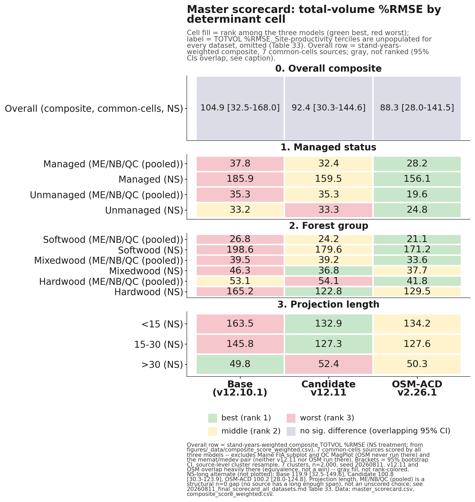

**Figure 23.** Master scorecard heatmap, total-volume percent RMSE by determinant cell, base versus
candidate v12.11 versus OSM v2.26.1, cell fill by rank.

Read across the three tables, OSM-ACD v2.26.1 wins every managed-status cell in both regions and every softwood and mixedwood ME/NB/QC cell; v12.11 wins mixedwood and hardwood in Nova Scotia and both of NS's
shorter projection-length buckets; and base wins only the over-30-year NS bucket, the same result already
reported in Table 10.10. Hardwood and the two shorter NS projection-length buckets are v12.11's clearest,
most consistent determinant wins, and they pair with section 10.6's finding that softwood is where v12.11
gains the most ground on base without necessarily beating OSM there.

These three tables should not be pooled or mean-ranked directly into an overall score, because doing so
counts the same Nova Scotia stands as up to three separate cells, once under managed status, again under
forest group, and again under projection length, while the eight independent Maine, New Brunswick, and
Quebec sources fold into far fewer cells, five, and zero for projection length, since no ME/NB/QC source
carries a long enough remeasurement span for that split. Summed across the 13 scored cells above, that gives
Nova Scotia roughly 50 percent of the pooled percent RMSE weight and 8 of 13 votes in a mean-rank composite,
against its true, non-overlapping share of about 34 percent of all benchmarked stands. An earlier pass at
this section's overall ranking was built exactly that way; it is superseded by the ranking below, which
pools the same underlying data by independent source instead.

**Table 10.14.** Overall ranking under six scenarios: two inclusion rules (all-available-data;
common-cells-only, where all three models have a score) crossed with three Nova Scotia treatments (with NS
from the original scorecard, without NS, with NS from the long-interval sensitivity scorecard).

| Inclusion rule | NS treatment | Model | Mean rank (1 = best) | Sources won | Pooled TOTVOL %RMSE | Pooled bias % |
|---|---|---|---|---|---|---|
| All-available-data | Without NS (8 ME/NB/QC sources) | Base | 2.50 | 1/8 | 35.9 | -11.3 |
| All-available-data | Without NS | **v12.11** | **1.50** | 4/8 | 34.7 | -9.6 |
| All-available-data | Without NS | OSM | 1.67 | 3/6 | **22.0** | **-2.4** |
| All-available-data | With NS (original scorecard, 9 sources) | Base | 2.56 | 1/9 | 86.2 | -21.6 |
| All-available-data | With NS | **v12.11** | **1.56** | 4/9 | **76.6** | -16.8 |
| All-available-data | With NS | OSM | 1.57 | 4/7 | 82.0 | -14.7 |
| All-available-data | With NS-long (sensitivity swap) | Base | 2.56 | 1/9 | 81.1 | -22.2 |
| All-available-data | With NS-long | **v12.11** | **1.44** | 5/9 | **70.2** | -17.6 |
| All-available-data | With NS-long | OSM | 1.71 | 3/7 | 75.3 | -17.3 |
| Common-cells-only | Without NS (6 shared sources) | Base | 2.83 | 0/6 | 26.1 | -4.9 |
| Common-cells-only | Without NS | **v12.11** | **1.50** | 3/6 | 24.2 | -2.8 |
| Common-cells-only | Without NS | OSM | 1.67 | 3/6 | **22.0** | **-2.4** |
| Common-cells-only | With NS (original scorecard, 7 shared sources) | Base | 2.86 | 0/7 | 97.4 | -21.5 |
| Common-cells-only | With NS | v12.11 | 1.57 | 3/7 | 84.6 | -15.5 |
| Common-cells-only | With NS | OSM | **1.57** | 4/7 | **82.0** | **-14.7** |
| Common-cells-only | With NS-long (sensitivity swap) | Base | 2.86 | 0/7 | 89.9 | -22.3 |
| Common-cells-only | With NS-long | **v12.11** | **1.43** | 4/7 | 75.6 | -16.6 |
| Common-cells-only | With NS-long | OSM | 1.71 | 3/7 | **75.3** | **-17.3** |

*Data: `figures/_data/overall_ranking.csv` (all 18 rows above), `overall_ranking_summary.csv` (the two
headline with-NS rows plotted in Figure 24), `overall_ranking_detail.csv` (per-source rank detail, both
inclusion rules), and `master_scorecard_sources.csv` (the 28-row non-overlapping per-source input table),
all built from `v1211_allsites_scorecard.csv`, `bench_ns_scorecard.csv`, and `bench_ns_long_scorecard.csv`.
Bold marks the better model on each metric within each scenario row-pair; a tie is bolded on both. Source
memo: `20260811_final_scorecard_all_datasets.md` (finalized 11 August 2026; supersedes
`20260723_master_scorecard_and_ranking.md`, preserved unchanged at
`20260723_master_scorecard_and_ranking_PREV_20260811.md`).*


**Figure 24.** Overall FVS-ACD ranking under two defensible weightings, with and without Nova Scotia:
equal-per-source mean rank (top) and stand-weighted pooled total-volume percent RMSE (bottom), base versus
candidate v12.11 versus OSM v2.26.1.

Neither model is a clean overall winner, and the ranking genuinely depends on the weighting and inclusion
rule chosen, a more honest result than a single headline number would give. v12.11 is the more consistent
performer of the two candidates: it has the better, or tied, equal-per-source mean rank in all six
scenarios, running 1.43 to 1.57, it never finishes clearly last on any metric in any scenario, and it leads
the pooled percent RMSE specifically when Nova Scotia and the full eight-source ME/NB/QC set are both
included. OSM-ACD v2.26.1 is the more decisive winner where it wins: it leads the fairest, apples-to-apples
pooled percent RMSE comparison, common-cells-only, in every Nova Scotia treatment, and on the determinant
cross-tab above it sweeps every managed-status cell in both regions and every softwood and mixedwood ME/NB/QC cell, a broad advantage on managed and softwood/mixedwood stands rather than a narrow one. Two
qualifications keep this comparison honest. First, OSM has no score for two of the eight ME/NB/QC sources,
Maine FIA subplot and QC MagPlot, both comparatively poor-fitting for either FVS build, so any
all-available-data scenario evaluates OSM on an easier six-source subset than it evaluates base and v12.11
on their full eight. Second, Nova Scotia itself carries two internally consistent but narrowly disagreeing
scorecards, the original benchmark (OSM ahead, 153.05 against v12.11's 156.69) and a long-interval
sensitivity build assembled for the projection-length split (v12.11 ahead, 127.35 against OSM's 128.34),
reported here side by side rather than resolved silently. Base is a clear third on every metric in every one
of the six scenarios without exception.

This reconciled ranking corrects two claims that appeared in earlier drafts of this report. v12.11 does not
lead managed status overall; OSM wins the managed-status cell outright in both regions (Table 10.11). And
v12.11 does not win the long-horizon bucket outright; base does, holding total-volume bias closest to zero
at the over-30-year NS interval (-0.06 percent, against v12.11's -1.66 percent and OSM's -9.14 percent),
though v12.11 still clearly outperforms OSM at that same horizon, consistent with section 10.7.4's
head-to-head finding. What the reconciled data does support is that v12.11's clearest wins are the two
shorter NS projection-length buckets and hardwood and mixedwood in Nova Scotia (Tables 10.12 and 10.13), and,
at the source level, CFRU CTRN and NB MagPlot among the managed ME/NB/QC sources (Baxter as well, though
that source is mature and held-out rather than actively managed), where v12.11 beats OSM outright under
every inclusion rule tested. Every source-level cell pooled into this ranking carries some
exposure to the substituted diameter-only height curve, and the coverage census in 10.5.1 quantifies it:
PEF and Baxter are thinnest at 4.02 and 18.45 percent measured coverage, the managed CTRN and MagPlot cells
that carry v12.11's win sit at 51.99 and 32.82 percent, about a quarter of Nova Scotia's t2 basal area is
scored the same way, and SILC and the Maine FIA long and subplot cells are effectively fully measured. All
three models are scored against the same observed tree list at each source, so the ranking is more durable
than the levels that feed it. The Baxter cell has since been repaired and rescored, and its model ordering
is unchanged while every level moves toward zero (Table 10.5b). It should also be read alongside, not instead of, section 10.9's long-horizon
Bakuzis finding: this section measures predictive accuracy against held-out or independent data, section
10.9 measures internal biological consistency across a controlled productivity gradient, and a model can
rank differently on the two.

This section's numbers reconcile an earlier internal disagreement in this project's working notes. A first
computation reported v12.11 leading the mean-rank composite at 1.53 against OSM's 1.72 and base's 2.50, with
a pooled percent RMSE of 109.75 against OSM's 121.45 and base's 128.91. A second, rebuilt computation
reported the opposite ordering on mean rank, OSM at 1.38 against v12.11's 1.92, while v12.11 narrowly led
pooled percent RMSE at 74.59 against OSM's 75.20. Neither of those two computations reproduces from the
source data pooled at the independent, non-overlapping source level; both were built on the four-determinant
cross-tab, which triple-counts Nova Scotia as described above. This section replaces both with the
six-scenario, per-source ranking in Table 10.14, verified end to end against `v1211_allsites_scorecard.csv`,
`bench_ns_scorecard.csv`, and `bench_ns_long_scorecard.csv` and documented in full in
`20260811_final_scorecard_all_datasets.md` (finalized 11 August 2026, superseding
`20260723_master_scorecard_and_ranking.md`). Those numbers are the authoritative overall ranking for this
report going forward.

**Coverage matrix, 11 August 2026.** `20260811_final_scorecard_all_datasets.md` adds a Table 30 coverage
matrix spanning all eleven benchmark sources this project has staged, not only the eight that feed Table 10.14
above. It confirms OSM-ACD v2.26.1 has no score on Maine FIA subplot or QC MagPlot, exactly the gap already
noted through this GTR, and discloses a third gap found while building that matrix: the Maine FIA
mature/control pair (memat, medev), staged 5 August 2026 for the v13.1 development track, has no score against
either v12.11 or OSM. That pair sits outside the eight-source ranking basis above and changes no rank or
ranking number in Table 10.14; it is recorded here per the house rule against silent omission of newly
discovered coverage gaps. No new Cardinal run was made to produce this matrix and no number reported in this
GTR changed.

### 10.9 Long-horizon Bakuzis across the productivity and species gradient

The guardrail Bakuzis check in section 10.3 (Table 10.3c) scores a single softwood synthetic stand over a
160-year, ESI 12/16/20 gradient and answers whether v12.11 broke anything on one stand type. This companion
check asks whether biological realism holds across the productivity gradient and across the
species-composition gradient the Acadian region actually contains, softwood, mixedwood, and hardwood, and
adds OSM-ACD v2.26.1 as a third point of comparison from its own existing long-horizon run. Three seeded
40-tree stands (3,000 stems ha⁻¹ initial DBH 5 to 13 cm, identical structure and RNG seed across models so
only the model and species mix differ) were projected across the same ESI(csi) 12/16/20 gradient for 160
years: softwood (*Abies balsamea* (L.) Mill., *Picea rubens* Sarg., *Picea mariana* (Mill.) Britton, Sterns
& Poggenb., *Picea glauca* (Moench) Voss), mixedwood (*A. balsamea*, *P. rubens*, *Acer rubrum* L., *Acer
saccharum* Marshall), and hardwood (*A. rubrum*, *A. saccharum*, *Betula alleghaniensis* Britton, *Betula
papyrifera* Marshall). OSM cannot be seeded on the synthetic gradient, so it is reused unchanged from its
existing 159-year run on 70 real SILC/CFI stands, binned into low, mid, and high site terciles on OSM's own
T50HT site-index proxy (mean 12.4, 16.4, and 19.2 m), the closest available analog to the FVS ESI gradient;
this is a genuine asymmetry in the evidence base, a controlled synthetic gradient for base and candidate
against real, previously disturbed stands for OSM, stated here rather than smoothed over.

**Table 10.15.** Long-horizon Bakuzis matrix, worst case across softwood, mixedwood, and hardwood stand
starts (base and candidate) versus the pooled real-stand OSM run, 160-year (FVS) and 159-year (OSM)
horizons.

| Relation | Base (frozen v12.10.1) | Candidate v12.11 (unmanaged) | OSM-ACD v2.26.1 |
|---|---|---|---|
| Eichhorn (volume-height, CV%) | pass (11.0 to 14.2%) | pass (11.0 to 14.1%) | flag (26.3%) |
| Reineke self-thinning (slope) | pass (-1.59 to -1.50) | pass (-1.62 to -1.49) | pass (-1.56) |
| Site ordering (HT / VOL inversions) | flag (0 to 4 / 0 to 4) | flag (0 to 4 / 0 to 4) | flag (42 / 105) |
| Yield-density plateau (BA₁₆₀, m² ha⁻¹) | pass (32.0 to 36.1) | pass (31.6 to 35.3) | pass (34.7) |
| Sukachev (QMD rises as TPH falls) | pass | pass | pass |

*Data: `figures/_data/bakuzis_longterm.csv` (headline rows first, then full per-stand-type detail, then the
OSM row). Source memo: `20260723_bakuzis_longterm.md`. OSM's run is reused unchanged (run 15 July 2026,
predates this benchmark cycle).*

Candidate v12.11 holds the same pass/flag pattern as base on every relation and every stand type: where base
passes, the candidate passes, and the one flag, site ordering, is present in base too, at nearly the same
ages and magnitude, so it is not a candidate-introduced regression. Read stand type by stand type, the
site-ordering flag traces to a single, narrow cause: on the mixedwood stand only, at ages 46 to 52 (base) or
46 to 49 (candidate), the mid-productivity site's height and volume trajectories edge fractionally above the
high-productivity site's for a handful of years (base age 49: height 12.84 m at ESI 16 versus 12.60 m at ESI
20, a 1.9 percent crossing; volume 138.7 versus 137.8 m³ ha⁻¹, a 0.6 percent crossing), then the ordering
re-establishes itself and holds for the remaining roughly 110 years of the run. Softwood and hardwood both
pass with zero inversions in both models. This reads as a pre-existing, self-correcting behavior of the
shared growth engine on this specific softwood-hardwood mix, likely a transient mortality or ingrowth-timing
asynchrony between site classes near stand establishment, not a structural site-effect problem the
candidate's levers introduced or worsened. OSM's site-ordering flag is a different order of severity: 42
height inversions and 105 volume inversions over the run, and at the 159-year endpoint the poorest site
tercile ends with more standing basal area, stand density index, and quadratic mean diameter than either the
mid or high tercile, a persistent, endpoint-level inversion rather than a brief mid-rotation crossing; some
of this may reflect genuine disturbance or measurement history in the underlying real SILC/CFI stands rather
than a pure OSM artifact, a caveat the objective test cannot itself distinguish and which is stated rather
than suppressed. Eichhorn separates the same way: both FVS configurations pass cleanly on all three stand
types (coefficient of variation of volume at matched height bins, both comfortably under the 15 percent
threshold), while OSM flags this relation at 26.3 percent CV, meaning OSM's volume-height relationship is
noticeably more site-dependent across its real-stand terciles than either FVS configuration is across the
seeded gradient. Reineke self-thinning and Sukachev are where all three models agree most closely.


**Figure 25.** Long-horizon Bakuzis evidence across the 160-year (FVS) and 159-year (OSM) horizons: (A)
mid-productivity-site basal-area trajectory by stand type, base versus candidate versus OSM's pooled
real-stand run; (B) Reineke self-thinning lines for every model by stand-type combination at the
mid-productivity site against the theoretical -1.605 reference slope.

Both FVS configurations score better on this internal-consistency test than OSM, which flags Eichhorn and
carries a persistent, endpoint-level site-ordering inversion on its real-stand run. This finding is read
alongside, not instead of, section 10.8's master scorecard and reconciled overall ranking: section 10.8
measures predictive accuracy against held-out or independent data, this section measures internal biological
consistency across a controlled productivity gradient, and a model can rank differently on the two.

### 10.10 Red-team review and watch items

An independent red-team review (22 July 2026) read the candidate report, the Lever 4 coefficient fit,
the crown-ratio investigation, and the guardrail results, then independently re-derived or stress-tested
every claim rather than restating it: twelve findings in total (one blocker, five majors, three minors,
one cosmetic item, and one process note; full detail in `20260721_v1211_redteam.md`). The review's
verdict was to finalize with fixes, not as-is. The lever architecture, the gating discipline, and the
byte-identical gate-off guarantee are sound and independently reproduce on a second, novel stand, but
several headline claims required correction before appearing in this report.

Top-height drift is anchor calibration, not a lever effect. Running six lever configurations, anchor
alone, anchor plus recruitment, plus the mortality gate, plus the stand constraint, plus Lever 4, and
all four candidate levers together, on an identical 60-year mixed managed stand gave bit-identical top
height, 20.269 m at year 60, in all six. Basal area varied meaningfully across the same six
configurations (22.37 to 21.64 m² ha⁻¹), confirming the levers do change tree-level dynamics; top
height simply does not depend on any of them once the ESI dominant-height anchor's clamp is not
saturated, because the anchor's target height is a function of climate site index and stand age only.
The in-domain top-height difference reported in the guardrail battery (+4.21 to +5.88 percent)
accordingly traces to the ESI dominant-height anchor calibration and the per-province AFAC assembly of
the scored population, not to Lever 4 or the recruitment change, and is stated that way here rather than
as a lever interaction.

The developing-end fix does not transfer to subplot grain. The recruitment lever closes little of the
developing-end gap at the FIA subplot grain, moving total-volume bias only from -24.90 to -24.82 percent
(Table 10.5), against a more visible improvement at whole-plot aggregation, -16.60 to -16.13 percent.
This is consistent with recruitment being a spatially patchy process that a single stand-level
multiplier cannot represent at fine grain. The developing end is improved at whole-plot aggregation and
essentially unchanged at subplot grain; it is not fixed, and this report does not lead with a
developing-end-fixed claim.

Lever 4 at scoring is a species-average correction, not a tree-specific one. Every reported Lever 4
guardrail and benchmark number was scored against SPLIT-synthesized rather than field-observed form and
risk. SPLIT fractionally splits each hardwood tree into pseudo-records weighted by the Smith Table A.9
marginal form and risk frequencies, so every stem of a species receives the same expansion-factor-
weighted height derate regardless of its individual size, vigor, or condition; `dht_hw_mod()` does not
use its DBH argument in the multiplier. Lever 4 is correctly described as a species-average height
correction validated at that level, not as tree-level risk conditioning, and the *Quercus rubra* L.
coefficient, the largest and least field-validated of the six species terms, has been capped to the
*Betula alleghaniensis* Britton and *Acer saccharum* Marshall field magnitude pending independent red
oak field heights (10.4).

The byte-identical gate-off guarantee is independently proven. This central claim, that v12.11 with
every lever off reproduces v12.10.1 exactly, was reconfirmed this review on a novel hardwood-heavy
stand not used in any prior smoke test (mixed red spruce, sugar maple, yellow birch, and red maple,
climate site index 20, a 30-year projection): maximum absolute difference in diameter increment, height
increment, and expansion factor was 0.000e+00, with no row-count difference, matching the original
benchmark reconfirmation.

Three further findings do not change any number reported in this GTR but are carried forward as watch
items rather than blockers. The ESI-anchored dominant-height mechanism was found to bypass the tree
height cap at long horizons on good sites, a pre-existing v12.7.0 behavior, not introduced by v12.11;
the fix is a gated re-clamp (`ops$use.htcap.postanchor`) that touches only the `use.esi.domht` path,
which is off in all benchmark scoring reported here, so it changes no number in this report. The
management-gated mortality attenuation (Lever 2) can permit a large transient density overshoot in
already-overstocked managed stands before the hard SDImax ceiling corrects it, a multi-decade transient
over-prediction risk for a neglected, overdue-for-thinning stand, precisely the use case Lever 2 targets;
a rate limiter on the attenuated mortality fraction is the proposed fix. The Lever 3b stand constraint
has no cohort or size-class exemption, so a stand-wide quadratic-mean-diameter floor can throttle a
vigorous regenerating cohort inside an otherwise mature stand; exempting small trees from the
reallocation pool is the proposed fix. All three are carried into the v13 program (10.7).

A further watch item, raised after that review and documented in full in 10.5.1, is the most consequential
of the ones listed here because it touches the evidence base itself. The scoring harness substitutes a
diameter-only height curve for every tree lacking a measured height, and a coverage census across all
eleven benchmark sources (SLURM job 13305450) has now quantified the exposure, closing the census that was
listed here earlier as the first v13.1 item. PEF carries a measured height on 1.60 percent of its tree
records study-wide and 4.02 percent of staged t2 basal area. Baxter carried a staging defect that dropped
its measured stems from the staged list entirely; that defect has since been repaired, recovering 463 stems
holding 18.45 percent of t2 basal area. Nova Scotia scores about a quarter of its t2 basal area on the
curve, which runs 8.0 percent tall on softwood and 12.1 percent short on hardwood there, but it is seventh
of eleven on coverage rather than the most exposed source, as an earlier version of this watch item had it.

The material finding of the census is that the thinnest sources are not the ones that matter most. The
managed sources carrying the candidate's central claim are the heavily imputed ones, CFRU CTRN at 51.99
percent coverage and the New Brunswick and Quebec MagPlot extract at 32.82 percent, and the curve runs 12 to
33 percent short on hardwood on every source large enough to be informative, while its softwood direction
varies by source, so a pooled check
conceals it. Three items follow, and all are carried forward. PEF is withdrawn as evidence that the engine
is unbiased on developing stands. The selection of Lever 3b over Lever 3a, gated on the held-out Baxter
number, should be re-examined against Table 10.5b: the staging repair, the curve validation against the 463
measured stems, and the rescore are complete, the ordering that drove the selection survives them, and the
magnitudes the selection was argued on have moved by roughly two-thirds. And the hardwood forest-group
finding in 10.6 now has a second candidate explanation of the right sign and magnitude alongside the
single-source Quebec artifact, which leaves one open item in place of the census: rescoring CTRN and the
MagPlot sources against a fitted curve. What the height substitution does not put at risk, and this is
stated in 10.5.1 with its evidence, is the maturity-gradient sign pattern of 10.4, which the PEF rescore
sharpens, the basal area, SDI, and quadratic mean diameter metrics, which never touch the curve and which
the bit-identical basal-area control in the Baxter rescore now confirms empirically, or the within-source
model comparisons, since all three models are scored against the same observed tree list at each source.

### 10.7 Planned v13

The v13 program addresses the disclosed limits above rather than the operational cell v12.10.1 already
wins. It moves from gated levers on fixed equations to refitted, site-driven, region-and-composition-aware
component equations with uncertainty, each step gated by the same multi-dimensional scorecard against the
prior version and OSM. The program is planned in four releases and none is gated as of this writing, so
nothing below is a result. It is the roadmap, not a claim.

The first release, v13.0, was a joint dominant-height and basal-area re-anchor aimed at the partial error
cancellation that leaves total volume modestly under observed on the unmanaged core (section 10.3), where the
top-height over-prediction and the basal-area under-prediction partly offset each other. A one-sided top-height
lever tested earlier drove volume further negative, and a narrow height re-anchor fix run this cycle, a blend
sweep across weights 0.50 to 1.00, parked at every setting: none reached pooled parity without reopening the
offset, so the v13.0 height path is exhausted for now and stays parked. The validated basal-area increment
correction, individually unbiased on the expanded Maine, New Hampshire, and Vermont remeasurement data, is
retained and carried forward into the v13.1 cycle. v12.10.1 remains the frozen operational baseline.

The second release, v13.1, is a Bayesian hierarchical refit of mortality and ingrowth with region,
ecoregion, and forest-type random effects and the brms maximum-SDI posterior as the self-thinning asymptote.
Fitting the two components as a system with shared random effects estimates directly the regional and
composition structure now carried by the gated SDImax multiplier and the two-segment relative-density knob,
so the growing and mature tails become separable by construction, and it targets the disclosed ingrowth
limit (section 10.3) by matching observed recruitment (about 40 stems ha⁻¹ yr⁻¹ in New Brunswick, 20 in
Quebec) rather than under-predicting it, and it now also carries the retained basal-area increment correction
from the v13.0 cycle. The hierarchical fits carry parameter and residual uncertainty into prediction intervals, a
scorecard dimension v12 does not satisfy. The refit is running on the cluster with convergence pending; no v13.1
scorecard numbers exist yet.

**Status note, 11 August 2026: v13.1 Bakuzis outcome.** Biological-realism testing of v13.1 against the
modified Bakuzis matrix has since run and produced a shipping decision, reflected in the companion deck
(`20260811_deck_bakuzis_content_diff.md`). Two v13.1 lever configurations fail the biological-realism test and
are blocked from shipping: `nosdi` fails on level rather than slope, with SDI drifting from 670 (base) to 1020
by age 160 and basal area plateauing at 35 to 50 m² ha⁻¹ above the defensible envelope, and the full-stack
configuration (`ing3.9`, all levers) shows a basal-area drawdown of 14.2 percent against base's 3.0 percent
between ages 27 and 48 with recovery delayed to ages 86 to 92, and its apparent volume gain reverses sign, +14.9
percent at year 20 to -2.9 percent at year 160. A narrower subset clears the test and is the one now shipping:
ingrowth at 2.5x plus the r2 increment refit, with SDImax retained and its onset retuned from 0.30 toward 0.55
to 0.60 relative density. This is a testing and configuration-selection outcome, not a new scorecard; no v13.1
numbers against the benchmark sources in sections 10.4 through 10.9 exist yet. A secondary, non-blocking flag
on the base configuration, a Sukachev-relationship departure at age 160 where ESI 20 carries +6.3 percent stems
against +1.6 percent basal area over ESI 12, is noted here for completeness but did not affect the shipping
decision.

The v12.11 candidate (10.4 to 10.6) sharpens this target further. The Quebec management-gate
over-correction on total volume, the SILC basal-area widening, and the developing-end gap at both
whole-plot and FIA subplot grain are recruitment and management-structure issues that the v13.1 refit
addresses directly, and the Lever 2 transient density overshoot and the Lever 3b cohort-exemption gap
identified by the v12.11 red-team review are carried forward as v13 refinements alongside the
crown-ratio recession recalibration already planned for the developing end. As with the rest of the v13
program, v13.1 is the next step and is not yet gated; no scorecard numbers exist for it, and v12.10.1
remains the recommended operational version until it is.

The third release, v13.2, carries management as a growth-scale release estimated per tree, so the additive
stand-level release of v12.10.1 (section 10.3) is reproduced through the full engine by a fitted per-tree
amplitude rather than a post-hoc net release applied at the stand level.

The fourth release, v13.3, adds a climate-scenario mode driven by the current and future site-productivity
surfaces, kept separate from the validated base so that projections can be run under alternative climate
normals without ever benchmarking on a projected surface.

Until v13 is gated, v12.10.1 is the recommended operational version for inventory projection, with v12.7.1
retained for long-horizon carbon and old-growth work on the specific hardwood population where the v12.9.x
flat multiplier under-shoots the realistic plateau. AcadianGY 12.11 (10.4 to 10.6) is a validated
candidate that corrects the maturity-dependent long-horizon volume bias and is available for evaluation
ahead of adoption, but it is not yet the operational or default version.

## 11. Literature Cited

Castle, M., Weiskittel, A., Wagner, R.G., Ducey, M.J., Frank, J., and Pelletier, G. 2018. Evaluating the influence of stem form and damage on individual-tree diameter increment and survival in the Acadian Region: implications for predicting future value of northern commercial hardwood stands. *Canadian Journal of Forest Research* 48: 1007-1019.

Chen, C. (Cen Chen), Weiskittel, A., Bataineh, M., and MacLean, D.A. 2018. Refining the Forest Vegetation Simulator for projecting the effects of spruce budworm defoliation in the Acadian Region of North America. *The Forestry Chronicle* 94(3): 240-253. doi:10.5558/tfc2018-037. The in-text callout "Cen et al. 2018" uses the first author's given name; reconcile it to Chen et al. 2018.

Chen, C., Kershaw, J.A., Weiskittel, A.R., and McGarrigle, E. 2023. Can a multistage approach improve individual tree mortality predictions across the complex mixed-species and managed forests of eastern North America? *Forest Ecosystems* 10: 100086. Cited in the text as Chen et al., in preparation.

Dixon, G.E. (comp.). 2002 (revised regularly). *Essential FVS: A User's Guide to the Forest Vegetation Simulator*. Internal report. USDA Forest Service, Forest Management Service Center, Fort Collins, CO.

FVS Staff. 2008 (revised August 2023). *Northeast (NE) Variant Overview: Forest Vegetation Simulator*. USDA Forest Service, Forest Management Service Center, Fort Collins, CO.

Kuehne, C., Weiskittel, A.R., Wagner, R.G., and Roth, B.E. 2016. Development and evaluation of individual tree- and stand-level approaches for predicting spruce-fir response to commercial thinning in Maine, USA. *Forest Ecology and Management* 376: 84-95.

Kuehne, C., Weiskittel, A.R., and Kershaw, J.A. 2022. Development and evaluation of refined annualized individual tree diameter and height increment equations for the Acadian variant of the Forest Vegetation Simulator. *Mathematical and Computational Forestry and Natural Resource Sciences* 14: 9-31.

Leary, R.A. 1997. Testing models of unthinned red pine plantation dynamics using a modified Bakuzis matrix of stand properties. *Ecological Modelling* 98: 35-46.

Li, R., Weiskittel, A.R., and Kershaw, J.A., Jr. 2011. Modeling annualized occurrence, frequency, and composition of ingrowth using mixed-effects zero-inflated models and permanent plots in the Acadian Forest Region of North America. *Canadian Journal of Forest Research* 41(10): 2077-2089. doi:10.1139/x11-117.

Li, R., Weiskittel, A., Dick, A.R., Kershaw, J.A., and Seymour, R.S. 2012. Regional stem taper equations for eleven conifer species in the Acadian Region of North America: development and assessment. *Northern Journal of Applied Forestry* 29(1): 5-14.

Loo, J., and Ives, N. 2003. The Acadian forest: historical condition and human impacts. *The Forestry Chronicle* 79(3): 462-474.

Rijal, B., Weiskittel, A.R., and Kershaw, J.A. 2012a. Development of regional height to diameter equations for 15 tree species in the North American Acadian Region. *Forestry: An International Journal of Forest Research* 85(3): 379-390.

Rijal, B., Weiskittel, A.R., and Kershaw, J.A. 2012b. Development of height to crown base models for thirteen tree species of the North American Acadian Region. *The Forestry Chronicle* 88(1): 60-73. doi:10.5558/tfc2012-011.

Russell, M.B., and Weiskittel, A.R. 2011. Maximum and largest crown width equations for 15 tree species in Maine. *Northern Journal of Applied Forestry* 28(2): 84-91.

Russell, M.B., Weiskittel, A.R., and Kershaw, J.A. 2014. Comparing strategies for modeling individual-tree height and height-to-crown base increment in mixed-species Acadian forests of northeastern North America. *European Journal of Forest Research* 133: 1121-1135.

Weiskittel, A.R., Crookston, N.L., and Radtke, P.J. 2011a. Linking climate, gross primary productivity, and site index across forests of the western United States. *Canadian Journal of Forest Research* 41: 1710-1721.

Weiskittel, A.R., Hann, D.W., Kershaw, J.A., Jr., and Vanclay, J.K. 2011b. *Forest Growth and Yield Modeling*. Wiley-Blackwell, Chichester, UK. 415 p. Citation added this revision (22 July 2026) for the Chapter 10 stand-level constraint framing behind the v12.11 candidate levers (10.4); the team should confirm the specific chapter section and page range before publication. The "2011a/b" split disambiguates this entry from the Weiskittel, Crookston, and Radtke (2011) site-index paper above, both published in 2011 with Weiskittel as first author; the in-text citation in section 3.4 has been updated to 2011a accordingly.

Weiskittel, A.R., and Li, R. 2012. Bark ratio (diameter outside bark to diameter inside bark) conversion for the primary Acadian species. The Acadian bark relationships trace to Li, R., and Weiskittel, A.R. 2011, Estimating and predicting bark thickness for seven conifer species in the Acadian Region of North America using a mixed-effects modeling approach: comparison of model forms and subsampling strategies, *European Journal of Forest Research* 130(2): 219-233 (doi:10.1007/s10342-010-0423-y), and to the bark component of Li et al. (2012); the exact author order and year of the in-text "Weiskittel and Li 2012" callout remain to be confirmed with the team.

Weiskittel, A.R., Kershaw, J.A., Jr., and Hennigar, C. 2012. Stand- and tree-level mortality models for the Acadian variant of the Forest Vegetation Simulator. University of Maine Cooperative Forestry Research Unit (CFRU), Orono, ME. Internal CFRU and Acadian model documentation: a targeted CrossRef and literature search (15 July 2026) found no standalone peer-reviewed article, consistent with the AcadianGY source, which carries these mortality equations without a journal citation. Cite as CFRU documentation; no DOI. The team should supply the exact CFRU annual report year and page range if a formal citation is required.

Weiskittel, A.R., Kershaw, J.A., Jr., and Rijal, B. 2013. Refit of the Acadian height-to-crown-base model with species random effects. University of Maine Cooperative Forestry Research Unit (CFRU), Orono, ME. Confirmed internal work, not a standalone article: a CrossRef search (15 July 2026) found no 2013 publication under this title, and the AcadianGY source dates this species-random-effect refit to September 2012. The published base model is Rijal et al. 2012b (doi:10.5558/tfc2012-011, above); cite this entry as the internal refit of that model.

Weiskittel, A.R., and Kuehne, C. 2019. Evaluating and modeling variation in site-level maximum carrying capacity of mixed-species forest stands in the Acadian Region of northeastern North America. *The Forestry Chronicle* 95(3): 171-182.

## 12. Appendices

Appendices A and B below are populated directly from the AcadianGY 12.9.0 source
(`scripts/AcadianGY_12.9.0.r`), extracted programmatically from the working parameter tables so the
values match the running model exactly. Appendix C is the keyword and database usage reference,
modeled on the Essential FVS keyword reference (Dixon 2002) and offered as a usage overview to be
finalized with the FVS software team. Appendix D is the validation appendix, compiled directly from
the frozen five-way benchmark results (n = 705 in-domain stands) so every number matches the frozen
operational harness reported in section 10 and in the companion benchmarking report, now
`FVS-ACD_v12.11_benchmark_report.md`, which carries that frozen five-way record forward in full in its
section 7 and supersedes the earlier `FVS-ACD_v12.10.1_benchmark_report_FINAL_20260710.md`. Readers
following that pointer should read its section 2.1, the height-coverage accounting summarized in 10.5.1,
alongside the tables. Formatting note: several Appendix B tables have 9 to
12 columns and render narrow in a portrait Word layout (see rendered docx); the final typeset GTR
should set these in landscape orientation or a smaller table font rather than leaving them
word-wrapped as in this draft.

## Appendix A. Species Code and Attribute Table

Alpha species codes as parameterized in AcadianGY 12.9.0 (`sp.attr`), with common and scientific names, FIA species code, PLANTS symbol, type (HW = hardwood, SW = softwood), specific gravity (`sg`), green wood density (`wd`, g per cm3), and shade, drought, and waterlog tolerance scores (0 to 5 scale, internal Acadian model compilation). `sp.grp.ingrowth` is the crown, ingrowth, and background-mortality parameter group the species maps to in Appendix B. 37 rows total: 35 distinct named species plus the OH (other hardwood) and OS (other softwood) composite groups, and a final `99` fallback row used when an input species code matches none of the above. RN and PC are retained aliases, not distinct species: RN is the FVS-NE alpha code for red pine (identical parameters to RP), and PC and PR are both carried as pin cherry with identical parameters, an inherited duplicate kept in the source table for input compatibility.

| Code | Common name | Scientific name | FIA code | PLANTS | Type | sg | wd | Shade | Drought | Waterlog | sp.grp.ingrowth |
|---|---|---|---|---|---|---|---|---|---|---|---|
| AB | American beech | Fagus grandifolia | 531 | FAGR | HW | 0.64 | 0.56 | 4.75 | 1.5 | 1.5 | AB |
| AS | Ash (unspecified) | Fraxinus spp. | 540 | FRAXI | HW | 0.57 | 0.51 | 2.84 | 2.74 | 3.02 | OH |
| BA | Black ash | Fraxinus nigra | 543 | FRNI | HW | 0.5 | 0.45 | 2.96 | 2 | 3.5 | OH |
| BC | Black cherry | Prunus serotina | 762 | PRSE2 | HW | 0.5 | 0.47 | 2.46 | 3.02 | 1.06 | OH |
| BF | Balsam fir | Abies balsamea | 12 | ABBA | SW | 0.35 | 0.33 | 5.01 | 1 | 2 | BF |
| BP | Balsam poplar | Populus balsamifera | 741 | POBA2 | HW | 0.34 | 0.31 | 1.27 | 1.77 | 2.63 | OH |
| BS | Black spruce | Picea mariana | 95 | PIMA | SW | 0.46 | 0.38 | 4.08 | 2 | 2 | SPR |
| BT | Bigtooth aspen | Populus grandidentata | 743 | POGR4 | HW | 0.39 | 0.36 | 1.21 | 2.5 | 2 | OH |
| EC | Eastern cottonwood | Populus deltoides | 742 | PODE3 | HW | 0.4 | 0.37 | 1.76 | 1.57 | 3.03 | OH |
| EH | Eastern hemlock | Tsuga canadensis | 261 | TSCA | SW | 0.4 | 0.38 | 4.83 | 1 | 1.25 | OS |
| GA | Green ash | Fraxinus pennsylvanica | 544 | FRPE | HW | 0.56 | 0.53 | 3.11 | 3.85 | 2.98 | OH |
| GB | Gray birch | Betula populifolia | 379 | BEPO | HW | 0.48 | 0.45 | 1.5 | 2.34 | 1 | BCH |
| HH | Eastern hophornbeam | Ostrya virginiana | 701 | OSVI | HW | 0.78 | 0.63 | 4.58 | 3.25 | 1.07 | OH |
| JP | Jack pine | Pinus banksiana | 105 | PIBA2 | SW | 0.43 | 0.4 | 1.36 | 4 | 1 | OS |
| NS | Norway spruce | Picea abies | 91 | PIAB | SW | 0.43 | 0.3702 | 4.45 | 1.75 | 1.22 | OS |
| OH | Other hardwood (group) | n/a (composite group) | 998 | n/a | HW | 0.5121 | 0 | 2.29 | 0 | 0 | OH |
| OS | Other softwood (group) | n/a (composite group) | 298 | n/a | SW | 0.445 | 0 | 2.27 | 0 | 0 | OS |
| PB | Paper birch | Betula papyrifera | 375 | BEPA | HW | 0.55 | 0.48 | 1.54 | 2.02 | 1.25 | BCH |
| PC | Pin cherry [alias of PR] | Prunus pensylvanica | 761 | PRPE2 | HW | 0.38 | 0.36 | 2.26 | 0 | 0 | OH |
| PR | Pin cherry | Prunus pensylvanica | 761 | PRPE2 | HW | 0.38 | 0.36 | 2.26 | 0 | 0 | OH |
| QA | Quaking aspen | Populus tremuloides | 746 | POTR5 | HW | 0.38 | 0.35 | 1.21 | 1.77 | 1.77 | QA |
| RB | River birch | Betula nigra | 373 | BENI | HW | 0.62 | 0.49 | 1.45 | 1.53 | 2.85 | BCH |
| RM | Red maple | Acer rubrum | 316 | ACRU | HW | 0.54 | 0.49 | 3.44 | 1.84 | 3.08 | RM |
| RP | Red pine | Pinus resinosa | 125 | PIRE | SW | 0.46 | 0.41 | 1.89 | 3 | 1 | OS |
| RN | Red pine [FVS-NE alias of RP] | Pinus resinosa | 125 | PIRE | SW | 0.46 | 0.41 | 1.89 | 3 | 1 | OS |
| RO | Northern red oak | Quercus rubra | 833 | QURU | HW | 0.63 | 0.56 | 2.75 | 2.88 | 1.12 | OH |
| RS | Red spruce | Picea rubens | 97 | PIRU | SW | 0.4 | 0.37 | 4.39 | 2.5 | 2 | SPR |
| SB | Sweet birch | Betula lenta | 372 | BELE | HW | 0.65 | 0.6 | 2.58 | 3 | 1 | BCH |
| SM | Sugar maple | Acer saccharum | 318 | ACSA3 | HW | 0.63 | 0.56 | 4.76 | 2.25 | 1.09 | SM |
| ST | Striped maple | Acer pensylvanicum | 315 | ACPE | HW | 0.46 | 0.44 | 3.56 | 2 | 1 | OH |
| TA | Tamarack (eastern larch) | Larix laricina | 71 | LALA | SW | 0.53 | 0.49 | 0.98 | 2 | 3 | OS |
| WA | White ash | Fraxinus americana | 541 | FRAM2 | HW | 0.6 | 0.55 | 2.46 | 2.38 | 2.59 | OH |
| WC | Northern white cedar | Thuja occidentalis | 241 | THOC2 | SW | 0.31 | 0.29 | 3.45 | 2.71 | 1.46 | WC |
| WP | Eastern white pine | Pinus strobus | 129 | PIST | SW | 0.35 | 0.34 | 3.21 | 2.29 | 1.03 | WP |
| WS | White spruce | Picea glauca | 94 | PIGL | SW | 0.4 | 0.33 | 4.15 | 2.88 | 1.02 | SPR |
| YB | Yellow birch | Betula alleghaniensis | 371 | BEAL2 | HW | 0.62 | 0.55 | 3.17 | 3 | 2 | BCH |
| 99 | Other (unmatched-species fallback) | n/a | n/a | n/a | HW | 0.3 | 0.3 | 3 | 0 | 0 | OH |

Specific gravity and green wood density source Miles and Smith (2009), USDA FS-NRS-38, as compiled in the Acadian parameter set.


### A.1 sp.grp.ingrowth groups

| Group | Description |
|---|---|
| AB | American beech group |
| BF | Balsam fir |
| BCH | Birch group (paper, gray, river, sweet, yellow) |
| OH | Other hardwood (composite) |
| OS | Other softwood (composite) |
| QA | Quaking aspen |
| RM | Red maple |
| SM | Sugar maple |
| SPR | Spruce group (black, red, white) |
| WC | Northern white cedar |
| WP | Eastern white pine |

## Appendix B. Component Parameter Tables

All tables below are extracted directly from the AcadianGY 12.9.0 R source (`scripts/AcadianGY_12.9.0.r`) and correspond one-to-one with the working parameter objects the model uses at runtime (`sp.attr`, `mcw.spp`, `ht.pred.spp`, etc., named in each subsection). Species-level diameter increment and height increment random effects (section 4.6, 4.7) are not reproduced here; the fixed-effect coefficients are given in the main text and the full species random-effect tables are published in Kuehne et al. (2022) Tables S3 and S5.


### B.1 Height-diameter species parameters (section 4.1, `ht.pred.spp`)

Species random-effect terms c0.spp and c3.spp added to the fixed c0 and c3 in the total height equation (Rijal et al. 2012a); nomatch defaults to OH. Fixed parameters: c0 = 12.44847305, c1 = 0.801705832, c2 = 0.043617034, c3 = 1.048674338, c4 = 0.011483716, c5 = -0.007550999.

| Code | Common name | c0.spp | c3.spp |
|---|---|---|---|
| AB | American beech | -1.633 | -0.1238 |
| AE | American elm | -0.692 | 0.03461 |
| AH | American hornbeam | -5.98 | -0.03278 |
| AI | Ailanthus (tree-of-heaven) | -6.45 | -0.0984 |
| AP | Apple spp. | -12.07 | -0.476 |
| AS | Ash (unspecified) | 6.698 | -0.1253 |
| BA | Black ash | -1.617 | -0.1416 |
| BC | Black cherry | -4.527 | -0.1726 |
| BE | Boxelder | -1.606 | -0.4246 |
| BF | Balsam fir | 1.775 | 0.1572 |
| BL | Black willow | -9.828 | -0.2926 |
| BN | Butternut | 0.8612 | -0.1032 |
| BO | Black oak | 1.17 | -0.04312 |
| BP | Balsam poplar | 2.522 | -0.06336 |
| BR | Bur oak | 5.443 | 0.3544 |
| BS | Black spruce | 3.886 | 0.1887 |
| BT | Bigtooth aspen | 5.283 | -0.06706 |
| BW | American basswood | 2.525 | 0.1539 |
| EC | Eastern cottonwood | 7.088 | 0.1821 |
| EH | Eastern hemlock | 0.06435 | 0.2607 |
| EL | Elm spp. (other) | -0.4602 | 0.1942 |
| GA | Green ash | -1.473 | -0.07439 |
| GB | Gray birch | -1.039 | -0.2387 |
| HH | Eastern hophornbeam | -2.454 | -0.1764 |
| HK | Hackberry | -0.1392 | -0.1071 |
| HT | Hackberry/hickory (unresolved short code) | -0.4984 | 0.0005085 |
| JP | Jack pine | 12.2 | 0.5071 |
| NC | Non-commercial hardwood / northern white cedar fallback (context-dependent) | -0.1548 | 0.05067 |
| NS | Norway spruce | 10.76 | 0.7615 |
| OH | Other hardwood (group) | -0.1523 | -0.07739 |
| OP | Other pine species | -1.252 | 0.197 |
| OS | Other softwood (group) | 6.644 | 0.155 |
| PB | Paper birch | 2.856 | -0.05313 |
| PI | Other spruce species | 6.119 | 0.3962 |
| PL | Pin oak (short-code variant, unresolved) | -12.58 | -0.3544 |
| PP | Pitch pine | -2.035 | 0.02845 |
| PR | Pin cherry | -5.279 | -0.2767 |
| PY | Swamp cottonwood | 2.4 | -0.03028 |
| QA | Quaking aspen | 5.285 | -0.01669 |
| RC | Eastern redcedar | -13.36 | -0.365 |
| RL | Slippery elm | -13.46 | -0.3733 |
| RM | Red maple | 1.134 | -0.1249 |
| RN | Red pine [FVS-NE alias of RP] | 2.354 | 0.4332 |
| RO | Northern red oak | 0.5672 | 5.492e-05 |
| RS | Red spruce | 3.289 | 0.1978 |
| SB | Sweet birch | 5.059 | 0.2633 |
| SC | Scotch pine (short-code variant of SP) | -1.777 | 0.273 |
| SE | Sourwood (unresolved short code, context sweetgum/sourwood group) | -1.204 | -0.2175 |
| SH | Shagbark hickory | 3.424 | 0.008524 |
| SM | Sugar maple | 1.831 | -0.1509 |
| SO | Scarlet oak | -0.3376 | 0.002666 |
| ST | Striped maple | -4.215 | -0.1585 |
| SV | Silver maple | -1.668 | -0.1804 |
| SW | Swamp white oak (short-code variant) | 1.308 | 0.03166 |
| TA | Tamarack (eastern larch) | 3.039 | -0.07014 |
| WA | White ash | 1.586 | -0.1526 |
| WC | Northern white cedar | -2.638 | 0.1571 |
| WO | White oak | -0.1796 | 0.05001 |
| WP | Eastern white pine | 1.892 | 0.2179 |
| WS | White spruce | 2.831 | 0.2849 |
| YB | Yellow birch | -1.135 | -0.1796 |

### B.2 Height-to-crown-base species parameters (section 4.3, `hcb.pred.spp`)

Species random-effect term a0.spp added to the fixed intercept in the HCB equation (Rijal et al. 2012b, refit with species random effect per Weiskittel et al. 2013); nomatch defaults to OH. Fixed parameters: a0 = 0.29070, a1 = 0.00636, a2 = -0.02288, a3 = 0.08232, a4 = -0.03086, a5 = -0.01701. The crown-recession equation (dHCB, Russell et al. 2014) uses the same fixed parameters for all species (no species-specific table in the source); shade tolerance from Appendix A enters the shade term directly.

| Code | Common name | a0.spp |
|---|---|---|
| AB | American beech | -0.2184 |
| AI | Ailanthus (tree-of-heaven) | 0.08171 |
| AP | Apple spp. | 0.1775 |
| BA | Black ash | 0.1127 |
| BC | Black cherry | -0.1988 |
| BF | Balsam fir | 0.09359 |
| BP | Balsam poplar | -0.1367 |
| BR | Bur oak | 0.0156 |
| BS | Black spruce | -0.2278 |
| BT | Bigtooth aspen | 0.01004 |
| EC | Eastern cottonwood | 0.5073 |
| EH | Eastern hemlock | 0.4039 |
| GB | Gray birch | -0.1816 |
| HK | Hackberry | 0.1146 |
| JP | Jack pine | -0.2708 |
| NC | Non-commercial hardwood / northern white cedar fallback (context-dependent) | -0.2051 |
| NS | Norway spruce | 0.9556 |
| OH | Other hardwood (group) | -0.04289 |
| OP | Other pine species | -0.718 |
| PB | Paper birch | -0.1809 |
| PI | Other spruce species | 0.5486 |
| PR | Pin cherry | -0.2709 |
| QA | Quaking aspen | 0.06083 |
| RM | Red maple | -0.2025 |
| RN | Red pine [FVS-NE alias of RP] | -0.1505 |
| RO | Northern red oak | -0.3702 |
| RS | Red spruce | -0.1213 |
| SC | Scotch pine (short-code variant of SP) | 0.2442 |
| SE | Sourwood (unresolved short code, context sweetgum/sourwood group) | 0.243 |
| SM | Sugar maple | -0.1638 |
| TA | Tamarack (eastern larch) | -0.304 |
| WA | White ash | -0.1483 |
| WC | Northern white cedar | 0.4196 |
| WO | White oak | 0.1672 |
| WP | Eastern white pine | -0.1467 |
| WS | White spruce | 0.1003 |
| YB | Yellow birch | 0.003235 |

### B.3 Crown width species parameters (section 4.4, `mcw.spp`, `lcw.spp`)

Maximum crown width mcw = a1 * DBH^a2 (open-grown, 99th-quantile) and largest crown width lcw = mcw / (b1 * DBH^b2), Russell and Weiskittel (2011), 15 species plus NC, OH, OS, and a `99` fallback. RB shares BF, GB, and RO's grouped coefficients where noted; nomatch defaults to `99`.

| Code | Common name | a1 (mcw) | a2 (mcw) | b1 (lcw) | b2 (lcw) |
|---|---|---|---|---|---|
| BF | Balsam fir | 1.37 | 0.572 | 1.49 | 0.105 |
| BS | Black spruce | 0.535 | 0.742 | 1 | 0.174 |
| EH | Eastern hemlock | 2.44 | 0.408 | 1.9 | -0.057 |
| WP | Eastern white pine | 1.24 | 0.585 | 1 | 0.147 |
| NC | Non-commercial hardwood / northern white cedar fallback (context-dependent) | 1.63 | 0.436 | 2.19 | -0.08 |
| RS | Red spruce | 1.8 | 0.461 | 4.33 | -0.264 |
| WS | White spruce | 1.5 | 0.496 | 2.09 | -0.069 |
| AB | American beech | 2.93 | 0.434 | 1 | 0.194 |
| GB | Gray birch | 2.24 | 0.382 | 3.1 | -0.214 |
| RB | River birch | 2.24 | 0.382 | 3.1 | -0.214 |
| RO | Northern red oak | 4.08 | 0.31 | 4.1 | -0.272 |
| PB | Paper birch | 1.48 | 0.623 | 2.1 | -0.035 |
| QA | Quaking aspen | 1.31 | 0.586 | 2.65 | 0.157 |
| RM | Red maple | 2.17 | 0.491 | 2.63 | -0.132 |
| SM | Sugar maple | 3.31 | 0.356 | 1 | 0.161 |
| YB | Yellow birch | 4.04 | 0.308 | 4.23 | -0.264 |
| OH | Other hardwood (group) | 4.04 | 0.308 | 2.65 | 0.157 |
| OS | Other softwood (group) | 1.597 | 0.514 | 2.328 | 0.02784 |
| 99 | Other (unmatched-species fallback) | 2.243 | 0.4627 | 2.793 | -0.09011 |

### B.4 Bark ratio / DOB-to-DIB species parameters (section 4.2, `bark.ratio.spp`)

Weiskittel and Li (2012). Where pcnt.bark > 0, DIB = DOB * (1 - pcnt.bark/100) (fixed percent-bark species); otherwise DIB = b0 * DOB^b1.

| Code | Common name | pcnt.bark | b0 | b1 |
|---|---|---|---|---|
| AB | American beech | 7 | 1 | 1 |
| BC | Black cherry | 10 | 1 | 1 |
| BF | Balsam fir | 0 | 0.878 | 1.025 |
| BP | Balsam poplar | 0 | 0.8737 | 1.012 |
| BA | Black ash | 0 | 0.8499 | 1.041 |
| BS | Black spruce | 0 | 0.871 | 1.026 |
| BT | Bigtooth aspen | 15 | 1 | 1 |
| EH | Eastern hemlock | 0 | 0.8916 | 1.012 |
| GA | Green ash | 13 | 1 | 1 |
| GB | Gray birch | 12 | 1 | 1 |
| JP | Jack pine | 0 | 0.916 | 1.01 |
| NS | Norway spruce | 0 | 0.8558 | 1.036 |
| PB | Paper birch | 0 | 0.8969 | 1.018 |
| QA | Quaking aspen | 0 | 0.8449 | 1.033 |
| RM | Red maple | 0 | 0.9214 | 1.012 |
| RO | Northern red oak | 11 | 1 | 1 |
| RP | Red pine | 0 | 0.928 | 0.999 |
| RS | Red spruce | 0 | 0.864 | 1.029 |
| SB | Sweet birch | 12 | 1 | 1 |
| SM | Sugar maple | 0 | 0.9383 | 1.006 |
| TL | Tamarack (alias of TA in taper table) | 0 | 1.511 | 0.8134 |
| TA | Tamarack (eastern larch) | 0 | 1.511 | 0.8134 |
| WA | White ash | 0 | 0.8834 | 1.019 |
| WC | Northern white cedar | 0 | 0.7797 | 1.057 |
| NC | Non-commercial hardwood / northern white cedar fallback (context-dependent) | 0 | 0.7797 | 1.057 |
| WP | Eastern white pine | 0 | 0.926 | 1 |
| WS | White spruce | 0 | 0.886 | 1.022 |
| YB | Yellow birch | 0 | 0.8688 | 1.028 |
| OH | Other hardwood (group) | 0 | 0.8923 | 1.019 |
| OS | Other softwood (group) | 0 | 0.8873 | 1.019 |
| 99 | Other (unmatched-species fallback) | 0 | 0.8898 | 1.019 |

### B.5 Tree-level background mortality species parameters (section 5, `tree.mort.spp`)

Weiskittel et al. (2012). Tree survival is logistic in DBH and DBH^2 (b0, b1, b2); d.jump, scale, and shape parameterize the associated Weibull-form diameter-jump term. This table is broader than Appendix A (48 rows) because several species collapse to shared coefficient sets across related taxa (for example AH, BE, NM, SH, SV all share the generic hardwood-group coefficients).

| Code | Common name | b0 | b1 | b2 | d.jump | scale | shape |
|---|---|---|---|---|---|---|---|
| AB | American beech | 2.153 | -0.02698 | 0.0002203 | 41 | 20 | 4.5 |
| AE | American elm | 2.948 | -0.1018 | 0.001828 | 22.5 | 40 | 2 |
| AH | American hornbeam | 4.552 | -0.4627 | 0.0126 | 12 | 15 | 4.5 |
| AP | Apple spp. | 5.643 | -0.4645 | 0.01327 | 16 | 10.6 | 4.1 |
| BA | Black ash | 1.718 | 0.0393 | -0.002351 | 39 | 37 | 4.25 |
| BC | Black cherry | 4.863 | -0.3696 | 0.01098 | 9.2 | 31 | 3.63 |
| BE | Boxelder | 4.552 | -0.2313 | 0.0126 | 14 | 20 | 4.5 |
| BF | Balsam fir | 2.574 | -0.08519 | 0.001597 | 53 | 40.6 | 1.51 |
| BL | Black willow | -3.518 | 0.5008 | -0.01144 | 10 | 10 | 2 |
| BN | Butternut | 9.614 | -0.8619 | 0.02159 | 15 | 27.5 | 1.5 |
| BO | Black oak | 2.74 | -0.04031 | 0.001485 | 40 | 40 | 2 |
| BP | Balsam poplar | 1.88 | -0.3915 | 0.0298 | 33 | 33.6 | 4.75 |
| BS | Black spruce | 1.957 | 0.05354 | -0.001038 | 34 | 22 | 3.75 |
| BT | Bigtooth aspen | 2.179 | -0.01254 | 0.000853 | 40 | 30 | 3 |
| BW | American basswood | -1.415 | 0.3205 | -0.002971 | 15 | 30 | 3 |
| CC | Choke cherry | 4.863 | -0.3696 | 0.01098 | 10 | 20 | 3.63 |
| EC | Eastern cottonwood | -0.4585 | 0.1993 | -0.002845 | 40.6 | 11 | 4.28 |
| EH | Eastern hemlock | 4.521 | -0.06704 | 0.001204 | 50 | 40 | 3.5 |
| GA | Green ash | 7.206 | -0.224 | 0.007037 | 34 | 39.6 | 3.41 |
| GB | Gray birch | 0.1923 | 0.1517 | -0.003927 | 16 | 8.2 | 3.83 |
| HH | Eastern hophornbeam | 2.967 | -0.101 | 0.007167 | 18 | 24 | 2 |
| JP | Jack pine | -0.4488 | 0.194 | -0.001954 | 30 | 20 | 3 |
| NM | Norway maple | 4.552 | -0.2313 | 0.0126 | 24 | 40 | 4.5 |
| NS | Norway spruce | 17.48 | -1.809 | 0.0617 | 15 | 35 | 2 |
| OH | Other hardwood (group) | 4.552 | -0.5205 | 0.0126 | 12 | 10 | 4.5 |
| PB | Paper birch | 2.586 | -0.05185 | 0.002185 | 26.4 | 41.2 | 1.88 |
| PP | Pitch pine | 12.16 | -1.048 | 0.02331 | 25.8 | 41.6 | 4.41 |
| PR | Pin cherry | -1.217 | 0.3211 | -0.009715 | 10 | 40 | 2 |
| QA | Quaking aspen | -0.4585 | 0.1993 | -0.002845 | 60.6 | 11 | 4.28 |
| RM | Red maple | 2.167 | 0.05573 | -0.001044 | 60.2 | 40.6 | 4.38 |
| RO | Northern red oak | 3.12 | -0.04129 | 0.002298 | 41 | 40.4 | 3.27 |
| RP | Red pine | 1.136 | 0.1436 | 0.001844 | 30 | 30 | 3 |
| RS | Red spruce | 2.042 | 0.04257 | -0.0004902 | 41 | 32 | 4.8 |
| SB | Sweet birch | 44.26 | -2.425 | 0.1388 | 22 | 35.6 | 4.57 |
| SH | Shagbark hickory | 4.552 | -0.2313 | 0.0126 | 15 | 10 | 4.5 |
| SM | Sugar maple | 2.707 | 0.008626 | 0.0007235 | 54.4 | 42 | 1.33 |
| SP | Shortleaf pine (context) / scotch pine (bark table context) | 5 | -0.3 | 0.01 | 20 | 40 | 3 |
| ST | Striped maple | 4.552 | -0.4627 | 0.0126 | 4.4 | 24.4 | 4.51 |
| SV | Silver maple | 4.552 | -0.2313 | 0.0126 | 24 | 40 | 4.5 |
| TA | Tamarack (eastern larch) | 1.427 | 0.08863 | -0.002123 | 30 | 33.6 | 4.5 |
| WA | White ash | 1.004 | 0.1654 | -0.0005815 | 21 | 40 | 4 |
| WC | Northern white cedar | 3.648 | -0.06067 | 0.0008508 | 40 | 45 | 5 |
| WL | Willow spp. | -3.518 | 0.5008 | -0.01144 | 10 | 10 | 2 |
| WO | White oak | -4.864 | 0.6251 | -0.006442 | 18 | 40 | 4 |
| WP | Eastern white pine | 3.338 | -0.02945 | 0.0009562 | 61.2 | 41.2 | 2.87 |
| WS | White spruce | 0.5438 | 0.1052 | 0.0006333 | 19 | 54 | 2 |
| YB | Yellow birch | 2.697 | -0.001251 | 0.0007521 | 48 | 60 | 2 |
| 99 | Other (unmatched-species fallback) | 2.697 | -0.001251 | 0.0007521 | 48 | 60 | 2 |

### B.6 Regional stand-mortality parameters (section 5, `stand.mort.prob.region`, `stand.mort.ba.region`)

Weiskittel et al. (2012), region-specific coefficients (ME, NB, NS, QC). Stand mortality probability: prob = exp(k)/(1+exp(k)), k = b0 + b1*BA + b2*BA^2 + b3*BAG + b4*QMD + b5*BA.BF + b6*BA.IH, evaluated against the region's `cut` threshold. Stand mortality basal area: BA.mort = (b0 + b1*pBA.bf + b2*pBA.ih) * BA^(b3 + b4*BAG); BF.mort = b5*BA.BF^b6 + b7*(QMD.BF/QMD).

Stand mortality probability:

| Region | b0 | b1 | b2 | b3 | b4 | b5 | b6 | cut |
|---|---|---|---|---|---|---|---|---|
| ME | 0.6907 | 0.1492 | -0.001856 | -2.557 | -0.05508 | 0.06415 | 0.04327 | 0.872 |
| NB | 0.6991 | 0.1251 | -0.001856 | -2.557 | -0.05508 | 0.06415 | 0.04327 | 0.7268 |
| NS | 0.2757 | 0.1499 | -0.001856 | -2.557 | -0.05508 | 0.06415 | 0.04327 | 0.9148 |
| QC | 1.047 | 0.1617 | -0.001856 | -2.557 | -0.05508 | 0.06415 | 0.04327 | 0.7352 |

Stand mortality basal area:

| Region | b0 | b1 | b2 | b3 | b4 | b5 | b6 | b7 |
|---|---|---|---|---|---|---|---|---|
| ME | 0.1858 | 0.2315 | 0.0202 | 0.5674 | -2.037 | 0.06815 | 0.3345 | 0.09951 |
| NB | 0.5988 | 0.2315 | 0.0202 | 0.1889 | -2.037 | 0.1461 | 0.3285 | 0.09951 |
| NS | 0.1302 | 0.2315 | 0.0202 | 0.5894 | -2.037 | 0.08678 | 0.2244 | 0.09951 |
| QC | 0.1068 | 0.2315 | 0.0202 | 0.681 | -2.037 | 0.01172 | 0.4941 | 0.09951 |

### B.7 Modifiers (section 8)

**Thinning.** Post-commercial-thinning diameter-increment modifier, Weiskittel, Hennigar, and Kershaw (2015) (the source code cites this reference; the main-text section 8 citation of Kuehne et al. 2016 for the same modifier should be reconciled against the code header before final publication). Defined only for BF and RS (all other species: modifier = 1). ddbh.thin.mod = 1 + exp(y0 + y1/((100*ba.perc.rmv*qmd.ratio)+0.01)) * y2^tst * y3^... (tst = years since thinning).

| Species | y0 | y1 | y2 | y3 |
|---|---|---|---|---|
| BF | -0.2566 | -22.7609 | 0.7745 | 1.0511 |
| RS | -0.5010 | -20.1147 | 0.8067 | 1.1905 |

**Spruce budworm** (Cen et al. 2018), region ME and NB only. Plot SBW mortality modifier region parameters:

| Region | b1 | b2 | b3 | b4 |
|---|---|---|---|---|
| ME | -2.638 | 0.0114 | -0.0076 | 0.0074 |
| NB | -3.089 | 0.0071 | -0.0037 | 0 |

Tree SBW survival modifier, region-species parameters (BF, BS, RS, WS by region):

| Region | Code | b1 | b2 | b3 | b4 | b5 | b6 | b7 | b8 |
|---|---|---|---|---|---|---|---|---|---|
| ME | BF | -6.521 | -0.4866 | -0.0355 | 0.0316 | 1.509 | -0.0175 | 0.0274 | 0.004 |
| ME | BS | -6.521 | -0.4866 | -0.1231 | 0.0316 | 1.509 | -0.0175 | 0.0274 | 0.0056 |
| ME | RS | -6.521 | -0.4866 | -0.1231 | 0.0316 | 1.509 | -0.0175 | 0.0274 | 0.0056 |
| ME | WS | -6.521 | -0.4866 | -0.1755 | 0.0316 | 1.509 | -0.0175 | 0.0274 | 0.0207 |
| NB | BF | -6.831 | 0 | -0.2285 | 0.2025 | 2.17 | 0 | 0 | 0.0029 |
| NB | BS | -6.831 | 0 | -0.2285 | 0.2025 | 2.081 | 0 | 0 | 0.0101 |
| NB | RS | -6.831 | 0 | -0.2285 | 0.2025 | 2.081 | 0 | 0 | 0.0101 |
| NB | WS | -6.831 | 0 | -0.2285 | 0.2025 | 1.58 | 0 | 0 | 0.0021 |

**Hardwood form and risk** (Castle et al. 2017/2018), four species (RO, SM, YB, RM) plus OH default (no modifier). Form prediction parameters (straight-tree merchantability, log-sweep, major-stem-type, and log-form probabilities):

| Code | stm.b0 | stm.b1 | stm.b2 | lsw.b0 | lsw.b1 | lsw.b2 | mst.b0 | mst.b2 | lf.b0 | lf.b1 | lf.b2 |
|---|---|---|---|---|---|---|---|---|---|---|---|
| RO | -0.9491 | 0.0174 | -0.2826 | -1.114 | -0.0322 | 0.791 | -0.411 | -0.5009 | -4.068 | 0.0322 | 0.1139 |
| SM | -0.9491 | 0.0174 | 0.7541 | -1.114 | -0.0322 | -0.2325 | -0.411 | -1.135 | -4.068 | 0.0322 | 0.6278 |
| YB | -0.9491 | 0.0174 | -0.0208 | -1.114 | -0.0322 | 0.298 | -0.411 | -0.7557 | -4.068 | 0.0322 | 1.068 |
| RM | -0.9491 | 0.0174 | 0 | -1.114 | -0.0322 | 0 | -0.411 | 0 | -4.068 | 0.0322 | 0 |
| OH | 0 | 0 | 0 | 0 | 0 | 0 | 0 | 0 | 0 | 0 | 0 |

Risk (defect/decay) prediction parameters:

| Code | hr.b0 | hr.b1 | hr.b2 | hr.b3 |
|---|---|---|---|---|
| RO | -0.6886 | -0.0001 | -0.0184 | -0.0393 |
| SM | -0.6886 | -0.0001 | -0.1513 | -0.0164 |
| YB | -0.6886 | -0.0001 | -0.9851 | 0.0196 |
| RM | -0.6886 | -0.0001 | 0 | 0 |
| OH | 0 | 0 | 0 | 0 |

Hardwood form/risk survival modifier species parameters (`tsurv.hw.spp`):

| Code | b0 | b1 |
|---|---|---|
| QA | -2.791 | 0.0791 |
| RM | -3.981 | 0.8343 |
| RO | -0.7937 | 0.8944 |
| YB | 5.253 | 0.1528 |
| PB | 0 | 0 |

### B.8 Ingrowth parameters (section 6)

Li et al. (2011), ten sp.grp.ingrowth groups. Composition (count) model:

| Group | b0 | b1 | b2 | b3 | b4 |
|---|---|---|---|---|---|
| BCH | -2.564 | 0.002 | 2.662 | -0.001 | -0.0127 |
| BF | -3.029 | 0.0027 | 2.778 | 0.0211 | 0.0221 |
| RM | -0.6566 | 0.0123 | 1.767 | -0.0421 | -0.0283 |
| SPR | -1.25 | -0.0132 | 2.047 | -0.0514 | 0.0351 |
| WP | -5.107 | -0.0117 | 3.882 | 0.0501 | 0.0726 |
| OH | -2.983 | -0.002 | 2.484 | 0.0673 | -0.0167 |
| OS | -4.718 | 0.007 | 3.227 | 0.1 | 0.0188 |
| AB | -2.983 | -0.002 | 2.484 | 0.0673 | -0.0167 |
| QA | -2.983 | -0.002 | 2.484 | 0.0673 | -0.0167 |
| SM | -2.983 | -0.002 | 2.484 | 0.0673 | -0.0167 |
| WC | -4.718 | 0.007 | 3.227 | 0.1 | 0.0188 |

Occurrence probability model parameters (two candidate model forms retained, GNLS and NLME; production default noted in `ops$ingrowth.model.type`):

| Model | a1 | a2 | a3 | a4 | a5 | a6 | a7 | b1 | b2 | b3 | b4 | b5 | b6 | b7 |
|---|---|---|---|---|---|---|---|---|---|---|---|---|---|---|
| GNLS | -0.2116 | -0.0255 | -0.1396 | -0.0054 | 0.0433 | 0.0409 | 0 | 3.898 | -0.0257 | -0.3668 | 0.0002 | 0.0216 | -0.0514 | 0 |
| NLME | -0.08217 | 0.1113 | -1.24 | -0.2319 | 0.03673 | -0.7745 | -0.1301 | 2.847 | -0.03114 | -0.2891 | 0.00335 | 0.2248 | -0.08223 | -0.03548 |

### B.9 Taper species parameters (section 7)

**Kozak variable-exponent taper** (Li et al. 2012, conifers; Weiskittel and Li 2012, hardwoods), separate outside-bark (ob) and inside-bark (ib) coefficient sets where both exist; nomatch defaults to ib/OS.

| Bark | Code | a0 | a1 | a2 | b1 | b2 | b3 | b4 | b5 | b6 | b7 |
|---|---|---|---|---|---|---|---|---|---|---|---|
| ob | AB | 1.0694 | 0.9975 | -0.012828 | 0.3921 | -1.0546 | 0.77584 | 4.1035 | 0.1186 | -1.0807 | 0 |
| ob | BC | 0.98022 | 0.99008 | 0.021502 | 0.60928 | -0.54627 | 0.52219 | 1.6561 | 0.040879 | -0.30281 | 0 |
| ib | BF | 0.88075 | 1.0149 | 0.019588 | 0.41952 | -0.67233 | 0.5433 | 1.4818 | 0.064704 | -0.34685 | 0 |
| ob | BF | 0.87046 | 0.99815 | 0.058482 | 0.30254 | -0.60579 | 0.58886 | 0.88266 | 0.10328 | -0.57433 | 0 |
| ob | BP | 1.0036 | 0.74425 | 0.28764 | 0.6634 | -2.0048 | 0.7508 | 3.9248 | 0.027679 | -0.13093 | 0 |
| ob | BA | 1.0036 | 0.74425 | 0.28764 | 0.6634 | -2.0048 | 0.7508 | 3.9248 | 0.027679 | -0.13093 | 0 |
| ib | BS | 0.80473 | 1.008 | 0.056011 | 0.35534 | -0.4132 | 0.41527 | 1.1165 | 0.099017 | -0.40992 | 0.11395 |
| ob | BS | 0.89638 | 0.97916 | 0.070704 | 0.28821 | -0.30358 | 0.43523 | 0.28709 | 0.086104 | -0.40775 | 0.37111 |
| ob | BT | 1.0201 | 1.0055 | -0.011031 | 0.51045 | -1.3264 | 0.55687 | 7.2108 | 0.07115 | -0.57184 | 0 |
| ib | EH | 0.96024 | 1.0082 | -0.025168 | 0.82526 | 1.9625 | 0.41523 | -5.0616 | 0.0098395 | -0.095533 | 0 |
| ob | EH | 0.84641 | 0.98432 | 0.080752 | 0.44544 | -0.67147 | 0.50495 | 2.4894 | 0.12415 | -0.72295 | 0 |
| ob | GA | 1.0852 | 1.1862 | -0.22619 | 0.51988 | 1.4303 | -0.34945 | 3.1953 | 0.13917 | -0.29672 | 0 |
| ob | GB | 1.0264 | 0.88356 | 0.13075 | 0.61135 | -0.11419 | 0.28832 | 2.6574 | 0.059005 | -0.17513 | 0 |
| ib | JP | 0.93155 | 1.0082 | -0.0041774 | 0.4313 | -0.86367 | 0.5117 | 2.2325 | 0.059865 | -0.3319 | 0.039631 |
| ob | JP | 0.84248 | 0.9928 | 0.073943 | 0.37222 | -0.72323 | 0.45343 | 1.3375 | 0.073373 | -0.31053 | 0.3964 |
| ib | NS | 0.93088 | 0.97361 | 0.035229 | 0.65078 | -0.30356 | 0.37833 | 1.1882 | 0.031116 | -0.031728 | 0 |
| ob | NS | 0.95095 | 0.99162 | 0.035718 | 0.50748 | -0.44047 | 0.40586 | 1.285 | 0.014396 | -0.078589 | 0.16973 |
| ib | PB | 0.71612 | 0.98112 | 0.13825 | 0.47822 | 0.30915 | 0.32663 | -0.30206 | 0.085859 | -0.27866 | 0 |
| ob | PB | 0.71612 | 0.98112 | 0.13825 | 0.47822 | 0.30915 | 0.32663 | -0.30206 | 0.085859 | -0.27866 | 0 |
| ob | QA | 0.5587 | 0.90478 | 0.30751 | 0.71313 | -0.58835 | 0.4292 | 2.8516 | 0.038161 | -0.13426 | 0 |
| ib | RM | 0.74583 | 1.0092 | 0.089093 | 0.58616 | -0.86591 | 0.65392 | 3.0604 | 0.082762 | -0.6486 | 0 |
| ob | RM | 0.74583 | 1.0092 | 0.089093 | 0.58616 | -0.86591 | 0.65392 | 3.0604 | 0.082762 | -0.6486 | 0 |
| ob | RO | 1.1751 | 1.0225 | -0.069889 | 0.45057 | -0.90288 | 0.58125 | 3.6267 | 0.16561 | -1.1143 | 0 |
| ib | RP | 0.97179 | 1.0011 | -0.015979 | 0.51143 | -0.974 | 0.25844 | 4.7532 | 0.058462 | -0.12372 | 0 |
| ob | RP | 1.0647 | 0.9949 | -0.012383 | 0.45896 | -1.0458 | 0.36145 | 4.0005 | 0.054337 | -0.12803 | 0 |
| ib | RS | 0.89798 | 1.0058 | 0.016673 | 0.49501 | -0.63375 | 0.38363 | 1.4138 | 0.08867 | -0.29754 | 0.15192 |
| ob | RS | 0.88689 | 0.99543 | 0.054137 | 0.41116 | -0.65802 | 0.41821 | 1.0911 | 0.10238 | -0.40367 | 0.10484 |
| ob | SB | 0.84711 | 0.98754 | 0.076969 | 0.93226 | -0.95458 | 0.48554 | 3.0295 | 0.076761 | -0.2384 | 0 |
| ob | SM | 1.0517 | 0.9613 | 0.038604 | 0.85564 | -0.24972 | 0.41494 | 1.2548 | 0.0413 | -0.1135 | 0 |
| ob | TL | 0.76298 | 0.97932 | 0.12279 | 0.24594 | -0.5649 | 0.66679 | -0.072878 | 0.14365 | -0.79119 | 0 |
| ob | TA | 0.76298 | 0.97932 | 0.12279 | 0.24594 | -0.5649 | 0.66679 | -0.072878 | 0.14365 | -0.79119 | 0 |
| ob | WA | 0.85507 | 0.97689 | 0.077036 | 0.78191 | -0.79176 | 0.4767 | 3.5004 | 0.085904 | -0.48797 | 0 |
| ib | WC | 0.86119 | 0.98152 | 0.05682 | 0.40718 | -0.054826 | 0.47809 | -1.3251 | 0.15385 | -0.53688 | 0 |
| ib | NC | 0.86119 | 0.98152 | 0.05682 | 0.40718 | -0.054826 | 0.47809 | -1.3251 | 0.15385 | -0.53688 | 0 |
| ob | WC | 0.87698 | 0.97219 | 0.090503 | 0.31964 | -0.49578 | 0.54661 | -0.054012 | 0.13167 | -0.45477 | 0 |
| ob | NC | 0.87698 | 0.97219 | 0.090503 | 0.31964 | -0.49578 | 0.54661 | -0.054012 | 0.13167 | -0.45477 | 0 |
| ib | WP | 1.0488 | 1.0078 | -0.045954 | 0.38085 | -0.85956 | 0.34381 | 4.6084 | 0.11185 | -0.55232 | 0 |
| ob | WP | 0.96198 | 0.98598 | 0.033318 | 0.38342 | -0.75366 | 0.39253 | 3.4224 | 0.1006 | -0.48562 | 0 |
| ib | WS | 0.75826 | 0.98482 | 0.099562 | 0.36505 | -0.51501 | 0.55914 | 0.75846 | 0.070119 | -0.44928 | 0.0783 |
| ob | WS | 0.72506 | 0.99993 | 0.11891 | 0.28603 | -0.41705 | 0.58123 | -0.56275 | 0.10138 | -0.56377 | 0.096122 |
| ob | YB | 1.1264 | 0.94851 | 0.037132 | 0.76625 | -0.028148 | 0.2334 | 4.857 | 0.075318 | -0.20505 | 0 |
| ob | OH | 0.94721 | 0.97135 | 0.063182 | 0.63361 | -0.54916 | 0.43901 | 3.1876 | 0.079154 | -0.41278 | 0 |
| ob | OS | 0.88048 | 0.98853 | 0.066079 | 0.36555 | -0.60725 | 0.48683 | 1.2824 | 0.09412 | -0.44738 | 0 |
| ib | OS | 0.89648 | 1.0019 | 0.020707 | 0.39152 | -0.39564 | -0.011787 | 1.3351 | 0.076312 | -0.28699 | 0 |

**Westfall and Scott taper** (Westfall and Scott 2010), alternate taper system; nomatch defaults to `99` (all-species composite).

| Code | th1 | th2 | a1 | a2 | gm1 | gm2 | phi | lmd | bet1 | bet2 |
|---|---|---|---|---|---|---|---|---|---|---|
| SM | 6.579 | 0.0111 | 1.0682 | 1.1833 | 0.1031 | 0.2624 | 0.1516 | 1.1482 | 0.6637 | 3.0996 |
| YB | 7.5437 | 0.0103 | 0.9961 | 1.1042 | 0.1313 | 0.3539 | 0.2091 | 0.9478 | 0.5995 | 3.4205 |
| PB | 7.5437 | 0.0103 | 0.9961 | 1.1042 | 0.1313 | 0.3539 | 0.2091 | 0.9478 | 0.5995 | 3.4205 |
| GB | 7.5437 | 0.0103 | 0.9961 | 1.1042 | 0.1313 | 0.3539 | 0.2091 | 0.9478 | 0.5995 | 3.4205 |
| SB | 7.5437 | 0.0103 | 0.9961 | 1.1042 | 0.1313 | 0.3539 | 0.2091 | 0.9478 | 0.5995 | 3.4205 |
| RM | 7.5707 | 0.0105 | 1.5273 | 0.7684 | 0.0931 | 0.4223 | 0.1441 | 1.391 | 0.6453 | 4.0737 |
| GA | 3.3085 | 0.0276 | 1.2634 | 0.9088 | 0.1098 | 0.5198 | 0.184 | 1.7842 | 0.6719 | 5.1178 |
| WA | 3.3085 | 0.0276 | 1.2634 | 0.9088 | 0.1098 | 0.5198 | 0.184 | 1.7842 | 0.6719 | 5.1178 |
| BT | 3.3085 | 0.0276 | 1.2634 | 0.9088 | 0.1098 | 0.5198 | 0.184 | 1.7842 | 0.6719 | 5.1178 |
| QA | 3.3085 | 0.0276 | 1.2634 | 0.9088 | 0.1098 | 0.5198 | 0.184 | 1.7842 | 0.6719 | 5.1178 |
| BP | 3.3085 | 0.0276 | 1.2634 | 0.9088 | 0.1098 | 0.5198 | 0.184 | 1.7842 | 0.6719 | 5.1178 |
| AB | 8.9843 | 0.0107 | 0.7621 | 1.3734 | 0.0956 | 0.165 | 0.1924 | 1.2237 | 0.4626 | 1.0954 |
| RO | 12.834 | 0.0125 | 0.9038 | 1.095 | 0.0935 | 0.3971 | 0.2038 | 1.0457 | 0.5508 | 3.4681 |
| BC | 3.2042 | 0.0479 | 1.2507 | 0.8075 | 0.08 | 0.417 | 0.2227 | 2.7226 | 0.7065 | 4.6476 |
| BF | 5.3693 | 0.0171 | 1.4212 | 0.3003 | 0.089 | 0.6485 | 0.1916 | 1.8873 | 0.4764 | 2.6383 |
| RS | 6.8745 | 0.011 | 1.1241 | 0.4107 | 0.1376 | 0.4842 | 0.2038 | 1.2598 | 0.4986 | 2.7865 |
| BS | 6.8745 | 0.011 | 1.1241 | 0.4107 | 0.1376 | 0.4842 | 0.2038 | 1.2598 | 0.4986 | 2.7865 |
| WS | 6.8745 | 0.011 | 1.1241 | 0.4107 | 0.1376 | 0.4842 | 0.2038 | 1.2598 | 0.4986 | 2.7865 |
| WP | 7.1438 | 0.0123 | 0.8978 | 0.7872 | 0.0989 | 0.4985 | 0.2049 | 0.9247 | 0.5715 | 2.0482 |
| TA | 5.2913 | 0.0411 | 1.1291 | 0.6831 | 0.0745 | 0.5798 | 0.1896 | 1.5776 | 0.6616 | 6.0645 |
| NS | 5.2913 | 0.0411 | 1.1291 | 0.6831 | 0.0745 | 0.5798 | 0.1896 | 1.5776 | 0.6616 | 6.0645 |
| JP | 5.2913 | 0.0411 | 1.1291 | 0.6831 | 0.0745 | 0.5798 | 0.1896 | 1.5776 | 0.6616 | 6.0645 |
| WC | 5.4 | 0.0256 | 1.9295 | 0.8142 | 0.0943 | 0.9642 | 0.2761 | 1.8605 | 1.3432 | 1.3438 |
| RP | 7.6044 | 0.0148 | 1.2379 | 0.3304 | 0.0759 | 0.6611 | 0.3008 | 1.1569 | 0.5462 | 3.0627 |
| EH | 7.2442 | 0.0152 | 1.4008 | 0.8306 | 0.0856 | 0.4724 | 0.2011 | 1.5776 | 0.6616 | 6.0645 |
| OH | 9.0505 | 0.0241 | 1.298 | 0.7684 | 0.0684 | 0.4555 | 0.1769 | 1.6684 | 0.5408 | 4.1821 |
| OS | 6.4182 | 0.019586 | 1.3058 | 0.59379 | 0.093686 | 0.61553 | 0.22399 | 1.4626 | 0.68527 | 2.8423 |
| 99 | 7.115 | 0.016837 | 1.1484 | 0.85719 | 0.10123 | 0.46091 | 0.19561 | 1.3514 | 0.63404 | 3.3026 |

### B.10 Honer volume species parameters (section 7)

Legacy total-tree cubic-volume equation, retained for cross-checking against the taper-integrated and NSVB-emulator volumes; columns p1.ht through p3.d are carried in the source table but not used in the current volume calculation.

| Code | Common name | a | b | b2 |
|---|---|---|---|---|
| WP | Eastern white pine | 0.691 | 363.7 | 0.184 |
| RP | Red pine | 0.71 | 355.6 | 0.184 |
| JP | Jack pine | 0.897 | 348.5 | 0.184 |
| TA | Tamarack (eastern larch) | 0.897 | 348.5 | 0.184 |
| LP | Loblolly pine (Honer volume table only, out of Acadian range) | 0.694 | 343.9 | 0.184 |
| BS | Black spruce | 1.588 | 333.4 | 0.184 |
| RS | Red spruce | 1.226 | 315.8 | 0.184 |
| WS | White spruce | 1.44 | 342.2 | 0.184 |
| BF | Balsam fir | 2.139 | 301.6 | 0.184 |
| NC | Non-commercial hardwood / northern white cedar fallback (context-dependent) | 4.167 | 244.9 | 0.184 |
| WC | Northern white cedar | 4.167 | 244.9 | 0.184 |
| EH | Eastern hemlock | 1.112 | 350.1 | 0.184 |
| QA | Quaking aspen | -0.312 | 436.7 | 0.184 |
| BP | Balsam poplar | 0.42 | 394.6 | 0.184 |
| BT | Bigtooth aspen | 0.42 | 394.6 | 0.184 |
| PB | Paper birch | 2.222 | 300.4 | 0.184 |
| GB | Gray birch | 2.222 | 300.4 | 0.184 |
| SB | Sweet birch | 2.222 | 300.4 | 0.184 |
| YB | Yellow birch | 1.449 | 344.8 | 0.184 |
| RM | Red maple | 1.046 | 384 | 0.184 |
| SM | Sugar maple | 1.046 | 384 | 0.184 |
| BW | American basswood | 0.948 | 401.5 | 0.184 |
| AB | American beech | 0.959 | 334.8 | 0.184 |
| WA | White ash | 0.959 | 334.8 | 0.184 |
| BC | Black cherry | 0.033 | 393.3 | 0.184 |
| RO | Northern red oak | 1.512 | 336.5 | 0.184 |
| OH | Other hardwood (group) | 1.512 | 336.5 | 0.184 |

## Appendix C. Keyword and Database Usage

This appendix is a usage overview of how the Acadian variant is invoked and driven through the standard
Forest Vegetation Simulator keyword and database machinery, modeled on the structure of the Essential
FVS keyword reference (Dixon 2002); it is to be finalized with the FVS software team, and the example
records below are illustrative of the conventions rather than a validated production keyword set.

### C.1 Invoking the Acadian (ACD) variant

The variant code is ACD. FVS is distributed as one executable per variant, so the Acadian variant is
selected by running the ACD build, or equivalently by choosing the Acadian (ACD) variant in the FVS
user interface, in FVSOnline, or in an rFVS or fvsOL session, before the run stream is read. A single
run uses one variant. All Acadian inputs and outputs are metric internally (DBH in cm, height in m,
basal area in m² ha⁻¹, density in trees ha⁻¹), in contrast with the imperial defaults of most CONUS
variants. As a matter of reproducibility, record the variant and revision with every run (for example,
FVS-ACD built on AcadianGY 12.10.1, the current operational version documented here).

### C.2 Keyword file structure

FVS is driven by a keyword (.key) file, a sequence of fixed-form records read in order. Each record
carries a keyword in the first field (columns 1 to 10) and up to seven numeric parameter fields in the
following 10-column fields; supplemental data that some keywords require (SQL text, tree records, event
lists) follow on subsequent lines and are closed by an end record. Keywords group by function: stand
identification and inventory (StdIdent, StandCN, MgmtId, InvYear), time control (TimeInt, NumCycl), the
database extension block (Database ... End), management activities (thinning and regeneration), and
output requests (Summary, TreeList, Compute). A comment begins with an exclamation mark. The run stream
is closed with Process and Stop.

An annotated example keyword set for a basic one-year-cycle Acadian projection:

```
StdIdent
ACD0001    Example Acadian spruce-fir stand
StandCN
ACD0001
MgmtId
NONE
InvYear    2026            ! inventory (start) year
TimeInt    0    1          ! all cycles one year long (Acadian one-year cycle)
NumCycl    20              ! project 20 cycles, that is 20 years
!  --- input from the FVS database ---
Database
DSNIn
AcadianInput.db
StandSQL
SELECT * FROM FVS_StandInit WHERE Stand_ID = '%StandID%'
EndSQL
TreeSQL
SELECT * FROM FVS_TreeInit WHERE Stand_ID = '%StandID%'
EndSQL
!  --- output to the FVS database ---
DSNOut
AcadianOutput.db
Summary    2               ! stand summary table to the database
TreeLiSt   0               ! tree list to the database, all cycles
End                        ! close the Database block
Process
Stop
```

The StandSQL and TreeSQL queries pull the stand-level and tree-level records for the stand from the
input database; the Summary and TreeLiSt requests inside the Database block route the summary and
tree-list output to the output database. Site productivity (the Acadian ESI, section C.4) and region
code travel in the stand record, so a basic run needs no separate site-index keyword.

### C.3 The FVS database extension: input

FVS reads its input either from a formatted tree-list file or, as in the example above, through the
database extension. Two tables carry the input. The stand table (FVS_StandInit) holds one row per stand
with the stand-level attributes: stand identifier, inventory year, location and region, site
productivity, sampling design (basal-area factor or fixed plot size), aspect, slope, and elevation. The
tree table (FVS_TreeInit) holds one row per sample tree with the stand identifier, plot identifier,
tree count or expansion factor, species code, diameter (DBH), total height where measured, height to
crown base or crown ratio where measured, and any tree history or damage codes. For the Acadian variant
the species field uses the alpha Acadian codes of Appendix A (species outside the set map to OH or OS by
type), diameters are in cm and heights in m, and missing heights and crown ratios are filled by the
variant's height-diameter and height-to-crown-base equations (sections 4.1 and 4.3).

### C.4 The FVS database extension: output

Output is requested with keywords inside the Database block and written to the output database. The
summary table (FVS_Summary and FVS_Summary2) carries one row per stand and cycle with stand-level state
and periodic values: trees ha⁻¹, basal area, quadratic mean diameter, top height, stand density index
and relative density, and merchantable and total volume. The tree list (FVS_TreeList) carries one row
per tree record per cycle with the projected diameter, height, crown ratio, and per-tree volume, so
composition and size structure can be tracked through time (as in the species-composition analysis of
section 10.3.1). User-defined variables can be emitted through Compute variables and the FVS_Compute
table. For the Acadian variant the volume and biomass columns are reported on the FIA National Scale
Volume and Biomass (NSVB) system (section 7).

### C.5 Where the Acadian variant differs in inputs and outputs

The Acadian variant departs from a typical CONUS variant in five ways that touch keyword and database
usage. First, productivity enters as the Ecological Site Index (ESI, section 3.4), a climate-and-soil
driven site driver supplied per stand through the site-productivity slot of the stand record rather
than a mapped habitat type or a species site index; the legacy Climate Site Index is accepted in the
same slot. Second, there is no habitat-type code, and Level 3 ecoregion is an optional stratifier for
maximum density only (sections 3.3 and 3.5). Third, the region code (ME, NB, NS, QC) travels in the
stand record and selects the regional mortality and spruce budworm modifier parameter sets. Fourth,
inputs and outputs are metric. Fifth, the reported volume and biomass are on the NSVB basis (gross cubic
volume, net merchantable and sawlog volume, and aboveground dry biomass, section 7), so the volume
columns in the summary and tree-list output are NSVB responses rather than the legacy single
form-factor merchantable volume. The projection cycle is one year (section 9); reporting frequency is
user-selectable through TimeInt and the output keywords.

## Appendix D. Validation Tables

This appendix compiles the frozen five-way benchmark results behind section 10 so every number matches
the frozen operational harness exactly. The benchmark is the n = 705 in-domain remeasured stands (New
Brunswick n = 355, Quebec n = 350), each stand projected over its own observed remeasurement window and
scored on the nine FIA National Scale Volume and Biomass (NSVB) metrics: basal area (BA), stand density
index (SDI), quadratic mean diameter (QMD), top height (TOPHT), total volume (TOTVOL), merchantable
volume (MERCHVOL), sawlog volume (SAWVOL), aboveground biomass (BIOMASS), and stand value (VALUE).
Because the frozen operational harness fully specifies the operational configuration, v12.7.1, v12.9.x,
and v12.10.1 (management gate off) are byte identical on the pooled base scorecard; they differ only in
the managed cells, shown in Table D5. OSM is v2.26.1. Height coverage on the New Brunswick and Quebec
MagPlot sources behind this appendix is 32.82 percent of t2 basal area overall and 36.30 percent on
hardwood, measured in the coverage census (Table 10.5a, 10.5.1), so the volume, biomass, and value metrics
below carry a substantial and now quantified exposure to the substituted diameter-only height curve, which
runs about 22 percent short on hardwood over the stems that do carry a measured height; basal area, SDI, and quadratic mean diameter do not, since the harness
derives them from diameter and expansion factor alone.

**Table D1.** Pooled five-way level bias (percent) on the nine NSVB metrics, frozen operational harness
(n = 705). Positive is over-prediction of the remeasured state.

| Metric | v12.5.0 | v12.7.0 | v12.9.x | v12.10.1 | OSM |
|:---|:---:|:---:|:---:|:---:|:---:|
| Basal area (BA) | +2.9 | -13.4 | -9.9 | -9.9 | -2.0 |
| Stand density index (SDI) | +5.1 | -12.1 | -9.4 | -9.4 | -4.1 |
| Quadratic mean diameter (QMD) | -4.9 | -0.7 | +1.0 | +1.0 | +11.0 |
| Top height (TOPHT) | +4.6 | +3.7 | +4.0 | +4.0 | +4.4 |
| Total volume (TOTVOL) | +9.3 | -8.3 | -3.9 | -3.9 | +1.6 |
| Merch volume (MERCHVOL) | +8.4 | -9.1 | -4.8 | -4.8 | +1.0 |
| Sawlog volume (SAWVOL) | +7.8 | -9.5 | -5.2 | -5.2 | +1.5 |
| Aboveground biomass (BIOMASS) | +9.7 | -8.1 | -3.9 | -3.9 | +1.1 |
| Stand value (VALUE) | +11.0 | -6.7 | -2.1 | -2.1 | +2.6 |

**Table D2.** Pooled rollup on the frozen harness (n = 705): mean absolute level bias across the nine
metrics, mean Nash-Sutcliffe modeling efficiency (NSE), total-volume RMSE, and the count of the nine
metrics passing the TOST level equivalence.

| Model | Mean abs level bias (%) | Mean NSE | RMSE total volume (m³ ha⁻¹) | TOST level equivalences (of 9) |
|:---|:---:|:---:|:---:|:---:|
| v12.5.0 | 7.1 | 0.71 | 53.1 | 4 |
| v12.7.0 | 8.0 | 0.73 | 49.6 | 2 |
| v12.9.x | 4.9 | 0.71 | 52.3 | 7 |
| v12.10.1 | 4.9 | 0.71 | 52.3 | 7 |
| OSM | 3.2 | 0.75 | 48.5 | 8 |

**Table D3.** Pooled percent RMSE (%RMSE) by model and metric on the frozen harness (n = 705). Lower is
better; %RMSE penalizes systematic offset and scatter together and is dimensionless.

| Metric | v12.5.0 | v12.7.0 | v12.9.x | v12.10.1 | OSM |
|:---|:---:|:---:|:---:|:---:|:---:|
| Basal area (BA) | 40.8 | 45.3 | 45.8 | 45.8 | 39.6 |
| Stand density index (SDI) | 40.9 | 45.9 | 46.2 | 46.2 | 39.6 |
| Quadratic mean diameter (QMD) | 27.8 | 25.4 | 25.7 | 25.7 | 29.1 |
| Top height (TOPHT) | 18.8 | 18.2 | 18.4 | 18.4 | 16.1 |
| Total volume (TOTVOL) | 56.0 | 52.3 | 55.2 | 55.2 | 51.1 |
| Merch volume (MERCHVOL) | 53.6 | 50.9 | 53.4 | 53.4 | 49.0 |
| Sawlog volume (SAWVOL) | 57.7 | 55.1 | 57.8 | 57.8 | 53.4 |
| Aboveground biomass (BIOMASS) | 52.2 | 47.9 | 50.6 | 50.6 | 47.2 |
| Stand value (VALUE) | 62.0 | 55.8 | 59.4 | 59.4 | 56.3 |

**Table D4.** Forest-type scorecard, signed level bias (percent) by model and metric on the frozen
harness, for the softwood (n = 321), mixedwood (n = 186), and hardwood (n = 178) strata (20 unclassified
stands excluded). Forest type is the committed percent-hardwood rule on the initial treelist (softwood
at most 25% hardwood BA, hardwood at least 75%, mixedwood between).

Softwood (n = 321):

| Model | BA | SDI | QMD | TOPHT | TOTVOL | MERCHVOL | SAWVOL | BIOMASS | VALUE |
|:---|:---:|:---:|:---:|:---:|:---:|:---:|:---:|:---:|:---:|
| v12.5.0 | +0.8 | +3.4 | -5.1 | -0.6 | +0.6 | +0.4 | -0.2 | +1.1 | +0.5 |
| v12.7.0 | -16.0 | -14.2 | -1.5 | -1.4 | -16.4 | -16.5 | -16.9 | -16.2 | -16.4 |
| v12.9.x | -14.0 | -12.8 | +0.1 | -1.2 | -14.1 | -14.2 | -14.7 | -14.1 | -14.1 |
| v12.10.1 | -14.0 | -12.8 | +0.1 | -1.2 | -14.1 | -14.2 | -14.7 | -14.1 | -14.1 |
| OSM | -2.3 | -3.2 | +8.1 | +3.9 | -1.0 | -1.0 | -0.8 | -1.4 | -1.1 |

Mixedwood (n = 186):

| Model | BA | SDI | QMD | TOPHT | TOTVOL | MERCHVOL | SAWVOL | BIOMASS | VALUE |
|:---|:---:|:---:|:---:|:---:|:---:|:---:|:---:|:---:|:---:|
| v12.5.0 | -2.1 | -0.7 | -4.9 | +3.2 | +7.2 | +6.7 | +6.3 | +6.4 | +8.8 |
| v12.7.0 | -17.0 | -16.3 | -1.1 | +2.1 | -9.5 | -10.0 | -10.3 | -10.4 | -8.3 |
| v12.9.x | -12.5 | -12.6 | +0.4 | +2.6 | -4.1 | -4.6 | -4.7 | -5.2 | -2.6 |
| v12.10.1 | -12.5 | -12.6 | +0.4 | +2.6 | -4.1 | -4.6 | -4.7 | -5.2 | -2.6 |
| OSM | -7.7 | -10.0 | +9.1 | +1.8 | -3.9 | -4.2 | -3.5 | -5.2 | -3.0 |

Hardwood (n = 178):

| Model | BA | SDI | QMD | TOPHT | TOTVOL | MERCHVOL | SAWVOL | BIOMASS | VALUE |
|:---|:---:|:---:|:---:|:---:|:---:|:---:|:---:|:---:|:---:|
| v12.5.0 | +15.3 | +18.2 | -7.1 | +12.3 | +31.3 | +30.0 | +30.6 | +30.8 | +32.8 |
| v12.7.0 | -1.9 | -0.3 | -1.4 | +11.4 | +11.4 | +10.2 | +10.8 | +10.6 | +12.7 |
| v12.9.x | +3.9 | +4.3 | +0.6 | +11.7 | +19.0 | +17.6 | +18.4 | +17.9 | +20.4 |
| v12.10.1 | +3.9 | +4.3 | +0.6 | +11.7 | +19.0 | +17.6 | +18.4 | +17.9 | +20.4 |
| OSM | +7.1 | +2.6 | +16.5 | +6.9 | +14.6 | +13.1 | +14.6 | +13.6 | +16.0 |

Hardwood is the high-variance frontier shared by every model, including OSM; v12.9.x and v12.10.1 are
identical in every forest-type cell because the management gate does not touch the unmanaged stands
that dominate each stratum.

**Table D5.** Management-class basal-area and total-volume level bias (percent) on the frozen harness,
showing the effect of the v12.10.1 Chapter 11 direct-effect gate (v12.9.x is gate off, v12.10.1 is gate
on). The gate touches only planted and PCT stands, so the unmanaged cell confirms the two builds are
identical there.

| Class (n) | Metric | v12.5.0 | v12.7.0 | v12.9.x | v12.10.1 | OSM |
|:---|:---|:---:|:---:|:---:|:---:|:---:|
| Unmanaged (266) | BA | +2.5 | -13.7 | -9.9 | -9.9 | -2.0 |
| Unmanaged (266) | TOTVOL | +7.5 | -9.7 | -5.3 | -5.3 | -1.6 |
| Planted (51) | BA | -14.5 | -28.2 | -24.9 | -4.4 | -20.9 |
| Planted (51) | TOTVOL | -14.0 | -28.0 | -23.7 | -10.8 | -19.7 |
| PCT (95) | BA | -3.2 | -17.2 | -15.6 | -1.3 | -5.4 |
| PCT (95) | TOTVOL | +1.9 | -13.6 | -11.3 | -2.0 | -0.1 |
| Managed (146) | BA | -7.4 | -21.3 | -19.0 | -2.5 | -11.2 |
| Managed (146) | TOTVOL | -4.0 | -19.0 | -15.9 | -5.3 | -7.4 |

**Table D6.** Observed-on-predicted regression and Robinson-Froese (2004) equivalence, pooled in-domain
set (n = 705), all nine metrics. The regression is observed = a + b x predicted; the slope b and
intercept a are equivalent to 1 and 0 respectively when their 90% confidence interval falls inside the
region of equivalence (slope [0.75, 1.25]; intercept plus or minus 25% of the mean observed). Overall is
TRUE only when both pass. A slope above one means the model under-predicts the high end.

| Metric | Model | Slope b | Intercept a | R² | Overall equiv |
|:---|:---|:---:|:---:|:---:|:---:|
| BA | v12.5.0 | 0.93 | 0.72 | 0.73 | TRUE |
| BA | v12.7.0 | 1.21 | -0.81 | 0.71 | FALSE |
| BA | v12.9.x | 1.14 | -0.42 | 0.68 | TRUE |
| BA | v12.10.1 | 1.14 | -0.42 | 0.68 | TRUE |
| BA | OSM | 0.98 | 0.79 | 0.74 | TRUE |
| SDI | v12.5.0 | 0.93 | 9.64 | 0.69 | TRUE |
| SDI | v12.7.0 | 1.17 | -14.74 | 0.65 | TRUE |
| SDI | v12.9.x | 1.13 | -10.80 | 0.63 | TRUE |
| SDI | v12.10.1 | 1.13 | -10.80 | 0.63 | TRUE |
| SDI | OSM | 1.00 | 20.29 | 0.71 | TRUE |
| QMD | v12.5.0 | 1.09 | -0.58 | 0.74 | TRUE |
| QMD | v12.7.0 | 1.03 | -0.36 | 0.77 | TRUE |
| QMD | v12.9.x | 0.99 | 0.00 | 0.77 | TRUE |
| QMD | v12.10.1 | 0.99 | 0.00 | 0.77 | TRUE |
| QMD | OSM | 0.81 | 1.52 | 0.79 | TRUE |
| TOPHT | v12.5.0 | 0.92 | 0.55 | 0.82 | TRUE |
| TOPHT | v12.7.0 | 0.93 | 0.40 | 0.82 | TRUE |
| TOPHT | v12.9.x | 0.93 | 0.46 | 0.82 | TRUE |
| TOPHT | v12.10.1 | 0.93 | 0.46 | 0.82 | TRUE |
| TOPHT | OSM | 1.03 | -1.01 | 0.86 | TRUE |
| TOTVOL | v12.5.0 | 0.83 | 8.45 | 0.74 | TRUE |
| TOTVOL | v12.7.0 | 1.04 | 4.02 | 0.75 | TRUE |
| TOTVOL | v12.9.x | 0.99 | 5.08 | 0.71 | TRUE |
| TOTVOL | v12.10.1 | 0.99 | 5.08 | 0.71 | TRUE |
| TOTVOL | OSM | 0.95 | 2.96 | 0.75 | TRUE |
| MERCHVOL | v12.5.0 | 0.84 | 7.59 | 0.75 | TRUE |
| MERCHVOL | v12.7.0 | 1.06 | 3.37 | 0.75 | TRUE |
| MERCHVOL | v12.9.x | 1.00 | 4.11 | 0.72 | TRUE |
| MERCHVOL | v12.10.1 | 1.00 | 4.11 | 0.72 | TRUE |
| MERCHVOL | OSM | 0.96 | 2.60 | 0.76 | TRUE |
| SAWVOL | v12.5.0 | 0.85 | 5.73 | 0.75 | TRUE |
| SAWVOL | v12.7.0 | 1.05 | 3.15 | 0.76 | TRUE |
| SAWVOL | v12.9.x | 1.00 | 3.30 | 0.72 | TRUE |
| SAWVOL | v12.10.1 | 1.00 | 3.30 | 0.72 | TRUE |
| SAWVOL | OSM | 0.96 | 1.84 | 0.77 | TRUE |
| BIOMASS | v12.5.0 | 0.80 | 8.51 | 0.71 | TRUE |
| BIOMASS | v12.7.0 | 1.03 | 3.73 | 0.72 | TRUE |
| BIOMASS | v12.9.x | 0.96 | 5.58 | 0.68 | TRUE |
| BIOMASS | v12.10.1 | 0.96 | 5.58 | 0.68 | TRUE |
| BIOMASS | OSM | 0.93 | 4.52 | 0.73 | TRUE |
| VALUE | v12.5.0 | 0.81 | 419.60 | 0.73 | TRUE |
| VALUE | v12.7.0 | 1.01 | 230.17 | 0.74 | TRUE |
| VALUE | v12.9.x | 0.95 | 302.98 | 0.71 | TRUE |
| VALUE | v12.10.1 | 0.95 | 302.98 | 0.71 | TRUE |
| VALUE | OSM | 0.93 | 177.51 | 0.74 | TRUE |

Four of the five models pass the joint equivalence test on all nine metrics; the single exception is
v12.7.0 basal area, whose slope of 1.21 sits just outside the [0.75, 1.25] region once its confidence
interval is included. Every volume and value cell passes overall equivalence for all five models, and
the operational build v12.10.1 has TOTVOL slope 0.99 and VALUE slope 0.95.

**Table D7.** Overall composite score on the %RMSE basis (primary volume-and-value weighting and equal
weighting), by stratum, frozen harness. Each metric earns a 0 to 100 score from its %RMSE
(score = 100 x max(0, 1 - %RMSE/100)); the primary composite weights TOTVOL and VALUE 3, MERCHVOL,
SAWVOL, and BIOMASS 2, and BA, SDI, QMD, and TOPHT 1 (weights sum to 16). Higher is better.

Primary (volume-and-value weighting):

| Model | Pooled | Softwood | Mixedwood | Hardwood |
|:---|:---:|:---:|:---:|:---:|
| v12.5.0 | 49.4 | 61.2 | 57.8 | 23.5 |
| v12.7.0 | 52.1 | 56.3 | 59.1 | 39.2 |
| v12.9.x | 49.8 | 55.3 | 58.2 | 33.4 |
| v12.10.1 | 49.8 | 55.3 | 58.2 | 33.4 |
| OSM | 53.4 | 61.6 | 59.5 | 34.4 |

Equal weighting:

| Model | Pooled | Softwood | Mixedwood | Hardwood |
|:---|:---:|:---:|:---:|:---:|
| v12.5.0 | 54.5 | 63.9 | 62.1 | 32.9 |
| v12.7.0 | 55.9 | 59.5 | 62.4 | 45.5 |
| v12.9.x | 54.2 | 58.6 | 61.9 | 40.9 |
| v12.10.1 | 54.2 | 58.6 | 61.9 | 40.9 |
| OSM | 57.6 | 64.0 | 63.3 | 42.1 |

**Table D8.** Overall composite score on the bias-and-NSE basis (primary volume-and-value weighting and
equal weighting), by stratum, frozen harness. This is the prior composite carried alongside the %RMSE
composite of Table D7 so the change of basis is visible. Higher is better.

Primary (volume-and-value weighting):

| Model | Pooled | Softwood | Mixedwood | Hardwood |
|:---|:---:|:---:|:---:|:---:|
| v12.5.0 | 64.9 | 87.4 | 71.6 | 26.3 |
| v12.7.0 | 66.5 | 51.3 | 63.7 | 58.5 |
| v12.9.x | 74.3 | 55.7 | 74.8 | 40.4 |
| v12.10.1 | 74.3 | 55.7 | 74.8 | 40.4 |
| OSM | 80.9 | 85.3 | 76.1 | 47.0 |

Equal weighting:

| Model | Pooled | Softwood | Mixedwood | Hardwood |
|:---|:---:|:---:|:---:|:---:|
| v12.5.0 | 67.9 | 86.0 | 73.9 | 31.8 |
| v12.7.0 | 66.4 | 54.8 | 62.9 | 62.9 |
| v12.9.x | 73.0 | 58.8 | 72.7 | 48.3 |
| v12.10.1 | 73.0 | 58.8 | 72.7 | 48.3 |
| OSM | 79.3 | 83.0 | 74.0 | 51.6 |

The ranking moves with the basis. On the bias basis OSM leads and the v12.9.x and v12.10.1 line ranks
second pooled; on the %RMSE basis, which scores systematic and random error together, OSM stays first
but v12.7.0 rises (its scatter is competitive despite real offsets) and the operational line ties
v12.7.0 near rank three. Every model scores far lower on hardwood than on softwood or mixedwood, the
shared frontier.

**Table D9.** Observed and predicted softwood basal-area fraction across the remeasurement interval,
pooled and by forest type, frozen benchmark (n = 680 classifiable stands of the frozen 705). Fractions
are percentages; bias and shifts are in percentage points (pts). The shift ratio is predicted mean
shift divided by observed mean shift (1.0 is a perfect match, negative is a wrong-direction move). This
reproduces the section 10.3.1 table.

| Model | Stratum | n | Obs t1 (%) | Obs t2 (%) | Pred t2 (%) | Obs shift (pts) | Pred shift (pts) | Bias (pts) | Direction | Shift ratio |
|:---|:---|:---:|:---:|:---:|:---:|:---:|:---:|:---:|:---:|:---:|
| v12.5.0 | Pooled | 680 | 59.9 | 60.7 | 59.5 | +0.82 | -0.45 | -1.27 | wrong | -0.55 |
| v12.5.0 | Softwood | 320 | 94.0 | 92.0 | 92.6 | -1.95 | -1.41 | +0.54 | right | 0.72 |
| v12.5.0 | Mixedwood | 186 | 51.7 | 51.3 | 51.5 | -0.40 | -0.24 | +0.17 | right | 0.59 |
| v12.5.0 | Hardwood | 174 | 6.1 | 13.3 | 7.2 | +7.20 | +1.08 | -6.13 | right | 0.15 |
| v12.7.0 | Pooled | 680 | 59.9 | 60.7 | 59.6 | +0.82 | -0.30 | -1.11 | wrong | -0.37 |
| v12.7.0 | Softwood | 320 | 94.0 | 92.0 | 92.8 | -1.95 | -1.11 | +0.84 | right | 0.57 |
| v12.7.0 | Mixedwood | 186 | 51.7 | 51.3 | 51.6 | -0.40 | -0.11 | +0.30 | right | 0.26 |
| v12.7.0 | Hardwood | 174 | 6.1 | 13.3 | 7.1 | +7.20 | +1.00 | -6.21 | right | 0.14 |
| v12.10.1 | Pooled | 680 | 59.9 | 60.7 | 59.7 | +0.82 | -0.26 | -1.08 | wrong | -0.32 |
| v12.10.1 | Softwood | 320 | 94.0 | 92.0 | 92.9 | -1.95 | -1.06 | +0.89 | right | 0.54 |
| v12.10.1 | Mixedwood | 186 | 51.7 | 51.3 | 51.7 | -0.40 | -0.05 | +0.35 | right | 0.14 |
| v12.10.1 | Hardwood | 174 | 6.1 | 13.3 | 7.1 | +7.20 | +0.98 | -6.22 | right | 0.14 |
| OSM | Pooled | 680 | 59.9 | 60.7 | 60.8 | +0.82 | +0.88 | +0.06 | right | 1.08 |
| OSM | Softwood | 320 | 94.0 | 92.0 | 94.0 | -1.95 | +0.02 | +1.97 | wrong | -0.01 |
| OSM | Mixedwood | 186 | 51.7 | 51.3 | 53.5 | -0.40 | +1.81 | +2.21 | wrong | -4.49 |
| OSM | Hardwood | 174 | 6.1 | 13.3 | 7.6 | +7.20 | +1.46 | -5.74 | right | 0.20 |

**Table D10.** Modified Bakuzis matrix (Leary 1997), the quantitative basis behind Figure 3 and Table
10.3c. Values in parentheses are the diagnostic quantities: Eichhorn coefficient of variation of volume
at matched height, fitted Reineke self-thinning slope, count of site-ordering inversions, and the
yield-density plateau basal area. The AcadianGY builds are scored on the seeded productivity-gradient
battery; OSM is scored on all five relations from a 160-year projection over a real-stand productivity
gradient, the 73 benchmark stands binned into terciles on OSM's own site-index height. v12.10.1 is Bakuzis
identical to v12.9.x (it inherits the same self-thinning machinery), so v12.7.1 and v12.9.x bracket the
operational line here.

| Model | Eichhorn (CV %) | Reineke slope | Site ordering (inversions) | Yield-density plateau BAmax (m² ha⁻¹) | BA at 160 yr (m² ha⁻¹) | Sukachev |
|:---|:---:|:---:|:---:|:---:|:---:|:---:|
| v12.5.0 | pass (13.3) | flag | pass (0) | flag (64.9) | 64.9 | flag |
| v12.7.0 | pass (11.2) | flag (-1.8) | pass (0) | pass (37.1) | 37.1 | pass |
| v12.7.1 | pass (11.0) | pass (-1.59) | pass (0) | pass (36.1) | 36.1 | pass |
| v12.9.x | pass (11.0) | pass (-1.59) | pass (0) | pass (36.1) | 36.1 | pass |
| OSM | flag (26.3) | pass (-1.56) | flag (42 ht, 105 vol) | pass (35.8) | 34.7 | pass |

v12.5.0 fails the two size-density relations outright, with basal area still at 64.9 m² ha⁻¹ at age 160,
while the v12.7.1 and later builds plateau near 36 m² ha⁻¹ on a Reineke slope of -1.59 against the -1.6
target. OSM, scored on all five over the real-stand gradient, passes both size-density relations over the
full horizon: its mid-site basal area peaks near 35.8 m² ha⁻¹ and levels to 34.7 by age 160 on a Reineke
slope of -1.56, and it passes Sukachev. It flags the two cross-site relations, Eichhorn (CV 26.3 percent)
and site ordering (42 height and 105 volume inversions), both sensitive to the real-stand substitution,
which runs OSM on a projection-year axis from heterogeneous starting conditions rather than an age-aligned
bare-ground gradient.
