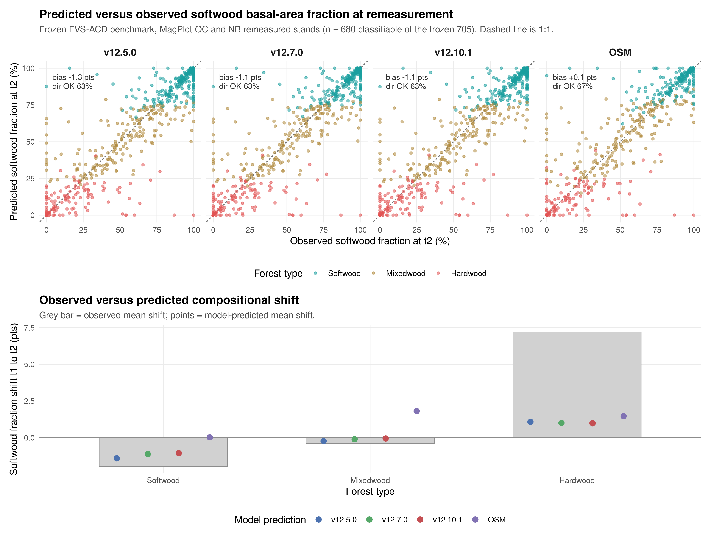

## Species composition over time (frozen benchmark)

**Methods.** Stand species composition is defined as the basal-area fraction by species group, using live trees at least 4 cm DBH: softwood versus hardwood, and a three-way split into spruce-fir (*Abies* + *Picea*), other softwood, and hardwood. For each benchmark stand we have a starting state (t1) and an observed endpoint (t2) from the MagPlot QC and NB remeasured treelists, and each model predicts the endpoint. Predicted composition for the FVS-ACD flagships (v12.5.0, v12.7.0, v12.10.1) comes from a non-invasive composition re-run of the frozen benchmark harness that emits per-group basal area at t2; the run reproduces the frozen August operational baseline (NB_AFAC 0.579, QC_AFAC 0.111) with zero difference against cb_v12101 on all nine stand totals. OSM predicted composition is taken directly from its head-to-head predicted treelist. The stand set is the frozen scorecard pooled set of 705 unique stands; 25 stands lacked classifiable t1 basal area, leaving 680. Forest type is the committed percent-hardwood rule applied to the t1 treelist (softwood at most 25% hardwood BA, hardwood at least 75%, else mixedwood). Bias is predicted minus observed softwood fraction in percentage points (pts); the shift ratio is predicted mean shift divided by observed mean shift, so 1.0 is a perfect match and a negative value is a wrong-direction move.

**Table X.** Observed and predicted softwood basal-area fraction across the remeasurement interval, pooled and by forest type, on the frozen benchmark (n = 680 classifiable stands of the frozen 705). Fractions are percentages; bias and shifts are in percentage points.

| Model | Stratum | n | Obs t1 (%) | Obs t2 (%) | Pred t2 (%) | Obs shift (pts) | Pred shift (pts) | Bias (pts) | Direction | Shift ratio |
|:---:|:---:|:---:|:---:|:---:|:---:|:---:|:---:|:---:|:---:|:---:|
| **v12.5.0** | Pooled | 680 | 59.9 | 60.7 | 59.5 | +0.82 | -0.45 | -1.27 | wrong | -0.55 |
| **v12.5.0** | Softwood | 320 | 94.0 | 92.0 | 92.6 | -1.95 | -1.41 | +0.54 | right | 0.72 |
| **v12.5.0** | Mixedwood | 186 | 51.7 | 51.3 | 51.5 | -0.40 | -0.24 | +0.17 | right | 0.59 |
| **v12.5.0** | Hardwood | 174 | 6.1 | 13.3 | 7.2 | +7.20 | +1.08 | -6.13 | right | 0.15 |
| **v12.7.0** | Pooled | 680 | 59.9 | 60.7 | 59.6 | +0.82 | -0.30 | -1.11 | wrong | -0.37 |
| **v12.7.0** | Softwood | 320 | 94.0 | 92.0 | 92.8 | -1.95 | -1.11 | +0.84 | right | 0.57 |
| **v12.7.0** | Mixedwood | 186 | 51.7 | 51.3 | 51.6 | -0.40 | -0.11 | +0.30 | right | 0.26 |
| **v12.7.0** | Hardwood | 174 | 6.1 | 13.3 | 7.1 | +7.20 | +1.00 | -6.21 | right | 0.14 |
| **v12.10.1** | Pooled | 680 | 59.9 | 60.7 | 59.7 | +0.82 | -0.26 | -1.08 | wrong | -0.32 |
| **v12.10.1** | Softwood | 320 | 94.0 | 92.0 | 92.9 | -1.95 | -1.06 | +0.89 | right | 0.54 |
| **v12.10.1** | Mixedwood | 186 | 51.7 | 51.3 | 51.7 | -0.40 | -0.05 | +0.35 | right | 0.14 |
| **v12.10.1** | Hardwood | 174 | 6.1 | 13.3 | 7.1 | +7.20 | +0.98 | -6.22 | right | 0.14 |
| **OSM** | Pooled | 680 | 59.9 | 60.7 | 60.8 | +0.82 | +0.88 | +0.06 | right | 1.08 |
| **OSM** | Softwood | 320 | 94.0 | 92.0 | 94.0 | -1.95 | +0.02 | +1.97 | wrong | -0.01 |
| **OSM** | Mixedwood | 186 | 51.7 | 51.3 | 53.5 | -0.40 | +1.81 | +2.21 | wrong | -4.49 |
| **OSM** | Hardwood | 174 | 6.1 | 13.3 | 7.6 | +7.20 | +1.46 | -5.74 | right | 0.20 |

**Figure 9.** Predicted versus observed softwood basal-area fraction at the remeasurement endpoint (t2) by model, with the 1:1 line (top), and the observed versus predicted mean compositional shift from t1 to t2 by forest type (bottom). Points are colored by committed forest type. Frozen benchmark, MagPlot QC and NB remeasured stands.

**Interpretation.** Stand composition is nearly stationary across the interval: the pooled mean softwood fraction moves less than one point (59.9% to 60.7%), and the only large observed signal is a +7.2 pt softwood gain in hardwood-dominated stands, partly offset by a -1.9 pt softwood loss in softwood stands. All three FVS-ACD models reproduce the direction of change within softwood and mixedwood stands but under-shift by roughly a third to a half, and they miss the pooled net direction, predicting a small softwood decline (-0.3 to -0.5 pt) against the observed +0.8 pt increase, because they under-represent softwood in-migration into hardwood stands (predicted about +1.0 pt versus observed +7.2 pt, bias near -6 pts). OSM best tracks the pooled net shift (+0.9 pt, ratio 1.08) but overshoots softwood in mixedwood and softwood stands; the spruce-fir split tells the same story, with the observed +7.0 pt spruce-fir gain in hardwood stands under-predicted by every model. Every model holds stand-level softwood fraction within about 1 to 2 pts of observed in softwood and mixedwood types, so overall composition is preserved and the shared weakness is the rate of softwood recolonization of hardwood-dominated stands.
