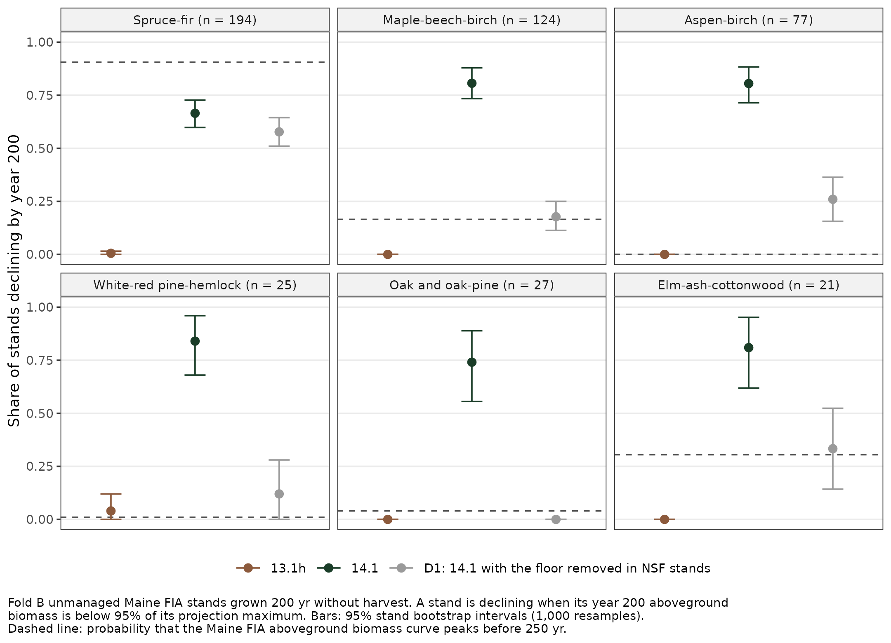

# Senescence conditioned on forest type, for 14.3: pre-registration 4 result

28 October 2026. Plan `plan/2026-10-28_v143_senescence-forest-type_PREREG4.md`, revision 1, md5 a15bd92af86cf7194926e32d8e7e102c, registered 2026-10-28T05:55:54-0400 (`logs/prereg_md5.txt`) after plan red team rounds 1 and 2 (`review/`), before any study script existed. Script md5s were recorded in `logs/launch_md5s.txt` at 06:00:28 before the chain; later tools were appended before use (see DEVIATIONS). Selection record `logs/selection_md5.txt`, 2026-10-28T06:26:05-0400. Assembly md5 62610094ab1944d09ead7aa1f2d85494 recorded 06:31:14 before it ran (`logs/assemble_md5.txt`). Host OSC Cardinal, R 4.5.2 (gcc 12.3.0), allocation PUOM0008, directory `~/v143p4/`.

Frozen runs were read, never rerun. No engine file, coefficient or default of 14.1 or 14.2 was edited; L and T were not re-estimated; GT1 stays a named failure of 14.1. Stand and plot identifiers stay in `serveronly_SERVERONLY/` and in the per task run logs on Cardinal; no coordinates were read. This record holds aggregates only. No em dashes. **Nothing here changes 14.1 or 14.2.**

## Outcome

**Rule 1: no verdict. Harness gate H3 failed** (`assembled/v143p4_verdict_DATA_2026-10-28.txt`: `outcome=RULE1_NO_VERDICT`, `harness_fail=H3_bridge`). The scorer bridge reproduced the frozen bench141 per set scores of 14.1 to within 0.00047 percentage points on every set whose stand count matched, but the stand count matched on only 12 of the 19 sets for each metric, against the registered floor of 15. Every other harness gate passed.

Had the harness passed, the result would have been **rule 2, H0: no eligible form**. Neither form had a calibration crossing inside the registered grid (form L) or enough calibration stands (form S), so no candidate arm was run.

**That H0 says nothing about the floor.** A post selection diagnostic (not registered; D7 below) shows that the registered observed mortality measure is not valid on the mefia_l_c frames, because TREE ids do not follow the same tree from t1 to t2. The calibration ratios therefore compare predicted mortality with a quantity that is not observed mortality. The question this study asked, whether a forest type conditioned floor fitted to remeasured FIA mortality removes the false hardwood decline, is still open.

### Decision rule, in order

1. **Harness.** H1a, H1b, H2, H4, H5, H6 and H7 pass. H3 fails (stand count clause). **No verdict.** The rule stops here.
2. Fit (reported, since it ran before the assembly): no eligible form. This would have been H0.
3. to 6. Not reached; no candidate exists.

## Harness gates

| Gate | Result | Value | Source |
|:--|:--|:--|:--|
| H1a, arm off equals frozen 14.1 on the 19 sets | pass | 28,898 stands; 133 file kind comparisons, 19,042,787 records; 0 differing values, 0 character mismatches | `logs/cmp_H1a_<set>_DATA.csv` |
| H1b, arm off equals frozen 14.1 on the 200 yr frame | pass | 918 stands, 7 kinds, worst absolute difference 0 | `logs/cmp_H1b_mefia_l_c_DATA.csv` |
| H2, arm g0 (on, delta 0, trace) equals frozen 14.1 | pass | 446 fold A stands, 7 kinds, worst absolute difference 0 | `logs/cmp_H2_mefia_l_c_DATA.csv` |
| H3, scorer bridge | **fail** | stand counts match on 12 of 19 sets per metric (floor 15); worst difference on matched sets 0.00047 points (threshold 0.0005) | `assembled/v143p4_H3_bridge_DATA_2026-10-28.csv` |
| H3, basis ratio | pass | 1.06719 against 1.0672 | `assembled/v143p4_gates_DATA_2026-10-28.csv` |
| H4, class agreement | pass | 1.0000 of 446 fold A stands | `assembled/v143p4_fit_harness_DATA_2026-10-28.csv` |
| H5, R monotone in delta | pass | both forms, both classes | same |
| H6, no candidate or D1 output before the selection record | pass | 0 of 31 D1 result files earlier than 06:26:05 | gates file |
| H7, completeness | pass | arm off ran every stand frozen 14.1 ran on all 19 sets and the 200 yr frame; D1 1.000 | cmp files; gates file |

The seven sets where the stand counts differ, with this study's pairing (stands run by frozen v141LT and v141off) against the frozen score table, are ctrn_c (1,086 against 1,075), ctrn_fl (175 against 172), mnap_c (99 against 98), ns_c (5,731 against 5,728), ns_long_c (8,549 against 8,544), ns_long_fl (2,319 against 2,318) and silc_l_c (120 against 116). The frozen score table applies a further stand filter that the plan did not name; the 16 October benchmark bridge met the same issue (72 of 114 rows matched, README). The floor of 15 was set in red team round 1 (M5) without checking how many sets would match. It is a registered harness gate and it failed; it was not changed.

## Fit (fold A, 446 stands; `logs/v143p4fit_15946084.out`, `assembled/v143p4_fit_R_DATA_2026-10-28.csv`, `assembled/v143p4_selection_DATA_2026-10-28.csv`)

Folds by the PREREG11 rule: fold A 446 stands, fold B 472 (`logs/v143p4frame_15946013.out`). All 446 fold A stands ran in all 13 grid arms; the floor set the kill in at least half the plot years in every one of them; one stand was churn flagged and excluded.

R is predicted over observed basal area mortality, as registered.

| delta | Form L, SF (224 stands) | Form L, NSF (221) | Form S, SF (7) | Form S, NSF (23) |
|:--:|:--:|:--:|:--:|:--:|
| -2.0 | 3.533 | 1.642 | 1.232 | 0.896 |
| -1.0 | 4.782 | 2.450 | 1.985 | 1.439 |
| 0 | 10.222 | 5.434 | 3.421 | 2.415 |
| +1.0 | 17.854 | 10.037 | 5.490 | 3.678 |

- **Form L: not eligible.** R exceeds 1 at every grid point in both classes, so there is no crossing in [-2, 1]; all bootstrap draws fall outside the grid.
- **Form S: not eligible.** Both classes have fewer than 30 calibration stands (7 and 23; the frame step showed this before any fit). NSF crosses at -1.758 (95% interval -1.969 to -0.746); SF has no crossing.

No coefficient file was written and no candidate arm ran (`logs/chain_s6_jobs.txt`: `candL not_eligible candS not_eligible`).

## Why the fit says nothing about the floor (post selection diagnostics, not registered)

Both diagnostics were written after the selection record. They read fold A only and no candidate output (`tools/diag_mort_measure.R`, `logs/v143p4diag_15946427.out`; `tools/diag_t2_content.R`, `logs/v143p4diag2_15946474.out`).

- The mefia_l_c hindcast intervals average **20.5 yr** on fold A.
- Over those intervals the observed measure gives 1.28 m² ha⁻¹ of basal area mortality per stand, with 5.4% of t1 trees absent at t2. Predicted mortality (MORT_BA_S) is 9.38 m² ha⁻¹. Predicted net basal area change is +7.90 against +10.68 observed.
- **TREE ids do not reliably pair the same tree across visits.** Of the t1 trees whose TREE id reappears at t2 (94.6%), 33.1% have a t2 diameter no larger than at t1. The mean diameter change is -7.87 cm for stems 25 to 40 cm at t1 and -20.67 cm for stems 40 cm and larger. Over 20 yr, live trees do not shrink by those amounts. An id present at both visits is often a different tree, so "id absent at t2" badly undercounts mortality.

The registered calibration target is therefore invalid on this frame, and the R values above are not mortality ratios. The fold B ratio of frozen 14.1 under the same measure (9.01 SF, 5.73 NSF; `assembled/v143p4_HB4_mortratio_foldB_DATA_2026-10-28.csv`) carries the same defect.

A valid repeat needs mortality from the FIA tree linkage on the server (PREV_TRE_CN and STATUSCD, or the TREE_GRM_COMPONENT table), not frame tag matching. That would be a new registration.

## The 200 yr frame (fold B, reported; no candidate to gate)

Share of fold B stands declining by year 200, with 95% stand bootstrap intervals (`assembled/v143p4_long200_decline_DATA_2026-10-28.csv`). 13.1h and 14.1 come from the frozen acdx trajectories. D1 is the registered diagnostic arm: 14.1 with the floor removed in NSF stands (delta_NSF -30, delta_SF 0), run by `tools/launch_s6.sh` as job 15946428.

| FIA type | Stands | Curve P(peak before 250 yr) | 13.1h | 14.1 | D1 |
|:--|:--:|:--:|:--:|:--:|:--:|
| Spruce-fir | 194 | 0.906 | 0.005 (0 to 0.015) | 0.665 (0.598 to 0.727) | 0.577 (0.510 to 0.644) |
| Maple-beech-birch | 124 | 0.165 | 0 | 0.806 (0.734 to 0.879) | 0.177 (0.113 to 0.250) |
| Aspen-birch | 77 | 0 | 0 | 0.805 (0.714 to 0.883) | 0.260 (0.156 to 0.364) |
| White-red pine-hemlock | 25 | 0.010 | 0.040 (0 to 0.120) | 0.840 (0.680 to 0.960) | 0.120 (0 to 0.280) |
| Oak and oak-pine | 27 | 0.040 | 0 | 0.741 (0.556 to 0.889) | 0 |
| Elm-ash-cottonwood | 21 | 0.305 | 0 | 0.810 (0.619 to 0.952) | 0.333 (0.143 to 0.524) |

`fig/v143p4_fig_share_declining_2026-10-28_r1.png` and `.pdf`. A stand is declining when its year 200 aboveground biomass is below 95% of its projection maximum. Dashed line: probability that the Maine FIA aboveground biomass curve peaks before 250 yr.

The plan's gates, applied to the reference arms and D1 for reading only (`assembled/v143p4_gates_DATA_2026-10-28.csv`):

- **LR1 at 0.30.** 14.1 fails on every hardwood and pine type (for example maple-beech-birch 0.806 against 0.165). 13.1h fails on spruce-fir (0.005 against 0.906) and elm-ash-cottonwood. D1 brings all five NSF types within 0.30 (passing at 0.40), but spruce-fir falls to 0.577.
- **LR2.** 14.1 at year 200: maple-beech-birch 0.558 of the curve. D1 at year 100 is 2.06 to 2.91 times the curve in the five NSF types.
- **Bakuzis.** With the floor removed, the share of stands whose maximum AGB exceeds the observed 99.9th percentile is 0.70 to 1.00 across NSF types (BK1). The share exceeding the observed 99.9th percentile of SDI is up to 0.815 (oak, BK2). Site ordering in aspen-birch is lost (lower limit -0.200, BK3). Eichhorn (0.924) and yield-density (-0.094) hold.

**Reading (mechanism only, no adoption).** The floor branch carries the hardwood decline in 14.1. Removing it in NSF stands removes most of the decline, but the stands then overshoot the observed biomass and density maxima, as 13.1h does. A level shift of the floor would have to land between these two failures. Whether remeasured FIA mortality, measured correctly, puts it there is untested. Spruce-fir declines less under D1 (0.577 against 0.665) even though its delta was 0. That is consistent with stands changing class as composition shifts over 200 yr, and with the composition rule disagreeing with FIA type on 11 of 370 spruce-fir stands (E1).

## DEVIATIONS

- **D1, step order.** The frame step (plan step 3) ran before the dry run (step 2), because the dry run needed the fold A keep file. The frame step reads no arm output.
- **D2, rjob.sbatch.** The first frame job (15945982) failed in 1 s before running anything: awk on the absent `assemble_md5.txt` under pipefail. The line was fixed, the previous copy kept as `tools/rjob_PREV_20261028.sbatch`, and the new md5 appended at 06:03:28.
- **D3, em dash in a build script.** The em dash check line of `scripts/build_v143p4.sh` itself contained an em dash. The check fired after the launchers and coefficient files had been written, and the built files contain none. The line was replaced with a chr(0x2014) check. The backup `scripts/build_v143p4_PREV_20261028.sh`, kept under the backup rule, still contains that one em dash.
- **D4, tools after the first md5 list.** `tools/cmp_all.sbatch`, `fit_record.sbatch`, `launch_s4.sh`, `launch_s6.sh`, `dry_check.R`, `diag_mort_measure.R` and `diag_t2_content.R` had their md5s appended to `logs/launch_md5s.txt` before use. `tools/dry_setup.sh` was appended (06:06:35) shortly after it ran.
- **D5, dry run files.** The dry fit (job 15946067) wrote three `_dry` files into `assembled/`; they were moved to `dry/fit/`. The dry run's H1a, H1b and H2 checks were IDENTICAL on 3 (hindcast) and 2 (200 yr) fold A stands.
- **D6, assembly script.** A first upload of `v143p4_assemble.R`, never md5 recorded and never run, was overwritten by the final version without a `_PREV` copy. The only change was the line that records an H5 row with an empty population as not evaluable. It was decided before any outcome was read, and in the event every H5 population was non-empty.
- **D7, post selection diagnostics.** Two unregistered diagnostics (above) were run after the selection record. They change no gate or verdict.
- **D8, figure re-render.** The assembly figure (`fig/v143p4_fig_share_declining_2026-10-28.png`, kept) clipped its caption. `scripts/v143p4_fig_r1.R` (md5 in `logs/assemble_md5.txt`, recorded before it ran) redrew it from the assembled CSV only as `_r1`, with the caption wrapped and stand counts in the panel titles.
- **D9, the H3 floor.** The registered floor of 15 matching sets was not checked against the frozen score table before registration. It failed and stands as the outcome.

## Files

`plan/`, `review/` (red team r1, r2), `scripts/` (overlay `AcadianGY_14.3dev_senft.r` md5 45689504, launchers, frame, fit, cmp, assembly, figure r1, build), `tools/`, `work/` (taskmaps, grid coefficients, fold and class counts), `explore/` (E0, E1), `logs/` (md5 records, chain job ids, identity checks, frame, fit, diagnostics and assembly logs), `assembled/`, `fig/`, `dry/` (dry fit and checks). Not exported: `serveronly_SERVERONLY/`, `out/`, and the per task run logs (`logs/hc_*`, `logs/l200_*`, dry run task logs), which name stands.

Slurm jobs: frame 15946013; harness and grid 15946078 (hc off, 62 tasks), 15946079 (grid, 26), 15946080 (200 yr off, 31); identity checks 15946081, 15946082, 15946083; fit and selection 15946084; D1 15946428; diagnostics 15946427, 15946474; assembly 15946492; figure r1 15946769.

## Verification note (28 October 2026)

An independent read-only check recomputed every headline value from the output files and found them matching, with the verdict following the registered rule in order. This revision changes wording only (1 fix). The earlier text is kept beside this file with the suffix _PREV_20261028b.
