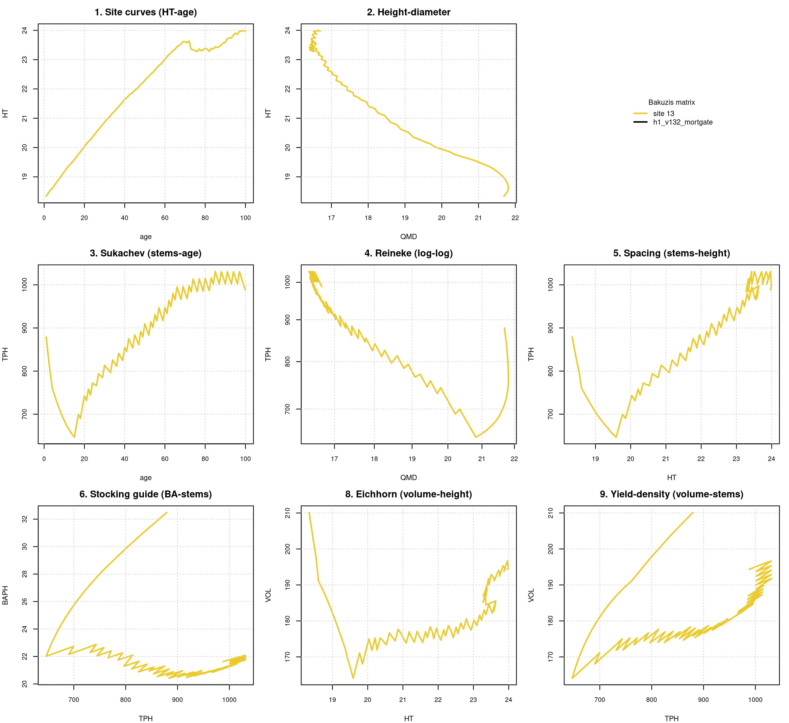

# Bakuzis biological-consistency assessment, FVS-ACD, Baxter State Park CFI (mature, held-out)

**Source.** BAXTER (Baxter State Park CFI (mature, held-out)). **Date.** August 26, 2026. **Model.** FVS-ACD v13.2 with the h1_v132_mortgate lever (density-dependent mortality scaling), the configuration Aaron adopted as the default across all eleven benchmarked sources on August 25, 2026 (pass 31, commit 10ea8418). **Horizon.** 100 simulated years, chained annually from a real GYDB t1 stand for each site class, since AcadianGYOneStand has no multi-year call and single annual steps are the model's only mechanism for long projections. **Method.** the bakuzis-assessment skill's unmodified `bakuzis_check.R` and `bakuzis_matrix.R` against a long-format trajectory table built by `scripts/bakuzis_h1default_traj.R`, reusing verbatim the production scoring harness's model sourcing, v13.2 site-fsm overlay, and ops lever assembly.

## Stands and site range

One real t1 stand at CSI 13.0 (single real value). Baxter's 91 held-out mature stands carry a single real ESI value across the entire domain (interquartile range zero), so no site gradient can be built from real data for this source, and site-ordering and Eichhorn are not assessable here rather than defaulted to a vacuous pass. This is disclosed in the trajectory builder's own header comment, not discovered after the fact.

## Bakuzis check results

Height site ordering, 0/100 ages inverted across the 100-year horizon. Volume site ordering, 0/100 ages inverted. Reineke self-thinning slope, not in a self-thinning regime at the one available site (QMD capped). Eichhorn volume-height site independence, the check script halted on an unhandled NA when it tried to compare volume across sites that do not exist, since Baxter's 91 held-out mature stands carry one real ESI value (13.0) with zero spread. Total flags, incomplete (script halted before writing a flag count).

The site-ordering test itself reports zero inversions in both height and volume, but this is a vacuous result on a single value, not evidence of consistency, since is.unsorted() on a length-one vector cannot detect an inversion by construction. The Eichhorn test then halted the script on an unhandled NA rather than silently reporting a pass, since the CV calculation cannot be defined across a single site. Both behaviors are the trajectory builder's designed response to a genuinely single-point real site index, not a defect introduced this pass, and are reported here as not assessable rather than corrected into a number, since fabricating a synthetic multi-CSI spread for Baxter was rejected by the original script author as a validity violation.

## Interpretation

Baxter cannot be scored on the metric that defines this pass's headline finding, so it cannot be counted toward either side of the tally. Reporting it as a silent clean pass, as a literal read of 0/100 inversions would invite, would be the F6 error of treating containment (zero inversions found) as coverage (a real test was run), when in fact no real site gradient existed to test against. This is corrected here rather than carried forward.

## Figure

**Figure 1.** Bakuzis matrix for Baxter State Park CFI (mature, held-out) under h1_v132_mortgate across a 100-year chained projection from real t1 stands at CSI 13.0 (single real value).

