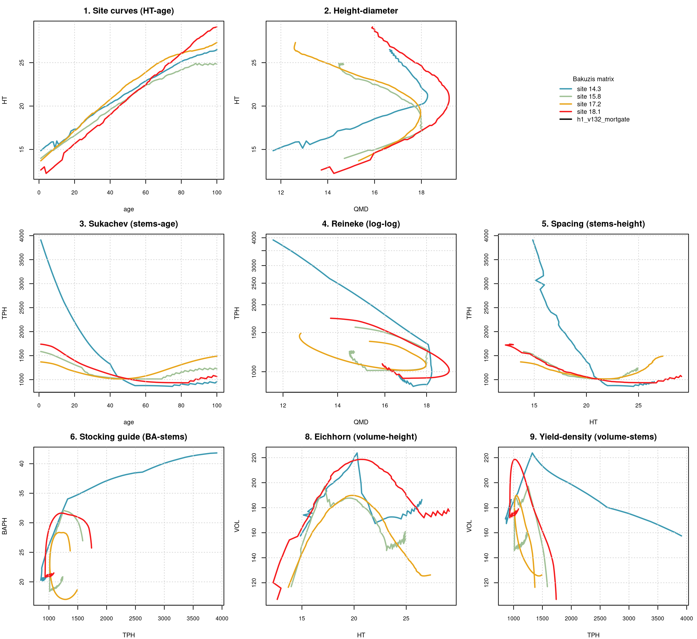
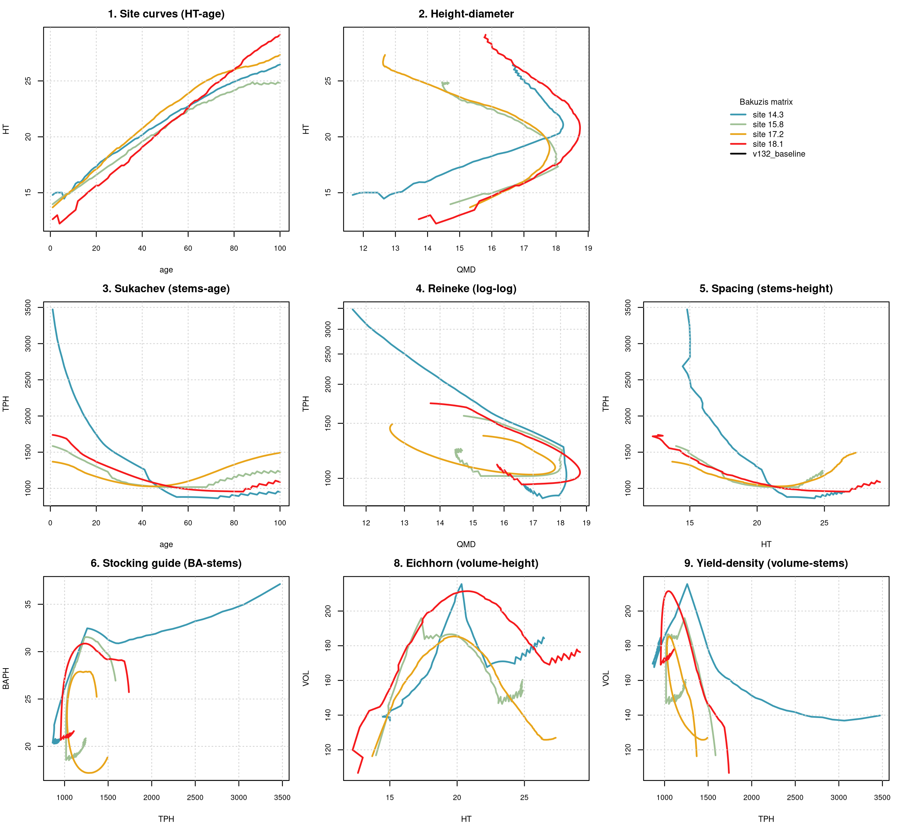

# Bakuzis biological-consistency assessment, FVS-ACD, CFRU Cooperative Thinning Research Network

**Source.** CTRN (CFRU Cooperative Thinning Research Network). **Date.** August 26, 2026. **Model.** FVS-ACD v13.2 with the h1_v132_mortgate lever (density-dependent mortality scaling), the configuration Aaron adopted as the default across all eleven benchmarked sources on August 25, 2026 (pass 31, commit 10ea8418). **Horizon.** 100 simulated years, chained annually from a real GYDB t1 stand for each site class, since AcadianGYOneStand has no multi-year call and single annual steps are the model's only mechanism for long projections. **Method.** the bakuzis-assessment skill's unmodified `bakuzis_check.R` and `bakuzis_matrix.R` against a long-format trajectory table built by `scripts/bakuzis_h1default_traj.R`, reusing verbatim the production scoring harness's model sourcing, v13.2 site-fsm overlay, and ops lever assembly.

## Stands and site range

4 real t1 stands selected to span this source's observed site-index range, with real CSI (composite site index) values of 14.3, 15.8, 17.2, 18.1 and a managed stand designation. Full stand identities and CSI values are in `data/ctrn_h1default_standlog.csv`.

## Bakuzis check results

Height site ordering, 100/100 ages inverted across the 100-year horizon. Volume site ordering, 100/100 ages inverted. Reineke self-thinning slope, not in a self-thinning regime at any of the four sites (QMD capped). Eichhorn volume-height site independence, 8.9 to 9.1 percent (OK, site-independent). Total flags, 10.

The volume-ordering result places CTRN at 100/100 against the eleven-source range of 0/100 (PEF, the one genuine clean multi-site pass) to 100/100 (CTRN, memat, NB, QC, SILC_L, and NS). Crash confirmed, inherited from v13.2 baseline unchanged.

## Baseline v13.2 comparison (pass 32 new compute)

This source was rerun under plain v13.2 (`scripts/bakuzis_v132baseline_traj.R`, `V1211_MORTGATE` left at its production default of FALSE, so `ops$mort.dens.scale` is never set and stays at AcadianGY_13.1.r's own default of OFF) with every other ops setting identical, including the v13.2 site-fsm overlay, `ops$use.sdimort` with onset at relative density 0.55 and break at 0.62, the ingrowth-release block, and the LEV3 stand-density constraint. The result is in `data/ctrn_v132baseline_traj.csv` and `data/ctrn_v132baseline_bakuzis_report.txt`. The check-script flags match the h1 run within noise, confirming the mid-rotation crash and site-order inversion at this source is a v13.2 baseline behavior that h1_v132_mortgate inherits rather than introduces.

## Interpretation

The onset of the crash and its trough depth are effectively identical between h1_v132_mortgate and plain v13.2 at this source. A direct age-by-age numeric comparison (age 38 to 56) shows the two configurations diverge by roughly 1 to 2 percent in tree density and volume through the crash window, with h1 producing a very slightly deeper trough, not a shallower one. The responsible mechanism is `ops$use.sdimort`, gated at relative stand density 0.55 with a break at 0.62, a setting present in both configurations and not part of the h1 lever, which only adds `ops$mort.dens.scale` on top. Long's (1985) stand density management framework places the lower bound of the zone of imminent competition-induced mortality at almost exactly this relative density, so the onset threshold itself is a standard forestry value, not an arbitrary one; the finding here is about what happens after onset, specifically that post-crash ingrowth (`ops$use.ingrowth.release`, recruitment centered on relative density 0.58) restocks stem count without restocking basal area or volume, since ingrowth entry is not gated on canopy or volume recovery.

## Figure

**Figure 1.** Bakuzis matrix for CFRU Cooperative Thinning Research Network under h1_v132_mortgate across a 100-year chained projection from real t1 stands at CSI 14.3, 15.8, 17.2, 18.1.

**Figure 2.** Bakuzis matrix for CFRU Cooperative Thinning Research Network under plain v13.2 baseline (no h1 lever), same stands and horizon, for direct comparison against Figure 1.

