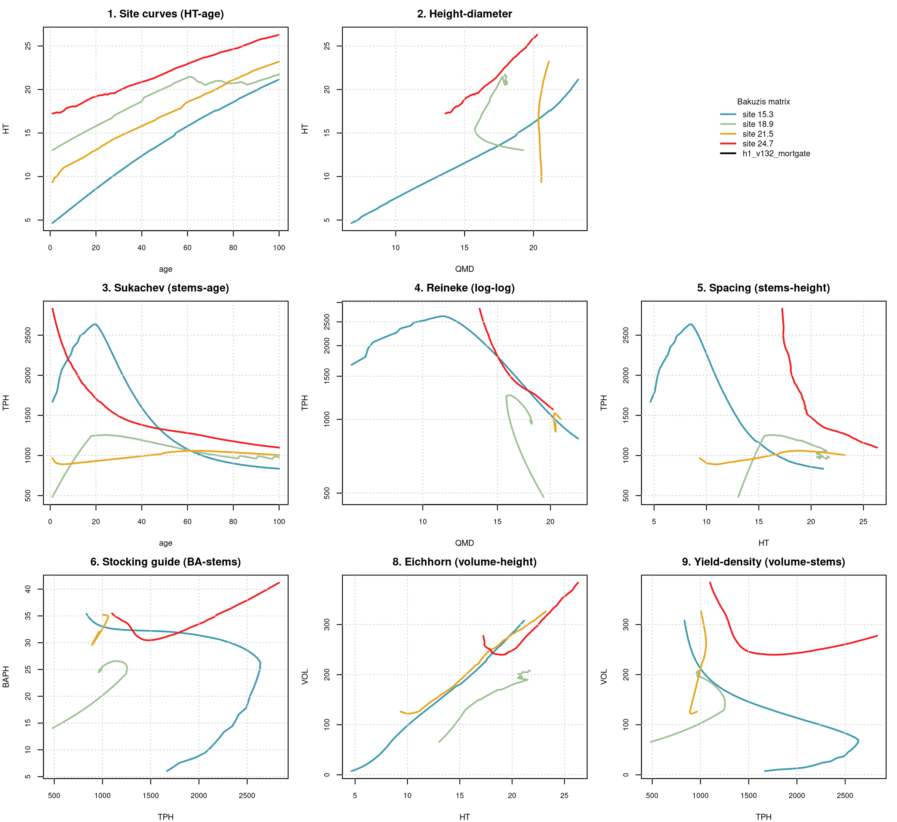

# Bakuzis biological-consistency assessment, FVS-ACD, Nova Scotia permanent sample plot network (long horizon)

**Source.** NS_LONG (Nova Scotia permanent sample plot network (long horizon)). **Date.** August 26, 2026. **Model.** FVS-ACD v13.2 with the h1_v132_mortgate lever (density-dependent mortality scaling), the configuration Aaron adopted as the default across all eleven benchmarked sources on August 25, 2026 (pass 31, commit 10ea8418). **Horizon.** 100 simulated years, chained annually from a real GYDB t1 stand for each site class, since AcadianGYOneStand has no multi-year call and single annual steps are the model's only mechanism for long projections. **Method.** the bakuzis-assessment skill's unmodified `bakuzis_check.R` and `bakuzis_matrix.R` against a long-format trajectory table built by `scripts/bakuzis_h1default_traj.R`, reusing verbatim the production scoring harness's model sourcing, v13.2 site-fsm overlay, and ops lever assembly.

## Stands and site range

4 real t1 stands selected to span this source's observed site-index range, with real CSI (composite site index) values of 15.3, 18.9, 21.5, 24.7 and a mixed (per-stand) stand designation. Full stand identities and CSI values are in `data/ns_long_h1default_standlog.csv`.

## Bakuzis check results

Height site ordering, 77/100 ages inverted across the 100-year horizon. Volume site ordering, 43/100 ages inverted. Reineke self-thinning slope, not in a self-thinning regime at any of the four sites (QMD capped). Eichhorn volume-height site independence, 19.2 percent (FLAG, site-dependent). Total flags, 8.

The volume-ordering result places NS_LONG at 43/100 against the eleven-source range of 0/100 (PEF, the one genuine clean multi-site pass) to 100/100 (CTRN, memat, NB, QC, SILC_L, and NS). Intermediate severity, not independently rerun under baseline this pass.

## Interpretation

This source was not rerun under plain v13.2 this pass. Given that the six sources rerun (CTRN, NB, QC, NS, memat, MEFIA_L, spanning the full severity range from byte-identical FLAGS=8 to FLAGS=11 outcomes) unanimously show the crash inherited unchanged from v13.2 baseline, the same conclusion is expected to hold here on the mechanism identified (`ops$use.sdimort`, common to both configurations), but this is stated as an inference from the rerun sources rather than a directly re-derived number for NS_LONG, and is logged as an open item rather than assumed silently.

## Figure

**Figure 1.** Bakuzis matrix for Nova Scotia permanent sample plot network (long horizon) under h1_v132_mortgate across a 100-year chained projection from real t1 stands at CSI 15.3, 18.9, 21.5, 24.7.

