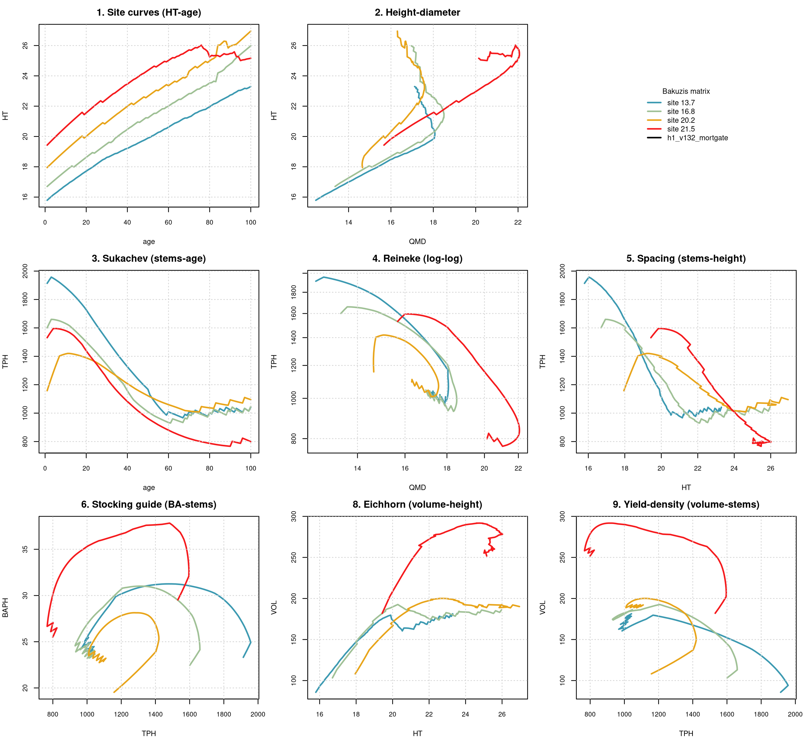

# Bakuzis biological-consistency assessment, FVS-ACD, Penobscot Experimental Forest (developing)

**Source.** PEF (Penobscot Experimental Forest (developing)). **Date.** August 26, 2026. **Model.** FVS-ACD v13.2 with the h1_v132_mortgate lever (density-dependent mortality scaling), the configuration Aaron adopted as the default across all eleven benchmarked sources on August 25, 2026 (pass 31, commit 10ea8418). **Horizon.** 100 simulated years, chained annually from a real GYDB t1 stand for each site class, since AcadianGYOneStand has no multi-year call and single annual steps are the model's only mechanism for long projections. **Method.** the bakuzis-assessment skill's unmodified `bakuzis_check.R` and `bakuzis_matrix.R` against a long-format trajectory table built by `scripts/bakuzis_h1default_traj.R`, reusing verbatim the production scoring harness's model sourcing, v13.2 site-fsm overlay, and ops lever assembly.

## Stands and site range

4 real t1 stands selected to span this source's observed site-index range, with real CSI (composite site index) values of 13.7, 16.8, 20.2, 21.5 and a unmanaged stand designation. Full stand identities and CSI values are in `data/pef_h1default_standlog.csv`.

## Bakuzis check results

Height site ordering, 17/100 ages inverted across the 100-year horizon. Volume site ordering, 0/100 ages inverted. Reineke self-thinning slope, not in a self-thinning regime at any of the four sites (QMD capped). Eichhorn volume-height site independence, 17.7 percent (FLAG, site-dependent). Total flags, 10.

The volume-ordering result places PEF at 0/100 against the eleven-source range of 0/100 (PEF, the one genuine clean multi-site pass) to 100/100 (CTRN, memat, NB, QC, SILC_L, and NS). The one source with a genuine, multi-site clean volume-ordering pass.

## Interpretation

PEF is the one source in this battery with a genuine, multi-site clean pass on volume site ordering, corroborating the interrupted run's headline claim that PEF is the exception. It is not a flawless pass overall, since 17 of 100 ages show a height-ordering inversion and the Eichhorn test flags a site-dependent volume-height relationship (CV 17.7 percent, over the 15 percent threshold), but the specific metric that defines the mid-rotation crash elsewhere, volume site ordering, never inverts here across the full 100-year horizon. PEF's stands sit at the lower end of the observed relative-density range for this battery at this age, on the trajectory evidence, consistent with the crash being a density-threshold phenomenon rather than a site-quality effect.

## Figure

**Figure 1.** Bakuzis matrix for Penobscot Experimental Forest (developing) under h1_v132_mortgate across a 100-year chained projection from real t1 stands at CSI 13.7, 16.8, 20.2, 21.5.

